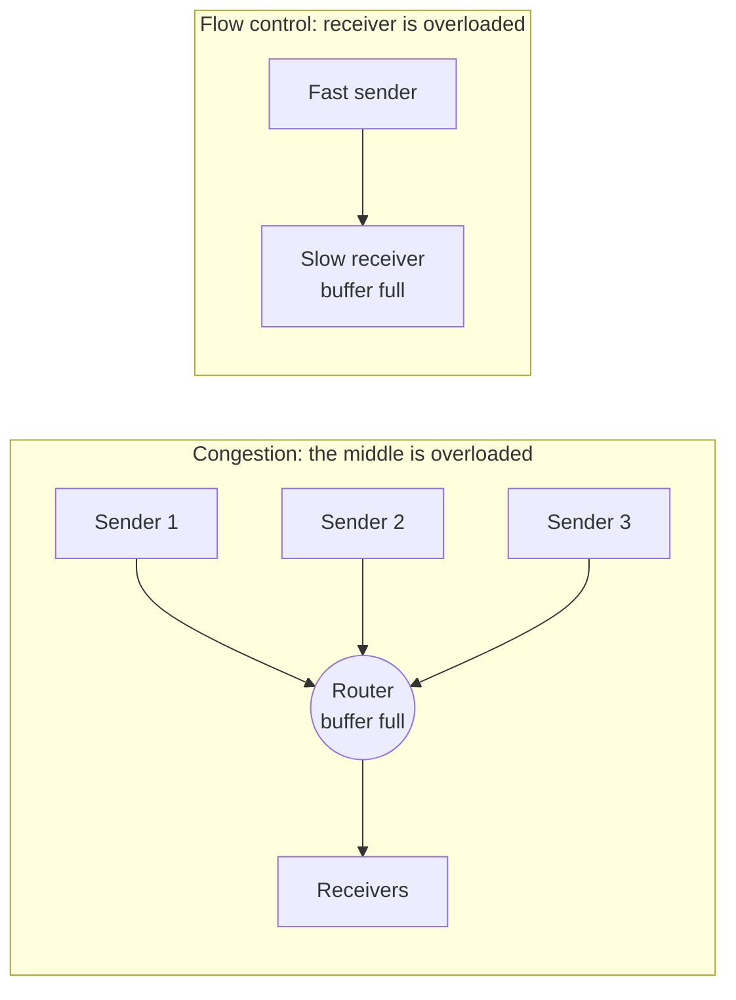
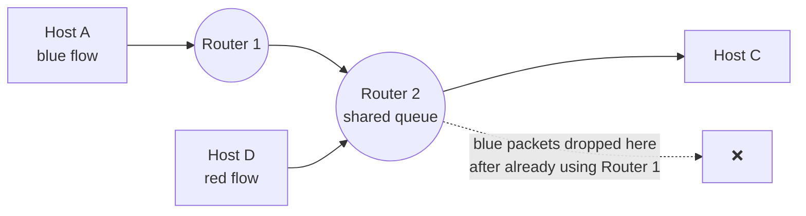
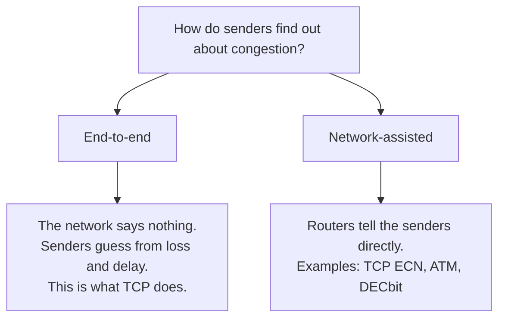
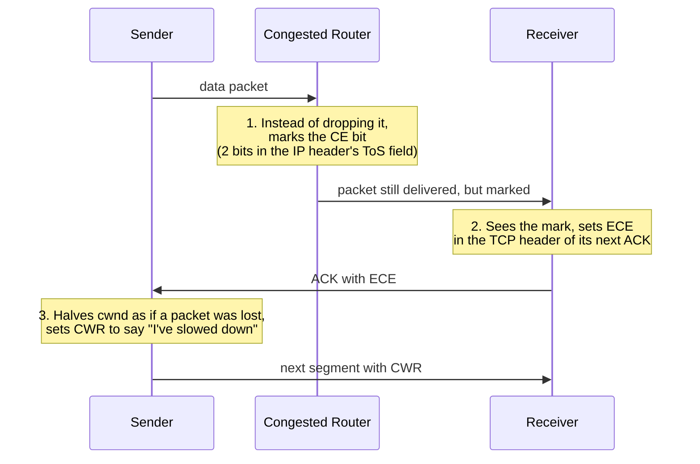
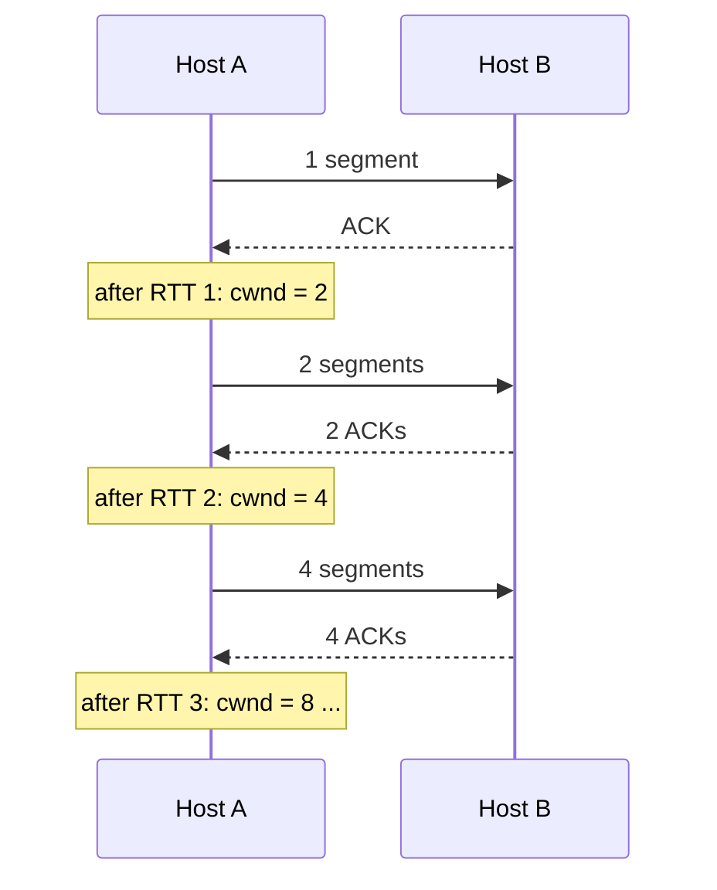
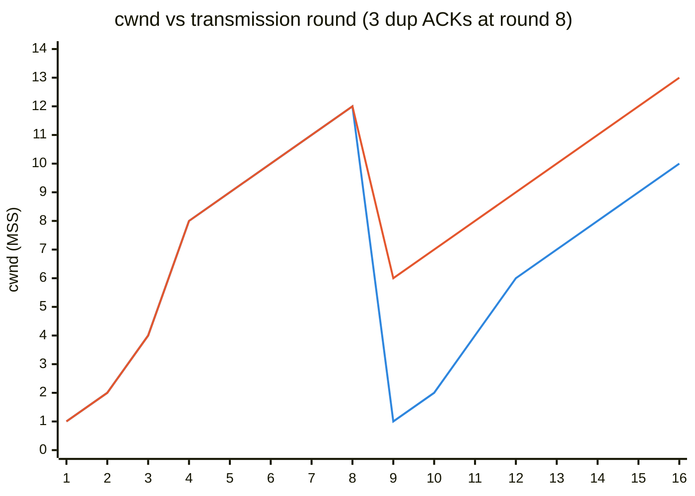
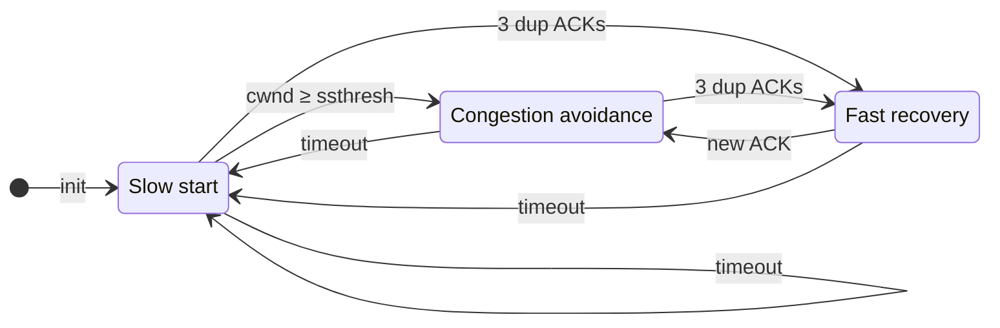

# 3.1 TCP Congestion Control

This lecture covers three parts of the transport layer chapter:
- 3.6 Principles of congestion control (what congestion is and why it's bad)
- 3.7 TCP congestion control (how TCP actually deals with it)
- 3.8 QUIC, which is the next lecture → [[3.2 QUIC Protocol]]

---

## 1. How it all started

In October 1986 there was a network link between LBL (Lawrence Berkeley Laboratory) and UC Berkeley. The two places were only 400 m apart. The link normally ran at 32 kbps. One day its speed fell to 40 bps. That's 1000 times slower.

Nothing was broken. The cables and machines were fine.

So what happened? Packets were getting lost because the router's queue was full. Every sender thought "my packet got lost, let me send it again." So they all sent more copies. That filled the queue even more, and more packets got lost, and they sent even more copies. In the end the network was busy carrying copies of packets that had already been delivered. Almost no new data got through.

This is called congestion collapse. Van Jacobson fixed it by adding congestion control to TCP, and that fix is what this whole lecture is about.

> [!question] Slide question: It's 9 pm in the hostel and Netflix is buffering. Is that flow control or congestion control?
> Flow control is when your own device can't keep up with the data coming in. Congestion control is when the network in the middle is overloaded.
>
> At 9 pm everyone in the hostel is streaming at the same time, so the shared Wi-Fi is overloaded. That's congestion. A simple check: if the same laptop streams fine at 3 am, your laptop isn't the problem. The network is.

---

## 2. What is congestion?

In simple words: too many people are sending too much data, too fast, and the network can't handle it.

Think of a road. If too many cars come in at once, there's a traffic jam. Two things happen:
- Long delays. Packets wait in a queue inside the router, like cars stuck at a signal.
- Packet loss. The router's buffer (its waiting area) fills up, and any new packet that arrives just gets thrown away.

Congestion is one of the top 10 problems in networking.

### Congestion is not the same as flow control

People mix these up a lot, so here's the difference:

| | Congestion control | Flow control |
|---|---|---|
| What's the problem? | Too many senders together are overloading the network | One sender is too fast for one receiver |
| What are we protecting? | The routers and links in the middle | The receiver's buffer |
| Example | Whole hostel streaming, Wi-Fi chokes | A fast server sending to an old slow phone |



---

## 3. Why congestion is bad: three scenarios

The slides build up the problem one step at a time. Each scenario adds something more realistic.

Two symbols you'll see:
- λin (lambda in) = how fast the sender is sending.
- λout (lambda out) = how fast data actually reaches the receiver. This is the throughput.

### Scenario 1: one router, unlimited buffer

The setup:
- Two senders (Host A and Host B) share one router.
- The link speed is R.
- The router's buffer is infinite, so nothing is ever dropped and nothing needs to be sent again.

What happens as each sender speeds up towards R/2?

```
 throughput λout                         delay
   R/2 |        _________                 |              |
       |       /                          |             /
       |      /                           |           _/
       |     /                            |        __/
       |    /                             |  _____/
       |___/________ λin                  |/_____________ λin
            R/2                                   R/2
 each sender gets at most R/2           delay shoots up near R/2
```

- Throughput: two senders share a link of speed R, so each one gets at most R/2. It can't go higher.
- Delay: as you get close to R/2, the queue keeps growing and the delay gets huge, almost infinite.

The lesson: even if nothing is ever lost, running a link close to its full capacity makes delay terrible. It's like a road at 99% full. Technically everyone fits, but everyone crawls.

---

### Scenario 2: one router, limited buffer

Now the buffer is limited, which is how real routers work. When it's full, packets get dropped, and the sender has to send them again (retransmit).

So now there are two rates:
- λin = the original data the app wants to send. Since the app eventually gets everything through, this equals λout.
- λ'in (lambda-in prime) = everything the sender actually puts on the wire, which is the original data plus all the resent copies. This is called the offered load, and it's always ≥ λin.

The slides look at three cases, from "perfect world" to "real world".

Case 1: the sender magically knows when there's space.
- It only sends when it knows the buffer has room.
- Nothing is lost. Throughput can go all the way up to R/2.

Case 2: the sender knows for sure which packets were lost.
- Packets can get dropped now.
- The sender only resends a packet when it knows for sure the packet was lost.
- Throughput is now less than R/2, because some of the link's capacity is used up carrying resent packets.

Case 3: real life.
- Packets get dropped, so resending is needed.
- But sometimes the sender's timer runs out too early, before the ACK could arrive. The sender thinks the packet was lost when it wasn't, so it sends another copy. Now both copies reach the receiver, and one was a complete waste.
- So the link is carrying needed resends and unneeded duplicates. Throughput drops even further.

```
 λout
 R/2 |- - - - - - - - - - - - - (case 1: perfect knowledge)
     |          _______        (case 2: lower, needed resends)
     |      ___/  ____         (case 3: lowest, duplicates too)
     |   __/ ___/
     |__/__/________________ λin
                        R/2
```

> [!warning] What congestion costs you (Scenario 2)
> 1. The sender does more work (resending) just to get the same amount of data through.
> 2. Unneeded duplicate copies waste the link, so the maximum throughput you can get goes down.

---

### Scenario 3: four senders, packets crossing several routers

The setup: four hosts (A, B, C, D), and each packet passes through more than one router. Buffers are limited and senders resend on timeout.

Here's the important part. Look at two flows:
- The blue flow goes through Router 1 first, then Router 2.
- The red flow joins directly at Router 2.

When the red flow sends faster and faster, it fills up Router 2's queue. Now almost every blue packet that reaches Router 2 gets dropped. So blue's throughput falls to zero.



```
 λout
 R/2 |   __
     |  /  \
     | /    \__
     |/        \____ → 0
     |________________ λ'in
                  R/2
```

> [!warning] The extra cost in Scenario 3
> A blue packet that gets dropped at Router 2 has already used up space and time at Router 1. All that earlier work is wasted. It's like a courier carrying a parcel halfway across the city and then throwing it in the bin.

---

### All the costs in one list

1. You can never get more throughput than the link capacity.
2. The closer you get to full capacity, the higher the delay.
3. Losing packets and resending them lowers the useful throughput.
4. Unneeded duplicate copies lower it even more.
5. If a packet is dropped later in its path, all the work done on it earlier was wasted.

---

## 4. Two ways to handle congestion



### End-to-end (what TCP uses)
- The network gives no direct signal.
- The sender guesses there's congestion by watching what happens: packets getting lost, or delays going up.
- This is the approach TCP takes.

### Network-assisted
- The routers themselves tell the senders and receivers "I'm getting congested."
- A router can say how congested it is, or even tell the sender exactly what speed to use.
- Examples: TCP ECN, ATM, and the DECbit protocol.

### ECN: warning about congestion without dropping anything

ECN stands for Explicit Congestion Notification. Normally a congested router just drops packets, and the sender figures it out from the loss. With ECN the router warns the sender instead.



Step by step:
1. The router is congested. Instead of dropping the packet, it marks a bit called CE (Congestion Experienced). These are 2 bits in the ToS field of the IP header. The packet still gets delivered.
2. The receiver sees the CE mark. In its next ACK, it sets a flag called ECE (ECN-Echo) in the TCP header. This passes the warning back to the sender.
3. The sender sees ECE. It halves its cwnd, the same thing it would do if a packet were lost. Then it sets CWR (Congestion Window Reduced) to tell the receiver "got it, I've slowed down."
4. The catch: the router, the sender and the receiver all have to support ECN. That's why ECN was defined in 1999 but took about 20 years to actually get used.

> [!note] Good side and bad side
> Good: congestion gets reported without a single packet being thrown away.
> Bad: the warning still takes one full round trip to reach the sender, and every router in the network has to be upgraded to support it. Because upgrading the network is so hard, TCP mainly relies on guessing from losses (end-to-end) instead.

*(The slides end this part with Suggested Readings and Q&A.)*

---

## 5. How TCP controls its speed: cwnd

TCP keeps a number called cwnd (congestion window). It's the maximum amount of data TCP lets itself have "in flight", meaning sent but not yet acknowledged.

```
 sender's sequence numbers
 |  already ACKed  |  sent, waiting for ACK  |  allowed to send  |
                   |<------------------ cwnd ------------------>|
                                       ^ last byte sent
```

Roughly, TCP sends cwnd bytes, waits one round trip (RTT) for the ACKs, then sends the next batch. So:

$$\text{TCP speed} \approx \frac{cwnd}{RTT}\ \text{bytes per second}$$

The rule TCP follows:

$$\text{LastByteSent} - \text{LastByteAcked} \le cwnd$$

In words: the data still waiting for an ACK must not be more than cwnd.

TCP keeps changing cwnd based on how congested the network seems. Making cwnd bigger means sending faster, and making it smaller means sending slower. That is basically all TCP congestion control is.

When you add flow control too (rwnd is the receiver's window), the rule becomes:

$$\text{LastByteSent} - \text{LastByteAcked} \le \min(cwnd,\ rwnd)$$

So TCP listens to whichever is stricter: the network (cwnd) or the receiver (rwnd).

### How should TCP choose its speed?
- Too fast, and you get congestion collapse.
- Too slow, and you waste the bandwidth you could have used.
- The goal is to send as fast as possible without jamming the network.

TCP follows three simple ideas:
1. A lost segment means there's congestion, so slow down.
2. An ACK for new data means the network is delivering fine, so speed up.
3. Keep testing the limit. Speed up until something gets lost, slow down, then start speeding up again. This is called bandwidth probing.

The TCP algorithm has three parts:
1. Slow start
2. Congestion avoidance
3. Fast recovery

---

## 6. AIMD: Additive Increase, Multiplicative Decrease

This is the basic pattern TCP follows. Keep increasing your speed until a packet is lost, then cut it down.

| Additive Increase | Multiplicative Decrease |
|---|---|
| Every RTT, increase by 1 MSS (one segment). Slow and steady. | When a loss happens, cut your speed in half. |

```
 sending speed (the "sawtooth")
   |      /|      /|      /|      /|
   |     / |     / |     / |     / |
   |    /  |    /  |    /  |    /  |
   |   /   |   /   |   /   |   /   |
   |  /    |  /    |  /    |  /    |
   |       '       '       '       '   ← cut in half on loss
   +--------------------------------------- time
```

The graph looks like saw teeth: slowly climb, suddenly drop, slowly climb again. TCP is always feeling around for how much bandwidth is available.

### Tahoe vs Reno: how much to cut?

What TCP does on a loss depends on how it found out about the loss:
- If loss is found by a timeout, both TCP Tahoe and TCP Reno set cwnd = 1 MSS, which means starting over.
- If loss is found by 3 duplicate ACKs, TCP Tahoe still sets cwnd = 1 MSS, but TCP Reno only cuts cwnd roughly in half.

So the only difference between Tahoe and Reno is what they do on 3 duplicate ACKs.

### Why AIMD?
AIMD runs separately on every computer. No one coordinates it, and everyone works at their own time (it's "distributed and asynchronous"). Even so, it has been shown to:
- share bandwidth well across the whole network
- stay stable, so speeds don't swing wildly out of control

---

## 7. Slow Start

When a connection first starts, TCP has no idea how fast the network is. So it starts small and doubles its speed every round trip until the first loss.

- Start with cwnd = 1 MSS.
- Double cwnd every RTT.
- How does it double? For every ACK that comes back, add 1 MSS. If you sent 4 segments, you get 4 ACKs, so you add 4 and now cwnd = 8.
- The name is a bit misleading. It starts slow, but it grows exponentially fast.



> [!tip] In real life cwnd starts at 10, not 1
> In 2013, RFC 6928 changed the starting window to 10 segments (about 14 KB). That's enough to send a small web page in the very first round trip. So if you capture packets with Wireshark, you'll see 10 segments go out at the start, not 1.

---

## 8. Noticing loss and reacting to it

TCP finds out about loss in two ways, and it reacts differently to each.

Timeout (no ACK came back at all):
- This is a bad sign. Even the ACKs aren't getting through, so the network is badly congested.
- Set cwnd = 1 MSS, do slow start up to the threshold, then grow slowly (linearly).

3 duplicate ACKs (TCP Reno):
- This is a milder sign. The receiver is still getting the later packets (that's why it keeps sending ACKs), and just one packet went missing.
- So Reno only cuts cwnd in half, then grows linearly.

TCP Tahoe doesn't make this distinction. It always sets cwnd = 1, whether it was a timeout or 3 duplicate ACKs.

### Tahoe vs Reno side by side

| What happened | TCP Tahoe | TCP Reno |
|---|---|---|
| Timeout | cwnd = 1 MSS | cwnd = 1 MSS |
| 3 duplicate ACKs | cwnd = 1 MSS | cwnd cut roughly in half |
| Fast retransmit (resend right away on 3 dup ACKs, without waiting for the timer) | Yes | Yes |
| Fast recovery | No | Yes |

### The full rule table (TCP Reno)

Starting values: cwnd = 1 MSS, ssthresh = 64 KB, dupACKcount = 0.

| Current state | New ACK arrives | Duplicate ACK arrives | 3rd duplicate ACK | Timeout |
|---|---|---|---|---|
| Slow start | cwnd += MSS, reset dupACKcount, send more | dupACKcount++ | ssthresh = cwnd/2, cwnd = ssthresh + 3, resend the missing segment, go to fast recovery | ssthresh = cwnd/2, cwnd = 1, reset dupACKcount, resend, stay in slow start |
| Congestion avoidance | cwnd += MSS×(MSS/cwnd), reset dupACKcount, send more | dupACKcount++ | ssthresh = cwnd/2, cwnd = ssthresh + 3, resend, go to fast recovery | ssthresh = cwnd/2, cwnd = 1, reset dupACKcount, resend, go to slow start |
| Fast recovery | cwnd = ssthresh, reset dupACKcount, go to congestion avoidance | cwnd += MSS, send more | (already here) | ssthresh = cwnd/2, cwnd = 1, reset dupACKcount, resend, go to slow start |

> [!note] Why "+3"?
> A duplicate ACK only gets sent when a packet reaches the receiver. So 3 duplicate ACKs mean 3 packets have left the network and arrived safely. That frees up room for 3 more, so TCP adds 3 to keep the pipe full. This is temporary. As soon as a proper new ACK comes, cwnd goes back to ssthresh.

> [!tip] Where does "cwnd += MSS×(MSS/cwnd)" come from?
> In congestion avoidance, each ACK adds only a small piece. In one RTT you get about cwnd/MSS ACKs, and those small pieces add up to exactly 1 MSS. So cwnd grows by 1 MSS per RTT, which is the "additive increase."

---

## 9. When to stop doubling: ssthresh

Q: Slow start doubles cwnd. When should it stop doubling and switch to slow, +1 growth?

A: When cwnd reaches half of what it was when the last loss happened. The idea is that last time things broke at that size, so being careful near it makes sense.

TCP stores this "half" value in a variable called ssthresh (slow start threshold).
- On a loss: ssthresh = cwnd / 2 (half of cwnd just before the loss).
- Below ssthresh: slow start (doubling).
- Above ssthresh: congestion avoidance (+1 per RTT).

### Worked example: Tahoe vs Reno

The setup: starting ssthresh = 8, and at the end of round 8 a loss is found through 3 duplicate ACKs.

- Rounds 1–4: slow start, doubling 1 → 2 → 4 → 8. It reaches ssthresh = 8.
- Rounds 5–8: congestion avoidance, +1 each round: 9, 10, 11, 12.
- At round 8 the loss happens with cwnd = 12, so both set ssthresh = 12/2 = 6.
- Tahoe drops to 1 and has to slow-start all over again.
- Reno drops to 6 and carries on with +1 growth from there.

The gap between the two lines is the throughput Tahoe loses by starting over.

| Round | 1 | 2 | 3 | 4 | 5 | 6 | 7 | 8 | 9 | 10 | 11 | 12 | 13 | 14 | 15 | 16 |
|---|---|---|---|---|---|---|---|---|---|---|---|---|---|---|---|---|
| Tahoe cwnd | 1 | 2 | 4 | 8 | 9 | 10 | 11 | 12 ✗ | 1 | 2 | 4 | 6 | 7 | 8 | 9 | 10 |
| Reno cwnd | 1 | 2 | 4 | 8 | 9 | 10 | 11 | 12 ✗ | 6 | 7 | 8 | 9 | 10 | 11 | 12 | 13 |


*(🔵 Blue = TCP Tahoe, falls to 1. 🟠 Orange = TCP Reno, falls to 6.)*

> [!example] Look closely at Tahoe after the loss
> It goes 1 → 2 → 4, and then the next doubling would be 8. But the new ssthresh is 6, so it stops doubling at 6 and switches to +1: 7, 8, 9, 10.

---

## 10. The whole thing as one diagram

TCP is always in one of three states. Here's how it moves between them:



What happens on each arrow (same rules as the table in section 8):

| Arrow | What TCP does |
|---|---|
| init | cwnd = 1 MSS, ssthresh = 64 KB, dupACKcount = 0 |
| Slow start, new ACK (stays in slow start) | cwnd + MSS, reset dupACKcount, send more |
| Duplicate ACK in any state | dupACKcount + 1 (in fast recovery also cwnd + MSS and send) |
| Slow start → Congestion avoidance | happens when cwnd goes above ssthresh; nothing else changes |
| Congestion avoidance, new ACK (stays) | cwnd + MSS×(MSS/cwnd), reset dupACKcount, send more |
| Anything → Fast recovery (3rd dup ACK) | ssthresh = cwnd/2, cwnd = ssthresh + 3, resend the missing segment |
| Fast recovery → Congestion avoidance (new ACK) | cwnd = ssthresh, reset dupACKcount |
| Anything → Slow start (timeout) | ssthresh = cwnd/2, cwnd = 1 MSS, reset dupACKcount, resend the missing segment |

---

## 11. TCP CUBIC: a smarter way to grow

### What's wrong with Reno?
- Adding just 1 MSS per RTT is painfully slow when cwnd is in the thousands. After a loss on a fast link, Reno takes forever to climb back up.
- Example from the slide: to keep up 10 Gbps over a path with 100 ms RTT, Reno would need the network to lose almost nothing, about 1 segment in 5 billion (a loss rate of 2 × 10⁻¹⁰). Real networks lose far more than that.

### The idea behind CUBIC
- Wmax = the cwnd size where the last loss happened (the same number Reno uses to set ssthresh).
- The network's limit probably hasn't changed much since then. So there's no need to crawl back up. Climb back near Wmax quickly, then slow down and be careful around it.

```
 speed
  Wmax |- - - -.--------.--------.--------.   CUBIC: drops to 0.7·Wmax,
       |     .´|      .´|      .´|      .´|   climbs fast, flattens near Wmax
 0.7Wmax|   /   |    /   |    /   |    /   |
       |  /    |   /    |   /    |   /    |   Reno: drops to 0.5·Wmax,
 0.5Wmax| /     |  /     |  /     |  /     |   then +1 MSS per RTT (straight line)
       +-----------------------------------  time
```

CUBIC does three things differently:

| Idea | In simple words |
|---|---|
| Return fast | After a loss, climb back towards the old limit quickly instead of +1 per RTT. |
| Then hold | Slow right down just below Wmax so you don't crash straight into the next loss. |
| Cut less | On a loss, drop to 0.7 × Wmax instead of half. A smaller drop means less to climb back. |

Overall CUBIC spends more time at high speed, which means more area under the graph and more data sent.

### Why it's called "cubic"
- The graph of x³ goes steep, then flat, then steep again.
- CUBIC uses that exact shape, shifted so the flat part sits right at Wmax.

```
 cwnd W
       |                                    ___/  after K: look for more room
  Wmax |- - - - - - - - - - - -●--------´´        (steep again)
       |              ____---´  ↑
       |         __--´          near K: go carefully (flat)
       |     _-´
       |   /   far from K: climb fast
0.7Wmax●  (just after the loss)
       +--------------------------K-------------- time since last loss
                                                  (actual time, NOT number of RTTs)
```

- K is the deadline: the time by which CUBIC plans to be back at Wmax. It isn't fixed. The bigger the drop was, the further away K is.
- CUBIC grows based on the clock, not on how many ACKs come back. This matters because:
  - In Reno, growth happens per RTT. A connection with a 20 ms RTT grows 10 times faster than one with a 200 ms RTT, so the nearby connection grabs much more bandwidth. That's unfair.
  - In CUBIC, both connections follow the same curve over time, so it's fair to both.

> [!note] Formula (not on the slides, just to help you understand)
> $W(t) = C\,(t-K)^3 + W_{max}$. When $t = K$, the cubic part becomes 0, so $W = W_{max}$. That's the flat spot.

---

## 12. Tahoe vs Reno vs CUBIC

All three are answers to the same question: what should TCP do when it sees a loss?

| | TCP Tahoe (1988) | TCP Reno (1990) | CUBIC (2008) |
|---|---|---|---|
| How it grows | slow start, then +1 MSS per RTT | slow start, then +1 MSS per RTT | slow start, then a cubic curve based on time since the last loss |
| On timeout | cwnd = 1, slow start | cwnd = 1, slow start | cwnd = 1, slow start |
| On 3 duplicate ACKs | cwnd = 1, slow start (treated just like a timeout) | cwnd = ssthresh + 3 during fast recovery, then ssthresh (so roughly half) | cwnd × 0.7 during fast recovery (a gentler cut) |
| Fast recovery | No | Yes | Yes |
| What problem it solved | The first congestion control that actually worked. It fixed the 1986 collapse. | 3 duplicate ACKs mean only mild trouble, so don't restart from zero. | +1 per RTT is way too slow on long, fast links. |
| Where you'll see it today | history books and exam questions | textbooks, the standard model everything is compared to | the default in Linux, Windows and macOS (RFC 9438) |

> [!important] The main point
> All three use slow start, and all three detect loss the same way. The only real difference is how much they cut when a loss happens and how fast they climb back up.

---

## Quick revision
- Congestion means too many senders overloading the network. Flow control means one fast sender overloading one receiver.
- Costs of congestion: high delay near capacity, resending, duplicate copies, and wasted work at earlier routers.
- TCP guesses congestion from loss (end-to-end). ECN is the network warning you directly: CE → ECE → CWR.
- Speed ≈ cwnd/RTT. Data in flight ≤ min(cwnd, rwnd).
- Slow start (double every RTT) until ssthresh, then congestion avoidance (+1 MSS every RTT), until a loss.
- Timeout: cwnd = 1 for both Tahoe and Reno. 3 duplicate ACKs: Tahoe goes to 1, Reno goes to half (+3, fast recovery).
- CUBIC: cuts to 0.7 × Wmax, grows along a cubic curve based on time, slows down near Wmax, and is the default in today's operating systems.

Next → [[3.2 QUIC Protocol]]
