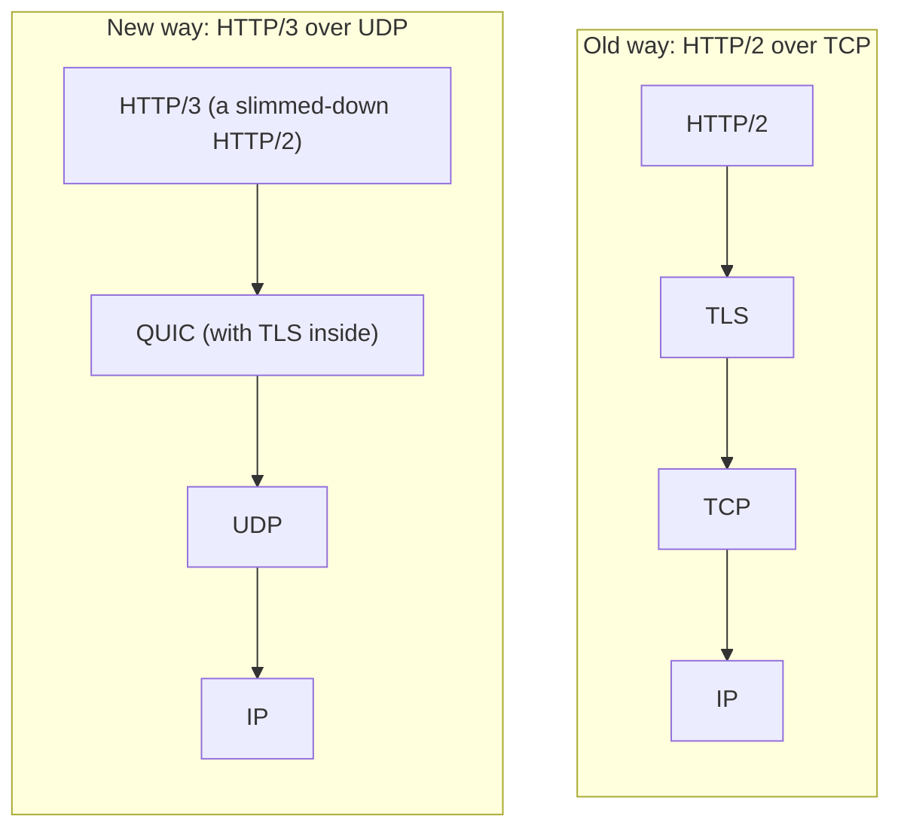
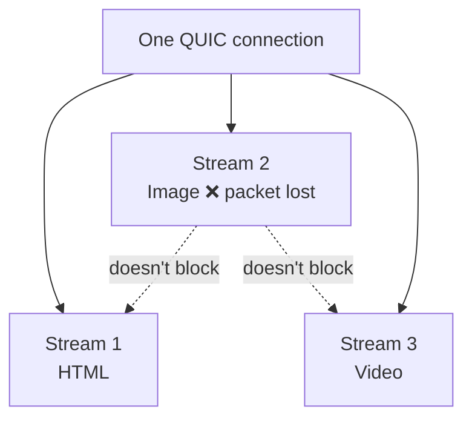
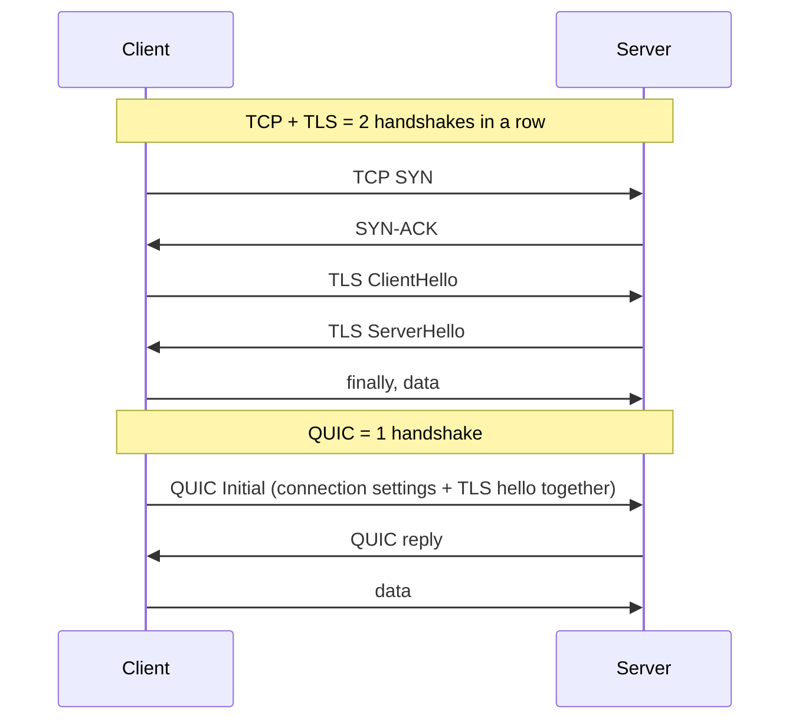
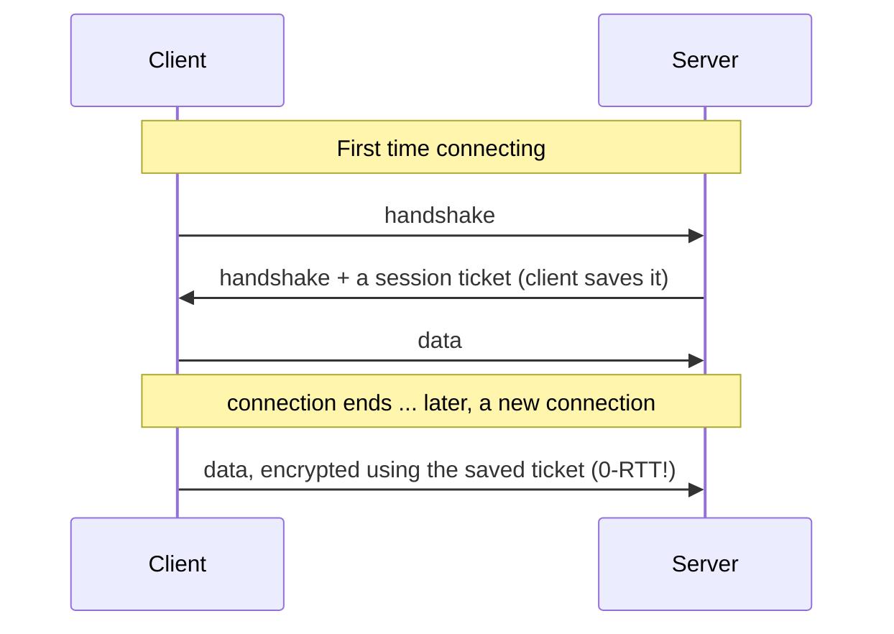
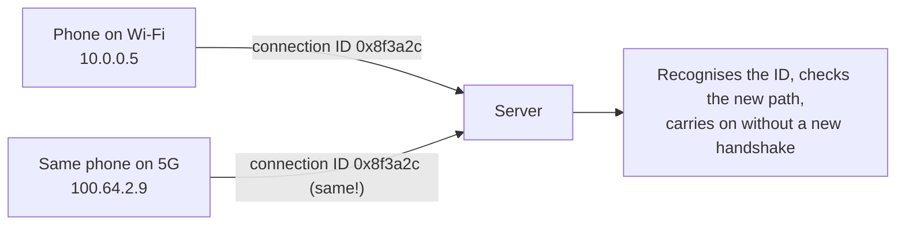
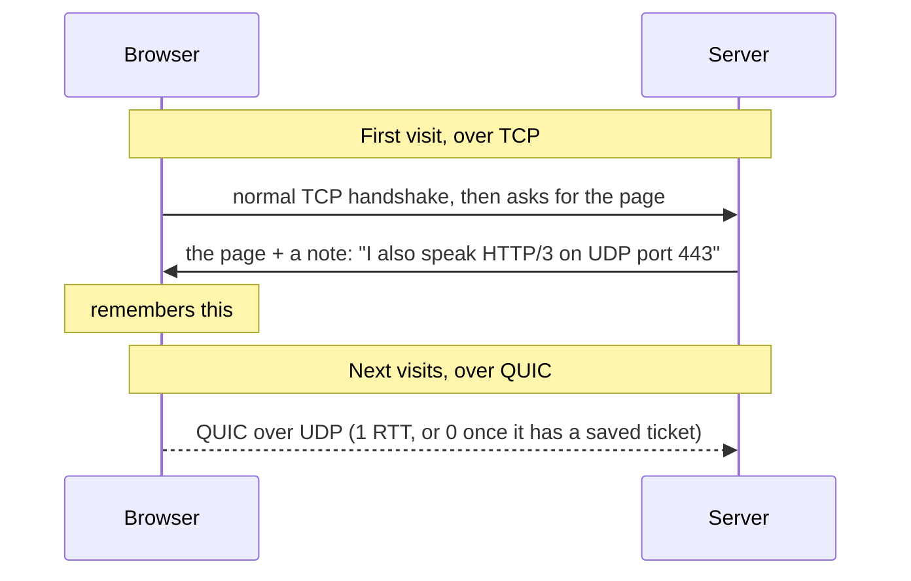

# 3.2 QUIC Protocol

This lecture is the last part of the transport layer chapter:
- 3.6 and 3.7 Congestion control, covered in the last lecture → [[3.1 TCP Congestion Control]]
- 3.8 How the transport layer is changing: the QUIC protocol (this note)

---

## 1. Why did anyone need something new?

For about 40 years the internet has run on just two transport protocols: TCP and UDP.

Over time people made different versions of TCP to handle special situations:

| Situation | What goes wrong with normal TCP | How it was fixed |
|---|---|---|
| Long, fast links (big file transfers) | Lots of packets are in flight at once, and one loss slows everything down | CUBIC: grow the window much faster |
| Wireless networks | Packets get lost because of a noisy signal or because you're moving, but TCP thinks it's congestion and slows down for no reason | Don't treat every loss as congestion |
| Very long-delay links (like satellite) | The RTT is huge, so growing "once per RTT" takes ages | Grow based on time, not on round trips (RFC 3135) |
| Data centers | Every microsecond of delay matters | Let routers warn senders before queues fill up (RFC 8257, DCTCP) |
| Background traffic (like updates) | Low-priority transfers shouldn't slow down important traffic | Back off as soon as other traffic shows up (RFC 6817) |

Here's the problem with all these fixes. TCP lives inside the operating system (the kernel). So every improvement means changing the OS on every computer, and it doesn't help anyone until every machine has been updated. That takes years.

So a new idea came up: build the transport features inside the application instead, and run it on top of UDP. That's HTTP/3, which runs on QUIC.

---

## 2. What is QUIC?

QUIC stands for Quick UDP Internet Connections.

- Google built it in 2012. Later the IETF made it an official standard (RFC 9000).
- It gives you the good parts of TCP: reliable delivery, congestion control and so on.
- But it runs on top of UDP, not TCP.
- It has encryption (TLS 1.3) built right in.
- It's what HTTP/3 runs on.
- It's technically an application-layer protocol sitting on top of UDP. Its main purpose is to make HTTP (web browsing) faster.
- Google uses it on many of its servers and apps, like Chrome and the YouTube mobile app.

### How the layers stack up



| Layer | Old way | New way |
|---|---|---|
| Application | HTTP/2 + TLS | HTTP/3 + QUIC |
| Transport | TCP | UDP |
| Network | IP | IP |

In simple words, QUIC takes the jobs that TCP and TLS used to do and moves them up into the application. Underneath, it just uses plain UDP.

### What was wrong with TCP + TLS?
1. Setting up a TCP connection takes time (a handshake).
2. TLS needs its own handshake on top of that, which is even more waiting.
3. TCP gives you only one stream of bytes, all in strict order.
4. If one packet is lost, everything behind it has to wait, even data that has nothing to do with the lost packet. This is called head-of-line blocking.
5. A TCP connection is tied to your IP address and port. If you switch from Wi-Fi to mobile data, your IP changes and the connection breaks.

---

## 3. Why build it on UDP?

Why not just make a better TCP? Because TCP is stuck.

- TCP is built into every operating system and into millions of middleboxes (routers, firewalls) all over the world. Upgrading all of them is practically impossible.
- UDP, on the other hand, is allowed through by almost every network device. And UDP does almost nothing on its own; it just carries packets.
- So QUIC uses UDP as a plain envelope and does all the clever work (reliability, congestion control, recovering lost packets) inside the application. No OS update is needed.
- It's easier to roll out, since you don't touch the IP stack at all.

QUIC does all of these jobs by itself:
- Reliability (making sure data arrives)
- Acknowledgments (ACKs)
- Retransmission (resending lost data)
- Congestion control
- Flow control
- Connection management (opening and closing connections)
- Stream multiplexing (many streams in one connection)
- Security (encryption)

> [!tip] Easy way to remember
> UDP is just an envelope that every network lets through. QUIC puts TCP's brain and TLS's security inside that envelope.

---

## 4. QUIC features at a glance

- QUIC doesn't invent everything from scratch. It reuses ideas you already know from TCP for setting up connections, handling errors and controlling congestion. The QUIC specification itself says that if you know TCP's loss detection and congestion control, you'll find very similar algorithms in QUIC.
- Connection setup: reliability, congestion control, authentication, encryption and connection state all get set up together, in one round trip (or even zero).
- Multiple streams inside one connection:
  - each stream has its own reliable delivery and security
  - but all streams share one congestion control
- HTTP/3 is basically HTTP designed to run on top of QUIC.

---

## 5. Streams: QUIC's big idea

One QUIC connection can carry many independent streams at the same time.
- A stream can go both ways (bidirectional) or only one way (unidirectional).
- Each stream is its own ordered sequence of bytes.



If a packet from Stream 2 is lost, only Stream 2 waits. Streams 1 and 3 keep going. This is how QUIC reduces head-of-line blocking.

### Picture it like this

```
 (a) HTTP/1.1 or HTTP/2 over TCP          (b) HTTP/3 over QUIC
 GET  GET  GET                            GET        GET        GET
 ------ TLS (one for all) ---             QUIC enc   QUIC enc   QUIC enc
 ------ TCP (one queue) -----             QUIC rel.  QUIC rel.✗ QUIC rel.
        ✗ one loss → ALL wait             (only this stream waits)
 ------ TCP congestion ctrl --            ---- QUIC congestion control ----
                                          ------------- UDP ---------------
```

Think of it like a supermarket. With TCP there's one checkout line, and if one customer's card fails, everyone behind them waits. With QUIC there are several checkout lines, so a problem in one line doesn't stop the others.

### What QUIC fixes and what it doesn't

| | Fixed? | Why |
|---|---|---|
| Blocking between different streams | ✅ Yes | QUIC keeps track of each stream separately, so a gap in one stream never holds up another. |
| Blocking inside the same stream | ❌ No | Each stream still has to deliver its bytes in order. If a packet in the middle of a stream is lost, the rest of that stream still waits. |

> [!note] Why couldn't HTTP/2 fix this by itself?
> HTTP/2 already sent many requests over one connection. But it was sitting on top of TCP, and TCP only knows about one single stream of bytes. When one TCP segment is lost, TCP holds back everything after it, including data belonging to totally unrelated HTTP/2 requests. HTTP/2 was doing the multiplexing, but TCP underneath had no idea. You can't fix this from above TCP, so QUIC had to replace TCP completely instead of sitting on top of it.

---

## 6. Setting up a connection

### TCP + TLS: two handshakes, one after the other



| TCP + TLS | QUIC |
|---|---|
| TCP first sets up reliability and congestion control. Then TLS sets up authentication and encryption. | QUIC sets up all of it (reliability, congestion control, authentication, encryption) together. |
| 2 handshakes, one after the other | 1 handshake |

### 0-RTT: no waiting at all

If you've talked to this server before, QUIC can skip the wait completely. The client sends encrypted data along with its very first message.



The client reuses the session ticket from the previous connection to encrypt and authenticate. So there's zero round-trip delay before sending data.

### Summary of the handshake costs

| Situation | How many round trips | What happens |
|---|---|---|
| TCP + TLS (old way) | about 2 RTT | TCP handshake finishes, then the TLS 1.3 handshake runs. Two setups, one after the other. |
| QUIC, first time | about 1 RTT | The connection settings and the TLS hello travel in the same message. One setup, both done together. |
| QUIC, coming back to the same server | 0 RTT | The client uses its saved session ticket, and real data goes in the very first packet. |
| Catch with 0-RTT | — | 0-RTT data can be replayed, so it's only safe for requests that can repeat harmlessly (like GET). Never use it for a POST that changes something. |

> [!warning] Why 0-RTT can be replayed, explained simply
> In 0-RTT the client sends real data in its very first packet, before any handshake happens. To encrypt it, the client uses a key left over from an old connection (the saved ticket), not a fresh key made just for this connection. So an attacker can copy that packet and send it to the server again.
> - If it's `GET /product/42` and it gets replayed 10 times, the server just shows the product page 10 times. That's annoying at worst, but harmless.
> - If it's `POST /orders {item: 42, qty: 1}` and it gets replayed 10 times, that's 10 orders, 10 payments and 10 deliveries!
>
> So the QUIC and TLS 1.3 rules leave it to the application: only put something in the 0-RTT packet if it's safe to process more than once. Browsers and servers usually limit what can go into that first packet.

---

## 7. QUIC and TLS 1.3

QUIC has TLS 1.3 built into its setup. That doesn't mean QUIC replaces TLS. They work together.

What TLS gives you:
- Authentication: you're talking to the real server
- Confidentiality: nobody can read the data
- Integrity: nobody can change the data without being noticed
- Key establishment: both sides agree on secret keys

Who does what:
- TLS 1.3 does the cryptography: the security logic and creating the secret keys.
- QUIC does the delivery: it carries the TLS handshake messages, makes sure they arrive, and resends them if they're lost.

QUIC also uses separate keys for separate jobs. That way, if one key is ever leaked, the damage stays small:

| Key | What it's used for |
|---|---|
| Handshake keys | Only to protect the first setup packets |
| Application keys | To encrypt the actual web traffic |
| Header protection keys | Only to hide packet numbers in the header, so outsiders (hackers, ISPs, middleboxes) can't read them |

---

## 8. Connection migration: switching networks without breaking

This is something TCP simply cannot do.

| | TCP | QUIC |
|---|---|---|
| On Wi-Fi, the connection is identified by | `10.0.0.5:51000 → 203.0.113.7:443` (your IP + port and the server's IP + port, the "4-tuple") | a connection ID, like `0x8f3a2c…` |
| You walk outside and your phone switches to 5G | Your packets now come from `100.64.2.9:62110 → 203.0.113.7:443` | Your IP changed, but the connection ID is still `0x8f3a2c…` |
| What happens | Different 4-tuple means a different connection. The old one is dead. The app has to open a new connection and ask for everything again. | The server recognises the connection ID. Same keys, same streams, same congestion state. The app doesn't even notice. |



- The connection ID is a label that both sides agree on for the connection itself. It's carried in the QUIC header and has nothing to do with your IP address or port.
- When the address changes, the server sees the same ID, checks that the new path is genuine, and keeps going. There's no new handshake and nothing has to be downloaded again.
- For privacy, the IDs keep changing (they're rotated), so someone watching the network can't use them to track your device.

> [!important] Why TCP can't be patched to do this
> A TCP connection is defined by its 4-tuple. Change the IP and it's simply a different connection. "Surviving an IP change" isn't a missing feature in TCP; it goes against what a TCP connection is.

---

## 9. How does the browser know to use HTTP/3?



- The problem: the browser can't just start talking QUIC. Maybe the server doesn't support it, or maybe the network blocks it. And if it tries and fails, you'd wait a long time.
- Option 1, ask over TCP first: the browser connects the normal way. The server's reply includes a note saying "I also speak HTTP/3." The browser remembers this and uses QUIC next time.
- Option 2, ask DNS: a special DNS record can say "this site supports HTTP/3" along with its address. Then the browser can skip TCP completely.
- So your very first connection to a website is usually never QUIC, and it's never 0-RTT.

> [!note] Two separate reasons the first visit is never 0-RTT
> 1. There's no saved session ticket yet, because you've never connected before.
> 2. The browser doesn't know yet that the server speaks HTTP/3.

---

## 10. Where QUIC falls short

QUIC isn't perfect. Here are its weak points:

| Problem | What it means |
|---|---|
| UDP is sometimes blocked | Many college and office firewalls block UDP. Then the browser quietly falls back to TCP. |
| Uses more CPU | The work happens in the application instead of the OS, and every single packet is encrypted. |
| Harder to debug | Almost everything is encrypted, so network admins can't look inside to see why a connection is slow. |
| Fake requests can be misused | Before the handshake is done, the server can't be sure who's really asking. So it must not send back much data until it has checked the address. Otherwise attackers could use it to flood someone else (an amplification attack). |
| The fallback hides problems | Since everything keeps working over TCP, nobody notices that QUIC was never actually used. |

> [!example] Real numbers
> About 39% of websites say they support HTTP/3, and almost every browser supports it. But only about 21% of real traffic actually uses it. Supporting a protocol isn't the same as actually using it.

---

## 11. QUIC vs TCP: summary table

| Feature | TCP + TLS (old) | QUIC (new) |
|---|---|---|
| Runs over | IP | UDP |
| Reliable delivery | Yes | Yes |
| Ordered delivery | Yes, but only one byte stream | Yes, separately for each stream |
| Connection setup | TCP handshake, then TLS | QUIC + TLS together (1 RTT) |
| Security | TLS added separately | TLS 1.3 built in |
| Multiple streams | Limited by the single TCP stream | Yes, many streams |
| Connection migration | Very hard | Supported |
| 0-RTT | No, needs a new handshake | Supported |
| Congestion control | Yes | Yes |
| Flow control | Yes | Yes |
| When your IP changes | Connection breaks | Connection keeps going |

---

## Quick revision
- QUIC was built by Google in 2012 and standardised by the IETF in RFC 9000. It runs over UDP, has TLS 1.3 built in, and is what HTTP/3 runs on.
- Why UDP: TCP is stuck inside OS kernels and middleboxes, while UDP passes through everywhere, so QUIC can be improved in the application without OS updates.
- Streams: a loss in one stream doesn't block the others. Inside a single stream, blocking still happens.
- Handshake cost: TCP + TLS about 2 RTT, first QUIC connection about 1 RTT, returning QUIC connection 0 RTT. 0-RTT data can be replayed, so only use it for safe requests like GET.
- The connection ID lets a connection survive a switch from Wi-Fi to 5G. IDs are rotated for privacy.
- The browser learns about HTTP/3 from the server's TCP reply ("I speak HTTP/3 on UDP 443") or from a DNS record.
- Weak points: UDP gets blocked, it uses more CPU, it's hard to debug, fake requests can be misused, and fallback to TCP hides problems.

← [[3.1 TCP Congestion Control]] | Next → [[3.4 Network Layer Overview]]
