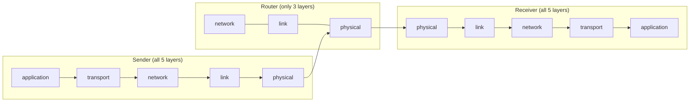
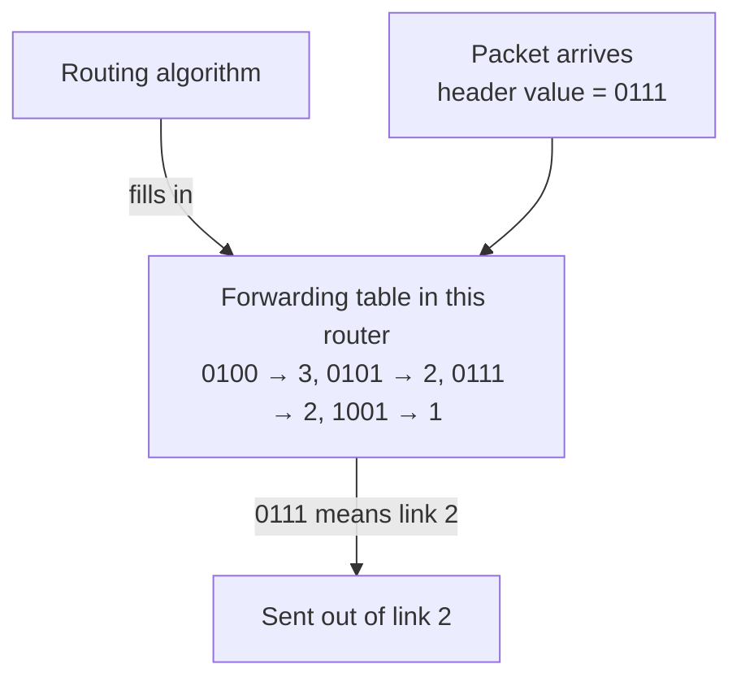
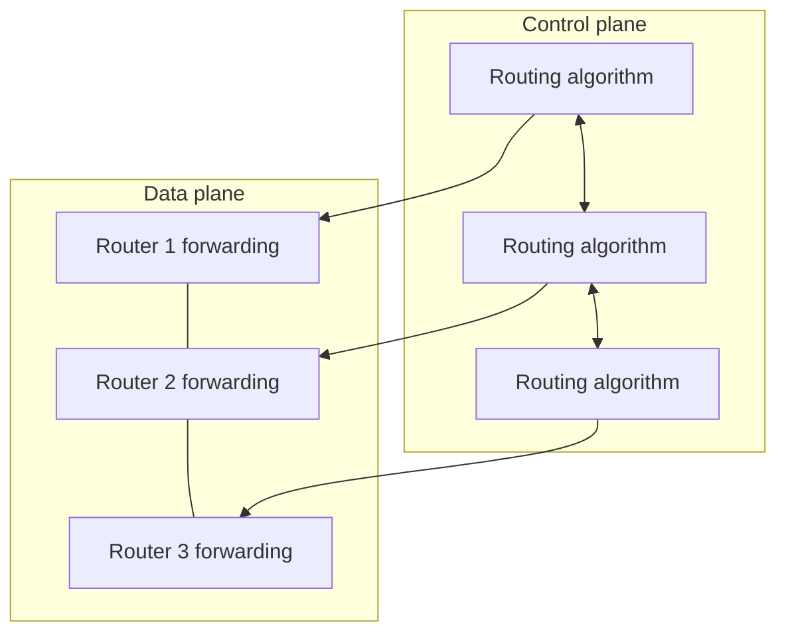
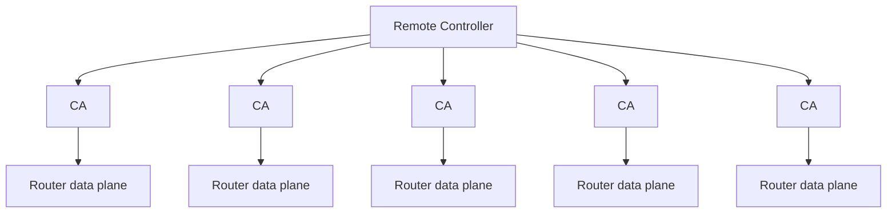

# 3.4 Network Layer: Overview

## Table of Contents
1. [[#1. What's coming in this unit]]
2. [[#2. What does the network layer do]]
3. [[#3. The two main jobs - forwarding and routing]]
4. [[#4. How routing and forwarding work together]]
5. [[#5. Data plane and control plane]]
    - [[#Way 1 - every router decides for itself]]
    - [[#Way 2 - one central controller decides (SDN)]]
6. [[#6. Network service model]]
    - [[#Service models of different networks]]
7. [[#7. Why best effort still works so well]]
8. [[#Quick revision]]

---

## 1. What's coming in this unit

This lecture starts the network layer. Here's everything the unit covers, so you can see where each lecture fits:

- 4.1 Overview of the network layer (this note)
- 4.2 What's inside a router → [[3.5 Inside a Router]]
- 4.3 Switching → [[3.6 Switching Fabrics]]
- 4.4 The Internet Protocol (IP)
  - Datagram format → [[3.7 IPv4 Datagram]]
  - Fragmentation → [[3.8 IPv4 Fragmentation]]
  - IPv4 addressing → [[3.9 IPv4 Addressing]] and [[3.10 Designing IPv4 Subnets - Exercises]]
  - NAT → [[3.11 IPv4 NAT]]
- 4.5 Software Defined Networking (SDN) → [[3.12 SDN - OpenFlow and P4]]
- Introduction to data center networking → [[3.13 Data Center Networking]]

---

## 2. What does the network layer do

The network layer's job is to carry a segment from the sending computer to the receiving computer, even if they're on opposite sides of the world.

Here's what happens at each end:
- At the sender: the transport layer hands down a segment (a TCP or UDP chunk). The network layer wraps it inside a datagram (adds an IP header with addresses) and passes it down to the link layer.
- At the receiver: the network layer takes the datagram, removes the IP header, and hands the segment up to the transport layer (TCP or UDP).

Unlike the transport layer, the network layer runs on every device on the internet, both on hosts (your laptop, a server) and on routers in between.

What a router does with each datagram:
- It looks at the header fields of every IP datagram passing through it, mainly the destination address.
- It moves the datagram from the input port it came in on to the correct output port, so it keeps moving towards its destination.

> [!note] Notice
> Your laptop has all 5 layers. A router only goes up to the network layer. It never opens the segment to look at TCP or app data; it only reads the IP header to decide where to send the packet.
>
> On the way, a packet can pass through many kinds of networks: mobile networks, national or global ISPs, company networks, data center networks, and so on.

---

## 3. The two main jobs - forwarding and routing

These two words sound similar, but they mean very different things.

| Job | What it means | Road trip example |
|---|---|---|
| Forwarding | A packet arrives at a router. The router sends it out of the right output link. That's it, one router, one step. | You reach a single highway junction and decide which exit to take. |
| Routing | Working out the whole path a packet should take from source to destination. This is done using routing algorithms. | Planning the full trip from your home to another city before you leave. |

> [!tip] Easy way to remember
> Forwarding is local: one router, one decision, done in nanoseconds.
> Routing is global: the whole path, worked out in advance.

---

## 4. How routing and forwarding work together

- The routing algorithm works out the full path through the network.
- Its result is stored in each router as a forwarding table.
- When a packet arrives, the router just looks up its forwarding table to decide which output link to use. This is the local forwarding step.

Example forwarding table from the slide:

| Value in the packet header | Send out of link |
|---|---|
| 0100 | 3 |
| 0101 | 2 |
| 0111 | 2 |
| 1001 | 1 |

A packet arrives with header value 0111. The router checks the table, sees "0111 → 2", and sends it out of link 2.

So routing is like the person who makes the map, and forwarding is like the person who reads the map at each junction.

---

## 5. Data plane and control plane

The network layer is split into two parts. You'll hear these two terms a lot.

| Data plane | Control plane |
|---|---|
| Works locally, inside one router | Works across the whole network |
| Decides which output port a packet arriving on an input port should go to (this is forwarding) | Decides the path a packet takes through all the routers, from source to destination (this is routing) |
| Looks at the values in the packet's header | Can be done in two ways: traditional routing algorithms running in every router, or SDN running on separate servers |

In simple words: the data plane does the work on each packet, and the control plane makes the decisions and the rules.

There are two ways to build the control plane.

### Way 1 - every router decides for itself

- Every router runs its own piece of the routing algorithm.
- The routers talk to each other and, together, each one works out its own forwarding table.
- This is the traditional way.

It's like every driver figuring out the route by chatting with nearby drivers.

### Way 2 - one central controller decides (SDN)

- A separate remote controller (a server somewhere else) works out the forwarding tables for all routers and installs them.
- Each router only runs a small Control Agent (CA) that talks to the controller and follows its instructions.
- This is called Software-Defined Networking (SDN).

It's like a traffic control room that sees the whole city and tells every signal what to do.

You'll study SDN in detail later → [[3.12 SDN - OpenFlow and P4]]

---

## 6. Network service model

The question here is: what promises should the network make when it carries your packets from sender to receiver?

These promises are called the service model. Some promises it could make:

| Promises for each single packet | Promises for a whole stream (flow) of packets |
|---|---|
| Your packet will definitely arrive | Packets will arrive in the same order they were sent |
| Your packet will arrive within 40 ms | You'll always get at least a minimum bandwidth |
| | The gap between packets won't vary much (low jitter, important for calls and video) |

### Service models of different networks

| Network | Service model | Bandwidth guaranteed? | No loss guaranteed? | In order? | Timing guaranteed? |
|---|---|---|---|---|---|
| Internet | Best effort | none | no | no | no |
| ATM | Constant Bit Rate | constant rate | yes | yes | yes |
| ATM | Available Bit Rate | a guaranteed minimum | no | yes | no |
| Internet | IntServ Guaranteed (RFC 1633) | yes | yes | yes | yes |
| Internet | DiffServ (RFC 2475) | possible | possibly | possibly | no |

The internet's normal service is called best effort. It means the network will try its best, but it promises nothing:
1. No promise that your packet will reach the destination at all.
2. No promise about when it will arrive, or in what order.
3. No promise about how much bandwidth you'll get.

IntServ and DiffServ were attempts to add guarantees to the internet, but plain best effort is what the internet mostly runs on.

> [!tip] Example
> Best effort is like normal post. It usually arrives, but nobody guarantees when, or that your letters arrive in the order you sent them. A courier with tracking and a delivery deadline is like a guaranteed service.

---

## 7. Why best effort still works so well

If the internet guarantees nothing, how do video calls and Netflix work? A few reasons:

- It's simple. Because the network makes no promises, it's easy to build. That's why the internet could spread everywhere so quickly.
- There's lots of bandwidth. Networks usually have enough capacity, so real-time apps like voice and video calls work "well enough, most of the time."
- Services are copied close to you. Big companies keep copies of their content in data centers and CDNs (content distribution networks) near users. So your Netflix video often comes from a server in your own city, not from the other side of the world.
- Congestion control helps. Apps that can adjust their speed (like TCP downloads) slow down when the network is busy, so the network doesn't collapse. (See [[3.1 TCP Congestion Control]].)

> The slide's conclusion: it's hard to argue with the success of the best-effort model. It has worked for the whole internet.

---

## Quick revision
- The network layer carries segments from host to host. The sender wraps the segment in a datagram, and the receiver unwraps it and passes it up to transport.
- It runs on every host and every router. Routers only go up to the network layer.
- Forwarding is local: one router sends a packet from its input to the right output. Routing is global: working out the whole path.
- The routing algorithm fills in the forwarding table, and the router looks up the table for each packet.
- The data plane forwards packets inside each router. The control plane decides routes across the network, either with every router deciding (traditional) or with one remote controller (SDN).
- The internet is best effort, with no guarantee of delivery, order, timing or bandwidth. ATM CBR and IntServ guarantee everything, and DiffServ makes partial promises.
- Best effort works because it's simple, there's plenty of bandwidth, content is copied near users, and congestion control keeps the network stable.

← [[3.2 QUIC Protocol]] | Next → [[3.5 Inside a Router]]
