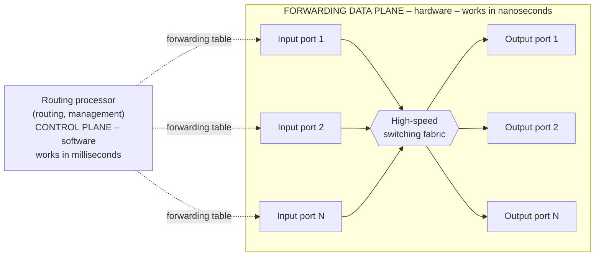
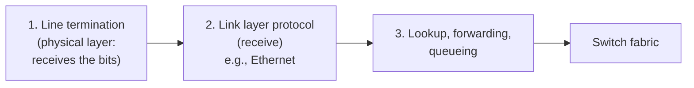
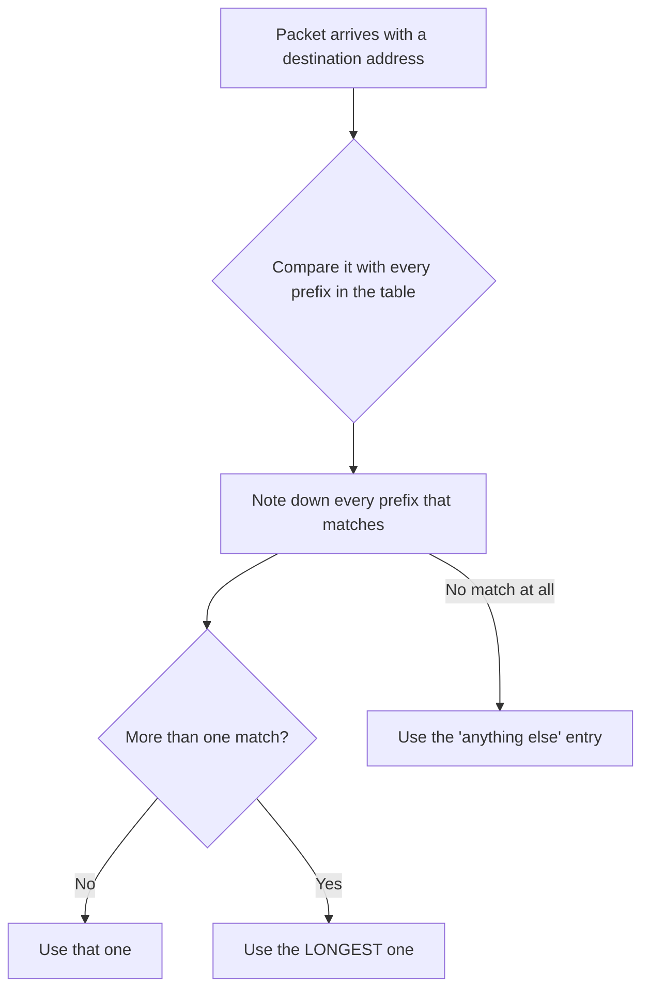

# 3.5 What's Inside a Router?

## Table of Contents
1. [[#1. Where this lecture fits]]
2. [[#2. The big picture of a router]]
3. [[#3. What happens at the input port]]
    - [[#Two ways to decide where a packet goes]]
4. [[#4. Destination-based forwarding]]
5. [[#5. Longest prefix matching]]
    - [[#Example 1]]
    - [[#Example 2]]
6. [[#6. How routers do this so fast - TCAM]]
7. [[#Quick revision]]

---

## 1. Where this lecture fits

- 4.1 Overview of the network layer → [[3.4 Network Layer Overview]]
- 4.2 What's inside a router (this note)
- 4.3 Switching → [[3.6 Switching Fabrics]]
- 4.4 IP: datagram format, fragmentation, addressing, NAT
- 4.5 SDN
- Data center networking

In the last lecture we said a router forwards packets. This lecture opens up the router and shows what's inside and how it decides where each packet goes.

---

## 2. The big picture of a router

A router has two main parts. One part thinks and the other part does the actual work.

| Part | Which plane | Built in | How fast |
|---|---|---|---|
| Routing processor: runs the routing algorithms and manages the router | Control plane | Software | Milliseconds |
| Input ports, switching fabric, output ports: physically move packets from in to out | Data plane | Hardware | Nanoseconds |

What each piece does:
- Input ports are where packets come in.
- The switching fabric is the "inside road" that carries a packet from an input port to the correct output port. (Covered in detail in [[3.6 Switching Fabrics]].)
- Output ports are where packets leave.
- The routing processor works out the forwarding table and gives a copy to the input ports.

> [!tip] Why is one part software and the other hardware?
> A router has to forward every single packet, which can be millions per second. Software would be far too slow for that, so forwarding is done in hardware, in nanoseconds.
> The routing table, on the other hand, only changes once in a while (for example, when a link goes down). So working it out in software, in milliseconds, is perfectly fine.

---

## 3. What happens at the input port

When a packet arrives at an input port, it goes through three steps:

1. Line termination. This is the physical layer. It receives the raw bits coming in on the wire.
2. Link-layer protocol. This handles the link-layer frame, for example Ethernet (you'll study this in chapter 6). It unwraps the frame to get the IP datagram inside.
3. Lookup, forwarding and queueing. This is the important step:
   - The router reads the packet's header (mainly the destination address).
   - It looks up the forwarding table, which is stored right there in the input port's memory, to find the correct output port. Because each input port does its own lookup without asking a central CPU, this is called decentralized switching.
   - This is called "match plus action": match the header against the table, then do the action (send it to that output port).
   - The goal is to finish all this at "line speed", meaning as fast as packets arrive on the link.
   - Input port queueing: if packets arrive faster than they can be pushed into the switching fabric, they have to wait in a queue at the input port.

### Two ways to decide where a packet goes

| Type | What the router looks at |
|---|---|
| Destination-based forwarding (the traditional way) | Only the destination IP address |
| Generalized forwarding | Any combination of header fields: source IP, port numbers, protocol and so on (covered in [[3.12 SDN - OpenFlow and P4]]) |

This lecture focuses on destination-based forwarding.

---

## 4. Destination-based forwarding

The simplest idea is to write the forwarding table as ranges of destination addresses. If a packet's destination falls inside a range, send it out of that link.

| Destination address range | Link interface |
|---|---|
| `11001000 00010111 00010000 00000000` to `11001000 00010111 00010111 11111111` | 0 |
| `11001000 00010111 00010000 00000100` to `11001000 00010111 00010000 00000111` | 3 |
| `11001000 00010111 00011000 00000000` to `11001000 00010111 00011000 11111111` | 1 |
| `11001000 00010111 00011001 00000000` to `11001000 00010111 00011111 11111111` | 2 |
| anything else | 3 |

> [!question] Slide question: what if the ranges don't divide up so nicely?
> Look at the second row. It's a small range that sits inside the first row's range, but it has to go to link 3 instead of link 0. So a packet in that small range matches two rows. Which one wins?
>
> Writing tables as plain ranges gets messy fast. The answer is longest prefix matching.

---

## 5. Longest prefix matching

Instead of writing full ranges, we write only the starting bits (the prefix) that an address must begin with. The rest of the bits are written as `*`, which means "don't care, any value is fine."

The rule: if an address matches more than one entry, pick the entry with the longest matching prefix. The longest match is the most specific one, so it wins.

| Prefix (address must start with) | Link interface |
|---|---|
| `11001000 00010111 00010*** ********` | 0 |
| `11001000 00010111 00011000 ********` | 1 |
| `11001000 00010111 00011*** ********` | 2 |
| anything else | 3 |

The first two bytes (`11001000 00010111`) are the same in every row, so you only need to compare the third byte.

### Example 1

Destination: `11001000 00010111 00010110 10100001`

Look at the third byte, `00010110`:
- Does it start with `00010`? Yes ✅. So row 1 matches.
- Is it exactly `00011000`? No ❌.
- Does it start with `00011`? No ❌.

Only row 1 matches, so the packet goes out of **link 0**.

### Example 2

Destination: `11001000 00010111 00011000 10101010`

Look at the third byte, `00011000`:
- Does it start with `00010`? No ❌.
- Is it exactly `00011000`? Yes ✅. That's a 24-bit match (8 + 8 + 8 bits).
- Does it start with `00011`? Yes ✅. That's a 21-bit match (8 + 8 + 5 bits).

Two rows match. The 24-bit one is longer, so the packet goes out of **link 1**.

> [!tip] Real-life example
> Think of delivering a letter. One rule says "anything for Bengaluru goes to van A." Another says "anything for Bengaluru, Koramangala goes to van B." A letter for Koramangala matches both, but the second rule is more specific, so it goes in van B.

Why routers use longest prefix matching will make full sense when you study IP addressing (CIDR, route aggregation and "more specific routes") → [[3.9 IPv4 Addressing]]

---

## 6. How routers do this so fast - TCAM

Comparing an address against thousands of prefixes, for millions of packets per second, has to be extremely fast. Routers use special memory chips called TCAMs (Ternary Content Addressable Memories).

- Normal memory works like this: you give it a location, and it gives you what's stored there.
- Content addressable memory works the other way: you give it the content (the destination address), and it finds the matching entry. And it does this in one clock cycle, no matter how big the table is.
- "Ternary" means each bit can have three values: 0, 1, or * (don't care). That's exactly what you need to store prefixes like `00010***`.
- Example: Cisco Catalyst switches hold about 1 million routing-table entries in TCAM.

---

## Quick revision
- A router has two parts: the routing processor (control plane, software, milliseconds) and the input ports + switching fabric + output ports (data plane, hardware, nanoseconds).
- At the input port: receive the bits, unwrap the link-layer frame, then look up the forwarding table and forward (or queue). This is match plus action, done at line speed.
- Destination-based forwarding uses only the destination IP. Generalized forwarding can use any header fields.
- Plain ranges get messy when they overlap, so routers use longest prefix matching: the most specific (longest) match wins.
- Answers to the examples: `…00010110…` goes to link 0, and `…00011000…` goes to link 1.
- TCAM finds the matching prefix in one clock cycle, whatever the table size. Cisco Catalyst holds about 1 million entries.

← [[3.4 Network Layer Overview]] | Next → [[3.6 Switching Fabrics]]
