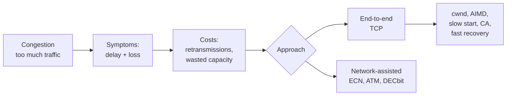
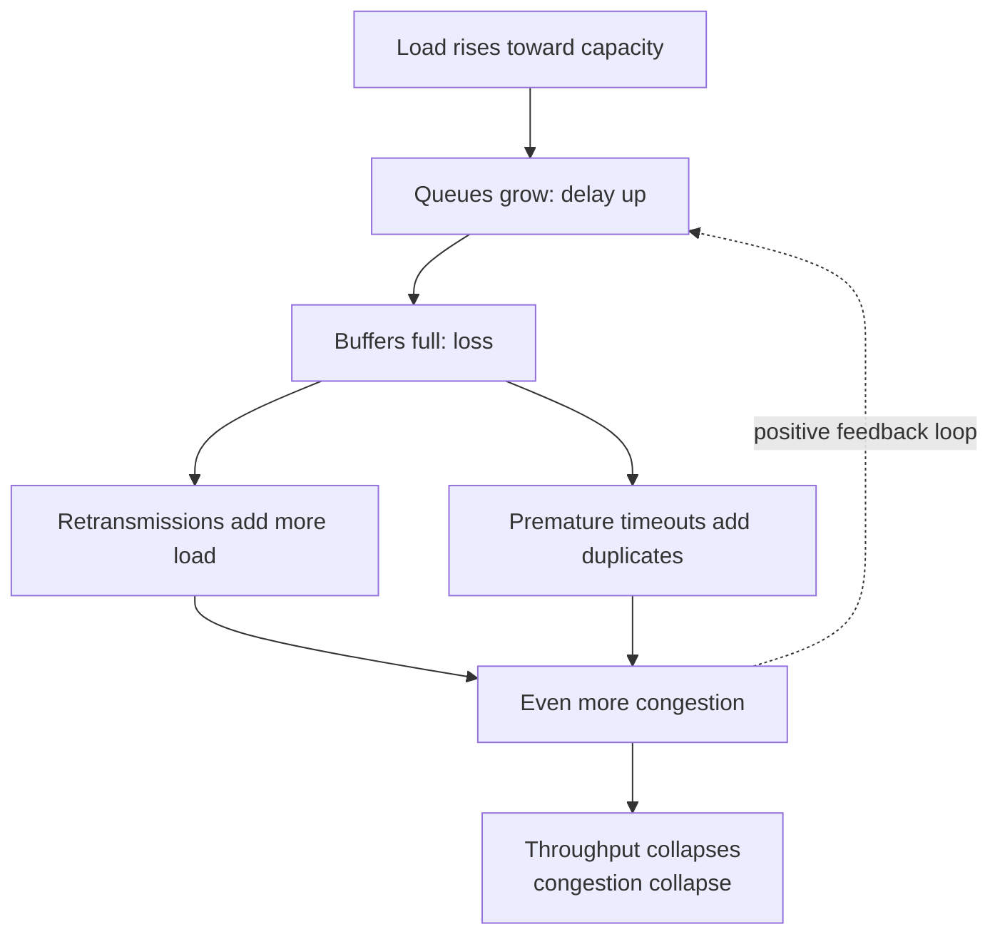
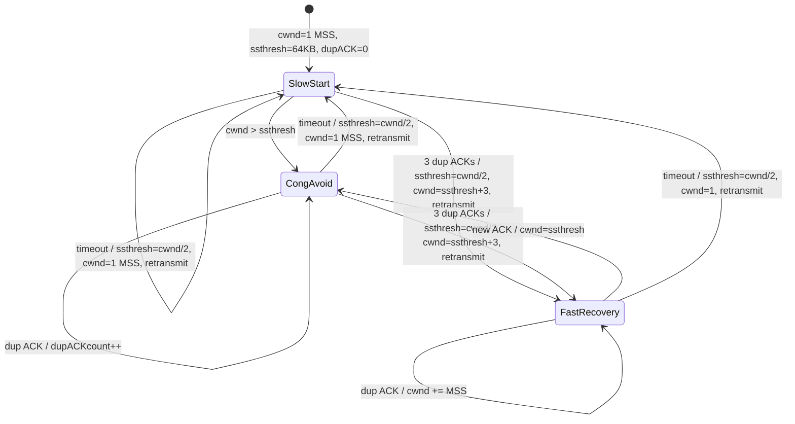

# Transport Layer: Congestion Control

> [!abstract] What this note covers
> Everything in the PES slides (3.6 and 3.7), expanded with full definitions, derivations, worked examples and exam-style questions.
> Anything marked **"Beyond the slides"** is extra material added to fill gaps. Anything marked **"Slide caveat"** flags a place where the slide is imprecise.

## Table of contents
1. [[#1. Big picture and roadmap]]
2. [[#2. Glossary of every term you need]]
3. [[#3. What is congestion?]]
4. [[#4. Causes and costs of congestion]]
5. [[#5. Approaches to congestion control]]
6. [[#6. TCP congestion control: the basics]]
7. [[#7. AIMD]]
8. [[#8. Slow start]]
9. [[#9. Reacting to loss: Tahoe vs Reno]]
10. [[#10. Slow start to congestion avoidance]]
11. [[#11. The full TCP congestion control FSM]]
12. [[#12. Worked examples]]
13. [[#13. Practice questions with answers]]
14. [[#14. Cheat sheet]]

---

## 1. Big picture and roadmap

The transport layer chapter is ordered like this:

| Section | Topic | Status here |
|---|---|---|
| 3.4 | Principles of reliable data transfer | already covered |
| 3.5 | TCP: segment structure, reliable data transfer, flow control, connection management | already covered |
| **3.6** | **Principles of congestion control** | **this note, Part A** |
| **3.7** | **TCP congestion control** | **this note, Part B** |

**Part A (3.6)** answers: *Why does congestion happen, what does it cost us, and what are the general ways to fight it?*
**Part B (3.7)** answers: *How exactly does TCP do it?* (cwnd, AIMD, slow start, congestion avoidance, fast recovery)



---

## 2. Glossary of every term you need

> [!info] Read this first. The rest of the note uses these terms constantly.

| Term | Full definition |
|---|---|
| **Congestion** | A state where the *offered load* (traffic arriving) in some part of the network approaches or exceeds the *capacity* of that part (a router or link), so packets queue up and get dropped. |
| **Link capacity / bandwidth (R)** | Maximum rate at which a link can transmit bits, e.g. R = 100 Mbps. |
| **Throughput** | Rate at which data is successfully delivered to the receiver (bits/sec or bytes/sec). Slides call it $\lambda_{out}$. |
| **Goodput** | Throughput of *useful, original* data only, i.e. excluding retransmitted duplicates. When retransmissions waste capacity, goodput < raw link throughput. |
| **Offered load** | Rate at which senders try to inject data into the network. $\lambda_{in}$ (original data) and $\lambda'_{in}$ (original + retransmitted). |
| **$\lambda_{in}$** | Application-layer sending rate: the *original* data handed to the transport layer. |
| **$\lambda'_{in}$** (lambda-in-prime) | Transport-layer sending rate: original data **plus retransmissions**. Always $\lambda'_{in} \ge \lambda_{in}$. |
| **$\lambda_{out}$** | Rate at which the receiving application gets data (throughput). |
| **Router buffer / queue** | Memory in a router where packets wait for the output link to become free. |
| **Queueing delay** | Time a packet waits in a router buffer before being transmitted. Grows rapidly as load approaches capacity. |
| **Packet loss (drop)** | Router discards a packet because its buffer is full (buffer overflow). |
| **Infinite buffer** | Idealisation: a router queue that never overflows, so no loss ever happens (only delay). |
| **Finite buffer** | Realistic queue of limited size: overflow means drops. |
| **Retransmission** | Sender re-sends a segment it believes was lost. |
| **Timeout** | Sender's retransmission timer expires without receiving the ACK; sender assumes loss. |
| **Premature timeout** | Timer expires although the packet or ACK is merely delayed, not lost. Causes *unneeded duplicates*. |
| **Duplicate ACK (dup ACK)** | An ACK that re-acknowledges data already acknowledged. The receiver sends one when a segment arrives *out of order* (a gap exists). |
| **Triple duplicate ACK** | Sender gets 3 dup ACKs for the same sequence number (so 4 identical ACKs in total). TCP treats this as a loss signal (**fast retransmit**). |
| **RTT (round-trip time)** | Time from sending a segment to receiving its ACK. |
| **MSS (maximum segment size)** | Largest amount of application data (bytes) in one TCP segment (not counting headers). Typically 1460 bytes on Ethernet. |
| **cwnd (congestion window)** | Sender-side variable limiting how much unACKed data may be in flight, chosen by the sender based on perceived network congestion. |
| **rwnd (receive window)** | Receiver-advertised window for **flow control**: how much buffer space the receiver has left. |
| **ssthresh (slow-start threshold)** | Variable marking the cwnd value at which TCP switches from exponential (slow start) to linear (congestion avoidance) growth. |
| **In-flight data** | Bytes sent but not yet ACKed: $LastByteSent - LastByteAcked$. |
| **Slow start (SS)** | Phase where cwnd roughly doubles every RTT. |
| **Congestion avoidance (CA)** | Phase where cwnd grows by about 1 MSS per RTT (linear). |
| **Fast retransmit** | Retransmitting a missing segment immediately after 3 dup ACKs, without waiting for the timeout. |
| **Fast recovery (FR)** | State entered after fast retransmit; the sender keeps the pipe partly full while waiting for the retransmitted segment's ACK. |
| **AIMD** | Additive Increase, Multiplicative Decrease: the control law TCP uses for cwnd. |
| **Bandwidth probing** | Slowly increasing the sending rate to discover how much capacity is available; backing off when loss occurs. |
| **Congestion collapse** | Catastrophic state where heavy load causes so many drops and retransmissions that useful throughput falls to near zero even though links are busy. |
| **End-to-end congestion control** | Hosts infer congestion by themselves from observed loss and delay. |
| **Network-assisted congestion control** | Routers send explicit congestion feedback to hosts. |
| **ECN (Explicit Congestion Notification)** | Mechanism where routers *mark* packets (instead of dropping them) to signal congestion. |
| **Self-clocking** | TCP sends new data only as ACKs return, so the ACK arrival rate "clocks" the sending rate. |

---

# PART A: Principles of congestion control (3.6)

## 3. What is congestion?

> [!quote] Slide definition
> Informally: **"too many sources sending too much data too fast for the *network* to handle."**

**Key idea:** the bottleneck is *inside the network* (routers and links), not at the receiver.

### Manifestations (how you notice congestion)
1. **Long delays**: packets wait in router buffers (queueing delay rises).
2. **Packet loss**: when the buffer is full, arriving packets are dropped (buffer overflow at routers).

Why these two? A router can forward packets at most at the output link rate $R$. If packets arrive faster than $R$ for a while, the excess must either **wait** (delay) or be **discarded** (loss).

### Congestion control vs flow control (slide: "different from flow control!")

| | **Flow control** | **Congestion control** |
|---|---|---|
| Problem | One sender is too fast for **one receiver** | **Too many senders**, sending too fast for the **network** |
| Who is overwhelmed | Receiver's buffer | Routers/links in the middle |
| Mechanism in TCP | Receive window **rwnd** (advertised in TCP header) | Congestion window **cwnd** (sender-computed) |
| Feedback source | Receiver tells sender explicitly | Mostly inferred (loss, delay) |
| Scope | Point-to-point (one connection) | Global/shared resource |

The slide's pictures: the **traffic jam** = congestion (many cars, shared road). The **kid and dog being sprayed with a hose** = flow control (one fast source, one receiver that can't absorb it).

> [!tip] Remember
> TCP's actual window is limited by **both**: 
> $$\text{LastByteSent} - \text{LastByteAcked} \le \min(\text{cwnd}, \text{rwnd})$$
> The slides focus on cwnd and assume rwnd is not the limit.

The slide calls congestion **"a top-10 problem!"**, meaning it is one of the most important problems in networking. Without congestion control, the Internet suffers collapse (this actually happened in 1986: throughput on a link between LBL and UC Berkeley dropped by a factor of ~1000, which led to Van Jacobson's TCP congestion control in 1988).

---

## 4. Causes and costs of congestion

The slides walk through three increasingly realistic scenarios. In each, ask: *what is the throughput $\lambda_{out}$ as a function of the sending rate?*

### 4.1 Scenario 1: one router, infinite buffers

**Setup**
- Two hosts (A and B), each sending to its own receiver
- One router in the middle with **infinite** buffers
- Input and output link capacity: **R**; the output link is **shared** by the two flows
- **No retransmissions needed** (infinite buffer, so no loss)

So: $\lambda'_{in} = \lambda_{in}$.

**Question on the slide:** *What happens as the arrival rate $\lambda_{in}$ approaches R/2?*

**Throughput analysis**
- The output link has capacity R and is shared equally by 2 flows, so each flow can get at most **R/2**.
- For $\lambda_{in} < R/2$: everything sent is delivered, so $\lambda_{out} = \lambda_{in}$ (straight line, slope 1).
- For $\lambda_{in} > R/2$: link saturated, $\lambda_{out}$ stays at **R/2**. The rest piles up in the infinite buffer.
- **Maximum per-connection throughput = R/2.**

**Delay analysis**
- As $\lambda_{in} \to R/2$ the link is almost fully utilised, and queueing delay rises sharply.
- *Beyond the slides:* a standard model uses **traffic intensity** $\rho = \dfrac{L\,a}{R}$, where $L$ = packet size (bits), $a$ = average packet arrival rate (packets/s), $R$ = link rate (bps).
  - $\rho \approx 0$: tiny average queueing delay
  - $\rho \to 1$: delay grows toward infinity (curve in the slide, a vertical asymptote at R/2)
  - $\rho > 1$: queue grows without bound

> [!success] Lesson of scenario 1
> 1. **Throughput can never exceed capacity** (R/2 per flow here).
> 2. **Delay increases as capacity is approached**, even before any loss occurs.
> Running near capacity has a *cost* (delay) even in the perfect, no-loss world.

---

### 4.2 Scenario 2: one router, **finite** buffers

**Setup changes:** buffers are now finite, so packets can be dropped. The sender **retransmits lost, timed-out packets**.

Therefore:
- Application-layer input = application-layer output: $\lambda_{in} = \lambda_{out}$ (in the long run, every original byte eventually gets delivered)
- Transport-layer input **includes retransmissions**: $\lambda'_{in} \ge \lambda_{in}$

The slide diagram shows host A's send buffer with a *copy* kept of each packet (needed because it may have to be resent).

We study three cases, from idealised to realistic:

#### Case (a): Perfect knowledge (idealisation)
- Sender **sends only when router buffers are available** (it magically knows).
- So **no loss, no retransmission**: $\lambda'_{in} = \lambda_{in}$.
- Result: $\lambda_{out} = \lambda_{in}$ up to R/2 (the straight line in the slide's graph, ending at the point (R/2, R/2)).

#### Case (b): Some perfect knowledge
- Packets **can** be lost (dropped when buffers are full).
- Sender **knows exactly when a packet was dropped** and **only resends if it is known to be lost**.
- So retransmissions are all *needed*, but they still consume capacity.

**Effect:** Offered load $\lambda'_{in}$ includes retransmissions. The router link carries both new and re-sent data. When the sender is pushing at R/2, part of that is retransmitted data, so *original* data delivered ($\lambda_{out}$) is less than R/2.

The graph curves below the diagonal near R/2. The gap = **"wasted" capacity due to retransmissions.**

> [!example] Textbook numbers (Kurose & Ross, *beyond the slides*)
> If the offered load is $\lambda'_{in} = R/2$, and the delivered original data is $\lambda_{out} = R/3$, then the sender is sending R/3 of original data + R/6 of retransmissions. Capacity spent on retransmissions = R/6.

#### Case (c): Realistic: **un-needed duplicates**
- Packets can be dropped (requiring retransmission), **but** the sender's timer can **time out prematurely**: the packet was only delayed (sitting in a long queue), not lost.
- Sender sends a **second copy**; **both copies get delivered**.
- The receiver discards the duplicate, but the link capacity was already burned carrying it.

The router now forwards **two copies of some packets**; the extra copy contributes nothing to throughput.

> [!example] Textbook numbers (*beyond the slides*)
> If each packet is, on average, forwarded twice, throughput asymptotically approaches **R/4** at offered load R/2.

The graph for case (c) curves even lower than case (b).

> [!success] "Costs" of congestion (from slide)
> 1. **More work (retransmission) for a given receiver throughput.** The sender must transmit more than $\lambda_{out}$ to deliver $\lambda_{out}$.
> 2. **Unneeded retransmissions: the link carries multiple copies of a packet,** which **decreases the maximum achievable throughput.**

---

### 4.3 Scenario 3: four senders, multi-hop paths, timeout/retransmit

**Setup**
- **Four** senders (Hosts A, B, C, D)
- **Multi-hop** paths (each flow crosses more than one router)
- Finite buffers, timeout/retransmit

Colour coding in the slide: the red flow (A to C) and blue flow (D to B) share a router queue (the "upper queue") on the way.

**Question:** What happens as $\lambda_{in}$ and $\lambda'_{in}$ increase?

**Answer (slide):** As the red $\lambda'_{in}$ increases, **all arriving blue packets at the upper queue are dropped, and blue throughput $\to 0$**.

**Why this happens (intuition)**
- Blue packets reach the upper router *after* having already used capacity at the previous hop.
- The red flow, entering that router directly from its source, arrives at a much higher rate and **grabs all the buffer space**.
- Blue packets arriving at the full buffer are dropped. All the effort spent carrying them on the first hop was **wasted**.
- As the load rises, the red traffic's own successful throughput also eventually falls, so the $\lambda_{out}$ curve **rises, peaks, and then collapses toward zero**. This is **congestion collapse**.

> [!success] Another "cost" of congestion (slide)
> **When a packet is dropped, any upstream transmission capacity and buffering used for that packet was wasted!**

### 4.4 Insights summary (slide "Causes/costs of congestion: insights")

| # | Insight | Which scenario |
|---|---|---|
| 1 | Throughput can **never exceed capacity** | 1 |
| 2 | **Delay increases** as capacity is approached | 1 |
| 3 | **Loss/retransmission decreases effective throughput** | 2(b) |
| 4 | **Unneeded duplicates further decrease** effective throughput | 2(c) |
| 5 | **Upstream transmission capacity / buffering wasted** for packets lost downstream | 3 |



> [!warning] The vicious circle
> Congestion causes loss, loss causes retransmission, retransmission adds load, which causes more congestion. Congestion control exists to **break this positive feedback loop** by making senders *slow down* when the network is stressed.

---

## 5. Approaches to congestion control

There are two broad approaches, distinguished by **whether the network layer helps**.

### 5.1 End-to-end congestion control
- **No explicit feedback from the network.**
- Congestion is **inferred** by the end systems from **observed loss and delay**.
- **This is the approach taken by TCP.**
- Why: IP provides no feedback by design (best-effort service), so TCP must work with what it can see: lost segments (timeouts, dup ACKs) and RTT changes.

### 5.2 Network-assisted congestion control
- **Routers provide direct feedback** to the sending/receiving hosts whose flows pass through the congested router.
- Feedback may **indicate the congestion level** (e.g. one bit: congested or not) or **explicitly set the sending rate** the sender should use.
- Slide examples: **TCP ECN, ATM, DECbit**.

| Protocol | How feedback works (beyond the slides) |
|---|---|
| **DECbit** | Router sets a single *congestion-indication bit* in the packet header when its average queue length exceeds a threshold. Receiver echoes the bit to the sender in the ACK; sender reduces its window if enough packets are marked. |
| **ATM ABR** | Sender sends special **RM (resource management) cells** between data cells. Switches along the path write feedback into them: a congestion-indication bit (NI/CI) or an explicit maximum rate (ER field). Sender adjusts to the lowest supported rate on the path. |
| **TCP ECN** | Network-assisted TCP extension (RFC 3168). Two bits in the IP header's ToS/traffic class field are used. A congested router **marks** packets (sets the CE codepoint) instead of dropping them. The receiver sets the **ECE** flag in TCP ACKs; the sender reduces its cwnd (as if a loss occurred) and sets **CWR** to confirm. Benefit: congestion is signalled **without losing data**. |

> [!tip] Exam angle
> End-to-end = *simple network, smart hosts* (Internet philosophy). Network-assisted = faster/more precise feedback but needs router support.

---

# PART B: TCP congestion control (3.7)

## 6. TCP congestion control: the basics

### 6.1 The congestion window (cwnd)

TCP sender's **sequence number space** (slide diagram) splits into regions:

```
 |  ACKed  |  sent, not-yet ACKed ("in-flight")  | available but not used |  not yet usable
            ^ LastByteAcked                       ^ LastByteSent
            |<------------------- cwnd ---------------------->|
```

- **Last byte ACKed**: everything up to here is confirmed delivered
- **Sent but not-yet ACKed ("in-flight")**: yellow region
- **Last byte sent**: right edge of what has been transmitted
- **Available but not used**: the window allows sending this, but nothing has been sent yet

**The rule (slide):** the TCP sender limits transmission:

$$\text{LastByteSent} - \text{LastByteAcked} \le \text{cwnd}$$

(The slide writes "<"; the standard statement is $\le$. In practice the limit is $\min(\text{cwnd}, \text{rwnd})$.)

**cwnd is dynamically adjusted in response to observed network congestion**. That adjustment *is* TCP congestion control.

### 6.2 TCP sending rate

**Roughly:** send cwnd bytes, wait one RTT for the ACKs, then send more.

$$\text{TCP rate} \approx \frac{\text{cwnd}}{\text{RTT}} \;\text{bytes/sec}$$

- Larger cwnd gives a higher rate. Larger RTT gives a lower rate (for the same cwnd).
- TCP controls its *rate* **indirectly** by controlling the *window*.

> [!example] Quick calculation
> MSS = 1460 B, cwnd = 10 MSS = 14,600 B, RTT = 100 ms.
> Rate $= 14600 / 0.1 = 146{,}000$ B/s $\approx 1.17$ Mbps.
> Double cwnd to 20 MSS and the rate doubles to ~2.34 Mbps.

**Self-clocking (beyond the slides):** TCP does not send in a rigid timed pattern. New data goes out when ACKs arrive, so if the network is slow, ACKs come back slowly and the sender automatically slows down.

### 6.3 How should the sender choose its rate? (slide "Determine sender rate")

The trade-off:

| If the sender is... | Consequence |
|---|---|
| **Too fast** | Congestion collapse |
| **Too cautious / too slow** | Under-utilises the available bandwidth |
| **Goal** | **Send at a high rate without congesting the network** |

**Guiding principles (from the slide):**
1. **A lost segment implies congestion**, so the sender's rate should be **decreased** when a segment is lost.
2. **An acknowledged segment indicates the network is delivering** the sender's segments, so the rate can be **increased** when an ACK arrives for a previously unacknowledged segment.
3. **Bandwidth probing**: the sender keeps increasing the rate until loss occurs, then backs off, then probes again. The "right" rate is never known in advance and also changes as other flows come and go.

**The TCP congestion-control algorithm has three main components:**
1. **Slow start**
2. **Congestion avoidance**
3. **Fast recovery** (recommended/optional in the original spec but implemented in Reno and later)

(AIMD is the underlying law governing steady-state behaviour.)

---

## 7. AIMD

> [!quote] Slide approach
> Senders can **increase** sending rate until packet loss (congestion) occurs, then **decrease** sending rate on a loss event.

| Part | Rule |
|---|---|
| **Additive Increase (AI)** | Increase sending rate by **1 MSS every RTT** until loss is detected |
| **Multiplicative Decrease (MD)** | **Cut sending rate in half** at each loss event |

### 7.1 Implementing additive increase
In congestion avoidance, cwnd grows by $\text{MSS} \times \frac{\text{MSS}}{\text{cwnd}}$ per ACK. A window of $N = \text{cwnd}/\text{MSS}$ segments yields $N$ ACKs per RTT, so total growth per RTT $= N \times \text{MSS}\cdot\frac{1}{N} = 1$ MSS. 

### 7.2 The sawtooth
Plotting sending rate against time gives the **AIMD sawtooth**: slow linear climb, sudden halving, repeat. TCP is **probing for bandwidth**: it keeps testing whether more is available.

```
rate
 |       /|        /|         /|
 |      / |  /|   / |   /|   / |
 |   /|/  | / |  /  |  / |  /  |
 |  / |   |/  | /   | /  | /
 | /  |       |/    |/   |/
 +-------------------------------> time
```

### 7.3 Why AIMD? (slide)
AIMD is a **distributed, asynchronous** algorithm (each sender acts independently, no global coordination) that has been shown to:
- **optimise congested flow rates network-wide**
- have **desirable stability properties**

**Beyond the slides: fairness.** If two flows share a bottleneck of capacity $R$, AIMD drives them toward an **equal share** ($R/2$ each): additive increase moves both up equally, multiplicative decrease cuts the larger flow more in absolute terms, so the gap shrinks every cycle. Other combinations (e.g. MIAD, AIAD) do not converge to fairness.

**Beyond the slides: average throughput.** If the window oscillates between $W/2$ and $W$ (where $W$ is the window at loss):
$$\text{avg throughput} \approx \frac{3}{4}\cdot\frac{W}{\text{RTT}}$$
A more complete formula relating throughput to loss rate $L$:
$$\text{avg TCP throughput} \approx \frac{1.22 \cdot \text{MSS}}{\text{RTT}\sqrt{L}}$$
(So very high-speed links need *extremely* low loss rates, which motivated newer variants such as CUBIC.)

---

## 8. Slow start

**Problem:** At connection start, TCP knows nothing about available bandwidth. Starting at a high rate risks congestion; creeping up linearly wastes time.

**Slide rule:** when a connection begins, **increase rate exponentially until the first loss event**.
- Initially **cwnd = 1 MSS**
- **Double cwnd every RTT**
- Done by **incrementing cwnd by 1 MSS for every ACK received**

**Why the doubling works:** if cwnd = N segments, you send N segments and get N ACKs in one RTT; each ACK adds 1 MSS, so cwnd becomes 2N.

| RTT round | cwnd (in MSS) | Segments sent in round |
|---|---|---|
| 0 → 1 | 1 | 1 |
| 1 → 2 | 2 | 2 |
| 2 → 3 | 4 | 4 |
| 3 → 4 | 8 | 8 |
| 4 → 5 | 16 | 16 |

(Matches the slide's Host A / Host B diagram: *one segment, two segments, four segments.*)

> [!summary] Slide summary
> **Initial rate is slow, but it ramps up exponentially fast.** "Slow" refers to the tiny starting window of 1 MSS, not to the growth, which is actually fast.

**Beyond the slides:** Modern TCP (RFC 6928) uses an **initial window of 10 MSS** instead of 1.

**When does slow start end?**
1. On a **loss event** (timeout): ssthresh is set to cwnd/2, cwnd is reset to 1 MSS, slow start restarts.
2. When **cwnd reaches ssthresh**: switch to congestion avoidance.
3. On **3 duplicate ACKs**: go to fast recovery (Reno).

---

## 9. Reacting to loss: Tahoe vs Reno

TCP has **two ways to detect loss**, and they signal *different severities*:

| Loss signal | What it means | Severity |
|---|---|---|
| **Timeout** | No ACKs are coming back at all; network may be badly congested | **Severe** |
| **3 duplicate ACKs** | A later segment got through (the receiver is sending ACKs), only one segment seems lost | **Mild** ("dup ACKs indicate network capable of delivering some segments") |

### Slide behaviours

**Loss indicated by timeout:**
- cwnd set to **1 MSS**
- Window then grows **exponentially (slow start) up to the threshold, then linearly**

**Loss indicated by 3 duplicate ACKs → TCP Reno:**
- cwnd is **cut in half**, then grows **linearly**

**TCP Tahoe:** **always** sets cwnd to 1 (on timeout *or* 3 duplicate ACKs).

| | **TCP Tahoe** (older) | **TCP Reno** (newer, widely used base) |
|---|---|---|
| On timeout | ssthresh = cwnd/2; cwnd = 1 MSS; slow start | ssthresh = cwnd/2; cwnd = 1 MSS; slow start |
| On 3 dup ACKs | ssthresh = cwnd/2; cwnd = **1 MSS**; slow start | ssthresh = cwnd/2; cwnd = **ssthresh (+3)**; fast recovery, then linear growth |
| Uses fast recovery? | No | **Yes** |

> [!warning] Slide caveat
> The "AIMD: more" slide says "cut in half on triple dup ACK (**Reno**)" and "cut to 1 MSS on timeout (**Tahoe**)". The label can mislead: **Reno also cuts to 1 MSS on a timeout.** The real difference between Tahoe and Reno is **how they react to 3 duplicate ACKs** (Tahoe: 1 MSS; Reno: halve). The slide "detecting, reacting to loss" has this right.

**Why treat 3 dup ACKs gently?** Each dup ACK means some later segment *arrived*. The pipe is still working, so a full reset to 1 MSS would be needlessly harsh.

**Why 3 and not 1?** Network reordering can cause 1 or 2 dup ACKs without any loss. Three makes a false alarm unlikely.

---

## 10. Slow start to congestion avoidance

> [!question] Q (slide)
> When should the exponential increase switch to linear?
> **A:** When **cwnd gets to 1/2 of its value before the timeout** (the last loss).

**Implementation:**
- Variable **ssthresh** (slow-start threshold)
- **On a loss event, ssthresh is set to 1/2 of cwnd just before the loss event**

Intuition: the cwnd that caused loss was too big. Half of it is a "known safe-ish" level. Grow fast to there, then probe carefully (linearly) beyond it.

**Initial ssthresh** is large (the FSM slide shows 64 KB), so slow start continues until the first loss.

### 10.1 Walking through the slide's graph

Graph: x-axis = transmission round, y-axis = cwnd in segments. Initial ssthresh = 8; loss at round 8 (marked X) when cwnd = 12.

| Round | 1 | 2 | 3 | 4 | 5 | 6 | 7 | 8 |
|---|---|---|---|---|---|---|---|---|
| cwnd | 1 | 2 | 4 | **8** | 9 | 10 | 11 | **12** ✗ |
| Phase | SS | SS | SS | hits ssthresh=8 | CA | CA | CA | CA, loss! |

Rounds 1 to 4: exponential (slow start). From round 4 (cwnd = ssthresh = 8): +1 per round (congestion avoidance). At round 8, cwnd = 12 and a loss happens. New **ssthresh = 12/2 = 6**.

| Round | 9 | 10 | 11 | 12 | 13 | 14 | 15 |
|---|---|---|---|---|---|---|---|
| **Tahoe** cwnd | 1 | 2 | 4 | 6 | 7 | 8 | 9 |
| **Reno** cwnd | 6 | 7 | 8 | 9 | 10 | 11 | 12 |

- **Tahoe** drops to 1, slow-starts exponentially up to ssthresh = 6 (round 12), then linear.
- **Reno** (3 dup ACK case) drops to 6 and goes straight into linear growth. It recovers much faster. 

> [!note] Timeout case
> If the loss in this graph were a *timeout*, Reno would also fall to 1 and follow the Tahoe curve.

---

## 11. The full TCP congestion control FSM

The "Summary" slide is a **finite state machine** with three states: **Slow start**, **Congestion avoidance**, **Fast recovery**.

### 11.1 Initialisation
On connection start (the Λ arrow means "no event needed"):
`cwnd = 1 MSS`, `ssthresh = 64 KB`, `dupACKcount = 0` → enter **Slow start**.

### 11.2 State-by-state transition table

| State | Event | Actions | Next state |
|---|---|---|---|
| **Slow start** | **new ACK** | `cwnd = cwnd + MSS`; `dupACKcount = 0`; transmit new segment(s) as allowed | Slow start |
| | **duplicate ACK** | `dupACKcount++` | Slow start |
| | **cwnd > ssthresh** | (nothing else) | **Congestion avoidance** |
| | **timeout** | `ssthresh = cwnd/2`; `cwnd = 1 MSS`; `dupACKcount = 0`; retransmit missing segment | Slow start |
| | **dupACKcount == 3** | `ssthresh = cwnd/2`; `cwnd = ssthresh + 3`; retransmit missing segment | **Fast recovery** |
| **Congestion avoidance** | **new ACK** | `cwnd = cwnd + MSS·(MSS/cwnd)`; `dupACKcount = 0`; transmit new segment(s) as allowed | Congestion avoidance |
| | **duplicate ACK** | `dupACKcount++` | Congestion avoidance |
| | **timeout** | `ssthresh = cwnd/2`; `cwnd = 1 MSS`; `dupACKcount = 0`; retransmit missing segment | **Slow start** |
| | **dupACKcount == 3** | `ssthresh = cwnd/2`; `cwnd = ssthresh + 3`; retransmit missing segment | **Fast recovery** |
| **Fast recovery** | **duplicate ACK** | `cwnd = cwnd + MSS`; transmit new segment(s) as allowed | Fast recovery |
| | **new ACK** | `cwnd = ssthresh`; `dupACKcount = 0` | **Congestion avoidance** |
| | **timeout** | `ssthresh = cwnd/2`; `cwnd = 1`; `dupACKcount = 0`; retransmit missing segment | **Slow start** |



### 11.3 Explaining each state in words

**Slow start:** exponential growth. Every new ACK adds 1 MSS. Ends at ssthresh or at loss.

**Congestion avoidance:** *careful* linear growth (~1 MSS per RTT, i.e. the additive increase of AIMD). The network is probably near its capacity, so we creep rather than leap.

**Fast recovery:** entered when 3 dup ACKs arrive.
- `ssthresh = cwnd/2`; `cwnd = ssthresh + 3` (the "+3" accounts for the 3 segments that triggered the dup ACKs and have left the network).
- The missing segment is retransmitted immediately (**fast retransmit**, no waiting for the timeout).
- Each additional dup ACK means another segment has left the network, so cwnd += MSS lets a new segment out and keeps the pipe flowing.
- When a **new ACK** (covering the retransmitted segment) arrives, **deflate**: `cwnd = ssthresh` and go to congestion avoidance.
- If a **timeout** hits while in fast recovery, fall back to slow start.

### 11.4 Why does the FSM treat these events differently?

| Event | Interpretation | Response |
|---|---|---|
| New ACK | Network is delivering data | Increase cwnd (SS: +1 MSS/ACK; CA: +1 MSS/RTT) |
| Dup ACK (1 or 2) | Possibly reordering; not yet conclusive | Just count it |
| 3 dup ACKs | Probably one lost segment, network still working | Halve (ssthresh = cwnd/2), fast retransmit, fast recovery |
| Timeout | Possibly severe congestion | Reset to 1 MSS, slow start |

> [!tip] Beyond the slides
> Modern Linux defaults to **CUBIC** (cwnd grows as a cubic function of time since last loss, better for high-bandwidth long-delay links). **BBR** (Google) estimates bandwidth and RTT directly instead of using loss as the signal. Reno/AIMD is still the conceptual foundation.

---

## 12. Worked examples

### Example 1: Throughput scenario 1
Link R = 10 Mbps shared by two flows, infinite buffers. What is the max per-flow throughput, and what happens to delay when each sends at 5 Mbps?
- Max per flow = R/2 = **5 Mbps**.
- At 5 Mbps each, the link is 100% utilised ($\rho \to 1$), so **delay grows without bound**.

### Example 2: Slow start sequence (Tahoe)
Initial ssthresh = 16 MSS. cwnd = 1 at round 1. A **timeout** occurs when cwnd = 20.

Before the timeout (rounds 1 to 9): 1, 2, 4, 8, 16 (reaches ssthresh), 17, 18, 19, 20 ✗

On timeout: ssthresh = 20/2 = **10**; cwnd = **1**.

After: 1, 2, 4, 8, 10 (reaches ssthresh), 11, 12, 13, ...

> [!note] Implementation detail
> Textbook implementations cap the doubling at ssthresh (8 to 10, not 8 to 16) and switch to linear at **cwnd ≥ ssthresh**. The slide FSM writes the condition as `cwnd > ssthresh`. In exams, follow the convention your instructor used. The shape (exponential then linear) is the same.

### Example 3: Reno, 3 dup ACKs
cwnd = 16 MSS in congestion avoidance when 3 dup ACKs arrive.
- ssthresh = 16/2 = **8**
- cwnd = 8 + 3 = **11** (fast recovery); retransmit missing segment
- 2 more dup ACKs: cwnd = 12, 13
- New ACK arrives: cwnd = **8**, state = congestion avoidance
- Then: 9, 10, 11, ... (+1 per RTT)

### Example 4: Throughput from cwnd
MSS = 1000 B, RTT = 50 ms, cwnd = 40 MSS.
Rate = 40,000 B / 0.05 s = 800,000 B/s = **6.4 Mbps**.

### Example 5: Why does AIMD average 3/4 W/RTT?
Window sawtooths between $W/2$ and $W$ linearly, so the average is $(W/2 + W)/2 = 0.75W$ per RTT.
Given W = 20 MSS at loss, MSS = 1500 B, RTT = 100 ms: avg = 0.75 × 20 × 1500 / 0.1 = **225,000 B/s ≈ 1.8 Mbps**.

---

## 13. Practice questions with answers

**Q1. Define congestion and name its two main symptoms.**
Too many sources sending too much data too fast for the network to handle. Symptoms: long queueing delays and packet loss from buffer overflow.

**Q2. Difference between flow control and congestion control?**
Flow control prevents one sender overwhelming one receiver (rwnd). Congestion control prevents many senders overwhelming the network (cwnd).

**Q3. In scenario 1, why is the max throughput per flow R/2?**
Two flows share one output link of capacity R, so each gets at most R/2.

**Q4. Why does delay go to infinity as $\lambda_{in} \to R/2$ even without loss?**
Arrival rate matches service rate, so queues grow without bound (infinite buffers).

**Q5. Explain the two kinds of retransmission waste in scenario 2.**
(i) Needed retransmissions: capacity spent resending lost data. (ii) Unneeded retransmissions: premature timeouts make the sender send duplicates that both arrive, so the link carries the same data twice.

**Q6. In scenario 3, why does blue throughput fall to 0?**
As red's offered load (including retransmissions) rises, it fills the shared router's buffer, so arriving blue packets are dropped. The upstream resources used by blue are wasted, and the overall throughput collapses.

**Q7. End-to-end vs network-assisted?**
End-to-end: hosts infer congestion from loss/delay (TCP). Network-assisted: routers give explicit feedback (ECN, ATM ABR, DECbit).

**Q8. State the TCP rate formula and what controls it.**
Rate ≈ cwnd / RTT bytes/sec, controlled by adjusting cwnd.

**Q9. What is AIMD, and why does it produce a sawtooth?**
Increase by 1 MSS per RTT; halve on loss. Linear climbs followed by sharp drops give the sawtooth.

**Q10. Tahoe vs Reno?**
On 3 dup ACKs, Tahoe sets cwnd = 1 (slow start); Reno halves and uses fast recovery. Both reset to 1 MSS on timeout.

**Q11. Why does TCP set ssthresh = cwnd/2 on loss?**
The cwnd at loss was beyond network capacity. Half is a safer estimate; slow start gets there quickly, then probing is linear.

**Q12. A TCP Reno connection has cwnd = 24 and detects a timeout. Give ssthresh and cwnd afterward.**
ssthresh = 12, cwnd = 1 MSS (slow start).

**Q13. Same connection, but 3 dup ACKs instead.**
ssthresh = 12, cwnd = 12 + 3 = 15 in fast recovery; after the new ACK, cwnd = 12 and congestion avoidance.

**Q14. Why is slow start called "slow" if growth is exponential?**
Because it begins with a very small window (1 MSS), not because of its growth rate.

**Q15. Why must TCP wait for 3 dup ACKs, not 1?**
Packet reordering produces 1 or 2 dup ACKs without loss; 3 makes false positives unlikely.

---

## 14. Cheat sheet

> [!summary] One-page revision

**Congestion** = network overloaded, shown by **delay** + **loss**. ≠ flow control.

**Costs** (scenarios 1 to 3): delay near capacity; retransmissions waste capacity; unneeded duplicates waste more; dropped packets waste upstream work; collapse possible.

**Approaches:** End-to-end (TCP, infer from loss/delay) vs Network-assisted (ECN, ATM, DECbit).

**TCP essentials**
- Limit: $\text{LastByteSent} - \text{LastByteAcked} \le \min(\text{cwnd}, \text{rwnd})$
- Rate ≈ cwnd/RTT
- **AIMD**: +1 MSS/RTT, halve on loss, sawtooth

| Phase | cwnd growth | Per-ACK rule |
|---|---|---|
| Slow start | doubles per RTT | +1 MSS |
| Congestion avoidance | +1 MSS per RTT | + MSS·(MSS/cwnd) |
| Fast recovery | inflates +1 MSS per dup ACK | → ssthresh on new ACK |

| Event | Action |
|---|---|
| Timeout | ssthresh = cwnd/2, cwnd = 1 MSS, slow start |
| 3 dup ACKs (Reno) | ssthresh = cwnd/2, cwnd = ssthresh + 3, fast retransmit, fast recovery |
| 3 dup ACKs (Tahoe) | ssthresh = cwnd/2, cwnd = 1 MSS, slow start |

**Initial values:** cwnd = 1 MSS, ssthresh = 64 KB, dupACKcount = 0.

---
*Source: PES University Computer Networks, Team Networks, Transport Layer slides (3.6, 3.7). Extra material follows the standard treatment in Kurose & Ross, "Computer Networking: A Top-Down Approach".*
