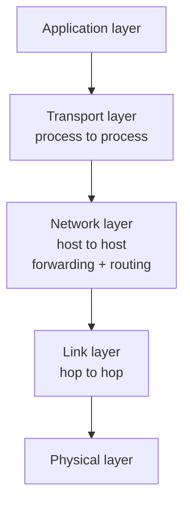
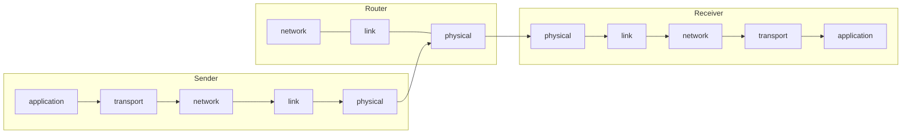
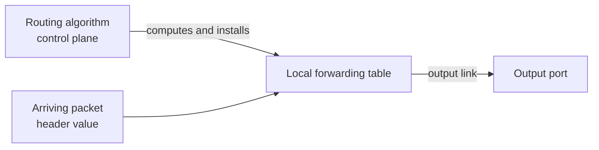
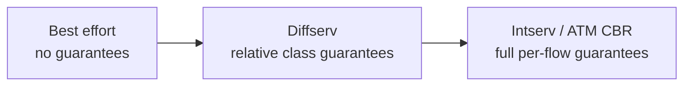

# Unit 4: Network Layer and Internet Protocol
## 4.1 Overview of the Network Layer

> [!abstract] What this note covers
> Every slide of the 4.1 deck (network-layer services, forwarding vs routing, routing/forwarding interplay, connection setup, the network service model and QoS table), expanded with full definitions, intuition, examples and exam-style questions.
> **"Beyond the slides"** = extra content to fill gaps. **"Slide caveat"** = slide wording that needs a clarification.
> Previous note: [[Congestion_Control_Notes]] (Unit 3, transport layer).

## Table of contents
1. [[#1. Where we are: unit roadmap]]
2. [[#2. Glossary]]
3. [[#3. Network-layer services and protocol]]
4. [[#4. Two key network-layer functions: forwarding and routing]]
5. [[#5. Interplay between routing and forwarding]]
6. [[#6. Connection setup]]
7. [[#7. Network service model]]
8. [[#8. Comparing service models (the QoS table)]]
9. [[#9. Worked examples]]
10. [[#10. Practice questions with answers]]
11. [[#11. Cheat sheet]]

---

## 1. Where we are: unit roadmap

| Section | Topic | Status |
|---|---|---|
| **4.1** | **Overview of Network Layer** | **this note** |
| 4.2 | What's inside a router? | next |
| 4.3 | Switching | next |
| 4.4 | The Internet Protocol (IP): datagram format, fragmentation, IPv4 addressing, NAT | next |

**Big question of 4.1:** *What does the network layer do, and what kind of service does it offer to the transport layer above it?*

---

## 2. Glossary

> [!info] Read this first.

| Term | Definition |
|---|---|
| **Network layer (layer 3)** | The layer responsible for moving packets from a sending *host* to a receiving *host* across many links and routers (host-to-host delivery). |
| **Datagram** | The unit of data at the network layer (in the Internet, an **IP datagram**): a header (with source/destination addresses etc.) plus a payload. |
| **Segment** | The transport-layer unit (TCP/UDP). It becomes the *payload* of a datagram. |
| **Encapsulation** | Wrapping data from a higher layer inside a lower-layer unit by adding that layer's header (segment goes inside datagram, datagram inside a frame). |
| **Decapsulation** | The reverse: stripping a header and passing the payload up. |
| **Packet** | Generic word for a unit of data on the network; at layer 3 it means the datagram. |
| **Host** | An end system (PC, phone, server) that runs applications. |
| **Router** | A network-layer device with multiple interfaces that forwards datagrams between networks based on header fields. |
| **Input port / output port** | The router's interfaces where datagrams arrive / leave. |
| **Link** | A communication channel between two adjacent nodes. |
| **Path (route)** | The sequence of routers/links a datagram follows from source to destination. |
| **Forwarding** | *Local, per-router action:* move a packet from a router's input link to the appropriate output link. |
| **Routing** | *Global, network-wide process:* determine the route (path) packets take from source to destination. |
| **Routing algorithm** | The procedure that computes good paths (e.g. link-state, distance-vector; covered later). |
| **Forwarding table (FIB)** | Per-router table mapping a header value to an output link. Also called a *routing table* in loose usage. |
| **Header value** | The field(s) in an arriving packet's header (e.g. destination address) used as the lookup key into the forwarding table. |
| **Data plane** | Per-router, fast, local functions: forwarding. |
| **Control plane** | Network-wide logic: routing, i.e. computing the paths and filling forwarding tables. |
| **Virtual circuit (VC)** | A connection-oriented network-layer service: a path is set up before data flows, and every packet follows it using a VC identifier. |
| **Connection setup** | Signalling phase in which hosts *and routers* establish a virtual connection before data transfer. |
| **Datagram network** | Connectionless network layer: no setup, each packet is forwarded independently by its destination address (the Internet). |
| **Service model** | The set of guarantees the network layer offers to the transport layer for transporting datagrams. |
| **Flow** | A stream of related datagrams between the same source and destination (e.g. one video call). |
| **QoS (Quality of Service)** | Guarantees about bandwidth, loss, order and timing. |
| **Best effort** | The Internet's service model: the network tries its best but guarantees nothing. |
| **Bandwidth guarantee** | A promise of some minimum (or constant) data rate for a flow. |
| **Jitter / inter-packet spacing** | Variation in the time gap between successive packets of a flow. |
| **ATM** | Asynchronous Transfer Mode: a connection-oriented, cell-based (53-byte cells) network architecture with rich QoS. |
| **Frame relay / X.25** | Older connection-oriented wide-area packet-switching technologies that use virtual circuits. |
| **Intserv** | Integrated Services: per-flow QoS architecture with reserved resources. |
| **Diffserv** | Differentiated Services: class-based QoS using packet markings. |

---

## 3. Network-layer services and protocol

### 3.1 The core idea (slide)
> [!quote] Slide
> Transport **segments** travel **from sending host to receiving host**.

### 3.2 What the sender does
- **Encapsulates segments into datagrams**, then **passes them to the link layer**.
- Encapsulation = take the transport-layer segment (TCP/UDP header + data), add an IP header in front of it. The result is a datagram.

### 3.3 What the receiver does
- **Delivers segments to the transport layer protocol.**
- Decapsulation: the receiving host's network layer strips the IP header and hands the segment up to TCP or UDP.

### 3.4 Network-layer protocols run in *every* Internet device
> [!quote] Slide
> Network layer protocols in **every** Internet device: **hosts, routers**.

This is the key contrast with the transport layer: transport protocols (TCP/UDP) run **only in end hosts**, but the network layer is present in **hosts *and* routers**. Routers do not look at TCP/UDP headers (normally); they only go up to layer 3.

In the slide's picture, the red path runs from the sending host's application/transport/network/link/physical stack, through many routers (each with only **network, link, physical**), to the receiving host's full stack. The network is a mix of: mobile network, enterprise network, national or global ISP, datacenter network. They are all different technologies stitched together by the network layer.

### 3.5 What do routers do? (slide)
**Routers:**
- **Examine header fields in all IP datagrams passing through it** (e.g. the destination IP address)
- **Move datagrams from input ports to output ports** to **transfer datagrams along the end-to-end path**

A router is therefore a *specialised packet switch*: it never creates or consumes user datagrams in normal operation; it just inspects and forwards them.

> [!tip] Beyond the slides: layers per device
> | Device | Layers implemented |
> |---|---|
> | Host | all 5 (application to physical) |
> | Router | network, link, physical |
> | Link-layer switch | link, physical |

### 3.6 Services the network layer could provide
In general, a network layer can offer services such as: (a) host-to-host delivery, (b) path determination, (c) optionally connection setup, (d) optionally QoS. The slides develop each in turn below.

---

## 4. Two key network-layer functions: forwarding and routing

> [!quote] Slide
> **Network-layer functions:**
> - **Forwarding:** move packets from a router's input link to the appropriate router output link.
> - **Routing:** determine route taken by packets from source to destination. *(Realised by routing algorithms.)*

| | **Forwarding** | **Routing** |
|---|---|---|
| Scope | **Local**: within a single router | **Global**: across the whole network |
| Question answered | "This packet just arrived. Which output link do I send it on?" | "What is the best path from A to B?" |
| Time scale | Nanoseconds to microseconds per packet | Seconds to minutes (when topology changes) |
| Implemented in | Hardware (fast path) | Software (routing protocols/algorithms) |
| Plane | **Data plane** | **Control plane** |
| Uses | Forwarding table | Routing algorithm; its output *fills* the forwarding table |

### The slide's analogy: taking a trip
- **Forwarding** = the process of **getting through a single interchange** (you are at one junction, you pick the correct exit ramp). Local and immediate.
- **Routing** = the process of **planning the trip from source to destination** (deciding in advance which highways to use). Global and strategic.

The slide shows a photo of a highway interchange (forwarding) and a road map with a highlighted route (routing).

> [!example] Another analogy
> A GPS app planning your whole journey is *routing*. Each time you reach a junction and turn left because the app said so is *forwarding*.

---

## 5. Interplay between routing and forwarding

Slide key statements (in red):
- **The routing algorithm determines the end-to-end path through the network.**
- **The forwarding table determines local forwarding at this router.**

The routing algorithm (running in the router, or in a central controller) **computes paths and writes entries into the forwarding table**. The forwarding hardware then **only looks up the table**. It never recomputes paths per packet.

### 5.1 The slide's forwarding table example

| Header value | Output link |
|---|---|
| 0100 | 3 |
| 0101 | 2 |
| 0111 | 2 |
| 1001 | 1 |

The router has three links (numbered 1, 2, 3). A packet arrives with header value **0111**. Look up 0111 in the table: **output link 2**. The packet is sent out of link 2.

**How it works step by step:**
1. Packet arrives on an input link.
2. Router reads the **value in the arriving packet's header** (here a 4-bit value).
3. Router looks it up in the **local forwarding table**.
4. Table says which **output link** to use; router transfers the packet there.

> [!note] Slide caveat / simplification
> Real IP forwarding does not do exact matches on a 4-bit value. It matches the **destination IP address** against **address prefixes** using **longest-prefix matching** (covered in 4.2/4.4). The 4-bit example is a teaching simplification.

### 5.2 Why separate routing from forwarding?
- **Speed**: forwarding must keep up with line rate (billions of packets/s on big routers). A simple table lookup can be done in hardware.
- **Flexibility**: routing logic can change (new algorithms, policies) without touching the fast path.
- **Scalability**: path computation is expensive and done rarely; lookups are cheap and done constantly.

> [!tip] Beyond the slides: SDN
> In **Software-Defined Networking**, the control plane is moved out of each router into a **logically centralised controller** that computes routes and installs forwarding-table entries in the routers (e.g. via OpenFlow). Routers become simple, fast forwarders.

---

## 6. Connection setup

> [!quote] Slide
> - **3rd important function in *some* network architectures:** ATM, frame relay, X.25
> - Before datagrams flow, **two end hosts *and* intervening routers establish a virtual connection**. Routers get involved.
> - **Network vs transport layer connection service:**
>   - **Network:** between two **hosts** (may also involve intervening routers in case of VCs)
>   - **Transport:** between two **processes**

### 6.1 What this means
So far the two key functions were forwarding and routing. In some architectures there is a **third function: connection setup**.

- **Connection-oriented network layer (virtual circuits):** before any data flows, a signalling phase sets up a path. Every router on the path stores **state** about the connection (a VC number mapping on each link, and possibly reserved resources). Then all packets of the connection follow that same path. At the end there is a teardown.
- **Connectionless network layer (datagram):** none of this. Each datagram carries the full destination address and is forwarded independently. **This is how the Internet's IP works.**

| | **Virtual-circuit network** (ATM, frame relay, X.25) | **Datagram network** (Internet / IP) |
|---|---|---|
| Setup phase | **Yes** (signalling) | **No** |
| Router state per connection | **Yes** (VC table entries) | **No** (stateless w.r.t. connections) |
| Packet carries | Short **VC identifier** | Full **destination address** |
| Path | Fixed for the connection | Can change packet by packet |
| QoS / resource reservation | Easy to provide | Hard |
| Failure of a router on path | Connection torn down | Packets simply re-routed |
| Complexity | Inside the network | At the edges (end hosts) |

### 6.2 Network-layer connection vs transport-layer connection
This is a frequent exam point.

| | Network-layer connection (VC) | Transport-layer connection (TCP) |
|---|---|---|
| Between | Two **hosts** | Two **processes** (sockets: IP + port) |
| Routers involved? | **Yes**, they hold VC state | **No**, routers know nothing about it |
| Where state lives | Hosts **and** routers | **End hosts only** |

> [!warning] Common confusion
> **TCP is connection-oriented, but IP is connectionless.** A TCP "connection" is just state kept at the two end hosts; the routers in the middle treat every segment's datagram independently. The Internet therefore has a connection-oriented *transport* service on top of a connectionless *network* service.

### 6.3 The technologies named on the slide (*beyond the slides*)
- **X.25**: 1970s-80s connection-oriented packet-switched WAN standard; used virtual circuits with heavy hop-by-hop error checking (designed for unreliable lines).
- **Frame relay**: successor to X.25; faster, less error checking, virtual circuits (PVCs/SVCs), widely used for business WAN links in the 1990s.
- **ATM (Asynchronous Transfer Mode)**: fixed-size 53-byte *cells*, virtual circuits, strong QoS classes (CBR, VBR, ABR, UBR). Designed to carry voice, video and data together.

All three are largely legacy; the Internet's datagram model won out. (MPLS borrows the label-switching idea of virtual circuits.)

---

## 7. Network service model

> [!question] Slide question
> What **service model** for the "channel" transporting datagrams from sender to receiver?

Think of the network layer as a **channel** between sender and receiver. The **service model** specifies what that channel promises to the transport layer: *what can the transport layer rely on?*

### 7.1 Example services for **individual datagrams**
- **Guaranteed delivery**: every datagram sent eventually arrives (no loss).
- **Guaranteed delivery with less than 40 msec delay**: arrives, *and* within a bounded time (important for interactive voice; 40 ms is the slide's example bound).

### 7.2 Example services for a **flow** of datagrams
A *flow* is a sequence of datagrams belonging together (e.g. one video stream).
- **In-order datagram delivery**: datagrams arrive in the order sent.
- **Guaranteed minimum bandwidth to flow**: the flow always gets at least some rate (e.g. 2 Mbps).
- **Restrictions on changes in inter-packet spacing**: the gaps between packets at the receiver should stay about the same as at the sender (low **jitter**). This matters for audio/video playback.

| Level | Example guarantees |
|---|---|
| Per **datagram** | Delivery; delay bound |
| Per **flow** | Order; minimum bandwidth; limited jitter |

### 7.3 The Internet's service model: **best effort**

| Network architecture | Service model | Bandwidth | Loss | Order | Timing |
|---|---|---|---|---|---|
| Internet | **best effort** | none | no | no | no |

> [!quote] Slide
> Internet "best effort" service model: **No** guarantees on:
> i. successful datagram delivery to destination
> ii. timing or order of delivery
> iii. bandwidth available to end-end flow

**Reading the table:** each "no" means the network does **not** guarantee that property. So in the Internet:
- A datagram may be **lost** (dropped at a congested router; see [[Congestion_Control_Notes#4. Causes and costs of congestion]])
- Datagrams may arrive **out of order** (different paths, different queues)
- Delay is **unpredictable** (queueing)
- **No** guaranteed bandwidth (you share links with everyone)

"Best effort" means the network *tries* to deliver, but if it fails, that is too bad. "Best effort" is sometimes jokingly called "no effort".

### 7.4 Why did simple best-effort win? (*beyond the slides*)
1. **Simplicity of the network core**: routers stay stateless and fast; no per-flow state.
2. **Sufficient bandwidth**: cheap, plentiful bandwidth usually makes QoS machinery unnecessary; just provision enough.
3. **Application-layer adaptation**: apps compensate (buffering for streaming, TCP retransmissions for reliability, adaptive bitrate video).
4. **Flexibility and scalability**: works over any link technology; easy to extend (the end-to-end argument: put intelligence at the edges).
5. **Economics/deployment**: QoS needs coordination between ISPs, which is hard to deploy.

**Where does reliability come from, then?** From the layer above: **TCP** provides reliable, in-order delivery and congestion control on top of the unreliable IP layer.

---

## 8. Comparing service models (the QoS table)

| Network architecture | Service model | Bandwidth | Loss | Order | Timing |
|---|---|---|---|---|---|
| Internet | **best effort** | none | no | no | no |
| ATM | **Constant Bit Rate (CBR)** | constant rate | yes | yes | yes |
| ATM | **Available Bit Rate (ABR)** | guaranteed min | no | yes | no |
| Internet | **Intserv Guaranteed** (RFC 1633) | yes | yes | yes | yes |
| Internet | **Diffserv** (RFC 2475) | possible | possibly | possibly | no |

**Column meanings:** *Bandwidth*: is a data rate guaranteed? *Loss*: is loss-free delivery guaranteed? *Order*: are datagrams delivered in order? *Timing*: is delay/spacing preserved?

### 8.1 Each model explained

**Best effort (Internet).** Nothing guaranteed. Default for the public Internet.

**ATM CBR (Constant Bit Rate).** Emulates a dedicated fixed-rate circuit, like a leased line or telephone circuit. The network guarantees a **constant rate**, **no loss**, **in-order** delivery and **timing** (low, bounded delay and jitter). Ideal for traditional voice and uncompressed circuit-like traffic.

**ATM ABR (Available Bit Rate).** For elastic data traffic. Guarantees a **minimum rate**, and the flow can use more when spare capacity exists. **Order is preserved**, but **loss and timing are not guaranteed**. ABR also provides **feedback**: switches signal congestion/allowed rate to the sender (network-assisted congestion control, see [[Congestion_Control_Notes#5.2 Network-assisted congestion control]]), so the sender adapts its rate.

**Intserv Guaranteed (Integrated Services).** Per-flow QoS for the Internet. The flow **reserves resources along its path** (using a signalling protocol such as **RSVP**), and every router keeps per-flow state. Gives full guarantees: bandwidth, no loss, order, timing. **Drawback:** heavy per-flow state in every router, so it does not scale to the core of the Internet. (*Slide caveat:* RFC 1633 describes the Intserv architecture; the "Guaranteed Service" class itself is defined in RFC 2212.)

**Diffserv (Differentiated Services).** Scalable, **class-based** QoS. Packets are **marked** (the DSCP field in the IP header) at the network edge into a small number of classes; routers apply different *per-hop behaviours* (e.g. priority queueing) per class, with **no per-flow state**. Because guarantees are relative ("this class gets better treatment than that class"), bandwidth/loss/order are only **possible/possibly** and **timing is not guaranteed**. Example: voice gets a high-priority class, bulk downloads a low one.

### 8.2 Summary comparison

| | Best effort | CBR | ABR | Intserv | Diffserv |
|---|---|---|---|---|---|
| Philosophy | no promises | emulate a circuit | min rate + elastic | per-flow reservation | per-class priority |
| Per-flow state in routers | no | yes | yes | **yes (heavy)** | **no** |
| Scalability | excellent | poor | moderate | poor | good |
| Strength of guarantee | none | strongest | medium | strongest | weakest (relative) |

Left to right: more guarantees, but more complexity and per-flow state.

> [!tip] Remember
> Notice the pattern: **the more guarantees, the more the network must remember** (state) about each flow. The Internet chose simplicity (stateless best effort) and pushed complexity to the edges.

---

## 9. Worked examples

### Example 1: Forwarding table lookup
Using the slide's table (0100→3, 0101→2, 0111→2, 1001→1):

| Arriving header | Output link |
|---|---|
| 0100 | 3 |
| 0101 | 2 |
| 0111 | 2 |
| 1001 | 1 |
| 0110 | **no entry** (needs a default route or the packet is dropped) |

### Example 2: Classify the action
| Action | Forwarding or routing? |
|---|---|
| Router A reads the destination address and sends the packet out interface 2 | Forwarding |
| Network computes the shortest path from Bengaluru to Mumbai nodes | Routing |
| Router updates its table after a link fails | Routing (control plane), which changes forwarding |
| Packet moves from input port to output port | Forwarding |

### Example 3: Which service model fits?
| Application | Best fit | Reason |
|---|---|---|
| Web browsing, email | Best effort (TCP) | Elastic, can tolerate delay |
| Traditional telephony | CBR | Needs constant rate + low jitter |
| File transfer needing some minimum rate | ABR | Min rate + elastic use of spare capacity |
| High-quality video conferencing for an enterprise | Intserv or Diffserv | Needs delay/loss bounds |

### Example 4: Where does the state live?
- Opening a TCP connection from your laptop to a web server: state at **your laptop and the server only**. Routers in between keep **no** per-connection state (IP is datagram-based).
- Opening an ATM virtual circuit: state at both hosts **and at every switch on the path**.

---

## 10. Practice questions with answers

**Q1. What does the network layer do on the sending and receiving sides?**
Sender: encapsulates transport segments into datagrams and passes them to the link layer. Receiver: delivers segments up to the transport layer.

**Q2. Which devices run network-layer protocols?**
Every Internet device: hosts and routers. (Transport protocols run only on hosts.)

**Q3. What do routers do?**
They examine header fields of every datagram passing through and move datagrams from input ports to output ports along the end-to-end path.

**Q4. Differentiate forwarding and routing.**
Forwarding: local, per-packet, moves a packet from input link to the right output link using the forwarding table (data plane). Routing: global, determines the end-to-end path using routing algorithms (control plane).

**Q5. Explain the trip analogy.**
Forwarding is passing through one interchange; routing is planning the whole trip from source to destination.

**Q6. How do routing and forwarding interact?**
The routing algorithm computes paths and populates the local forwarding table; the forwarding table then determines per-packet forwarding at that router.

**Q7. A packet with header value 0101 arrives. What is the output link?**
Link 2.

**Q8. What is the third (optional) network-layer function?**
Connection setup, used in ATM, frame relay and X.25: hosts and routers establish a virtual connection before datagrams flow.

**Q9. Network-layer vs transport-layer connection service?**
Network: between two hosts, and with VCs involves intermediate routers. Transport: between two processes, involving only end hosts.

**Q10. Give two example services for individual datagrams and three for a flow.**
Individual: guaranteed delivery; guaranteed delivery with bounded delay (<40 ms). Flow: in-order delivery; guaranteed minimum bandwidth; restrictions on inter-packet spacing change.

**Q11. What is the Internet's service model, and what does it guarantee?**
Best effort. It guarantees nothing about delivery, order, timing or bandwidth.

**Q12. Why can TCP still provide reliable transfer over best-effort IP?**
TCP adds sequence numbers, ACKs, timers and retransmissions at the end hosts, building reliability on top of an unreliable network layer.

**Q13. Compare ATM CBR and ABR.**
CBR: constant rate, no loss, in-order, timing guaranteed. ABR: guaranteed minimum rate, in-order, but no loss or timing guarantee; also provides congestion feedback.

**Q14. Intserv vs Diffserv?**
Intserv: per-flow reservation (RSVP), strong guarantees, per-flow state in routers, poor scalability. Diffserv: per-class marking and treatment, no per-flow state, scalable, weaker (relative) guarantees.

**Q15. Why does a VC network make QoS easier than a datagram network?**
Routers along a fixed path hold per-connection state and can reserve resources (bandwidth, buffers) in advance; datagram routers treat packets independently.

---

## 11. Cheat sheet

> [!summary] One-page revision

**Network layer:** host-to-host delivery. Sender encapsulates segments into datagrams; receiver passes segments up. Runs in **hosts and routers**. Routers inspect headers and move datagrams input port → output port.

| Function | Scope | Plane | Mechanism |
|---|---|---|---|
| **Forwarding** | local (one router) | data | forwarding table lookup |
| **Routing** | global (end-to-end path) | control | routing algorithms fill the table |
| *(Connection setup)* | hosts + routers | control/signalling | only in ATM, frame relay, X.25 |

**Analogy:** forwarding = one interchange; routing = trip planning.

**Network vs transport connection:** network = host to host (routers may hold state in VCs); transport = process to process (end hosts only).

**Service model guarantees:** bandwidth, loss, order, timing.

| Model | Bandwidth | Loss | Order | Timing |
|---|---|---|---|---|
| Internet best effort | none | no | no | no |
| ATM CBR | constant rate | yes | yes | yes |
| ATM ABR | guaranteed min | no | yes | no |
| Intserv Guaranteed | yes | yes | yes | yes |
| Diffserv | possible | possibly | possibly | no |

**Key takeaway:** the Internet = connectionless, datagram-based, best-effort. Reliability, order and congestion control are added at the edges (TCP).

---
*Source: PES University Computer Networks, Team Networks, Unit 4 slides (4.1). Extra material follows the standard treatment in Kurose & Ross, "Computer Networking: A Top-Down Approach".*
