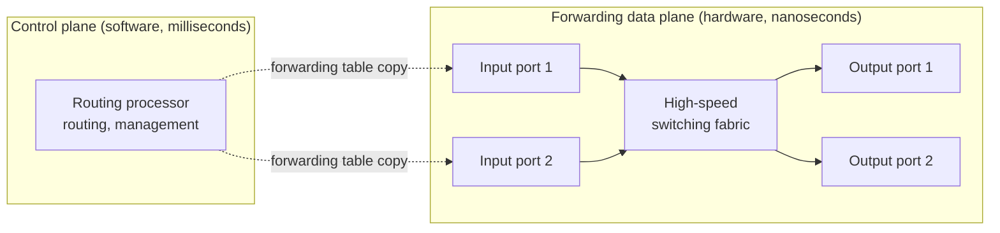
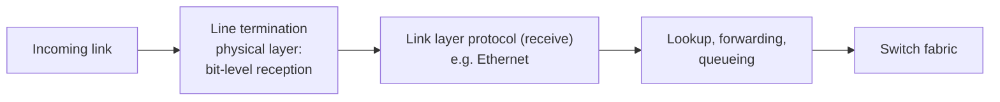
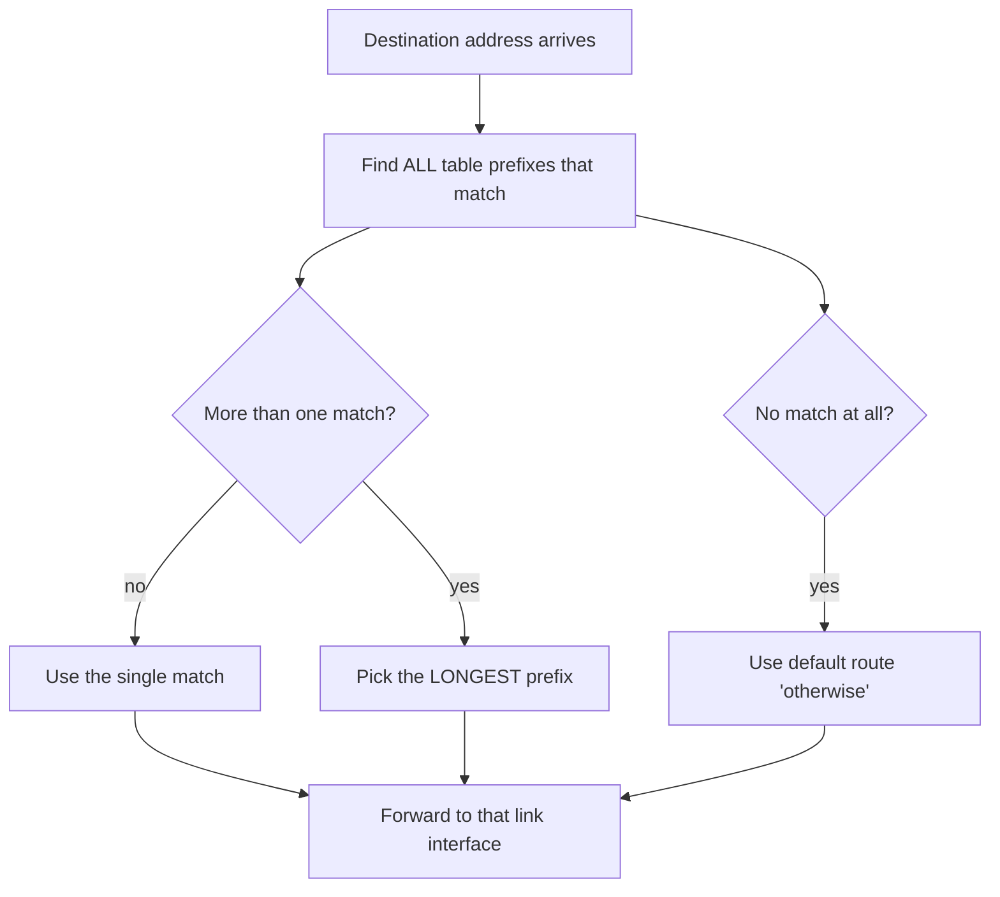
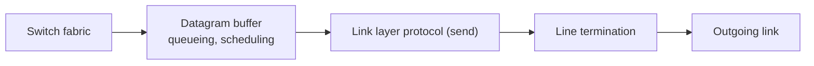

# Unit 4: Network Layer and Internet Protocol
## 4.2 What's Inside a Router?

> [!abstract] What this note covers
> Every slide of the 4.2 deck: generic router architecture, input port functions, destination-based vs generalized forwarding, the address-range forwarding table, longest prefix matching (with both slide examples solved), and TCAMs. All of it is expanded with full definitions, bit-level working, and exam-style questions.
> **"Beyond the slides"** = extra content added to fill gaps. **"Slide caveat"** = slide wording/rendering that needs clarification.
> Related notes: [[Network_Layer_Overview_Notes]] (4.1), [[Congestion_Control_Notes]] (Unit 3).

## Table of contents
1. [[#1. Where we are]]
2. [[#2. Glossary]]
3. [[#3. Router architecture overview]]
4. [[#4. Input port functions]]
5. [[#5. Destination-based forwarding]]
6. [[#6. Longest prefix matching]]
7. [[#7. TCAMs: how it is done at line speed]]
8. [[#8. Rest of the router (beyond the slides)]]
9. [[#9. Worked examples]]
10. [[#10. Practice questions with answers]]
11. [[#11. Cheat sheet]]

---

## 1. Where we are

| Section | Topic | Status |
|---|---|---|
| 4.1 | Overview of Network Layer | done: [[Network_Layer_Overview_Notes]] |
| **4.2** | **What's inside a router?** | **this note** |
| 4.3 | Switching | next |
| 4.4 | The Internet Protocol: datagram format, fragmentation, IPv4 addressing, NAT | next |

**Link with 4.1:** there we learned that **forwarding** (local, per-packet) uses a **forwarding table** filled in by **routing** (global). Now we open the box: *how does a router physically do forwarding, and how does it do the table lookup fast enough?*

---

## 2. Glossary

> [!info] Read this first.

| Term | Definition |
|---|---|
| **Router** | A network-layer device with several interfaces that receives datagrams on input ports and forwards them out of output ports based on header fields. |
| **Port / interface** | A physical connection point of a router to a link. Each port has an input side and an output side. |
| **Input port** | Receives bits from an incoming link, reconstructs the datagram, looks up the output port, and hands the datagram to the switch fabric. |
| **Output port** | Takes datagrams from the switch fabric, buffers them, and transmits them on the outgoing link. |
| **Switching fabric** | The high-speed internal "interconnect" that transfers datagrams from input ports to the correct output ports. |
| **Routing processor** | The router's general-purpose CPU running control-plane software: routing protocols, building routing/forwarding tables, management. |
| **Control plane** | Network-wide logic deciding *how* packets should be forwarded (routing, management). **Software; milliseconds** time scale. |
| **Data plane** | Per-packet, local forwarding operations. **Hardware; nanoseconds** time scale. |
| **Line termination** | Physical-layer function at the input port: bit-level reception of signals from the link. |
| **Link-layer protocol (receive)** | The data-link function at the input port, e.g. **Ethernet**: receives the frame and strips the frame header/trailer to extract the datagram. |
| **Lookup** | Searching the forwarding table for the entry that matches a datagram's header field(s). |
| **Match plus action** | Forwarding abstraction: *match* header-field values against table entries, then perform the entry's *action* (e.g. send to output port X). |
| **Decentralized switching** | Each input port performs lookup and forwarding **independently** using its own copy of the forwarding table, with no central per-packet processor. |
| **Line speed (wire speed)** | The rate at which bits arrive on the link. Processing "at line speed" means the port finishes handling each packet before the next one arrives, so no backlog builds up. |
| **Forwarding table** | Table mapping header values (or address prefixes) to output link interfaces. |
| **Destination-based forwarding** | Traditional forwarding: output port chosen **only from the destination IP address**. |
| **Generalized forwarding** | Forwarding based on **any set of header field values** (link, network or transport layer fields), the basis of SDN/OpenFlow. |
| **Address prefix** | The leading bits of an address, written with `*` for the remaining don't-care bits (e.g. `11001000 00010111 00010***...`) or in CIDR form `200.23.16.0/21`. |
| **Prefix length** | Number of fixed leading bits in a prefix (the `/21` in CIDR notation). |
| **Longest prefix match (LPM)** | Rule: among all table entries whose prefix matches the destination address, choose the one with the **longest** prefix. |
| **Default route ("otherwise")** | Catch-all entry with prefix length 0 (`0.0.0.0/0`); matches every address, so it is chosen only when nothing more specific matches. |
| **Input port queueing** | Datagrams waiting at an input port because they arrive faster than they can be transferred into the switch fabric. |
| **TCAM** | **Ternary Content-Addressable Memory**: hardware memory that compares a search key against all stored entries *in parallel*; each stored bit can be 0, 1, or *don't care*. |
| **Content addressable** | You present the *content* (the key, here an address) and the memory returns the matching entry/location, rather than you supplying a memory address. |
| **Ternary** | Three possible values per bit: 0, 1, **X (don't care)**. |
| **Clock cycle** | One tick of the hardware clock, the smallest unit of hardware timing. |

---

## 3. Router architecture overview

> [!quote] Slide
> **High-level view of generic router architecture.**

A router has four main building blocks:

| Component | Role |
|---|---|
| **Input ports** | Receive datagrams, perform lookup |
| **High-speed switching fabric** | Moves datagrams from input to output ports |
| **Output ports** | Queue and transmit datagrams |
| **Routing processor** | Runs the control plane |

### 3.1 The dashed line: control plane vs data plane

The slide splits the picture with a dashed line:

| | **Control plane** (above the line) | **Data plane** (below the line) |
|---|---|---|
| Slide label | "routing, management control plane" | "forwarding data plane" |
| Implemented in | **Software** | **Hardware** |
| Time frame | **Millisecond** | **Nanosecond** |
| Does | Runs routing protocols (e.g. OSPF, BGP), computes paths, builds the forwarding table, handles management | Per-packet lookup and transfer to the correct output port |
| Frequency | Occasionally (when topology/policy changes) | For *every* packet |

**Why the time scales differ:** A packet can arrive every few tens of nanoseconds on a fast link, so forwarding must be done in dedicated hardware. Route computation only needs to happen when something changes, so it can be slow software.

> [!example] Why "nanosecond"? (*beyond the slides*)
> At 10 Gbps, a minimum-size 64-byte packet (512 bits) lasts $512 / 10^{10} = 51.2$ ns on the wire. A new packet can therefore arrive every ~50 ns, and the router must finish its lookup and forwarding within that budget, otherwise packets pile up. At 100 Gbps the budget shrinks to ~5 ns.

The arrow from the routing processor into the input ports in the slide diagram is the **forwarding table being installed/updated** in each input port's memory.

> [!tip] Beyond the slides
> Real routers often use **line cards** (one per port or group of ports) that each contain a copy of the input/output logic, connected through the fabric to a central **route processor card**.

---

## 4. Input port functions

> [!quote] Slide
> The input port is a pipeline of three stages feeding into the switch fabric: **line termination → link layer protocol (receive) → lookup, forwarding, queueing → switch fabric**.

### 4.1 Stage by stage

| Stage | Layer | What it does |
|---|---|---|
| **Line termination** | Physical | **Bit-level reception**: converts the electrical/optical/radio signal into a stream of bits |
| **Link layer protocol (receive)** | Link | Frames the bits (e.g. **Ethernet**, covered in chapter 6), checks for errors, strips the frame header/trailer to obtain the **datagram** |
| **Lookup, forwarding, queueing** | Network | Reads header fields, **looks up the output port in the forwarding table**, forwards the datagram into the switch fabric, queueing if needed |

### 4.2 Decentralized switching (slide)

> [!quote] Slide
> - Using **header field values**, lookup output port using **forwarding table in input port memory** ("**match plus action**")
> - **Goal:** complete input port processing at '**line speed**'
> - **Input port queuing:** if datagrams arrive faster than forwarding rate into switch fabric

**Decentralized** = every input port has its **own local copy** of the forwarding table and does the lookup itself. This gives:
- **Parallelism**: with N ports, N lookups happen simultaneously
- **No central bottleneck**: a single central CPU doing lookups for all packets could never keep up
- **Speed**: the table is in fast memory right at the port

**Match plus action:**
1. **Match** the packet's header field(s) against the table entries.
2. **Action**: do what the matched entry says (here: send the datagram to output port *k*; in generalized forwarding it could also be drop, modify, copy, etc.).

**Line speed:** If the port can process packets as fast as they arrive on the link, it never becomes the bottleneck. If it cannot, a backlog builds up (input queueing, and eventually loss).

### 4.3 Input port queueing

Even with line-speed lookup, a queue can form at the input port when datagrams arrive **faster than they can be moved into the switch fabric** (the fabric's transfer rate is lower than the combined arrival rate, or the fabric is busy serving another input).

> [!warning] Beyond the slides: Head-of-line (HOL) blocking
> Suppose two datagrams at the head of two different input queues both want the **same output port**. Only one can cross the fabric at a time; the other waits. While it waits, **datagrams behind it in the same queue are also blocked**, even if their output ports are free. This is **HOL blocking**. Queueing delay and **loss due to input buffer overflow** can result.

Rule of thumb: if the fabric is at least **N times faster** than a single line rate (N = number of inputs), input queueing is eliminated.

### 4.4 Two styles of forwarding (slide)

| | **Destination-based forwarding** | **Generalized forwarding** |
|---|---|---|
| Rule | Forward based **only on destination IP address** (traditional) | Forward based on **any set of header field values** |
| Match on | Destination IP address (with longest prefix match) | e.g. source/destination IP, MAC address, TCP/UDP port numbers, protocol, VLAN... |
| Action | Output port | Forward, drop, rewrite fields, copy to controller, send to multiple ports... |
| Where used | Classic IP routers | **SDN / OpenFlow** switches ("match-action tables") |

Generalized forwarding is what lets one box behave like a router, switch, firewall, NAT or load balancer simply by changing table rules. (SDN is discussed in the next chapter of most syllabi.)

---

## 5. Destination-based forwarding

### 5.1 The slide's forwarding table

Addresses are 32 bits, written as four 8-bit groups.

| Destination address range | Link interface |
|---|---|
| `11001000 00010111 00010000 00000000` **through** `11001000 00010111 00010111 11111111` | **0** |
| `11001000 00010111 00011000 00000000` **through** `11001000 00010111 00011000 11111111` | **1** |
| `11001000 00010111 00011001 00000000` **through** `11001000 00010111 00011111 11111111` | **2** |
| otherwise | **3** |

> [!note] Slide caveat
> The rendered slide has overlapping text (an animation overlay), so the first and second rows look garbled. The table above is the standard version of this slide (Kurose & Ross) and matches the highlighted bits.

**Decoded to dotted decimal** (convert each 8-bit group: `11001000` = 200, `00010111` = 23):

| Range | Dotted decimal | Interface |
|---|---|---|
| `...00010000.00000000` to `...00010111.11111111` | 200.23.**16**.0 to 200.23.**23**.255 | 0 |
| `...00011000.00000000` to `...00011000.11111111` | 200.23.**24**.0 to 200.23.**24**.255 | 1 |
| `...00011001.00000000` to `...00011111.11111111` | 200.23.**25**.0 to 200.23.**31**.255 | 2 |
| anything else | n/a | 3 |

The yellow highlight in the slide marks the bits that vary inside a range.

### 5.2 Why a table of ranges?

- A **separate entry for each of the 2³² ≈ 4.3 billion** possible addresses is impossible.
- Instead, the table stores **ranges** of consecutive addresses that share the same outgoing link. A lookup checks which range contains the destination address.

### 5.3 The slide's question

> [!question] Q (slide)
> **But what happens if ranges don't divide up so nicely?**

In the table above, every range lined up on neat boundaries and no range was nested inside another. In reality:
- Ranges have different sizes, can **overlap**, and one range can contain a *special case* (exception) inside it.
- Example: addresses 200.23.24.0 to 200.23.31.255 mostly go to interface 2, but the **200.23.24.x** block must go to interface 1. If you write the second as "an exception inside the first" instead of splitting the big range into separate pieces, the table becomes much smaller, **but now two entries match some addresses**.

**Answer: use the *longest prefix match* rule.** It resolves overlaps cleanly.

---

## 6. Longest prefix matching

> [!quote] Slide: longest prefix match
> When looking for a forwarding table entry for a given destination address, use the **longest** address prefix that matches the destination address.

### 6.1 Prefix notation

A **prefix** fixes the first *k* bits and leaves the rest as don't-care (`*`). A datagram matches a prefix if its first *k* bits equal the prefix bits.

The slide's table in prefix form:

| Destination address prefix | Prefix length | CIDR form | Link interface |
|---|---|---|---|
| `11001000 00010111 00010*** ********` | 21 bits | 200.23.16.0/21 | **0** |
| `11001000 00010111 00011000 ********` | 24 bits | 200.23.24.0/24 | **1** |
| `11001000 00010111 00011*** ********` | 21 bits | 200.23.24.0/21 | **2** |
| otherwise | 0 bits | 0.0.0.0/0 | **3** |

Counting the fixed bits: 8 + 8 + 5 = **21** for the 1st and 3rd; 8 + 8 + 8 = **24** for the 2nd. A prefix of length *k* covers $2^{32-k}$ addresses: a /21 covers $2^{11} = 2048$ addresses; a /24 covers $2^8 = 256$.

**Notice the overlap:** prefix 3 (`00011***`, /21) *contains* prefix 2 (`00011000`, /24), because `00011000` starts with `00011`. This is exactly the "ranges don't divide nicely" situation.

### 6.2 The algorithm

1. Compare the destination address with **every** prefix in the table.
2. Collect all entries that **match**.
3. Pick the one with the **longest prefix length** (the most specific).
4. Forward on that entry's interface. If nothing else matches, the default ("otherwise") entry wins.

### 6.3 The slide's two examples, solved

**Example 1:** `11001000 00010111 00010110 10100001`  (= 200.23.22.161)

| Prefix | Interface | Matches? |
|---|---|---|
| `11001000 00010111 00010` (21 bits) | 0 | Yes: first 21 bits are `11001000 00010111 00010` ✓. (third octet `00010110` starts with `00010`) |
| `11001000 00010111 00011000` (24 bits) | 1 | No: third octet `00010110` ≠ `00011000` |
| `11001000 00010111 00011` (21 bits) | 2 | No: third octet starts `00010`, not `00011` |
| otherwise | 3 | matches everything (length 0) |

Matches: entry 0 (21 bits) and the default (0 bits). **Longest = entry 0, so the answer is interface 0.** (The slide highlights exactly this match.)

**Example 2:** `11001000 00010111 00011000 10101010`  (= 200.23.24.170)

| Prefix | Interface | Matches? |
|---|---|---|
| `11001000 00010111 00010` | 0 | No: third octet starts `00011` |
| `11001000 00010111 00011000` (24 bits) | 1 | **Yes**: third octet `00011000` ✓ |
| `11001000 00010111 00011` (21 bits) | 2 | **Yes**: third octet starts `00011` ✓ |
| otherwise | 3 | Yes (0 bits) |

Three entries match, with lengths 24, 21 and 0. **Longest = 24 bits, so the answer is interface 1.** (The slide highlights `11001000 00010111 00011000`.)

> [!success] Intuition
> The longer the matching prefix, the **more specific** the entry is about *this* destination. A specific route is an exception to a general route; the most specific one should win. It is like a postal system: "Flat 5, 12 MG Road, Bengaluru" overrides "Bengaluru".

### 6.4 Why LPM is used (the teaser on the slide) *(beyond the slides)*

> [!quote] Slide
> We'll see *why* longest prefix matching is used shortly, when we study addressing.

The reason is **address aggregation (CIDR)** in IPv4 addressing, covered in 4.4:
- An ISP owns one big block (e.g. 200.23.16.0/20) and **advertises just that one prefix** to the rest of the Internet. This keeps the global routing tables small.
- If one customer inside that block moves to another ISP, the *new* ISP advertises a **more specific** prefix (e.g. a /24 from inside the block). Routers then hold both the general and the specific entry, and **LPM sends that customer's traffic to the right ISP** while everyone else still follows the aggregate.

So LPM enables **aggregation with exceptions**, which is what makes Internet-scale routing tables manageable.

---

## 7. TCAMs: how it is done at line speed

> [!quote] Slide
> - Longest prefix matching is often performed using **ternary content addressable memories (TCAMs)**.
> - **Content addressable:** present address to TCAM: retrieve address in **one clock cycle, regardless of table size**.
> - **Cisco Catalyst:** ~**1M** routing table entries in TCAM.

### 7.1 The problem
A software search (a linear scan or even a tree walk) of a million-entry table takes too many steps for a 50 ns budget.

### 7.2 What a TCAM is
- A normal RAM: *you* give an **address**, it returns the **data** stored there.
- A **CAM** (content-addressable memory): *you* give the **data (the key)**, it returns the **address/location** of the matching entry. It compares the key against **all entries simultaneously** (in parallel hardware).
- A **TCAM** (ternary CAM): each stored bit can be **0, 1, or X (don't care)**. The don't-care state is exactly what prefixes need: `00011***` is stored as `0 0 0 1 1 X X X`...

### 7.3 How LPM is done in a TCAM
1. Store entries **sorted by prefix length, longest first** (e.g. all /32s, then /31s, ... down to /0).
2. Present the destination address; **all entries compare in parallel** in a single clock cycle.
3. Several entries may match; a **priority encoder** outputs the **first (topmost) matching entry**, which is automatically the longest prefix.
4. That entry's stored action (output port) is returned.

| Property | Value |
|---|---|
| Lookup time | **1 clock cycle, independent of table size** |
| Capacity example | Cisco Catalyst: ~**1M** entries |
| Downsides (*beyond the slides*) | **Expensive, power-hungry, heat-generating, limited size**; updating (re-sorting) entries is awkward |

> [!tip] Beyond the slides: software alternatives
> When TCAM is not used, LPM can be done with a **binary trie / Patricia trie** (walk the address bits from the left, remembering the last node that held a route) or optimised multibit tries and hashing. They use cheaper memory but need several memory accesses per lookup.

---

## 8. Rest of the router (beyond the slides)

The slides stop after the input port, but a full "inside a router" picture also includes these (they are developed in 4.3 and are good to know now).

### 8.1 Switching fabric: three classic designs
| Fabric | How it works | Limit |
|---|---|---|
| **Switching via memory** | First-generation: input port interrupts the CPU, packet is copied into memory and then to output | Memory bandwidth (each packet crosses the bus twice) |
| **Switching via a bus** | Input ports transfer directly to output ports over a shared bus | Bus bandwidth (one packet at a time) |
| **Switching via an interconnection network (crossbar)** | N×N grid of crosspoints; multiple non-conflicting transfers happen in parallel | Hardware complexity; contention for the same output |

### 8.2 Output port functions

- **Buffering** is needed when datagrams arrive from the fabric **faster than the output link can transmit** them.
- **Packet scheduling** decides which queued packet is sent next (FIFO, priority, round robin, weighted fair queueing).
- **Drop policy** decides what to drop when the buffer is full (**tail drop**, or smarter schemes such as RED). 
- **Output port queueing and buffer overflow are the real cause of the packet loss and delay** that we met in [[Congestion_Control_Notes#3. What is congestion?]].
- Buffer sizing rule of thumb: RFC 3439 suggests $B = RTT \times C$ (average RTT times link capacity); newer work suggests $B = \dfrac{RTT \times C}{\sqrt{N}}$ for $N$ flows.

---

## 9. Worked examples

### Example 1: Run LPM on a full set of addresses
Table (from the slides):

| Prefix | Interface |
|---|---|
| 200.23.16.0/21 (`11001000 00010111 00010***`) | 0 |
| 200.23.24.0/24 (`11001000 00010111 00011000`) | 1 |
| 200.23.24.0/21 (`11001000 00010111 00011***`) | 2 |
| otherwise (0.0.0.0/0) | 3 |

| Destination | Third octet in binary | Matching entries | Winner | Interface |
|---|---|---|---|---|
| 200.23.22.161 | `00010110` | /21 (→0), default | /21 (→0) | **0** |
| 200.23.24.170 | `00011000` | /24 (→1), /21 (→2), default | /24 | **1** |
| 200.23.28.5 | `00011100` | /21 (→2), default (third octet 28 ≠ 24 so the /24 fails) | /21 (→2) | **2** |
| 200.23.15.1 | `00001111` | default only | default | **3** |
| 200.23.32.7 | `00100000` | default only | default | **3** |
| 200.24.16.1 | second octet `00011000` ≠ `00010111` | default only | default | **3** |

### Example 2: How to convert a range to a prefix
Range: `11001000 00010111 00010000 00000000` to `11001000 00010111 00010111 11111111`.
1. Find the leading bits that are identical across the whole range: `11001000 00010111 00010` (21 bits).
2. The remaining 11 bits run from all 0s to all 1s, so the range is exactly `11001000 00010111 00010***********`.
3. Prefix length 21. Number of addresses $= 2^{11} = 2048$.
4. In dotted decimal: **200.23.16.0/21**, covering 200.23.16.0 to 200.23.23.255.

### Example 3: Why exceptions help (table size)
Without LPM, to send 200.23.24.x to interface 1 and the rest of 200.23.24.0 to 200.23.31.255 to interface 2, you must split the big block into separate ranges (24.x, 25.x, ..., 31.x). With LPM you store **two** entries (a /21 and a /24 exception). Across the Internet, this saving multiplies enormously.

### Example 4: Packet budget at line speed
Link 40 Gbps, minimum packet 64 bytes = 512 bits. Time per packet $= 512 / (40 \times 10^9) = 12.8$ ns. The input port must finish its lookup in under ~12.8 ns, so a software scan is impossible and TCAM-like hardware is needed.

### Example 5: Which plane?
| Event | Plane |
|---|---|
| Router receives a datagram and sends it out of port 3 | Data plane (hardware, ns) |
| Router runs OSPF and recomputes shortest paths | Control plane (software, ms) |
| Routing processor installs new forwarding table in input ports | Control plane acting on the data plane |
| TCAM returns the matching entry | Data plane |

---

## 10. Practice questions with answers

**Q1. Name the four main components of a generic router and what each does.**
Input ports (receive, lookup), switching fabric (transfers datagrams from inputs to outputs), output ports (queue and transmit), routing processor (runs the control plane).

**Q2. Differentiate control plane and data plane in a router.**
Control plane: routing and management, in software, millisecond time scale. Data plane: per-packet forwarding, in hardware, nanosecond time scale.

**Q3. Why must the data plane be in hardware?**
Packets can arrive every few tens of nanoseconds on fast links; software cannot do lookups that fast.

**Q4. List the input port functions, with their layer.**
Line termination (physical layer, bit-level reception); link layer protocol, e.g. Ethernet (link layer); lookup, forwarding and queueing (network layer).

**Q5. What is "decentralized switching"?**
Each input port does its own lookup using a local copy of the forwarding table, instead of a central processor handling every packet.

**Q6. Explain "match plus action".**
Match header field values against table entries; the matching entry's action (e.g. output port) is applied to the packet.

**Q7. What is meant by processing at "line speed"?**
The port handles each packet as fast as packets arrive on the link, so it does not become a bottleneck or build up a backlog.

**Q8. When does input port queueing occur?**
When datagrams arrive faster than they can be transferred into the switch fabric (e.g. the fabric is busy or two inputs want the same output). It can cause HOL blocking.

**Q9. Destination-based vs generalized forwarding?**
Destination-based: output port chosen only from the destination IP address. Generalized: any set of header fields (link, network, transport) can be matched, with richer actions (SDN/OpenFlow).

**Q10. State the longest prefix match rule.**
Of all table prefixes that match the destination address, use the longest one.

**Q11. Forward 11001000 00010111 00010110 10100001 and 11001000 00010111 00011000 10101010 with the slide's table.**
First: interface 0 (matches the 21-bit prefix `...00010`). Second: interface 1 (the 24-bit prefix `...00011000` beats the 21-bit `...00011`).

**Q12. How many addresses does a /21 prefix cover? A /24?**
$2^{32-21} = 2048$; $2^{32-24} = 256$.

**Q13. What does the "otherwise" row represent, and why does it never beat a more specific match?**
A default route (prefix length 0). It matches everything but has the shortest possible length, so any real match wins.

**Q14. What is a TCAM and why is it used?**
A ternary content-addressable memory compares the destination address with all stored prefixes in parallel; bits can be 0, 1 or don't-care. It returns the best match in one clock cycle regardless of table size, which achieves line-speed LPM.

**Q15. How does a TCAM make sure the *longest* prefix wins?**
Entries are stored in order of decreasing prefix length, and a priority encoder returns the first matching entry.

**Q16. Give a disadvantage of TCAMs.**
They are costly, consume a lot of power and generate heat, and have limited capacity.

**Q17. A router table has 10.0.0.0/8 → A, 10.1.0.0/16 → B, 10.1.2.0/24 → C. Where do 10.1.2.9, 10.1.9.9 and 10.9.9.9 go?**
10.1.2.9 → C (/24 longest); 10.1.9.9 → B (/16 matches, /24 doesn't); 10.9.9.9 → A (only /8 matches).

**Q18. Why can't a router keep one table entry per IP address?**
There are $2^{32}$ (~4.3 billion) IPv4 addresses; storing and searching so many entries is infeasible. Prefixes aggregate many addresses per entry.

---

## 11. Cheat sheet

> [!summary] One-page revision

**Router = input ports + switching fabric + output ports + routing processor.**

| | Control plane | Data plane |
|---|---|---|
| What | Routing, management | Forwarding |
| How | Software (routing processor) | Hardware (ports + fabric) |
| Speed | **milliseconds** | **nanoseconds** |

**Input port pipeline:** line termination (physical, bits) → link layer receive (e.g. Ethernet) → lookup/forwarding/queueing → switch fabric.

**Key ideas**
- **Decentralized switching**: each input port has a copy of the forwarding table.
- **Match plus action**; goal = **line speed**.
- **Input queueing** if arrivals > rate into fabric (HOL blocking).
- **Destination-based** (dest IP only) vs **generalized** (any header fields).

**Longest prefix match**
- Many entries may match; pick the **longest** prefix.
- Prefix length *k* covers $2^{32-k}$ addresses.
- Default route (/0) = "otherwise".
- Why: **aggregation with exceptions** (CIDR, coming in 4.4).

| Slide example | Address | Winner | Interface |
|---|---|---|---|
| 1 | 11001000 00010111 000**10**110 10100001 | 21-bit `...00010` | **0** |
| 2 | 11001000 00010111 00011000 10101010 | 24-bit `...00011000` | **1** |

**TCAM:** ternary (0/1/X) content-addressable memory; all entries compared in parallel; **one clock cycle regardless of table size**; entries sorted longest prefix first; priority encoder; ~1M entries on a Cisco Catalyst; costly and power-hungry.

---
*Source: PES University Computer Networks, Team Networks, Unit 4 slides (4.2). Extra material follows the standard treatment in Kurose & Ross, "Computer Networking: A Top-Down Approach".*
