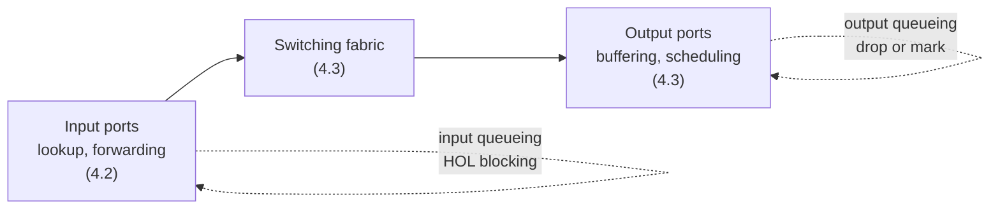
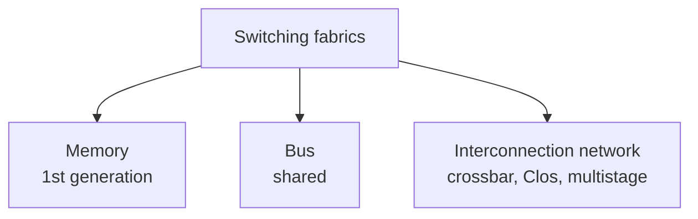
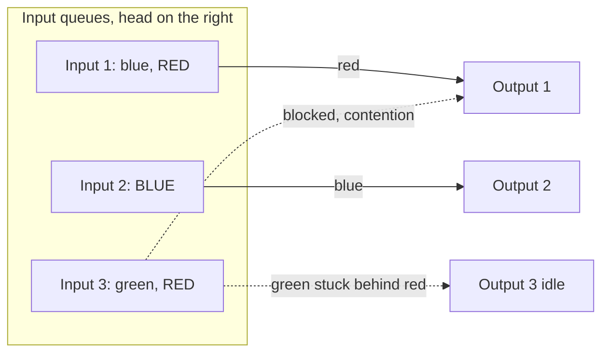
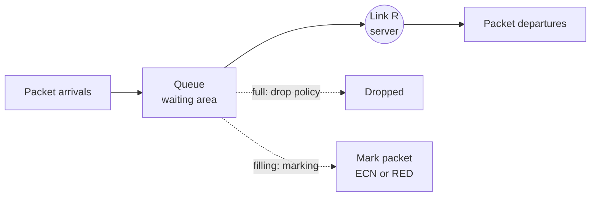

# Unit 4: Network Layer and Internet Protocol
## 4.3 Switching

> [!abstract] What this note covers
> Every slide of the 4.3 deck: switching rate, the three switching fabrics (memory, bus, interconnection network incl. crossbar/Clos/multistage and the Cisco CRS), input port queueing and head-of-line blocking, output port queueing, how much buffering, and buffer management (drop, marking, ECN, RED). All expanded with definitions, worked numbers and exam-style questions.
> **"Beyond the slides"** = extra material. **"Slide caveat"** = wording that needs clarification.
> Related notes: [[Router_Architecture_Forwarding_Notes]] (4.2), [[Network_Layer_Overview_Notes]] (4.1), [[Congestion_Control_Notes]] (Unit 3).

## Table of contents
1. [[#1. Where we are]]
2. [[#2. Glossary]]
3. [[#3. Switching fabrics: the big picture]]
4. [[#4. Switching via memory]]
5. [[#5. Switching via a bus]]
6. [[#6. Switching via an interconnection network]]
7. [[#7. Input port queueing and HOL blocking]]
8. [[#8. Output port queueing]]
9. [[#9. How much buffering?]]
10. [[#10. Buffer management]]
11. [[#11. Worked examples]]
12. [[#12. Practice questions with answers]]
13. [[#13. Cheat sheet]]

---

## 1. Where we are

| Section | Topic | Status |
|---|---|---|
| 4.1 | Overview of Network Layer | done: [[Network_Layer_Overview_Notes]] |
| 4.2 | What's inside a router? (input ports, lookup, LPM, TCAM) | done: [[Router_Architecture_Forwarding_Notes]] |
| **4.3** | **Switching** | **this note** |
| 4.4 | The Internet Protocol: datagram format, fragmentation, IPv4 addressing, NAT | next |

**Link with 4.2:** the input port has looked up the output port. Now: *how does the datagram physically get across the router to that output port (the switching fabric), and what happens when several datagrams want the same port at once (queueing)?*



---

## 2. Glossary

> [!info] Read this first.

| Term | Definition |
|---|---|
| **Switching** | Transferring a packet from an input link (port) of a router to the appropriate output link (port). |
| **Switching fabric** | The router's internal hardware that performs the input-to-output transfer. |
| **Line rate (R)** | The transmission rate of one input or output link. |
| **Switching rate** | The rate at which packets can be transferred from inputs to outputs through the fabric. Usually quoted as a multiple of the line rate. |
| **Memory bandwidth** | How many bytes per second can be read/written to a memory. |
| **System bus** | A shared set of wires over which only one transfer happens at a time. |
| **Bus contention** | Multiple ports wanting the shared bus at once; only one gets it, the others wait. |
| **Crossbar** | An N×N grid of wires with a switch (crosspoint) at each intersection. Closing crosspoint (i, j) connects input i to output j. |
| **Crosspoint** | A single switching element at a row/column intersection of a crossbar. |
| **Non-blocking** | A fabric that can transfer packets from any set of distinct inputs to distinct outputs simultaneously with no internal conflict. |
| **Clos network** | A multistage (typically 3-stage) interconnection network built from smaller crossbars, using far fewer crosspoints than one big crossbar. |
| **Multistage switch** | An n×n switch assembled from several stages of smaller switches. |
| **Cell** | A fixed-length unit used *inside* the fabric (different from an IP datagram). |
| **Switching plane** | One independent copy of a fabric; several planes work in parallel to raise capacity. |
| **Input port queueing** | Datagrams waiting at an input port because the fabric cannot accept them yet. |
| **Output port contention** | Two or more inputs trying to send to the *same* output port in the same time slot. |
| **HOL (head-of-the-line) blocking** | The packet at the front of an input queue, blocked, prevents the packets behind it from moving even if their output ports are idle. |
| **Output port queueing** | Datagrams buffered at an output port because they arrive from the fabric faster than the output link can send them. |
| **Buffer** | Memory that holds queued packets. |
| **Drop policy** | Rule deciding which packet to discard when the buffer is full. |
| **Tail drop** | Drop the newly arriving packet when the queue is full. |
| **Scheduling discipline** | Rule that picks the next queued packet to transmit (FIFO, priority, round robin, WFQ...). |
| **Priority scheduling** | Higher-priority packets are always served before lower-priority ones. |
| **Network neutrality** | Principle that ISPs should treat all Internet traffic equally (no favouring or throttling by source, application or payer). |
| **Marking** | Setting a bit in a packet header to signal congestion instead of dropping it. |
| **ECN** | Explicit Congestion Notification: router marks packets; end hosts react. |
| **RED** | Random Early Detection: router drops/marks packets *probabilistically* as the average queue grows, before the buffer is full. |
| **Bufferbloat** | Excessive buffering that causes large queueing delay (long RTTs). |
| **BDP (bandwidth-delay product)** | $\text{link capacity} \times \text{RTT}$ = amount of data "in the pipe". |

---

## 3. Switching fabrics: the big picture

> [!quote] Slide
> - Transfer packet from **input link to appropriate output link**
> - **Switching rate:** rate at which packets can be transferred from inputs to outputs
>   - often measured as a **multiple of input/output line rate**
>   - **N inputs: switching rate N times line rate desirable**

**Why N times R?** Suppose a router has N input ports and N output ports, each running at line rate R. In the worst case all N inputs receive a packet at the same instant, and they all go to *different* outputs. To avoid any waiting, the fabric must carry N×R in total. A fabric slower than that causes **input queueing** (section 7).

Slide figure: N input ports (each R) → high-speed switching fabric (rate: **NR, ideally**) → N output ports (each R).

### Three major types of switching fabrics (slide)



| Fabric | Packets moved at once | Bottleneck | Era / use |
|---|---|---|---|
| **Memory** | 1 | Memory bandwidth (2 bus crossings per datagram) | First-generation routers |
| **Bus** | 1 | Bus bandwidth (bus contention) | Access/enterprise routers (e.g. 32 Gbps bus, Cisco 5600) |
| **Interconnection network** | **Many in parallel** | Output contention, hardware cost | High-end core routers (e.g. Cisco CRS) |

---

## 4. Switching via memory

> [!quote] Slide: first generation routers
> - Traditional computers with switching **under direct control of the CPU**
> - Packet **copied to system's memory**
> - Speed **limited by memory bandwidth (2 bus crossings per datagram)**

**How it works (step by step), matching the slide's picture** (input port, memory, output port, all on a *system bus*):
1. A packet arrives at the input port (e.g. an Ethernet card).
2. The input port signals the CPU (interrupt).
3. The CPU reads the packet **from the input port into memory** (bus crossing #1).
4. The CPU examines the header, looks up the output port in the forwarding table.
5. The CPU **copies the packet from memory to the output port** (bus crossing #2).

This is just a **general-purpose computer acting as a router**.

**Throughput limit:** if the memory can read or write $B$ packets per second, each packet needs one write + one read = **2 memory/bus operations**. So the forwarding rate is at most $B/2$ packets/sec. Moreover, only one packet is handled at a time.

> [!tip] Beyond the slides
> Modern routers that resemble "switching via memory" (e.g. Cisco Catalyst 8500 series) use **shared memory with the lookup done by the input line card**, not the central CPU, which removes the CPU bottleneck. The slide describes the original first-generation design.

---

## 5. Switching via a bus

> [!quote] Slide
> - Datagram from **input port memory to output port memory via a shared bus**
> - **Bus contention:** switching speed limited by **bus bandwidth**
> - **32 Gbps bus, Cisco 5600:** sufficient speed for **access routers**

**How it works:**
1. The input port gets a packet and does its own lookup (as in 4.2).
2. It attaches an **internal tag** (the output port number) and sends the packet across the **shared bus** to *all* output ports.
3. Only the output port matching the tag keeps it; the others discard it.
4. The packet is placed in that output port's buffer.

**Key properties**
- The CPU is **not** involved per packet (improvement over memory switching): lookup is decentralised at input ports.
- **Only one packet can be on the bus at a time.** If several packets arrive simultaneously, **all but one wait** (bus contention). 
- The **bus bandwidth caps the total switching rate**: the sum over all ports can't exceed the bus speed.

> [!example] Why 32 Gbps is "sufficient for access routers"
> An access router with e.g. 24 ports at 1 Gbps would need 24 Gbps in the worst case, which fits in 32 Gbps. A core router with 16 ports at 100 Gbps would need 1.6 Tbps, so a bus can't keep up.

---

## 6. Switching via an interconnection network

> [!quote] Slide
> **Crossbar, Clos networks, other interconnection nets** were *initially developed to connect processors in a multiprocessor*.

### 6.1 Crossbar (the 3×3 in the slide)

An N×N crossbar has N horizontal lines (inputs) and N vertical lines (outputs), with a switch at every intersection: **N² crosspoints**.

```
          out1  out2  out3
  in1 ──── o ──── o ──── o
            |      |      |
  in2 ──── o ──── o ──── o
            |      |      |
  in3 ──── o ──── o ──── o
```

- To send input *i* to output *j*, **close crosspoint (i, j)**.
- **Multiple packets can cross at the same time** as long as they use **different inputs and different outputs**. This is the big advantage over memory/bus.
- A crossbar is **non-blocking** *inside* the fabric: a packet is only held up if its **output** is busy with another packet in that slot (output port contention) or its input is busy.
- Drawback: **N² crosspoints** become expensive as N grows.

### 6.2 Multistage switches (Clos networks)

> [!quote] Slide
> **Multistage switch:** an n×n switch built from **multiple stages of smaller switches**.

The slide's picture: an **8×8 multistage switch built from smaller-sized switches**: a first stage, a middle stage and a last stage (3 stages).

- Fewer total crosspoints than one big crossbar for large sizes.
- Multiple paths exist between any input and output (the middle-stage switches), giving parallelism and fault tolerance.

> [!example] Crosspoint comparison (*beyond the slides*)
> **1024×1024:** a single crossbar needs $1024^2 = 1{,}048{,}576$ crosspoints.
> A 3-stage Clos with $n = 32$ inputs per first-stage switch, $r = 32$ first-stage switches, and $m = 2n-1 = 63$ middle switches (strictly non-blocking) needs $2\cdot r\cdot n\cdot m + m \cdot r^2 = 2(32)(32)(63) + 63(32)^2 = 193{,}536$, roughly **5.4× fewer**.
> For the tiny 8×8 in the slide (two 4×4 input switches, four 2×2 middle switches, two 4×4 output switches) the count is 32 + 16 + 32 = 80, versus 64 for a crossbar, so the saving only appears at large sizes.

### 6.3 Exploiting parallelism with cells

> [!quote] Slide
> - **Fragment datagram into fixed-length cells on entry**
> - **Switch cells through the fabric, reassemble datagram at exit**

Why? Datagrams have variable length. Slicing them into **equal-sized cells** lets the fabric run in synchronised "cell times" and lets one datagram be spread across several parallel paths/planes.

> [!warning] Slide caveat
> This "fragmentation into cells" is **internal to the router fabric**. It is **not** IP fragmentation (which is covered in 4.4). The cells are created at input and reassembled at output, invisible outside the router.

### 6.4 Scaling with multiple switching planes

> [!quote] Slide
> **Scaling, using multiple switching "planes" in parallel** (speedup, scale-up via parallelism).
> **Cisco CRS router:** basic unit = **8 switching planes**; each plane = **3-stage interconnection network**; up to **100's of Tbps** switching capacity.

Idea: build several identical fabric planes (plane 0 to plane 7) and **spray the cells of each datagram across all planes**; each plane carries a fraction of the traffic, so total capacity multiplies by the number of planes.

---

## 7. Input port queueing and HOL blocking

> [!quote] Slide
> - If the **switch fabric is slower than the input ports combined**, queueing may occur at **input queues**
>   - **queueing delay and loss due to input buffer overflow!**
> - **Head-of-the-Line (HOL) blocking:** a queued datagram at the front of the queue **prevents others in the queue from moving forward**

### 7.1 Output port contention
Two packets at different inputs both need the same output in the same slot. The fabric can only deliver one; **the other is blocked and waits**.

### 7.2 The slide's picture, step by step

Colours = destination output port: **red** → output 1, **blue** → output 2, **green** → output 3. (Packets enter from the left, so the right-most is at the head of each queue.)

**Time t (left diagram)**
| Input | Queue (head first) |
|---|---|
| Input 1 | red, then blue |
| Input 2 | blue |
| Input 3 | red, then green |

- Input 1's red → output 1 ✓
- Input 2's blue → output 2 ✓
- Input 3's red also wants output 1: **output port contention**, only one red can go; the **lower red packet is blocked**.

**One packet time later (right diagram)**
- Input 3's red is **still stuck at the head**, so the **green packet behind it cannot move**, **even though its output port (3) is completely idle**. That is **HOL blocking: "green packet experiences HOL blocking".**



### 7.3 Consequences and remedies *(beyond the slides)*
- **Delay and loss** (input buffer overflow).
- With FIFO input queues and uniform random traffic, HOL blocking limits throughput to about **58.6% (2 − √2)** of line rate for large N.
- **Remedies:** 
  1. **Virtual output queues (VOQ):** each input keeps a separate queue per output, so a blocked packet doesn't block others; a scheduler (matching algorithm) decides which transfers happen each slot.
  2. **Speedup:** run the fabric faster than the line rate (ideally N×R, as stated in section 3).
  3. **Output-queued or combined input-output queued** designs.

---

## 8. Output port queueing

> [!important] The deck marks this with a warning sign: **"This is a really important slide."**

Output port structure (slide): **switch fabric (rate: NR) → datagram buffer + queueing/scheduling → link layer protocol (send) → line termination → outgoing link (rate R)**.

> [!quote] Slide
> - **Buffering** required when datagrams arrive from fabric **faster than link transmission rate**.
> - **Drop policy:** which datagrams to drop if no free buffers?  → *Datagrams can be lost due to congestion, lack of buffers.*
> - **Scheduling discipline** chooses among queued datagrams for transmission → *Priority scheduling: who gets best performance, network neutrality.*

### 8.1 Why do queues form at the output?
The fabric can deliver up to **N×R** into a single output port, but the link sends at only **R**. If several inputs send to the same output simultaneously, the arrival rate exceeds R and the excess must wait.

> [!example] Slide animation: "at t, packets move from input to output; one packet time later"
> Several packets (red from two different inputs) move to the same output (red); only one can be transmitted per packet time, so the other **queues in the output buffer** while the output link transmits the first. Next packet time, it's the second one's turn.

> [!success] Key slide statements
> - **Buffering when arrival rate via switch exceeds output line speed.**
> - **Queueing (delay) and loss due to output port buffer overflow!**

**This is where congestion loss actually happens.** It is the physical origin of the **delay and packet loss** discussed in [[Congestion_Control_Notes#3. What is congestion?]]: router buffers fill up and overflow. TCP's loss-based reaction (cwnd halving) is a response to *exactly this event*.

### 8.2 Drop policy
When the buffer is full and another packet arrives, something must go: the arriving packet (**tail drop**), or an already-queued packet chosen by priority/random (see section 10).

### 8.3 Scheduling discipline
Decides **which queued packet is transmitted next**.

| Discipline | Idea |
|---|---|
| **FIFO** | First come, first served |
| **Priority** | Always serve the highest-priority non-empty class first |
| **Round robin** | Take one packet from each class in turn |
| **Weighted fair queueing (WFQ)** | Round robin where classes get different shares (weights) of the link |

### 8.4 Priority scheduling and network neutrality
Priority scheduling raises the question the slide asks: **who gets the best performance?** If a router serves some traffic first (e.g. a paying customer's video, or the ISP's own service), others experience longer delays or more loss.

**Network neutrality** is the policy position that ISPs should *not* discriminate among traffic by source, destination, application or payment.
- *Arguments for neutrality:* keeps the Internet open to small innovators; prevents ISPs acting as gatekeepers.
- *Arguments for allowing prioritisation:* some traffic (VoIP, telemedicine) genuinely needs low delay; paid prioritisation may fund infrastructure; traffic management is sometimes needed.
- Legal treatment varies by country. Exams normally expect you to define it and link it to scheduling.

---

## 9. How much buffering?

> [!quote] Slide
> - **RFC 3439 rule of thumb:** average buffering equal to a "typical" RTT (say **250 msec**) × link capacity **C**
>   - e.g. **C = 10 Gbps link: 2.5 Gbit buffer**
> - **More recent recommendation:** with **N flows**, buffering equal to
> $$\frac{\text{RTT}\cdot C}{\sqrt{N}}$$
> - But **too much buffering can increase delays** (particularly in home routers)
>   - long RTTs: **poor performance for real-time apps, sluggish TCP response**
>   - recall **delay-based congestion control**: "keep bottleneck link just full enough (busy) but no fuller"

### 9.1 Where the rule comes from
$\text{RTT} \times C$ is the **bandwidth-delay product**: the amount of data that fills the pipe for one RTT. If the buffer is that big, then when TCP halves its window after a loss, the bottleneck link still has enough queued data to **stay busy** (full utilisation) while the sender backs off.

**Check:** $0.25\ \text{s} \times 10 \times 10^9\ \text{bit/s} = 2.5 \times 10^9$ bits = **2.5 Gbit** ≈ 312.5 MB. ✓ matches the slide.

### 9.2 The newer √N rule
With many (N) independent TCP flows, their sawtooth patterns are not synchronised, so the aggregate fluctuates much less than a single flow. A smaller buffer then suffices:
$$B = \frac{\text{RTT}\cdot C}{\sqrt{N}}$$
For $N = 10{,}000$ flows on the same 10 Gbps / 250 ms link: $2.5\ \text{Gbit}/\sqrt{10000} = 2.5\ \text{Gbit}/100 = $ **25 Mbit** (about 3 MB), a 100× reduction.

### 9.3 Too much buffering: bufferbloat
A large buffer never drops, so it keeps filling up, and **every packet waits behind a long queue**.

**Queueing delay** = queue size / link rate. 

> [!example] Home router
> 1 MB (8 Mbit) buffer on a 10 Mbps uplink: when full, delay = 8 Mbit / 10 Mbps = **0.8 s** added to every packet. Real-time apps (video calls, gaming) become unusable and TCP gets its congestion signal (loss) very late, so it reacts sluggishly.

**Delay-based congestion control** (the slide's "recall"): senders watch RTT growth as the congestion signal and aim to keep the bottleneck "**just full enough (busy) but no fuller**", i.e. keep the standing queue near zero. (Beyond the slides: examples are TCP Vegas and Google's BBR.)

> [!summary] Take-away
> Too little buffer → loss and under-utilisation. Too much buffer → huge delay. The right amount is about one BDP (single flow) or BDP/√N (many flows).

---

## 10. Buffer management

> [!quote] Slide
> **Buffer management:**
> - **Drop:** which packet to add, drop when buffers are full
>   - **tail drop:** drop arriving packet
>   - **priority:** drop/remove on priority basis
> - **Marking:** which packets to mark to signal congestion (**ECN, RED**)

**Abstraction (slide): a queue.** Packet arrivals → **queue (waiting area)** → **link (server, rate R)** → packet departures. The buffer is the waiting area; the link is the server; scheduling picks who enters the server next.



| Mechanism | What happens | Pros | Cons |
|---|---|---|---|
| **Tail drop** | When full, discard the newly arriving packet | Trivial to implement | Can hit many flows at once (global TCP synchronisation); drops only after the queue is already full (high delay) |
| **Priority drop** | Discard (or push out) lower-priority packets first | Protects important traffic | Needs classification; can starve low priority |
| **Marking (ECN)** | Router sets the CE bits in the IP header; receiver echoes it in TCP (ECE); sender reduces cwnd | **Signals congestion without losing data** | Needs support at both ends and in routers |
| **RED (Random Early Detection)** | As the *average* queue length rises between a min and max threshold, drop (or mark) arriving packets with increasing probability | Early warning, avoids synchronisation, keeps queues short | Parameter tuning is tricky |

**Link with TCP:** these are exactly the *network-assisted* signals described in [[Congestion_Control_Notes#5. Approaches to congestion control]] (ECN). Without ECN, TCP learns of congestion only via **loss** (timeout / 3 dup ACKs).

---

## 11. Worked examples

### Example 1: Required switching rate
A router has 8 ports, each 10 Gbps. Ideal switching rate $= N \times R = 8 \times 10 = 80$ Gbps.
- **Bus of 32 Gbps:** worst case 80 Gbps needed, so a bus is a bottleneck (input queueing/loss).
- **Crossbar:** can carry all 8 simultaneously if they go to different outputs.

### Example 2: Memory-switched router limit
Memory can perform 4 million operations/sec. Each packet needs 1 write + 1 read = 2 operations.
Max forwarding rate $= 4/2 =$ **2 million packets/sec**. With 1500-byte packets (12,000 bits) that is 24 Gbps; with 64-byte packets (512 bits) only about 1 Gbps.

### Example 3: Output queue build-up
Four inputs each send at rate R toward the same output port (link rate R) for a time T.
- Arrival into output buffer: 4R. Departure: R. **Net growth: 3R.**
- Buffer of size B overflows after $t = B/(3R)$.
- E.g. R = 1 Gbps, B = 3 Mbit: $t = 3\times10^6/(3\times10^9) = 1$ ms, so packets start dropping after only 1 ms of such a burst.

### Example 4: HOL blocking trace
Input A queue (head first): [→Out1, →Out2]; Input B queue: [→Out1, →Out3]. Out3 and Out2 are idle.
- Slot 1: A and B both want Out1. Say A wins. B's head is blocked, so B's second packet (→Out3) **cannot move though Out3 is idle**.
- Slot 2: B's →Out1 goes; A's →Out2 goes.
- Slot 3: B's →Out3 finally goes (one slot later than it needed to).

With **virtual output queues**, B's →Out3 would have gone in slot 1.

### Example 5: Buffer sizing
Link 40 Gbps, RTT 100 ms.
- RFC 3439: $C \times \text{RTT} = 40\times10^9 \times 0.1 = 4\times10^9$ bits = **4 Gbit**.
- With N = 400 flows: $4\ \text{Gbit}/\sqrt{400} = 4/20 = $ **200 Mbit**.

### Example 6: Queueing delay from a full buffer
Buffer = 5 Mbit, link = 100 Mbps. Worst-case queueing delay $= 5/100 = 0.05$ s = **50 ms**.

### Example 7: Crossbar vs Clos cost
8×8 crossbar: 64 crosspoints. 1024×1024 crossbar: 1,048,576 vs Clos (n = 32, r = 32, m = 63): 193,536 (see section 6.2).

### Example 8: Which fabric?
| Scenario | Fabric | Why |
|---|---|---|
| Early software router on a PC | Memory | CPU copies packets; limited by memory bandwidth |
| Small enterprise/access router, ≤ ~30 Gbps total | Bus | Cheap; the bus bandwidth is enough |
| Core router with Tbps capacity | Interconnection network (multistage, multi-plane) | Parallel transfers |

---

## 12. Practice questions with answers

**Q1. Define switching rate. What is desirable for N input ports?**
The rate at which packets can be transferred from inputs to outputs, often expressed as a multiple of the line rate. Ideally N times the line rate (NR).

**Q2. Name the three types of switching fabrics.**
Memory, bus, interconnection network.

**Q3. Explain switching via memory and why it is slow.**
First-generation routers: the CPU copies each packet from the input port into memory and then to the output port. Every datagram crosses the bus twice, so memory bandwidth limits speed to under B/2 packets/s, and only one packet is moved at a time.

**Q4. What is bus contention?**
Several packets want to cross the shared bus at the same time; only one can, so the rest wait. The bus bandwidth limits the switching speed.

**Q5. Why is a 32 Gbps bus (Cisco 5600) acceptable for access routers?**
Access routers' total port speed is below ~32 Gbps, so the bus rarely limits them.

**Q6. How does a crossbar differ from a bus?**
A crossbar allows multiple simultaneous transfers (any set of distinct input-output pairs); a bus allows only one at a time. A crossbar costs N² crosspoints.

**Q7. What is a multistage (Clos) switch and why use it?**
An n×n switch built from several stages of smaller switches. It needs fewer crosspoints than a big crossbar and offers many parallel paths.

**Q8. Why are datagrams fragmented into fixed-length cells inside the fabric? Is it the same as IP fragmentation?**
Fixed-size cells enable synchronous, parallel switching across paths/planes. No, it's internal to the router, reassembled at the output port, unrelated to IP fragmentation.

**Q9. Describe the Cisco CRS fabric.**
8 parallel switching planes, each a 3-stage interconnection network, giving hundreds of Tbps of capacity.

**Q10. When does input port queueing occur?**
When the switch fabric is slower than the input ports combined, or when several inputs contend for the same output.

**Q11. Define HOL blocking and explain with an example.**
A packet at the head of an input queue, blocked due to output contention, holds up the packets behind it even if their outputs are free (e.g. green packet stuck behind a blocked red packet in the slide).

**Q12. How can HOL blocking be reduced?**
Virtual output queues, a faster fabric (speedup), or output queueing.

**Q13. Why do queues build at output ports?**
The fabric can deliver up to NR into one output port, but the link sends at only R.

**Q14. What is a drop policy, and name two.**
The rule for choosing which packet to discard when the buffer is full: tail drop (drop the arrival), priority drop (drop lower-priority packets).

**Q15. What is a scheduling discipline? How does priority scheduling relate to network neutrality?**
It picks which queued packet to send next. Priority scheduling can favour some traffic over other traffic, which raises the neutrality question of whether ISPs may discriminate.

**Q16. State the RFC 3439 buffer rule and compute for a 10 Gbps link, RTT 250 ms.**
$B = \text{RTT}\times C = 0.25 \times 10\ \text{Gbps} = 2.5$ Gbit.

**Q17. State the newer recommendation and why buffers can be smaller with many flows.**
$B = \text{RTT}\cdot C/\sqrt{N}$. Many flows' window fluctuations average out, so aggregate demand is smoother.

**Q18. Why can too much buffering hurt?**
Large queues add queueing delay (bufferbloat): long RTTs hurt real-time apps and make TCP react slowly because loss signals arrive late.

**Q19. Compare tail drop, RED and ECN marking.**
Tail drop: drops arrivals when full, simple but late. RED: probabilistically drops/marks early based on average queue length. ECN marking: sets a header bit to signal congestion without dropping the packet.

**Q20. A 4-port router has 10 Gbps ports. Is a 32 Gbps bus enough?**
Worst case aggregate input = 40 Gbps > 32 Gbps, so no (input queueing would occur under full load).

---

## 13. Cheat sheet

> [!summary] One-page revision

**Switching rate:** ideally $N \times R$ for N ports at line rate R.

| Fabric | Parallel transfers? | Limit | Note |
|---|---|---|---|
| **Memory** | No | Memory bandwidth, 2 bus crossings/datagram | First-gen, CPU-controlled |
| **Bus** | No (1 at a time) | Bus bandwidth, **bus contention** | 32 Gbps Cisco 5600 for access routers |
| **Interconnection network** | **Yes** | Output contention; cost | Crossbar (N² crosspoints), Clos/multistage; cells; multiple planes |

**Cisco CRS:** 8 planes × 3-stage network → 100s of Tbps.

**Input queueing:** fabric slower than inputs combined → delay, loss. **HOL blocking:** front packet blocks those behind (fix: VOQ, speedup).

**Output queueing:** arrivals via fabric > link rate R → buffer; **loss when full**. Needs **drop policy** + **scheduling discipline** (priority → network neutrality). *(Marked "really important".)*

**Buffer size:**
- RFC 3439: $B = \text{RTT} \times C$ (250 ms × 10 Gbps = 2.5 Gbit)
- Many flows: $B = \dfrac{\text{RTT}\cdot C}{\sqrt{N}}$
- Too big → bufferbloat (delay) → long RTT, sluggish TCP, bad real-time

**Buffer management:** *Drop* = tail drop, priority drop. *Marking* = ECN, RED (signal congestion early).

**Big link:** output-port buffer overflow = the physical cause of congestion loss that TCP reacts to.

---
*Source: PES University Computer Networks, Team Networks, Unit 4 slides (4.3). Extra material follows the standard treatment in Kurose & Ross, "Computer Networking: A Top-Down Approach".*
