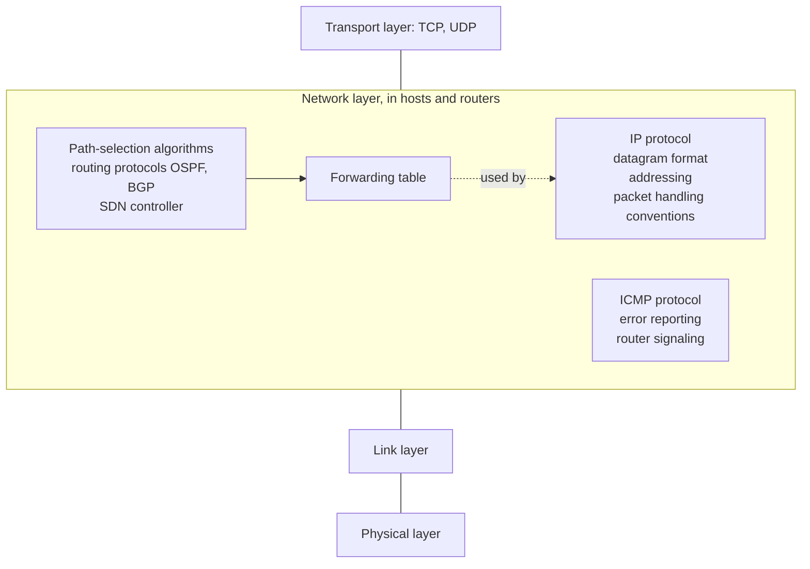
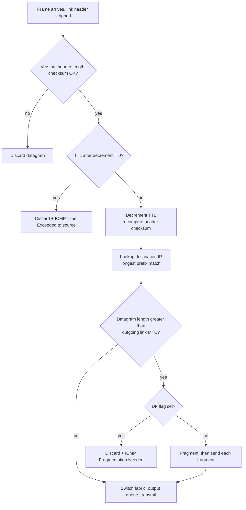

# Unit 4: Network Layer and Internet Protocol
## 4.4 The Internet Protocol (IP): Network Layer in the Internet and the IP Datagram Format

> [!abstract] What this note covers
> Both slides of this deck: **(1)** the network layer of the Internet (path-selection algorithms, forwarding table, IP protocol, ICMP protocol) and **(2)** the **IPv4 datagram format**: every header field explained, header overhead, and a fully decoded real header with checksum calculation. Because the slides are very compact, I have expanded each field into definitions, examples and exam questions.
> **"Beyond the slides"** = extra material. **"Slide caveat"** = slide wording needing clarification.
> Related notes: [[Network_Layer_Overview_Notes]] (4.1), [[Router_Architecture_Forwarding_Notes]] (4.2), [[Switching_Fabrics_Queueing_Notes]] (4.3), [[Congestion_Control_Notes]] (Unit 3).

## Table of contents
1. [[#1. Where we are]]
2. [[#2. Glossary]]
3. [[#3. The network layer in the Internet]]
4. [[#4. IP datagram format: the big picture]]
5. [[#5. Field-by-field explanation]]
6. [[#6. Overhead of TCP/IP headers]]
7. [[#7. What a router does to a datagram]]
8. [[#8. ICMP: the network layer's error reporting]]
9. [[#9. Fragmentation fields: preview]]
10. [[#10. Worked examples]]
11. [[#11. Practice questions with answers]]
12. [[#12. Cheat sheet]]

---

## 1. Where we are

| Section | Topic | Status |
|---|---|---|
| 4.1 | Overview of Network Layer | done |
| 4.2 | What's inside a router? | done |
| 4.3 | Switching | done |
| **4.4** | **The Internet Protocol (IP)** | in progress |
| | • **Datagram format** | **this note** |
| | • Fragmentation | next deck (preview in section 9) |
| | • IPv4 addressing | next deck |
| | • NAT | next deck |

---

## 2. Glossary

> [!info] Read this first.

| Term | Definition |
|---|---|
| **IP (Internet Protocol)** | The network-layer protocol of the Internet. Defines the datagram format, the addressing scheme and the conventions for handling packets. Provides **connectionless, best-effort** host-to-host delivery. |
| **IPv4** | Version 4 of IP, with 32-bit addresses. The version this deck covers. |
| **IP datagram** | An IP packet: a header (control information) + payload (usually a TCP or UDP segment). |
| **Header** | The first part of the datagram carrying the control fields (addresses, TTL, etc.). 20 to 60 bytes in IPv4. |
| **Payload** | The data carried by the datagram (e.g. a transport-layer segment). |
| **Version** | 4-bit field: 4 for IPv4 (6 for IPv6). |
| **IHL / header length** | Length of the IP header, in 32-bit words (the slide calls it "header length (bytes)", see the caveat below). |
| **Type of Service (ToS)** | 8-bit field carrying the DiffServ code point (6 bits) and ECN (2 bits). |
| **DSCP (DiffServ Code Point)** | 6-bit marking that tells routers which service class the packet belongs to. |
| **ECN** | 2-bit Explicit Congestion Notification field used for network-assisted congestion signalling. |
| **Total length** | 16-bit field: header + payload length, in bytes. |
| **Identifier** | 16-bit value identifying which original datagram a fragment belongs to. |
| **Flags** | 3 bits: Reserved, DF (Don't Fragment), MF (More Fragments). |
| **Fragment offset** | 13-bit position of a fragment's data within the original datagram, in units of 8 bytes. |
| **Fragmentation / reassembly** | Splitting a datagram into smaller pieces to fit a link's MTU / putting the pieces back together at the destination. |
| **MTU (Maximum Transmission Unit)** | The largest datagram (in bytes) a link can carry (Ethernet: 1500). |
| **TTL (Time To Live)** | 8-bit hop counter, decremented by each router; the datagram is discarded at 0. |
| **Protocol (upper-layer protocol)** | 8-bit field telling the destination which transport/upper-layer protocol gets the payload (6 = TCP, 17 = UDP, 1 = ICMP...). |
| **Header checksum** | 16-bit error-detection code computed over the **header only**. |
| **One's complement sum** | Addition with end-around carry; the basis of the Internet checksum. |
| **Source / destination IP address** | 32-bit addresses of the sending and ultimate receiving host. |
| **Options** | Optional variable-length header extensions (timestamp, record route, etc.). |
| **ICMP** | Internet Control Message Protocol: error reporting and router "signalling". |
| **OSPF** | Open Shortest Path First: a link-state *intra-domain* routing protocol. |
| **BGP** | Border Gateway Protocol: the *inter-domain* routing protocol between autonomous systems. |
| **SDN controller** | A logically centralised control-plane program that computes paths and installs forwarding rules in routers/switches. |
| **Forwarding table** | Table in each router mapping destination prefixes to output interfaces. |
| **Hop** | One router-to-router (link) step of a datagram's journey. |
| **Overhead** | Header bytes that carry control information rather than application data. |

---

## 3. The network layer in the Internet

> [!quote] Slide: "host, router network layer functions"
> The network layer sits **between the transport layer (TCP, UDP) and the link layer**. It contains three components:



### 3.1 Path-selection algorithms (control plane)
> [!quote] Slide
> **Path-selection algorithms:** implemented in **routing protocols (OSPF, BGP)** and the **SDN controller**. They produce the **forwarding table**.

These are the **routing** part from [[Network_Layer_Overview_Notes#4. Two key network-layer functions forwarding and routing]]:
- **OSPF** (*beyond the slides*): link-state protocol used **inside** one organisation's network (an autonomous system). Each router learns the whole topology and runs Dijkstra's shortest-path algorithm.
- **BGP**: the protocol that glues the Internet's thousands of autonomous systems together; routes are chosen using **policy** as well as path length.
- **SDN controller**: a central controller computes routes and **installs** forwarding-table entries in the routers (e.g. via OpenFlow).

The arrow in the slide from the path-selection box into the **forwarding table** means exactly this: *the output of routing is the forwarding table.*

### 3.2 Forwarding table
Local table used by the router's data plane for each packet (matched with **longest prefix match**, [[Router_Architecture_Forwarding_Notes#6. Longest prefix matching]]).

### 3.3 IP protocol (the main data-plane protocol)
> [!quote] Slide: IP protocol
> - **datagram format**
> - **addressing**
> - **packet handling conventions**

| Part | What it defines |
|---|---|
| **Datagram format** | Which fields the header has and what they mean (this note) |
| **Addressing** | How hosts and interfaces are identified: 32-bit IPv4 addresses, subnets, CIDR (next decks) |
| **Packet handling conventions** | What routers/hosts must do with a datagram: decrement TTL, verify/recompute checksum, fragment if needed, drop if TTL=0, etc. (section 7) |

IP's service model is **unreliable, best-effort, connectionless** ([[Network_Layer_Overview_Notes#7. Network service model]]): no delivery, order or timing guarantee. Reliability is added by TCP.

### 3.4 ICMP protocol
> [!quote] Slide
> **ICMP protocol:** **error reporting**, router "**signaling**".

Covered in section 8.

> [!note] Why the slide shows ICMP overlapping the IP box
> ICMP messages are carried *inside* IP datagrams (IP protocol number 1), yet ICMP is considered part of the network layer. The overlap in the slide's drawing reflects this "sits on top of IP but belongs to the network layer".

---

## 4. IP datagram format: the big picture

The IPv4 header is arranged in **rows of 32 bits**. The fixed part is **20 bytes** (5 rows). Options (if any) add up to 40 more bytes. Then comes the payload.

```
 0                   1                   2                   3
 0 1 2 3 4 5 6 7 8 9 0 1 2 3 4 5 6 7 8 9 0 1 2 3 4 5 6 7 8 9 0 1
+-------+-------+---------------+-------------------------------+
|  ver  | head. |  type of      |        total length           |
|  (4)  |  len  |  service (8)  |        (bytes) (16)           |
|       |  (4)  |               |                               |
+-------+-------+---------------+---+---------------------------+
|        16-bit identifier      |flg|     fragment offset (13)  |
|                               |(3)|                           |
+---------------+---------------+---+---------------------------+
|  time to live |  upper layer  |        header checksum        |
|     (8)       |  protocol (8) |             (16)              |
+---------------+---------------+-------------------------------+
|                 32-bit source IP address                      |
+---------------------------------------------------------------+
|               32-bit destination IP address                   |
+---------------------------------------------------------------+
|                options (if any)  e.g. timestamp,              |
|                     record route taken                        |
+---------------------------------------------------------------+
|                    payload data                               |
|     (variable length, typically a TCP or UDP segment)         |
+---------------------------------------------------------------+
```

**Summary table (20-byte fixed header):**

| Row | Fields | Bits |
|---|---|---|
| 1 | Version (4) · Header length (4) · Type of service (8) · Total length (16) | 32 |
| 2 | Identifier (16) · Flags (3) · Fragment offset (13) | 32 |
| 3 | TTL (8) · Upper-layer protocol (8) · Header checksum (16) | 32 |
| 4 | Source IP address (32) | 32 |
| 5 | Destination IP address (32) | 32 |
| (6+) | Options (0 to 40 bytes, variable) | |
| | Payload data | variable |

Header size: 5 × 4 bytes = **20 bytes** minimum.

---

## 5. Field-by-field explanation

### 5.1 Version (4 bits)
> [!quote] Slide: IP protocol version number
Identifies the IP version so the receiver knows how to parse the rest: **4** for IPv4, **6** for IPv6. In binary IPv4 = `0100`.

### 5.2 Header length (4 bits)
> [!quote] Slide: header length (bytes)
Since options make the header variable in length, this field says **where the header ends and the payload starts**.

> [!warning] Slide caveat
> The slide labels it "header length (bytes)", but the **4-bit value counts 32-bit (4-byte) words**, not bytes. So: header bytes = value × 4.
> - Minimum value **5** → 5 × 4 = **20 bytes** (no options)
> - Maximum value **15** (4 bits) → 15 × 4 = **60 bytes** (so options ≤ 40 bytes)
> Most datagrams have header length = 5. (Real header example: `0x45` = version 4, IHL 5.)

### 5.3 Type of service (8 bits)
> [!quote] Slide: "type" of service: **diffserv (0:5)**, **ECN (6:7)**

| Bits | Name | Purpose |
|---|---|---|
| 0 to 5 (6 bits) | **DiffServ / DSCP** | Marks the packet's service class so routers can apply class-based treatment, e.g. low-delay for voice. This is the *Diffserv* QoS model from [[Network_Layer_Overview_Notes#8. Comparing service models the QoS table]] |
| 6 to 7 (2 bits) | **ECN** | Explicit Congestion Notification: lets a congested router *mark* the packet (instead of dropping it) so that the end hosts slow down; see [[Congestion_Control_Notes#5.2 Network-assisted congestion control]] and [[Switching_Fabrics_Queueing_Notes#10. Buffer management]] |

*Beyond the slides:* ECN bit meanings: `00` not ECN-capable, `10`/`01` ECN-capable transport, `11` **CE (Congestion Experienced)**, set by a congested router. Historically this byte was "Type of Service" with precedence/delay/throughput/reliability bits; it was redefined for DiffServ and ECN.

### 5.4 Total datagram length (16 bits)
> [!quote] Slide: total datagram length (bytes); **Maximum length: 64K bytes; Typically: 1500 bytes or less**

- **Header + payload**, in bytes.
- 16 bits → maximum $2^{16}-1 = 65{,}535$ bytes ("64K").
- In practice datagrams are at most the link **MTU**, typically **1500 bytes** on Ethernet; larger ones are fragmented (section 9).
- **Payload length = total length − header length.**
- Needed because the link layer may pad frames, so the receiver can't infer where the datagram ends from the frame size.

### 5.5 Identifier, flags, fragment offset (16 + 3 + 13 bits)
> [!quote] Slide: **fragmentation/reassembly** (the 16-bit identifier, flgs, fragment offset)

These three fields support **fragmentation and reassembly**:
| Field | Size | Meaning |
|---|---|---|
| **16-bit identifier** | 16 | Same value in all fragments of one original datagram, so the destination can group them |
| **Flags** | 3 | bit 0 reserved (0); bit 1 **DF** = Don't Fragment; bit 2 **MF** = More Fragments (1 on all fragments except the last) |
| **Fragment offset** | 13 | Position of this fragment's data in the original payload, in **units of 8 bytes** |

Details and a worked example are in section 9.

### 5.6 Time to live, TTL (8 bits)
> [!quote] Slide: **TTL: remaining max hops (decremented at each router)**

- The sender sets an initial value (e.g. 64, 128 or 255).
- **Each router decrements it by 1.**
- When it reaches **0**, the router **discards the datagram** and sends an **ICMP "Time Exceeded"** message back to the source.
- **Purpose:** stop datagrams looping forever (e.g. due to a routing loop) and wasting capacity. It is a hop limit, not a time measurement despite its name.
- Used by **traceroute** (section 8).

### 5.7 Upper-layer protocol (8 bits)
> [!quote] Slide: **upper layer protocol (e.g., TCP or UDP)**

Tells the **destination host's** network layer which protocol should receive the payload: it's the **demultiplexing key between network and transport layers**, analogous to the port number between transport and application.

| Value | Protocol |
|---|---|
| 1 | ICMP |
| 6 | **TCP** |
| 17 | **UDP** |
| 89 | OSPF |
| 41 | IPv6 encapsulated in IPv4 |

Routers normally ignore this field (they only forward); the final destination uses it.

### 5.8 Header checksum (16 bits)
> [!quote] Slide: **header checksum**

**Purpose:** detect corruption in the **IP header only** (not the payload; TCP/UDP have their own checksums).

**How it is computed (sender):**
1. Set the checksum field to 0.
2. Treat the header as a sequence of **16-bit words** and add them using **one's-complement addition** (any carry out of bit 16 is added back at the bottom: "end-around carry").
3. Take the **one's complement** (flip all bits) of the sum; this is the checksum.

**How it is verified (router/receiver):** sum all 16-bit words *including* the checksum; the result must be **0xFFFF** (all ones). If not, the datagram is **discarded**.

**Why routers recompute it at every hop:** the **TTL changes** at each router, so the header changes, so the checksum must be updated. (Routers use incremental update tricks for speed.)

**Why only the header?** Checking the whole payload at every router would be costly; end-to-end integrity is the job of the transport layer (TCP/UDP checksum). Note the layered redundancy: IP header checksum + TCP/UDP checksum + link-layer CRC.

A full worked calculation is in section 10.

### 5.9 Source and destination IP addresses (32 + 32 bits)
> [!quote] Slide: **32-bit source IP address**, **32-bit destination IP address**

- **Source address:** the host that created the datagram.
- **Destination address:** the **final** receiver. **Routers use the destination address (with longest prefix match) to choose the output port.**
- The addresses normally stay unchanged end-to-end (exception: **NAT**, covered later, rewrites them).
- $2^{32} \approx 4.3$ billion possible addresses, a limitation that led to IPv6.

### 5.10 Options (variable, 0 to 40 bytes)
> [!quote] Slide: options (if any), **e.g., timestamp, record route taken**

- Optional extensions that make the header **variable length** (the reason header length is needed).
- Examples: **timestamp** (each router records the time), **record route** (each router appends its address), source routing (sender specifies the path).
- Rarely used: they slow down routers (processed in the slow path), raise security concerns, and are frequently dropped. IPv6 removed options from the base header (it uses extension headers).
- The header is padded to a multiple of 32 bits.

### 5.11 Payload data
> [!quote] Slide: **payload data (variable length, typically a TCP or UDP segment)**

The transport-layer segment (or an ICMP message, OSPF packet, etc.). It is variable in length; **header length + payload = total length**.

---

## 6. Overhead of TCP/IP headers

> [!quote] Slide: "overhead"
> - **20 bytes of TCP**
> - **20 bytes of IP**
> - **= 40 bytes + app layer overhead for TCP+IP**

Every TCP segment carried in an IP datagram pays **at least 20 + 20 = 40 bytes** of header overhead (and the link layer adds more, e.g. 18 bytes for Ethernet), plus any application-layer headers (HTTP etc.).

| Payload | Total | Efficiency (payload / total, TCP+IP only) |
|---|---|---|
| 1 byte (telnet keystroke) | 41 bytes | 2.4% |
| 100 bytes | 140 bytes | 71.4% |
| **1460 bytes** (full Ethernet segment) | **1500 bytes** | **97.3%** |

This is why **MSS = MTU − 40 = 1460 bytes** on Ethernet (the MSS from [[Congestion_Control_Notes#2. Glossary of every term you need]]), and why small packets are inefficient.

---

## 7. What a router does to a datagram

> [!quote] Slide: IP protocol: **packet handling conventions**

These are the rules every IP router follows when a datagram arrives. They connect the header fields to the router pipeline in [[Router_Architecture_Forwarding_Notes#4. Input port functions]].



| Step | Field(s) used | Why |
|---|---|---|
| 1. Sanity checks | version, header length, **header checksum** | Drop corrupted headers |
| 2. TTL | **TTL** | Stop loops; generate ICMP at 0 |
| 3. Recompute checksum | header checksum | TTL changed |
| 4. Forwarding lookup | **destination IP** | Choose output port |
| 5. Fragmentation check | total length, **DF**, MTU | Fit the next link |
| 6. Options | options | Processed on a slower path if present |
| 7. Queue and send | ToS (DSCP/ECN) | Scheduling class, congestion marking |

Notice what routers do **not** look at: the transport header (ports) or the payload. (Firewalls and NATs are exceptions; generalized forwarding can match on them.)

---

## 8. ICMP: the network layer's error reporting

> [!quote] Slide: **ICMP protocol:** error reporting, router "signaling"

**ICMP (Internet Control Message Protocol)** lets hosts and routers report problems and exchange network-layer information. Because IP itself is best-effort and silent about failures, ICMP is the "feedback channel".

- ICMP messages are **carried in IP datagrams** (upper-layer protocol value = **1**).
- Format: **Type (8 bits) · Code (8 bits) · Checksum (16 bits) · rest-of-header (32 bits)**, then data. For *error* messages the data is the **IP header + first 8 bytes of the payload of the offending datagram**, so the source can tell which connection/socket failed.

| Type | Code | Meaning | Typical cause |
|---|---|---|---|
| 0 | 0 | Echo reply | Reply to ping |
| 8 | 0 | Echo request | `ping` |
| 3 | 0 | Destination network unreachable | No route |
| 3 | 1 | Destination host unreachable | Host down/ARP fails |
| 3 | 3 | Destination port unreachable | No process on that UDP port |
| 3 | 4 | **Fragmentation needed and DF set** | Datagram too big for a link, DF=1 |
| 11 | 0 | **TTL expired in transit** | TTL reached 0 |
| 11 | 1 | Fragment reassembly time exceeded | Missing fragments |
| 12 | 0 | Bad IP header | Parameter problem |

**ICMP rules (*beyond the slides*):** ICMP errors are never generated in response to other ICMP errors (prevents storms) and only for the first fragment.

### 8.1 Ping
Sends **ICMP echo request (8/0)**; destination replies with **echo reply (0/0)**. Measures reachability and RTT.

### 8.2 Traceroute (uses the TTL field)
1. Send a probe with **TTL = 1**. The first router decrements to 0, drops it and returns **ICMP Time Exceeded (11/0)**. Its address and the RTT are recorded.
2. Send **TTL = 2**: the second router answers. Repeat with 3, 4, ...
3. When a probe reaches the destination, the destination replies (**port unreachable 3/3** for UDP probes, or **echo reply 0/0** for ICMP probes), so traceroute stops.

The result is the list of routers on the path: TTL turned into a measurement tool.

> [!note] ICMP in later decks
> The course outline shows **4.5: DHCP and ICMP** in more depth; this section is the overview you need for the IP header.

---

## 9. Fragmentation fields: preview

The **identifier, flags (DF, MF) and fragment offset** fields exist so an oversized datagram can be split across links with a smaller MTU and reassembled at the destination. The full treatment (rules, formulas, worked numerical problems) is in the next note: [[IP_Fragmentation_Notes]].

Quick example: a 4000-byte datagram (20-byte header + 3980 data) crossing a 1500-byte MTU link becomes **3 fragments** of total length 1500, 1500, 1040 with offsets **0, 185, 370**.

---

## 10. Worked examples

### Example 1: Decode a real IPv4 header
Header in hex (20 bytes):

`45 00 00 3C 1C 46 40 00 40 06 B1 E6 AC 10 0A 63 AC 10 0A 0C`

| Bytes | Hex | Field | Value |
|---|---|---|---|
| 0 (high nibble) | 4 | Version | **4** (IPv4) |
| 0 (low nibble) | 5 | Header length | 5 × 4 = **20 bytes** (no options) |
| 1 | 00 | Type of service | DSCP 0, ECN 00 (default) |
| 2 to 3 | 003C | Total length | **60 bytes** → payload = 60 − 20 = **40 bytes** |
| 4 to 5 | 1C46 | Identifier | 7238 |
| 6 to 7 | 4000 | Flags + offset | `010` → **DF = 1, MF = 0**; offset = 0 (not fragmented, must not be) |
| 8 | 40 | TTL | **64** |
| 9 | 06 | Upper-layer protocol | **6 = TCP** |
| 10 to 11 | B1E6 | Header checksum | 0xB1E6 |
| 12 to 15 | AC 10 0A 63 | Source IP | **172.16.10.99** |
| 16 to 19 | AC 10 0A 0C | Destination IP | **172.16.10.12** |

(Convert hex bytes to decimal: AC = 172, 10 = 16, 0A = 10, 63 = 99, 0C = 12.)

### Example 2: Compute the header checksum for the header above
1. Set checksum to 0000. The 16-bit words: `4500, 003C, 1C46, 4000, 4006, 0000, AC10, 0A63, AC10, 0A0C`.
2. Add them:

| Running sum | After adding |
|---|---|
| 4500 + 003C | 453C |
| + 1C46 | 6182 |
| + 4000 | A182 |
| + 4006 | E188 |
| + 0000 | E188 |
| + AC10 | 18D98 |
| + 0A63 | 197FB |
| + AC10 | 2440B |
| + 0A0C | **24E17** |

3. **Fold the carry** (end-around): 0x4E17 + 0x2 = **0x4E19**.
4. **One's complement:** 0xFFFF − 0x4E19 = **0xB1E6** ✓ (matches the header).

**Verification at a receiver:** add all words *with* the checksum: 0x24E17 + 0xB1E6 = 0x2FFFD → fold 0xFFFD + 2 = **0xFFFF** → all ones means valid ✓.

### Example 3: Header length value
Header length field = 8. Header = 8 × 4 = **32 bytes**, so options take 32 − 20 = **12 bytes**.

### Example 4: Overheads and limits
- Max total length: 65,535 bytes → max payload = 65,535 − 20 = **65,515 bytes**.
- Max header: 15 × 4 = 60 bytes → max options = **40 bytes**.
- TCP+IP overhead for a 1460-byte segment payload: 40 bytes → 1500 = MTU, efficiency 97.3%.

### Example 5: TTL
A host sends with TTL = 64 and the destination is 12 hops away. Each of the 11 intermediate routers decrements, so the datagram arrives with TTL = 64 − 11 = 53 (the number of routers that decrement, not counting the source host or destination). If the path were 70 routers long, the datagram would be discarded at the 64th router and ICMP 11/0 sent back.

---

## 11. Practice questions with answers

**Q1. Which protocols make up the Internet's network layer?**
IP (datagram format, addressing, packet handling), ICMP (error reporting, router signaling), plus routing protocols/SDN controller (path selection) that fill the forwarding table.

**Q2. List the fields of the IPv4 header in order.**
Version, header length, type of service, total length, identifier, flags, fragment offset, TTL, upper-layer protocol, header checksum, source address, destination address, options.

**Q3. What is the minimum and maximum IPv4 header size, and why?**
20 bytes (header-length field = 5) and 60 bytes (field = 15; the field counts 4-byte words).

**Q4. What does the upper-layer protocol field do?**
Tells the destination host which protocol (TCP = 6, UDP = 17, ICMP = 1) should receive the payload: demultiplexing between network and transport layers.

**Q5. Why is the checksum recomputed at every router?**
The TTL is decremented at each hop, so the header changes.

**Q6. Why does the IP checksum cover only the header?**
Cheap to compute at every hop; payload integrity is handled end-to-end by TCP/UDP checksums (and link-layer CRC).

**Q7. What is TTL for, and what happens when it reaches 0?**
Prevents infinite looping. The router discards the datagram and sends ICMP Time Exceeded (type 11, code 0) to the source.

**Q8. How many bits are in the type-of-service field and how are they used?**
8 bits: 6 for DiffServ (DSCP) and 2 for ECN.

**Q9. Maximum IP datagram size, and typical?**
65,535 bytes (16-bit length); typically 1500 bytes or less (Ethernet MTU).

**Q10. A datagram has total length 1500 and header length field 5. What is the payload size?**
1500 − 20 = 1480 bytes.

**Q11. Why do options make header length necessary?**
Options vary in size, so the receiver needs to know where the header ends.

**Q12. Compute the overhead of sending 1 byte over TCP/IP.**
20 + 20 = 40 bytes header; total 41 bytes; efficiency 1/41 ≈ 2.4%.

**Q13. Explain how traceroute works.**
Sends probes with TTL 1, 2, 3...; each router that drops one returns ICMP Time Exceeded, revealing the path; the destination's reply ends the trace.

**Q14. Which field would an IP router use to forward a packet, and which does it never use?**
Uses destination IP (longest prefix match); normally never uses the transport-layer ports or payload.

**Q15. In the decoded header 45 00 00 3C ..., what is the payload length?**
0x3C = 60 total − 20 header = 40 bytes.

**Q16. Verify: sum of all header words including checksum should be?**
0xFFFF (after folding carries); otherwise the header is corrupted.

---

## 12. Cheat sheet

> [!summary] One-page revision

**Network layer in the Internet = path selection (OSPF, BGP, SDN) → forwarding table + IP + ICMP.**

| Field | Bits | Notes |
|---|---|---|
| Version | 4 | 4 for IPv4 |
| Header length | 4 | in **4-byte words**; 5 to 15 → 20 to 60 bytes |
| Type of service | 8 | DiffServ **0:5**, ECN **6:7** |
| Total length | 16 | header + data, ≤ 65,535; typically ≤ 1500 |
| Identifier | 16 | groups fragments |
| Flags | 3 | reserved, **DF**, **MF** |
| Fragment offset | 13 | units of **8 bytes** |
| TTL | 8 | −1 per router; 0 → discard + ICMP |
| Upper-layer protocol | 8 | 6 TCP, 17 UDP, 1 ICMP |
| Header checksum | 16 | header only; one's-complement; recomputed per hop |
| Source IP | 32 | |
| Destination IP | 32 | used for forwarding (LPM) |
| Options | 0 to 40 B | timestamp, record route |

**Overhead:** TCP 20 + IP 20 = **40 bytes** (+ app overhead). MSS = 1500 − 40 = 1460.

**Router rules:** verify → TTL−1 → recompute checksum → LPM lookup → fragment if needed → forward.

**ICMP:** ping = 8/0 and 0/0; traceroute uses TTL + 11/0; 3/4 = fragmentation needed & DF set.

---
*Source: PES University Computer Networks, Team Networks, Unit 4 slides (4.4: network layer in the Internet, IP datagram format). Extra material follows the standard treatment in Kurose & Ross, "Computer Networking: A Top-Down Approach".*
