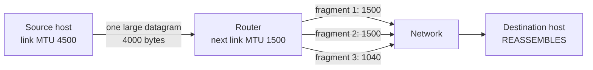
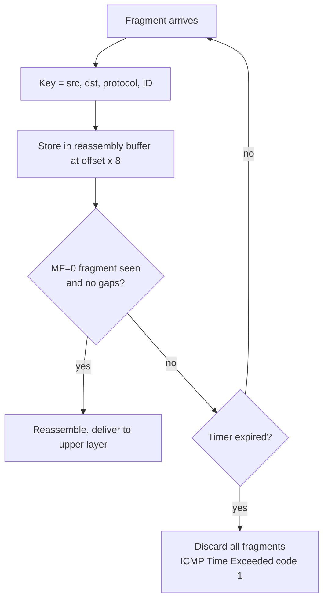

# Unit 4: Network Layer and Internet Protocol
## 4.4 The Internet Protocol (IP): Fragmentation and Reassembly

> [!abstract] What this note covers
> All slides of this deck: why fragmentation exists (MTU), how one datagram becomes several, the role of the identifier / flags / offset fields, the **4000-byte / MTU 1500** example, the **5140-byte / Ethernet** table, and the **numerical problem (MTU 200, packet 520)** whose answer table is missing in the slides (rendered as a broken image), which I solve fully here. I added reassembly, nested fragmentation, Path MTU Discovery, the downsides of fragmentation, and exam-style practice.
> **"Beyond the slides"** = extra material. **"Slide caveat"** = wording needing clarification.
> Related notes: [[IP_Datagram_Format_Notes]] (fields), [[Network_Layer_Overview_Notes]] (4.1), [[Router_Architecture_Forwarding_Notes]] (4.2), [[Congestion_Control_Notes]] (MSS).

## Table of contents
1. [[#1. Where we are]]
2. [[#2. Glossary]]
3. [[#3. Why fragmentation? The MTU problem]]
4. [[#4. How fragmentation works]]
5. [[#5. The slide example: 4000 bytes, MTU 1500]]
6. [[#6. The slide example: 5140 bytes over Ethernet]]
7. [[#7. The numerical problem: MTU 200, packet 520]]
8. [[#8. Reassembly at the destination]]
9. [[#9. Beyond the slides: nested fragmentation, DF and Path MTU Discovery]]
10. [[#10. Costs and problems of fragmentation]]
11. [[#11. Worked examples]]
12. [[#12. Practice questions with answers]]
13. [[#13. Cheat sheet]]

---

## 1. Where we are

The roadmap slide for Unit 4 now shows the full outline:

| Section | Topic | Status |
|---|---|---|
| 4.1 | Overview of Network Layer | done |
| 4.2 | What's inside a router? | done |
| 4.3 | Switching | done |
| **4.4** | **The Internet Protocol (IP)** | |
| | • Datagram format | done: [[IP_Datagram_Format_Notes]] |
| | • **Fragmentation** | **this note** |
| | • IPv4 addressing | next |
| | • NAT | next |
| 4.5 | Introduction to network layer protocols: DHCP, ICMP | later |
| 4.6 | IPv6 addressing | later |
| 4.7 | Introduction to routing algorithms | later |

---

## 2. Glossary

> [!info] Read this first.

| Term | Definition |
|---|---|
| **MTU (Maximum Transmission Unit)** | The largest IP datagram (header + data, in bytes) that a particular link can carry in one link-layer frame. Ethernet: 1500 bytes. |
| **Fragmentation** | Splitting one IP datagram into several smaller IP datagrams (fragments) so each fits the MTU of the next link. |
| **Fragment** | One of the smaller datagrams produced; it is a complete IP datagram with its own header. |
| **Reassembly** | Putting the fragments back together to recover the original datagram. In IPv4 this happens **only at the final destination host**. |
| **Identifier (ID)** | 16-bit header field with the same value in all fragments of one original datagram. |
| **DF flag (Don't Fragment)** | Flag bit. 1 = routers must not fragment this datagram (drop it if it is too big); 0 = fragmentation allowed. |
| **MF flag (More Fragments)** | Flag bit. 1 = more fragments follow; 0 = this is the **last** fragment (or the datagram is not fragmented). The slides call it "fragflag". |
| **Fragment offset** | 13-bit field: position of this fragment's data within the original datagram's data, **in units of 8 bytes**. |
| **Data field / payload** | The part of a datagram after the header. |
| **Fragmentation unit (8 bytes)** | Because the offset counts 8-byte units, every fragment except the last must carry a data size that is a **multiple of 8 bytes**. |
| **Path MTU** | The smallest MTU along the entire path from source to destination. |
| **PMTUD (Path MTU Discovery)** | Technique to find the path MTU by sending DF=1 datagrams and listening for ICMP "Fragmentation needed" errors. |
| **Reassembly buffer / timer** | Memory and timeout the destination uses while waiting for all fragments. |
| **MSS** | TCP maximum segment size, chosen to avoid fragmentation (see [[Congestion_Control_Notes#2. Glossary of every term you need]]). |
| **Frame** | The link-layer unit that carries an IP datagram. |

---

## 3. Why fragmentation? The MTU problem

> [!quote] Slide: IP fragmentation, reassembly
> - **Network links have MTU (max. transfer size)**: largest possible link-level frame
>   - **different link types, different MTUs**
> - **Large IP datagram divided ("fragmented") within net**
>   - **one datagram becomes several datagrams**
>   - **"reassembled" only at final destination**
>   - **IP header bits used to identify, order related fragments**

### 3.1 The problem
Different link technologies limit the frame size differently:

| Link type | Typical MTU (bytes) |
|---|---|
| Ethernet | **1500** |
| Wi-Fi (802.11) | ~2304 (often 1500 used in practice) |
| PPPoE (DSL) | 1492 |
| Old/other links (e.g. PPP, X.25) | 576 or less |
| Loopback / jumbo frames | 9000+ / 65,535 |

A datagram can start on a link with a large MTU and later meet a link with a smaller MTU. The router at that boundary cannot send it as is.

### 3.2 The solution: fragment *inside* the network
The router **fragments** the datagram: it splits the data into pieces and puts each in a new datagram with its own IP header. The slide's picture: **in: one large datagram → out: 3 smaller datagrams**.

### 3.3 Key design choice: reassemble only at the destination
> [!quote] Slide: "reassembled" only at final destination

Why not reassemble at the next router?
- Fragments may take **different paths**, so no single router sees them all.
- Routers should be **fast and stateless**: holding fragments in buffers requires state, memory and timers.
- Reassembling at intermediate routers would be wasted work if the next link again has a small MTU.

So fragments travel as independent datagrams and the **destination host** does all the reassembly. The source and destination address fields are the same in all fragments, and the routers forward each one independently.

> [!warning] Slide caveat on "MTU"
> The slide defines MTU as "largest possible link-level frame". More precisely, **MTU is the maximum size of the IP datagram (the frame's payload)** a link can carry. The frame itself also has a link header/trailer (Ethernet adds 14 + 4 = 18 bytes), so the Ethernet MTU is 1500 while the maximum Ethernet frame is 1518. In every numerical problem, *MTU = maximum datagram size including the IP header*.

---

## 4. How fragmentation works

### 4.1 The three header fields (recap from [[IP_Datagram_Format_Notes#5.5 Identifier flags fragment offset 16 3 13 bits]])

| Field | Bits | What it does in fragmentation |
|---|---|---|
| **Identifier** | 16 | Same in all fragments of the same original datagram (and unique per source/destination/protocol for a while) |
| **Flags** | 3 | `Reserved` (0), **DF**, **MF** |
| **Fragment offset** | 13 | Where the data goes: offset × 8 = byte position in the original data |

Slide table labels: **DF "May / Don't"** → 0 = fragmentation **may** happen, 1 = **don't** fragment. **MF "Last / More"** → 0 = **last** fragment, 1 = **more** fragments follow.

### 4.2 Step-by-step algorithm at a router

Given: datagram with header length $H$ (usually 20 bytes), data length $D$, outgoing link MTU $M$, and DF = 0.

1. **If $H + D \le M$:** no fragmentation, just forward.
2. Otherwise compute the **maximum data per fragment**: $$\text{max data} = \left\lfloor \frac{M - H}{8} \right\rfloor \times 8$$ (round **down to a multiple of 8**, because offsets are in 8-byte units).
3. Cut the data into chunks of that size; the **last chunk** gets the remainder.
4. Number of fragments: $\left\lceil \dfrac{D}{\text{max data}} \right\rceil$.
5. For each fragment $i$:
   - **Total length** = data in fragment + $H$
   - **Identifier** = same as the original
   - **Fragment offset** = (data bytes before this fragment) / 8 (+ the original offset if the datagram being split was itself a fragment)
   - **MF** = 1 for every fragment except the last; for the last, MF = 0 (or *keeps the original MF* if the datagram being split was itself a non-last fragment)
   - **Header checksum** recomputed (and TTL decremented as for any forwarding)
   - Source, destination, protocol: copied

### 4.3 Why multiples of 8?
The offset field has 13 bits but the datagram's data can be up to ~65,515 bytes (needs 16 bits). Counting offsets in **units of 8 bytes** lets 13 bits address the entire range: $2^{13} \times 8 = 65{,}536$. The price: every fragment except the last must have a data size divisible by 8.

---

## 5. The slide example: 4000 bytes, MTU 1500

> [!quote] Slide
> **Example:** 4000-byte datagram, **MTU = 1500 bytes**. **1480 bytes in data field; offset = 1480/8.**

**Step 1: Split header and data.** Total 4000, header 20 → **data = 3980 bytes**.

**Step 2: Max data per fragment.** MTU 1500 − header 20 = **1480** bytes. Is it a multiple of 8? $1480 / 8 = 185$ ✓ (exactly).

**Step 3: Number of fragments.** $\lceil 3980 / 1480 \rceil = \lceil 2.69 \rceil = $ **3**.

**Step 4: Fill in the fields.**

| Fragment | Data bytes | Total length | ID | MF ("fragflag") | Offset (units of 8 B) | Byte range in original data |
|---|---|---|---|---|---|---|
| Original | 3980 | **4000** | x | 0 | 0 | 0 to 3979 |
| **1** | 1480 | **1500** | x | **1** | **0** | 0 to 1479 |
| **2** | 1480 | **1500** | x | **1** | **185** (= 1480/8) | 1480 to 2959 |
| **3** | 1020 | **1040** | x | **0** (last) | **370** (= 2960/8) | 2960 to 3979 |

**Checks:**
- Data adds up: 1480 + 1480 + 1020 = **3980** ✓
- Total length of last: 1020 + 20 = **1040** ✓
- Offset 3: $(1480 + 1480)/8 = 2960/8 = 370$ ✓
- Bytes on the wire after fragmentation: 1500 + 1500 + 1040 = 4040 (**40 extra bytes**: two extra 20-byte headers).

This matches the slide's three boxes exactly: length 1500 / flag 1 / offset 0; length 1500 / flag 1 / offset 185; length 1040 / flag 0 / offset 370.

---

## 6. The slide example: 5140 bytes over Ethernet

> [!quote] Slide: Fragmentation, Example
> **Original IP datagram:** Identifier **345**, Total length **5140**, DF 0, MF 0, Offset 0.
> **IP fragments (Ethernet):** 0-0, 0-1, 0-2, 0-3.

**Work-out** (header 20, Ethernet MTU 1500):
- Data = 5140 − 20 = **5120** bytes
- Max data per fragment = 1500 − 20 = **1480** (multiple of 8 ✓: 185 units)
- Fragments = $\lceil 5120/1480 \rceil = \lceil 3.46 \rceil = $ **4** (three full + one partial)
- Last fragment's data: 5120 − 3 × 1480 = 5120 − 4440 = **680** → total length 680 + 20 = **700**

| Sequence | Identifier | Total length | DF | MF | Fragment offset |
|---|---|---|---|---|---|
| Original | 345 | 5140 | 0 | 0 | 0 |
| 0-0 | 345 | **1500** | 0 | **1** | **0** |
| 0-1 | 345 | **1500** | 0 | **1** | **185** |
| 0-2 | 345 | **1500** | 0 | **1** | **370** |
| 0-3 | 345 | **700** | 0 | **0** | **555** |

Offsets: 0; 1480/8 = 185; 2960/8 = 370; 4440/8 = **555** ✓. This matches the slide table exactly.

Total bytes on the wire: 1500 × 3 + 700 = 5200 (60 extra bytes = 3 extra headers).

> [!tip] Pattern to remember
> Full-size fragments: **total length = MTU**, offsets are **0, 185, 370, 555, ...** (multiples of 185 when MTU = 1500). Last fragment: **MF = 0**, smaller length.

---

## 7. The numerical problem: MTU 200, packet 520

> [!quote] Slide: Fragmentation, Numerical Example
> An IP router with a **Maximum Transmission Unit (MTU) of 200 bytes** has received an IP packet of **size 520 bytes with an IP header of length 20 bytes**. *The values of the relevant fields in the IP header.* 

> [!note] Slide caveat
> The slide's answer table is a **broken image** and the sentence is incomplete. The question is the classic: *"What are the values of the relevant fields (total length, MF, offset) in the IP headers of the resulting fragments?"* I solve it fully below.

**Step 1: Data size.** 520 − 20 = **500 bytes** of data.

**Step 2: Max data per fragment.** MTU − header = 200 − 20 = **180** bytes. Is 180 divisible by 8? $180/8 = 22.5$ ✗. **Round down to a multiple of 8:** $22 \times 8 =$ **176 bytes**.

> [!warning] The classic mistake
> Using 180 bytes per fragment would give offsets like 22.5, which is impossible. **Always round the per-fragment data down to a multiple of 8.**

**Step 3: Number of fragments.** $\lceil 500 / 176 \rceil = \lceil 2.84 \rceil = $ **3** fragments:
- Fragment 1: 176 bytes
- Fragment 2: 176 bytes
- Fragment 3: 500 − 352 = **148** bytes (≤ 176 ✓)

**Step 4: Field values.**

| Fragment | Data | Total length (data + 20) | MF | Offset (data before / 8) | Byte range |
|---|---|---|---|---|---|
| Original | 500 | 520 | 0 | 0 | 0 to 499 |
| **1** | 176 | **196** | **1** | **0** | 0 to 175 |
| **2** | 176 | **196** | **1** | **22** (176/8) | 176 to 351 |
| **3** | 148 | **168** | **0** | **44** (352/8) | 352 to 499 |

(Identifier = same value in all three; DF = 0 in all.)

**Checks:** 176 + 176 + 148 = 500 ✓; offset 3 = 352/8 = 44 ✓; every fragment length (196, 196, 168) ≤ 200 ✓; fragments 1 and 2 carry multiples of 8 (176 = 22 × 8) ✓; 148 does not need to be (last fragment).

**Overhead:** 196 + 196 + 168 = 560 bytes sent vs 520 original (40 extra = 2 extra headers).

---

## 8. Reassembly at the destination *(beyond the slides)*

The slide says "IP header bits used to identify, order related fragments." Here is exactly how.

### 8.1 Identifying fragments of the same datagram
The destination groups fragments by the tuple **(source IP, destination IP, protocol, identifier)**.

### 8.2 Ordering fragments
Fragment offset × 8 gives each fragment's position in the data. Fragments can arrive **out of order**; they are placed by offset.

### 8.3 Knowing when the datagram is complete
1. The fragment with **MF = 0** is the last one. It tells the total data length: $$\text{total data} = (\text{offset}_{last} \times 8) + (\text{total length}_{last} - \text{header length})$$
2. When the received fragments cover **every byte** from 0 to total data − 1 with no gaps, the datagram is complete. 
3. The header of the reassembled datagram = the first fragment's header, with MF = 0, offset = 0, total length = original.

> [!example] Reassemble the slide's 4000-byte datagram
> Last fragment: offset 370, total length 1040 → total data $= 370\times8 + (1040 - 20) = 2960 + 1020 = 3980$ → total datagram length = 3980 + 20 = **4000** ✓.

### 8.4 Timeout and loss
- The destination starts a **reassembly timer** when the first fragment arrives (typically 15 to 120 seconds; e.g. 30 s in Linux).
- If any fragment is missing at timeout, the destination **discards all fragments** of that datagram and may send **ICMP Time Exceeded, code 1 (fragment reassembly time exceeded)**.
- IP does **not** retransmit single fragments. Recovery, if any, comes from the layer above (e.g. TCP retransmits the whole segment).

---

## 9. Beyond the slides: nested fragmentation, DF and Path MTU Discovery

### 9.1 A fragment can be fragmented again
Different links along the path may have smaller and smaller MTUs, so **fragments can themselves be fragmented**. Rules:
- Offsets always refer to the **position in the original datagram's data** (original offset + position inside the fragment).
- MF of the last sub-fragment of a fragment: **stays what the parent had** (if the parent had MF = 1, the last sub-fragment must keep MF = 1, because more data follows from the original datagram).

> [!example] Nested example
> The 4000-byte datagram is first fragmented at MTU 1500 (fragments of 1480, 1480, 1020 data). Then fragment 2 (1500 bytes: ID x, offset 185, MF 1) meets a link with **MTU 700**.
> - Max data = (700 − 20) = 680, divisible by 8 ✓ (85 units).
> - 1480 data → 680 + 680 + 120.
>
> | Sub-fragment | Data | Total length | Offset | MF |
> |---|---|---|---|---|
> | 2a | 680 | 700 | 185 | 1 |
> | 2b | 680 | 700 | 185 + 85 = **270** | 1 |
> | 2c | 120 | 140 | 270 + 85 = **355** | **1** (parent had MF = 1) |
>
> Next original fragment starts at offset 370 = 355 + 120/8 (= 15) ✓: the data is continuous.

### 9.2 DF flag and Path MTU Discovery (PMTUD)
- If **DF = 1** and the datagram exceeds the next link's MTU, the router **drops it** and returns **ICMP Type 3, Code 4 (Fragmentation needed and DF set)**, including the **next-hop MTU**.
- **PMTUD:** the sender sends DF=1 packets, lowers its packet size on receiving ICMP 3/4, and repeats until packets get through. The result is the **path MTU**, and the sender then avoids fragmentation completely.
- *Problem:* firewalls that block ICMP break PMTUD ("PMTU black hole").

### 9.3 How TCP avoids fragmentation
TCP picks **MSS = MTU − 40** (1460 for Ethernet, 20 IP + 20 TCP header), so full segments fit in one frame; most TCP traffic therefore is **not** fragmented. Fragmentation mostly affects **UDP** (e.g. large DNS responses, VPN/tunnel traffic) and tunnels that add headers.

### 9.4 IPv6 is different
**IPv6 routers never fragment.** Only the **source** may fragment (using a Fragment extension header), and it uses PMTUD. IPv6 guarantees a **minimum MTU of 1280 bytes**. (Covered in 4.6.)

---

## 10. Costs and problems of fragmentation *(beyond the slides)*

| Problem | Explanation |
|---|---|
| **Extra overhead** | Every fragment repeats a 20-byte header (e.g. 40 or 60 extra bytes in the examples) |
| **Loss amplification** | The datagram is lost if **any** fragment is lost: $P_{\text{loss}} = 1-(1-p)^n$ for $n$ fragments each lost with probability $p$ |
| **Wasted retransmission** | A TCP/application retransmission resends the *whole* datagram, not just the lost fragment |
| **Router and host burden** | Fragmentation costs router CPU; reassembly needs buffers and timers at the host |
| **Firewalls/NAT difficulty** | Only the first fragment contains the transport header (ports), so stateless filters can't inspect later fragments |
| **Security** | Fragment-based attacks: *Teardrop* (overlapping offsets crash reassembly), *tiny fragment* evasion, reassembly-buffer exhaustion (DoS) |
| **Unfavourable interplay** | Fragments are independent datagrams, so they can be reordered or take different paths |

> [!example] Loss amplification
> p = 1% per fragment, a datagram split into 3 fragments: $1-(0.99)^3 = 2.97\%$ datagram loss (roughly 3× worse than an unfragmented datagram).

Hence the modern preference: **avoid fragmentation** (PMTUD, MSS clamping, IPv6).

---

## 11. Worked examples

### Example 1: Generic procedure (cheat recipe)
Given total length $L$, header $H = 20$, MTU $M$:
1. Data $D = L - H$
2. Per-fragment data $F = \lfloor (M - H)/8 \rfloor \times 8$
3. Number of fragments $n = \lceil D / F \rceil$
4. Fragment $i$ (0-indexed): data = $F$ (last: $D - (n-1)F$), offset = $iF/8$, total length = data + $H$, MF = 1 except last (0)

### Example 2: 2000-byte datagram, MTU 576
- $D = 1980$; $F = \lfloor 556/8 \rfloor \times 8 = 69 \times 8 = $ **552**; $n = \lceil 1980/552 \rceil = \lceil 3.59 \rceil = 4$
- Last fragment data: 1980 − 3 × 552 = 1980 − 1656 = **324**

| Fragment | Data | Total length | MF | Offset |
|---|---|---|---|---|
| 1 | 552 | 572 | 1 | 0 |
| 2 | 552 | 572 | 1 | 69 |
| 3 | 552 | 572 | 1 | 138 |
| 4 | 324 | 344 | 0 | 207 |

Check: 207 × 8 = 1656 ✓; 1656 + 324 = 1980 ✓.

### Example 3: Reassembly from out-of-order fragments
Fragments of ID = 77 arrive in this order (header 20): 
(a) offset 185, MF 1, length 1500; (b) offset 370, MF 0, length 1040; (c) offset 0, MF 1, length 1500.
- Placement by offset: (c) → bytes 0 to 1479; (a) → 1480 to 2959; (b) → 2960 to 3979.
- Last (b): total data = 370 × 8 + (1040 − 20) = 3980. No gaps → complete → deliver a 4000-byte datagram (3980 data).

### Example 4: Missing fragment
Same as above but (a) never arrives. After the timer expires, the destination discards (c) and (b), and may send ICMP 11/1. A TCP sender would later retransmit the *entire* segment after its own timeout.

### Example 5: Why do I get no fragmentation with TCP over Ethernet?
MSS = 1460 → each TCP segment + 40 bytes of headers = 1500 ≤ MTU → no fragmentation. If a path link has MTU 1400, PMTUD (DF = 1) triggers ICMP 3/4, the sender reduces its segment size, and fragmentation is still avoided.

### Example 6: Loss probability
Datagram split into 5 fragments, each lost independently with p = 2%: P(loss of datagram) = $1 - 0.98^5 = 1 - 0.9039 = 9.6\%$.

### Example 7: Largest unfragmented UDP payload on Ethernet
MTU 1500 − IP 20 − UDP 8 = **1472 bytes** of UDP data.

### Example 8: Is 1480 a valid per-fragment size for MTU 1500? Is 1400 for MTU 1420?
- 1500 − 20 = 1480; 1480/8 = 185 ✓ valid.
- 1420 − 20 = 1400; 1400/8 = 175 ✓ valid (so 1400 per fragment, offsets 0, 175, 350, ...).

---

## 12. Practice questions with answers

**Q1. What is MTU and why does it cause fragmentation?**
MTU is the largest datagram a link can carry. Links differ in MTU, so a datagram that was legal on one link may be too big for the next; the router then fragments it.

**Q2. Where does fragmentation occur and where does reassembly occur in IPv4?**
Fragmentation at the source or any router along the path; reassembly only at the final destination host.

**Q3. Why isn't reassembly done at intermediate routers?**
Fragments may follow different paths, and buffering/timers would add state and cost to fast routers; the next link may require fragmentation again anyway.

**Q4. Which IP header fields support fragmentation?**
Identifier, flags (DF, MF), fragment offset (plus total length and header checksum change).

**Q5. What does MF = 0 indicate? What about DF = 1?**
MF = 0: last fragment (or unfragmented datagram). DF = 1: routers must not fragment; drop and send ICMP 3/4 if too big.

**Q6. In what units is fragment offset measured and why?**
8-byte units, so a 13-bit field can address up to 65,535 bytes of data.

**Q7. A 4000-byte datagram (20-byte header) meets MTU 1500. Give length, MF and offset of each fragment.**
(1500, MF 1, offset 0), (1500, MF 1, offset 185), (1040, MF 0, offset 370).

**Q8. A 5140-byte datagram, ID 345, goes over Ethernet. How many fragments, and what are the offsets?**
4 fragments; lengths 1500, 1500, 1500, 700; offsets 0, 185, 370, 555; MF = 1, 1, 1, 0.

**Q9. Router MTU 200, packet 520 bytes, header 20. Give the fragments.**
Data 500; per-fragment 176; three fragments: lengths 196, 196, 168; offsets 0, 22, 44; MF 1, 1, 0.

**Q10. Why can't the per-fragment data be 180 bytes in Q9?**
180 is not a multiple of 8, so the next offset would be 22.5, not representable. Round down to 176.

**Q11. Which fields differ among the fragments of one datagram, and which are the same?**
Different: total length, MF, fragment offset, header checksum. Same: identifier, source and destination address, protocol, (DF); TTL is the same value at that router.

**Q12. How does the destination know it has all fragments?**
It has received the MF = 0 fragment, from which total data length = offset × 8 + data length, and the received fragments cover all bytes with no gaps.

**Q13. What happens if one fragment is lost?**
The destination can't complete reassembly; after the reassembly timer expires, it discards all received fragments of the datagram (optionally ICMP 11/1). IP never retransmits individual fragments.

**Q14. Explain Path MTU Discovery.**
Send datagrams with DF = 1; if too big for some link, the router returns ICMP "fragmentation needed" (3/4) with the link's MTU; the sender reduces its size and tries again until it fits, discovering the smallest MTU on the path.

**Q15. Why does TCP rarely cause fragmentation?**
TCP sets MSS = MTU − 40, so segments plus headers fit in a single frame, and often uses PMTUD.

**Q16. Give three disadvantages of fragmentation.**
Header overhead; loss amplification (one lost fragment loses the whole datagram); extra processing/buffering; security problems (teardrop, filtering difficulties).

**Q17. Does IPv6 allow router fragmentation?**
No. Only the source host fragments; it relies on PMTUD (minimum MTU 1280).

**Q18. A fragment with offset 185, MF = 1, and 1480 data bytes meets a link with MTU 700. What are the new fragments?**
Per fragment 680 data bytes: (offset 185, 700 bytes, MF 1), (offset 270, 700 bytes, MF 1), (offset 355, 140 bytes, MF 1: still 1 since the original had more fragments).

**Q19. Compute the total bytes on the wire for a 3000-byte datagram (20-byte header) over MTU 1500.**
Data = 2980. Fragments carry 1480 + 1480 + 20 = 2980 bytes of data, so there are 3 fragments with total lengths 1500, 1500 and 40. Total on the wire = 3040 bytes, which is 40 bytes more than the original 3000 (two extra 20-byte headers).

**Q20. Largest possible offset value, and its byte position?**
$2^{13} - 1 = 8191$ → byte position $8191 \times 8 = 65{,}528$.

---

## 13. Cheat sheet

> [!summary] One-page revision

**Why:** links have different **MTU**s → big datagram is **fragmented** in the network, **reassembled only at the destination**. Fields used: **ID, flags (DF, MF), offset**.

**Formulas** (H = header length, M = MTU, D = data bytes):
- Max data per fragment: $F = \lfloor (M-H)/8 \rfloor \times 8$
- Fragments: $n = \lceil D/F \rceil$
- Offset of fragment $i$ (from 0): $iF/8$
- Total length: data + H
- MF = 1 except on the last fragment (0)

| Slide example | Data | Fragments (total length, MF, offset) |
|---|---|---|
| 4000 B, MTU 1500 | 3980 | (1500,1,0) (1500,1,185) (1040,0,370) |
| 5140 B, Ethernet (ID 345) | 5120 | (1500,1,0) (1500,1,185) (1500,1,370) (700,0,555) |
| 520 B, MTU 200 | 500 | (196,1,0) (196,1,22) (168,0,44) |

**Rules to remember**
- Offset unit = **8 bytes** → per-fragment data (except last) = multiple of 8.
- All fragments: same ID, src, dst; each has its own header, length, checksum.
- Lost fragment → whole datagram lost (timeout, discard); no per-fragment retransmission.
- **DF = 1** + too big → drop + **ICMP 3/4**; used for **PMTUD**.
- TCP: MSS = MTU − 40 = 1460 avoids fragmentation. IPv6: only source fragments (min MTU 1280).

---
*Source: PES University Computer Networks, Team Networks, Unit 4 slides (4.4: fragmentation). Extra material follows the standard treatment in Kurose & Ross, "Computer Networking: A Top-Down Approach".*
