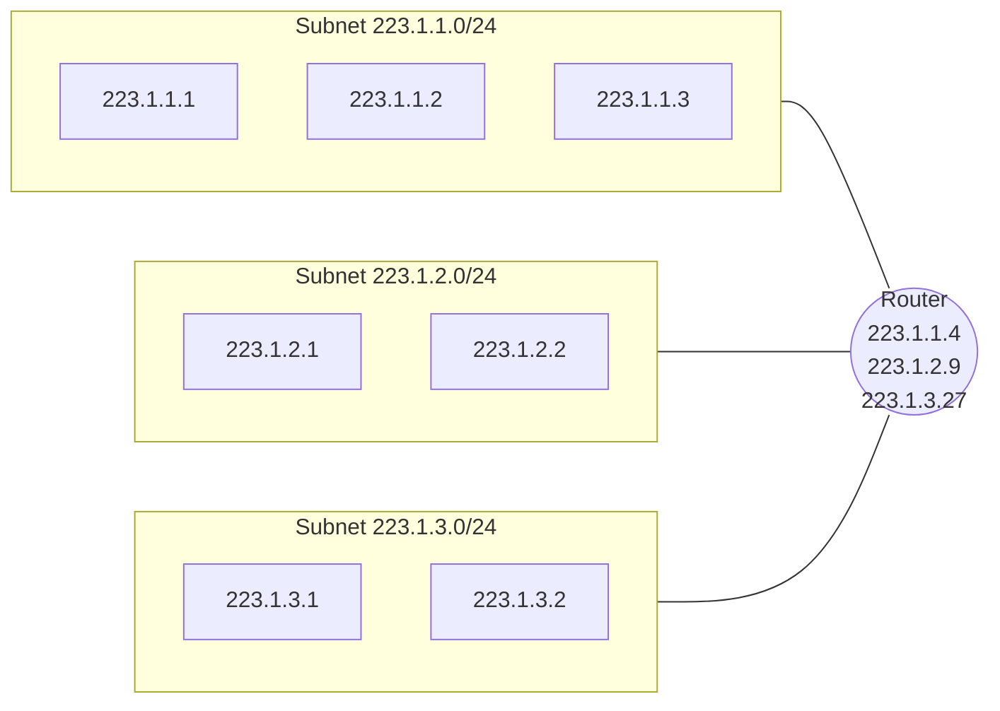
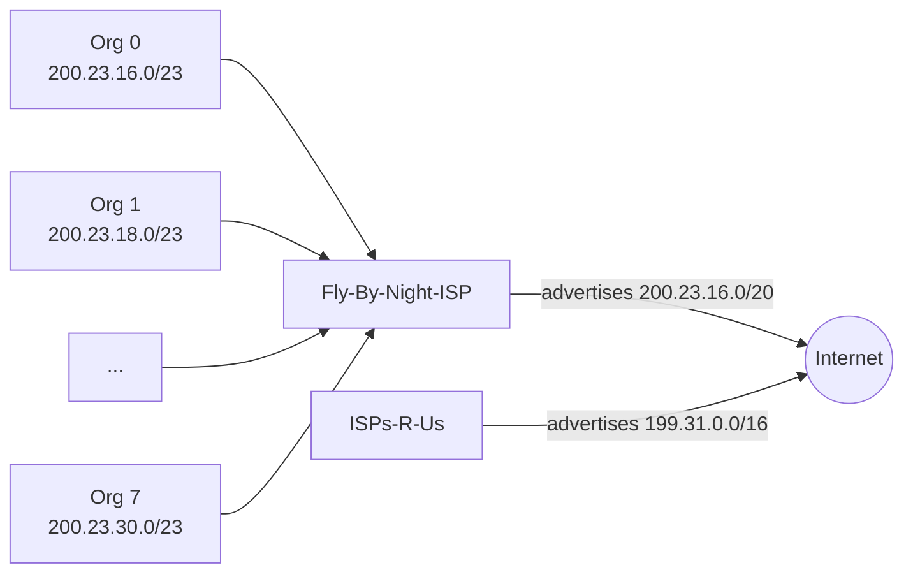
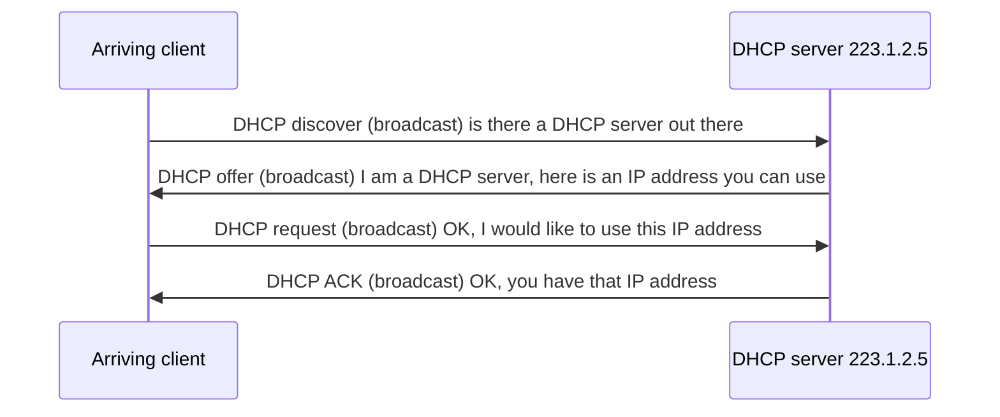
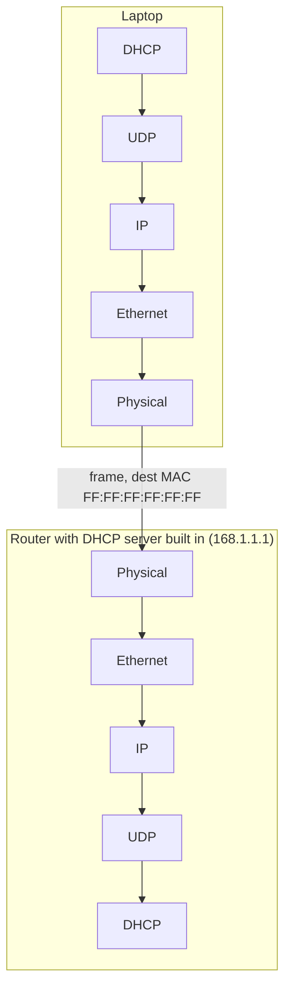
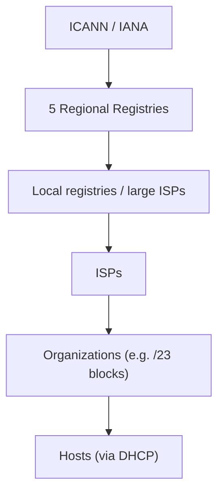

# Unit 4: Network Layer and Internet Protocol
## IPv4 Addressing, Subnets, CIDR and DHCP

> [!abstract] What this note covers
> All 31 slides of this deck: IP address and interface, dotted-decimal conversion (both exercises solved), subnets (including the 6-subnet quiz), CIDR and prefix/mask tables, why classful addressing was dropped (with the classification exercise solved), how an ISP hands out address blocks, route aggregation and "more specific routes", how a host gets an address (DHCP: all four messages, fields, and the encapsulation example), and the "last words" on ICANN and IPv4 exhaustion. Expanded with definitions, subnet arithmetic recipes, worked examples and practice questions.
> **"Beyond the slides"** = extra material. **"Slide caveat"** = slide wording/typo to be aware of.
> Related notes: [[IP_Datagram_Format_Notes]], [[IP_Fragmentation_Notes]], [[Router_Architecture_Forwarding_Notes]] (longest prefix match), [[Network_Layer_Overview_Notes]].

## Table of contents
1. [[#1. Where we are]]
2. [[#2. Glossary]]
3. [[#3. IP address, interface and dotted-decimal notation]]
4. [[#4. Subnets]]
5. [[#5. CIDR: classless addressing]]
6. [[#6. Classful addressing and why it was dropped]]
7. [[#7. How a network gets an address block]]
8. [[#8. Hierarchical addressing and route aggregation]]
9. [[#9. How a host gets an address]]
10. [[#10. DHCP]]
11. [[#11. IP addressing: last words]]
12. [[#12. Worked examples]]
13. [[#13. Practice questions with answers]]
14. [[#14. Cheat sheet]]

---

## 1. Where we are

| Section | Topic | Status |
|---|---|---|
| 4.1 to 4.3 | Network layer overview, router, switching | done |
| 4.4 | IP: datagram format | done: [[IP_Datagram_Format_Notes]] |
| 4.4 | IP: fragmentation | done: [[IP_Fragmentation_Notes]] |
| **4.4** | **IP: IPv4 addressing** | **this note** |
| 4.4 | IP: NAT | next |
| **4.5** | **DHCP** (and ICMP) | **DHCP in this note** |
| 4.6, 4.7 | IPv6 addressing, routing algorithms | later |

The slide sequence is: addressing basics → subnets → CIDR → classful (and why not) → getting a block → route aggregation → getting a host address (DHCP) → last words.

---

## 2. Glossary

> [!info] Read this first.

| Term | Definition |
|---|---|
| **IP address (IPv4)** | A **32-bit** identifier associated with each host or router **interface**. |
| **Interface** | The connection between a host/router and a physical link. Routers typically have **multiple** interfaces; hosts typically one or two (e.g. wired Ethernet, wireless 802.11). **IP addresses belong to interfaces, not to machines.** |
| **Dotted-decimal notation** | Writing the 32 bits as four 8-bit groups (bytes/octets), each in decimal, separated by dots. |
| **Octet** | 8 bits; one of the four parts of an IPv4 address (0 to 255). |
| **Subnet** | A group of device interfaces that can physically reach each other **without passing through an intervening router**; they share the same subnet (network) part of the address. |
| **Subnet part (network prefix)** | The high-order bits of an address shared by all devices in the subnet. |
| **Host part** | The remaining low-order bits that identify a particular interface within the subnet. |
| **Subnet mask** | A 32-bit pattern with 1s over the subnet part and 0s over the host part. Describes which part of an address refers to the subnet and which to the host (e.g. 255.255.255.0 = /24). |
| **Prefix length (/x)** | Number of bits in the subnet part. |
| **CIDR** | Classless InterDomain Routing (said "cider"): the subnet portion has **arbitrary length**; address format `a.b.c.d/x`. |
| **Network address** | The address with all **host bits = 0**; identifies the subnet itself (not assigned to a host). |
| **Broadcast address (directed)** | The address with all **host bits = 1**; sends to all hosts in the subnet. |
| **Limited broadcast address** | **255.255.255.255**: broadcast to everyone on the local link; never forwarded by routers. |
| **Classful addressing** | The old scheme with fixed network sizes: Class A (/8), B (/16), C (/24); plus Class D (multicast), E (reserved). |
| **Address block** | A contiguous range of addresses described by one prefix. |
| **ISP** | Internet Service Provider; gets large blocks and allocates sub-blocks to customers. |
| **Route (address) aggregation / summarization** | Advertising **one prefix** that covers many smaller networks. |
| **Longest prefix match** | Routers pick the matching forwarding-table entry with the longest prefix ([[Router_Architecture_Forwarding_Notes#6. Longest prefix matching]]). |
| **DHCP** | Dynamic Host Configuration Protocol: a host dynamically obtains an IP address from a network server when it joins. |
| **Lease** | The time period for which a DHCP-assigned address is valid; it can be renewed. |
| **yiaddr** | "Your IP address" field in a DHCP message: the address being offered/assigned. |
| **Transaction ID** | Number tying together the messages of one DHCP exchange. |
| **First-hop router (default gateway)** | The router a host sends non-local traffic to. |
| **ICANN** | Internet Corporation for Assigned Names and Numbers: allocates IP addresses (via regional registries) and manages the DNS root zone. |
| **RIR** | Regional Internet Registry: one of 5 regional registries that distribute addresses. |
| **IPv6** | Next-generation IP with 128-bit addresses. |

---

## 3. IP address, interface and dotted-decimal notation

> [!quote] Slide: IP addressing, introduction
> - **IP address:** 32-bit unique ID associated with each host or router **interface**
> - **interface:** connection between host/router and physical link
>   - routers typically have **multiple interfaces**
>   - host typically has **one or two interfaces** (e.g. wired Ethernet, wireless 802.11)

### 3.1 Dotted-decimal
Slide example: **223.1.1.1 = 11011111 00000001 00000001 00000001**, i.e. 223 · 1 · 1 · 1.

Each octet = 8 bits = value 0 to 255. Total: $2^{32} = 4{,}294{,}967{,}296$ possible addresses.

**Bit weights in one octet:** `128 64 32 16 8 4 2 1`.

### 3.2 Binary to dotted-decimal (slide exercise)
> [!question] Slide
> Change these from binary to dotted-decimal. **Solution:** replace each group of 8 bits by its decimal value and add dots.

a. `10000001 00001011 00001011 11101111`
- 10000001 = 128 + 1 = **129**
- 00001011 = 8 + 2 + 1 = **11**
- 00001011 = **11**
- 11101111 = 128 + 64 + 32 + 8 + 4 + 2 + 1 = **239**
- **Answer: 129.11.11.239** ✓ (matches the slide)

b. `11000001 10000011 00011011 11111111`
- 11000001 = 128 + 64 + 1 = **193**
- 10000011 = 128 + 2 + 1 = **131**
- 00011011 = 16 + 8 + 2 + 1 = **27**
- 11111111 = **255**
- **Answer: 193.131.27.255** ✓

### 3.3 Dotted-decimal to binary (slide exercise)
> [!question] Slide
> **Solution:** replace each decimal number with its binary equivalent.

a. **111.56.45.78**
- 111 = 64 + 32 + 8 + 4 + 2 + 1 → `01101111`
- 56 = 32 + 16 + 8 → `00111000`
- 45 = 32 + 8 + 4 + 1 → `00101101`
- 78 = 64 + 8 + 4 + 2 → `01001110`
- **Answer: 01101111 00111000 00101101 01001110** ✓

b. **221.34.7.82**
- 221 = 128 + 64 + 16 + 8 + 4 + 1 → `11011101`
- 34 = 32 + 2 → `00100010`
- 7 → `00000111`
- 82 = 64 + 16 + 2 → `01010010`
- **Answer: 11011101 00100010 00000111 01010010** ✓

> [!tip] Method
> Greedy: take the largest weight that fits, subtract, continue. Write 1 under the weights you used, 0 under the rest.

### 3.4 How are interfaces connected? (slide)
> [!quote] Slide
> **Q:** how are interfaces actually connected? **A:** we'll learn about that in chapters 6, 7.
> - **Wired Ethernet** interfaces are connected by **Ethernet switches**.
> - **Wireless WiFi** interfaces are connected by a **WiFi base station**.
> **For now:** don't need to worry about how one interface is connected to another (with no intervening router).

The key point: hosts that are connected at the link layer (via a switch or access point) *without a router in between* are on the **same subnet**.

---

## 4. Subnets

> [!quote] Slide: What's a subnet?
> - Device interfaces that can **physically reach each other without passing through an intervening router**.
> - **IP addresses have structure:**
>   - **subnet part:** devices in the same subnet have **common high-order bits**
>   - **host part:** remaining **low-order bits**
> - A portion of a network that shares a particular subnet address.

The slide's network (a "network consisting of **3 subnets**"): addresses 223.1.1.x, 223.1.2.x and 223.1.3.x; one router with interfaces 223.1.1.4, 223.1.2.9 and 223.1.3.27.

### 4.1 Recipe for defining subnets (slide)
> [!quote] Slide
> - **Detach each interface from its host or router, creating "islands" of isolated networks.**
> - **Each isolated network is called a subnet.**

Result: three subnets **223.1.1.0/24**, **223.1.2.0/24**, **223.1.3.0/24**, with **subnet mask /24**: the **high-order 24 bits** are the subnet part.

### 4.2 Subnet mask
> [!quote] Slide
> A 32-bit combination used to describe which portion of an address refers to the subnet and which part refers to the host.

For /24: `11111111 11111111 11111111 00000000` = **255.255.255.0**. 

**Same subnet test:** AND each address with the mask; if results are equal, they are in the same subnet. 
- 223.1.1.1 AND 255.255.255.0 = 223.1.1.0; 223.1.1.4 AND mask = 223.1.1.0 → **same subnet** (direct delivery).
- 223.1.1.1 vs 223.1.2.1 → 223.1.1.0 vs 223.1.2.0 → **different** subnets (need a router).

### 4.3 Quiz: "Where are the subnets? What are the /24 subnet addresses?" (slide)
The slide's network has three routers connected to each other by point-to-point links, plus hosts on LAN segments. Detaching every interface leaves **six islands**:

| # | Subnet | Contains (interfaces) |
|---|---|---|
| 1 | **223.1.1.0/24** | hosts 223.1.1.1, 223.1.1.2, 223.1.1.4 and the top router's 223.1.1.3 |
| 2 | **223.1.2.0/24** | hosts 223.1.2.1, 223.1.2.2 and left router's 223.1.2.6 |
| 3 | **223.1.3.0/24** | hosts 223.1.3.1, 223.1.3.2 and right router's 223.1.3.27 |
| 4 | **223.1.7.0/24** | top router's 223.1.7.0 ↔ right router's 223.1.7.1 (point-to-point link) |
| 5 | **223.1.8.0/24** | left router's 223.1.8.1 ↔ right router's 223.1.8.0 (link) |
| 6 | **223.1.9.0/24** | left router's 223.1.9.1 ↔ top router's 223.1.9.2 (link) |

> [!note] Rule
> **Every link between two routers is also a subnet**, even though it has just two interfaces. Number of subnets = number of "islands" after detaching all interfaces from hosts/routers.

---

## 5. CIDR: classless addressing

> [!quote] Slide
> **CIDR: Classless InterDomain Routing** (pronounced "cider")
> - **Subnet portion of address of arbitrary length**
> - **Address format: a.b.c.d/x**, where **x is the number of bits in the subnet portion** of the address

Slide example: **200.23.16.0/23**

| | Bits |
|---|---|
| Address in binary (23-bit and 9-bit parts) | `11001000 00010111 0001000` followed by `0 00000000` |
| **Subnet part (23 bits)** | `11001000 00010111 0001000` |
| **Host part (9 bits)** | `0 00000000` |

Range: from `...00010000.00000000` to `...00010001.11111111` → **200.23.16.0 to 200.23.17.255**, i.e. $2^9 = 512$ addresses. Mask for /23 = **255.255.254.0**.

### 5.1 Special addresses inside a block
For a block with $h$ host bits:
- **Network address:** all host bits 0 (e.g. 200.23.16.0)
- **Broadcast address:** all host bits 1 (e.g. 200.23.17.255)
- **Usable host addresses:** $2^h - 2$ (the two special ones are not assigned to hosts). For /23: $2^9 - 2 = 510$.

### 5.2 CIDR block table (slide)
> [!note] Slide caveat
> The slide's column says "# Host Addresses (inclusive of network and broadcast id)". These are **total addresses in the block**, and the number of *valid hosts* is 2 less (e.g. /30: 4 addresses, valid hosts = 2).

| Prefix | Addresses in block | Usable hosts | Prefix | Addresses | Usable hosts |
|---|---|---|---|---|---|
| /30 | 4 | 2 | /20 | 4,096 | 4,094 |
| /29 | 8 | 6 | /19 | 8,192 | 8,190 |
| /28 | 16 | 14 | /18 | 16,384 | 16,382 |
| /27 | 32 | 30 | /17 | 32,768 | 32,766 |
| /26 | 64 | 62 | /16 | 65,536 | 65,534 |
| /25 | 128 | 126 | /15 | 131,072 | 131,070 |
| /24 | 256 | 254 | /14 | 262,144 | 262,142 |
| /23 | 512 | 510 | /13 | 524,288 | 524,286 |
| /22 | 1,024 | 1,022 | /12 | 1,048,576 | 1,048,574 |
| /21 | 2,048 | 2,046 | | | |

Formula: addresses = $2^{32 - x}$.

### 5.3 Prefix lengths and masks (slide)

| /n | Mask | /n | Mask | /n | Mask | /n | Mask |
|---|---|---|---|---|---|---|---|
| /1 | 128.0.0.0 | /9 | 255.128.0.0 | /17 | 255.255.128.0 | /25 | 255.255.255.128 |
| /2 | 192.0.0.0 | /10 | 255.192.0.0 | /18 | 255.255.192.0 | /26 | 255.255.255.192 |
| /3 | 224.0.0.0 | /11 | 255.224.0.0 | /19 | 255.255.224.0 | /27 | 255.255.255.224 |
| /4 | 240.0.0.0 | /12 | 255.240.0.0 | /20 | 255.255.240.0 | /28 | 255.255.255.240 |
| /5 | 248.0.0.0 | /13 | 255.248.0.0 | /21 | 255.255.248.0 | /29 | 255.255.255.248 |
| /6 | 252.0.0.0 | /14 | 255.252.0.0 | /22 | 255.255.252.0 | /30 | 255.255.255.252 |
| /7 | 254.0.0.0 | /15 | 255.254.0.0 | /23 | 255.255.254.0 | /31 | 255.255.255.254 |
| **/8** | **255.0.0.0** | /16 | **255.255.0.0** | /24 | **255.255.255.0** | /32 | 255.255.255.255 |

> [!quote] Slide
> The addresses in colour (/8, /16, /24) are the **default masks for classes A, B and C**. Thus **classful addressing is a special case of classless addressing**.

**How to read a mask quickly:** the interesting octet takes values from the series 128, 192, 224, 240, 248, 252, 254, 255 (each adds one more 1-bit from the left).

### 5.4 Recipe: find network, broadcast and host range from `a.b.c.d/x`
1. Find the "interesting octet" (the one where the prefix ends) and the **block size** $= 256 - \text{mask value in that octet}$.
2. Network address = largest multiple of the block size that is ≤ the address's value in that octet (lower octets 0).
3. Broadcast = network + block size − 1 in that octet (lower octets 255).
4. Hosts = everything between.

Example: **192.168.10.77/26** → mask 255.255.255.192, block size 64 in the 4th octet; 77 lies in 64–127 → network **192.168.10.64**, broadcast **192.168.10.127**, hosts **.65 to .126** (62 hosts).

---

## 6. Classful addressing and why it was dropped

### 6.1 The classes (slide table)

| Class | Leading bits (HOB) | Net-ID bits | Host-ID bits | No. of networks | Hosts per network | Start address | End address | Default mask |
|---|---|---|---|---|---|---|---|---|
| **A** | 0 | 8 | 24 | $2^7 = 128$ | $2^{24} = 16{,}777{,}216$ | 0.0.0.0 | 127.255.255.255 | 255.0.0.0 (/8) |
| **B** | 10 | 16 | 16 | $2^{14} = 16{,}384$ | $2^{16} = 65{,}536$ | 128.0.0.0 | 191.255.255.255 | 255.255.0.0 (/16) |
| **C** | 110 | 24 | 8 | $2^{21} = 2{,}097{,}152$ | $2^8 = 256$ | 192.0.0.0 | 223.255.255.255 | 255.255.255.0 (/24) |
| **D** | 1110 | n/a | n/a | n/a | n/a | 224.0.0.0 | 239.255.255.255 | **multicast** |
| **E** | 1111 | n/a | n/a | n/a | n/a | 240.0.0.0 | 255.255.255.255 | **reserved (experimental)** |

- **Broadcast address: 255.255.255.255.**
- **Number-of-networks formula:** $2^n$ where $n$ = network bits *excluding the fixed class bits* (hence $2^7$, $2^{14}$, $2^{21}$). **Hosts per network:** $2^h - 2$ where $h$ = host bits.

**Quick class identification by first octet:** A: 0 to 127 · B: 128 to 191 · C: 192 to 223 · D: 224 to 239 · E: 240 to 255.

### 6.2 Why not classful? (slide)
> [!quote] Slide
> - Network portion: **8, 16 or 24 bits**, known as **Class A, B, C**.
> - **Class C (/24)** accommodates only $2^8 - 2 = 254$ hosts (two of the 256 addresses are reserved) → **too small for many organizations**.
> - **Class B (/16)** supports up to 65,534 hosts and **Class A (/8)** up to 16,777,214 hosts → **too large, poor utilization**.
> - **Classful addressing, which is almost obsolete, is replaced with classless addressing.**

> [!warning] Slide caveat
> The slide prints "65,634" for Class B. The correct value is $2^{16} - 2 = $ **65,534**.

**The problem in one example:** a company needs 2,000 addresses. A Class C (254) is far too small; a Class B (65,534) wastes ~63,500 addresses (97% unused). With CIDR it can get a **/21** (2,046 hosts), almost perfectly sized.

Other classful problems: fixed granularity, rapid exhaustion of Class B, huge routing tables (each Class C is a separate route).

### 6.3 Exercise: find the class of each address (slide)
| Address | Reasoning | Class |
|---|---|---|
| a. `00000001 00001011 00001011 11101111` | **First bit is 0** | **A** |
| b. `11000001 10000011 00011011 11111111` | **First 2 bits are 1, third bit is 0** (110) | **C** |
| c. 14.23.120.8 | **First byte is 14** (0 to 127) | **A** |
| d. 252.5.15.111 | **First byte is 252** (240 to 255) | **E** |

(b in decimal = 193.131.27.255, first byte 193 is within 192–223 ✓.)

---

## 7. How a network gets an address block

> [!quote] Slide: IP addresses, how to get one?
> **Q:** how does a network get the subnet part of an IP address? **A:** it gets an **allocated portion of its provider ISP's address space**.

Slide example: the **ISP's block is 200.23.16.0/20** (`11001000 00010111 00010000 00000000`). The ISP can allocate its space in **8 blocks** of /23:

| Organization | Address (binary) | Prefix |
|---|---|---|
| Organization 0 | `11001000 00010111 00010000 00000000` | **200.23.16.0/23** |
| Organization 1 | `11001000 00010111 00010010 00000000` | **200.23.18.0/23** |
| Organization 2 | `11001000 00010111 00010100 00000000` | **200.23.20.0/23** |
| Organization 3 | `11001000 00010111 00010110 00000000` | 200.23.22.0/23 |
| Organization 4 | `11001000 00010111 00011000 00000000` | 200.23.24.0/23 |
| Organization 5 | `11001000 00010111 00011010 00000000` | 200.23.26.0/23 |
| Organization 6 | `11001000 00010111 00011100 00000000` | 200.23.28.0/23 |
| Organization 7 | `11001000 00010111 00011110 00000000` | **200.23.30.0/23** |

(Rows 3 to 6 are filled in by continuing the pattern: the slide elides them with "...".)

**Why exactly 8 blocks?** Going from /20 to /23 uses $23 - 20 = 3$ extra bits, so $2^3 = 8$ sub-blocks. Each /23 has 512 addresses; $8 \times 512 = 4096 = $ the size of the /20 ✓. The third octet of each block increases by 2 (16, 18, 20, ..., 30) because a /23 spans two values of the third octet.

> [!note] Terminology (*beyond the slides*)
> Splitting a bigger block into smaller blocks = **subnetting**. Combining smaller blocks into a bigger one = **supernetting / aggregation**. Giving each subnet a size that matches its need (different prefix lengths) = **VLSM** (variable-length subnet masking), which CIDR makes possible.

---

## 8. Hierarchical addressing and route aggregation

> [!quote] Slide
> **Hierarchical addressing allows efficient advertisement of routing information.**

### 8.1 Route aggregation (slide)
The picture: Organizations 0 to 7 (200.23.16.0/23 ... 200.23.30.0/23) connect to **Fly-By-Night-ISP**. Another ISP, **ISPs-R-Us**, owns 199.31.0.0/16. Each ISP advertises one prefix to the rest of the Internet:
- Fly-By-Night-ISP: **"Send me anything with addresses beginning 200.23.16.0/20"**
- ISPs-R-Us: **"Send me anything with addresses beginning 199.31.0.0/16"**

> [!quote] Slide
> The ability to use a **single prefix to advertise multiple networks** is often referred to as **address aggregation** (also **route aggregation** or **route summarization**).

**Benefit:** the Internet sees **one route instead of eight**. This keeps global routing tables small and routing updates few. Aggregation only works when addresses are allocated **hierarchically**: the customer's block lies *inside* the provider's block.

### 8.2 More specific routes (slide)
> [!quote] Slide
> - **Organization 1 moves from Fly-By-Night-ISP to ISPs-R-Us.**
> - **ISPs-R-Us now advertises a more specific route to Organization 1.**

Now ISPs-R-Us advertises: **"199.31.0.0/16 or 200.23.18.0/23"**. Fly-By-Night-ISP still advertises 200.23.16.0/20 (which, taken alone, still *covers* Org 1's addresses).

So Internet routers hold both entries:

| Prefix | Next hop |
|---|---|
| 200.23.16.0/20 | Fly-By-Night-ISP |
| 200.23.18.0/23 | ISPs-R-Us |
| 199.31.0.0/16 | ISPs-R-Us |

**Longest prefix match decides** ([[Router_Architecture_Forwarding_Notes#6. Longest prefix matching]]; this is the "why LPM?" teaser from 4.2):

| Destination | Matching prefixes | Winner |
|---|---|---|
| 200.23.18.77 (Org 1) | /20 and **/23** | **/23 → ISPs-R-Us** ✓ |
| 200.23.20.5 (Org 2) | /20 only | /20 → Fly-By-Night-ISP |
| 199.31.4.9 | /16 only | ISPs-R-Us |

Org 1 keeps its addresses (no renumbering), traffic is delivered correctly, and nobody else's routes change. Cost: one extra entry in the global table (loss of perfect aggregation).

---

## 9. How a host gets an address

> [!quote] Slide: That's actually two questions
> 1. **How does a host get an IP address within its network** (host part of address)?
> 2. **How does a network get an IP address for itself** (network part of address)?

Section 7 answered #2 (block from the ISP). Now #1:

> [!quote] Slide: How does a host get an IP address?
> - **Hard-coded by a sysadmin** in a config file (e.g. `/etc/rc.config` in UNIX)
> - **DHCP: Dynamic Host Configuration Protocol:** dynamically get an address from a server. **"Plug-and-play"**.

| | Manual (static) | DHCP (dynamic) |
|---|---|---|
| Effort | Admin configures each host | Automatic |
| Mobility | Poor (must reconfigure in each network) | Good |
| Address reuse | None | Addresses reused when hosts leave |
| Errors | Typos, duplicate addresses | Server prevents duplicates |
| Typical use | Servers, routers | Laptops, phones, most hosts |

---

## 10. DHCP

### 10.1 Goal and benefits (slide)
> [!quote] Slide
> **Goal:** host dynamically obtains an IP address from a network server when it "joins" the network.
> - can **renew its lease** on an address in use
> - allows **reuse of addresses** (only hold an address while connected/on)
> - support for **mobile users** who join/leave the network

### 10.2 The four-message exchange (slide)
> [!quote] Slide: DHCP overview
> 1. host broadcasts **DHCP discover** msg *[optional]*
> 2. DHCP server responds with **DHCP offer** msg *[optional]*
> 3. host requests IP address: **DHCP request** msg
> 4. DHCP server sends address: **DHCP ack** msg

Memory aid: **D-O-R-A** (Discover, Offer, Request, Acknowledge).

### 10.3 The slide's scenario, field by field
Setting: subnet with a **DHCP server 223.1.2.5**; an **arriving DHCP client needs an address in this network**. The slide notes that **typically the DHCP server is co-located in the router, serving all subnets to which the router is attached**.

| Step | Message | Source (IP, port) | Destination (IP, port) | yiaddr | Transaction ID | Lifetime |
|---|---|---|---|---|---|---|
| 1 | **DHCP discover** | 0.0.0.0, **68** | 255.255.255.255, **67** | 0.0.0.0 | 654 | n/a |
| 2 | **DHCP offer** | 223.1.2.5, **67** | 255.255.255.255, **68** | **223.1.2.4** | 654 | 3600 secs |
| 3 | **DHCP request** | 0.0.0.0, **68** | 255.255.255.255, **67** | **223.1.2.4** | **655** | 3600 secs |
| 4 | **DHCP ACK** | 223.1.2.5, **67** | 255.255.255.255, **68** | **223.1.2.4** | 655 | 3600 secs |

**Reading the table**
- **UDP ports:** the **server uses port 67**, the **client uses port 68**. DHCP messages travel in UDP datagrams.
- **0.0.0.0 as source:** the client doesn't have an address yet ("this host").
- **255.255.255.255 (limited broadcast) as destination:** the client does not know the server's address, so it broadcasts to everyone on the local link.
- **yiaddr** ("your IP address"): 0.0.0.0 in the discover; the offered/assigned address (**223.1.2.4**) in the later messages.
- **Transaction ID:** matches replies to requests. The offer repeats 654 from the discover, and the slide shows the request/ACK pair with a different ID (**655**).
  > [!note] Slide caveat
  > In RFC 2131 the client normally keeps the **same transaction ID (xid) across all four messages** of one exchange. The slide's change from 654 to 655 is a teaching simplification. For exams, reproduce the slide's values; in a real packet capture you will usually see one xid.
- **Lifetime 3600 s = 1 hour:** the **lease**. The client must renew before it expires or stop using the address.

> [!quote] Slide note [RFC 2131]
> **The first two steps (discover and offer) can be skipped "if a client remembers and wishes to reuse a previously allocated network address"**, hence "[optional]" on the earlier slide. The client goes straight to a DHCP request.

### 10.4 Why is the *request* also broadcast? *(beyond the slides)*
More than one DHCP server may answer the discover with offers. The client picks one and **broadcasts** the request, so **all servers see which offer was accepted** and the others can withdraw theirs and release the addresses they held back. Also, the client still has no address, so it can't unicast.

### 10.5 DHCP: more than IP addresses (slide)
> [!quote] Slide
> DHCP can return more than just the allocated IP address on the subnet:
> - **address of the first-hop router** for the client
> - **name and IP address of the DNS server**
> - **network mask** (indicating network versus host portion of the address)

So a single DHCP exchange gives a host everything it needs to start communicating: **IP address, subnet mask, default gateway, DNS server.**

### 10.6 DHCP example: connecting laptop (slides)
> [!quote] Slide
> - The **connecting laptop uses DHCP** to get an IP address, the address of its first-hop router and the address of the DNS server.
> - The **DHCP REQUEST message is encapsulated in UDP, encapsulated in IP, encapsulated in Ethernet.**
> - The **Ethernet frame is broadcast (dest: FFFFFFFFFFFF)** on the LAN and received at the router running the DHCP server.
> - **Ethernet is demultiplexed to IP, IP demultiplexed to UDP, UDP demultiplexed to DHCP.**

Setup: a **router with the DHCP server built in** (router address 168.1.1.1 on the slide).

**Layer-by-layer on the way out:** DHCP message → UDP (src port 68, dst port 67) → IP (src 0.0.0.0, dst 255.255.255.255) → Ethernet (dst MAC FF:FF:FF:FF:FF:FF = **link-layer broadcast**).

**Reply (second example slide):**
> [!quote] Slide
> - The **DHCP server formulates a DHCP ACK** containing the client's IP address, the IP address of the first-hop router for the client, and the name and IP address of the DNS server.
> - The **encapsulated DHCP server reply is forwarded to the client**, demuxing up to DHCP at the client.
> - The **client now knows** its IP address, the name and IP address of the DNS server, and the IP address of its first-hop router.

### 10.7 More DHCP details *(beyond the slides)*
| Item | Detail |
|---|---|
| **Lease renewal** | At **T1 = 50%** of the lease the client unicasts a request to renew; at **T2 = 87.5%** it broadcasts to any server; if the lease expires, it must stop using the address and restart from discover |
| **Other messages** | DHCPNAK (server refuses a request), DHCPDECLINE (client found the address in use), DHCPRELEASE (client gives the address back), DHCPINFORM (client already has an address, asks only for settings) |
| **Relay agent** | A router can forward DHCP broadcasts as unicasts to a DHCP server on another subnet, so one server can serve many subnets |
| **Why UDP?** | Client has no IP yet, so a connection-oriented protocol like TCP can't be used; broadcast needs UDP |
| **Security** | Rogue DHCP servers can hand out a malicious gateway/DNS; DHCP starvation attacks exhaust the pool. Mitigation: DHCP snooping on switches |

---

## 11. IP addressing: last words

> [!quote] Slide
> **Q: How does an ISP get a block of addresses?**
> **A: ICANN: Internet Corporation for Assigned Names and Numbers** (www.icann.org)
> - **allocates IP addresses, through 5 regional registries (RRs)**, who may then allocate to local registries
> - **manages the DNS root zone**, including delegation of individual TLD (.com, .edu, ...) management

The five regional Internet registries (*beyond the slides*): **ARIN** (North America), **RIPE NCC** (Europe, Middle East, parts of Central Asia), **APNIC** (Asia-Pacific), **LACNIC** (Latin America and Caribbean), **AFRINIC** (Africa). 

> [!quote] Slide
> **Q: Are there enough 32-bit IP addresses?**
> - **ICANN allocated the last chunk of IPv4 addresses to the RRs in 2011.**
> - **NAT (next) helps IPv4 address space exhaustion.**
> - **IPv6 has a 128-bit address space.**

The slide ends with Vint Cerf's remark about how nobody could foresee how much address space would be needed when IPv4 was fixed at 32 bits.

**The numbers:** IPv4 $2^{32} \approx 4.3\times10^{9}$ addresses; IPv6 $2^{128} \approx 3.4\times10^{38}$.

---

## 12. Worked examples

### Example 1: Same subnet or not?
Mask 255.255.255.0. Are 223.1.3.27 and 223.1.3.1 in the same subnet? AND with the mask: both 223.1.3.0 → **yes**. 223.1.3.27 and 223.1.2.2: 223.1.3.0 vs 223.1.2.0 → **no** (a router is needed).

### Example 2: Details of a CIDR address
**200.23.16.0/20**
- Mask: 255.255.240.0; host bits = 12 → $2^{12} = 4096$ addresses, 4094 usable
- Block size in the 3rd octet = 256 − 240 = 16 → third octet 16 to 31
- Network: 200.23.16.0; broadcast: **200.23.31.255**; usable: 200.23.16.1 to 200.23.31.254

### Example 3: Which of the eight /23s contains 200.23.25.9?
Third octet 25 → blocks start at 16, 18, ..., so 25 lies in 24–25 → **Organization 4 (200.23.24.0/23)**.

### Example 4: Subnet a /24 into four equal subnets
Block 192.168.1.0/24 → need 4 subnets → borrow 2 bits → **/26** (mask 255.255.255.192), 64 addresses (62 usable) each:

| Subnet | Network | Usable hosts | Broadcast |
|---|---|---|---|
| 1 | 192.168.1.0/26 | .1 to .62 | .63 |
| 2 | 192.168.1.64/26 | .65 to .126 | .127 |
| 3 | 192.168.1.128/26 | .129 to .190 | .191 |
| 4 | 192.168.1.192/26 | .193 to .254 | .255 |

### Example 5: VLSM, different sizes from one block
From **200.23.16.0/24**, allocate for 100 hosts, 50 hosts and 25 hosts:
- 100 hosts → need $2^h - 2 \ge 100$ → h = 7 → **/25** → **200.23.16.0/25** (126 hosts)
- 50 hosts → h = 6 → **/26** → **200.23.16.128/26** (62 hosts)
- 25 hosts → h = 5 → **/27** → **200.23.16.192/27** (30 hosts)
(Allocate the largest first; blocks must not overlap: 0–127, 128–191, 192–223.)

### Example 6: Aggregate four networks
192.168.0.0/24, 192.168.1.0/24, 192.168.2.0/24, 192.168.3.0/24 are contiguous and aligned (third octet 0 to 3 = 4 values = 2 bits) → aggregate to **192.168.0.0/22** (mask 255.255.252.0).

### Example 7: Longest prefix match with the "move" scenario
Table: 200.23.16.0/20 → A; 200.23.18.0/23 → B; default → C. Packet to 200.23.19.200: third octet 19 lies in 18–19 → matches /23 (and /20) → **B**. Packet to 200.23.22.1: /20 only → **A**. Packet to 10.0.0.1 → default **C**.

### Example 8: Hosts needed vs class
A company needs 5,000 hosts. Classful: Class B (65,534; ~92% waste). CIDR: need $2^h - 2 \ge 5000$ → h = 13 (8190) → **/19**.

### Example 9: DHCP lease timing
Lease = 3600 s. T1 (renew) = 1800 s; T2 (rebind) = 3150 s (87.5%). If no server answers by 3600 s, the client stops using 223.1.2.4 and restarts discovery.

### Example 10: Decode the DHCP packet headers
Discover: IP src 0.0.0.0 / UDP 68, IP dst 255.255.255.255 / UDP 67, Ethernet dst FF:FF:FF:FF:FF:FF. All three destination fields say "everyone on this link", because the client doesn't know any address yet.

---

## 13. Practice questions with answers

**Q1. Define IP address and interface. How many addresses does a router typically have?**
A 32-bit identifier of a host/router interface. A router has one per interface (several); a host has one or two.

**Q2. Convert 10000001 00001011 00001011 11101111 to dotted-decimal.**
129.11.11.239.

**Q3. Convert 221.34.7.82 to binary.**
11011101 00100010 00000111 01010010.

**Q4. What is a subnet? State the recipe for finding subnets.**
Interfaces that can reach each other without a router in between, sharing the same high-order bits. Detach every interface from its host/router to form isolated "islands"; each island is a subnet.

**Q5. How many subnets are in the slide's 3-router network, and what are they?**
Six: 223.1.1.0/24, 223.1.2.0/24, 223.1.3.0/24, 223.1.7.0/24, 223.1.8.0/24, 223.1.9.0/24 (router-to-router links are subnets too).

**Q6. What does the /24 subnet mask mean?**
The high-order 24 bits are the subnet part; mask = 255.255.255.0; 8 host bits (254 usable hosts).

**Q7. Explain CIDR and the format a.b.c.d/x.**
Classless InterDomain Routing: the subnet part can be any length x; address written as a.b.c.d/x.

**Q8. For 200.23.16.0/23, give the range and the number of usable hosts.**
200.23.16.0 to 200.23.17.255; 512 addresses; 510 usable.

**Q9. Why are 2 addresses subtracted when counting hosts?**
The all-0s host part is the network address and the all-1s host part is the broadcast address; neither is assigned to a host.

**Q10. List classes A to E with their leading bits and first-octet ranges.**
A: 0, 0 to 127; B: 10, 128 to 191; C: 110, 192 to 223; D: 1110, 224 to 239 (multicast); E: 1111, 240 to 255 (reserved).

**Q11. Why was classful addressing abandoned?**
Only three sizes: Class C too small (254 hosts), Class B too large (65,534, poor utilisation); led to wasted addresses and large routing tables. Replaced by CIDR.

**Q12. Find the class of 14.23.120.8 and 252.5.15.111.**
Class A and Class E.

**Q13. How does an organisation obtain a block? Give the slide's example.**
It is allocated a portion of its ISP's block. ISP block 200.23.16.0/20 splits into eight /23 blocks for Organizations 0 to 7 (200.23.16.0/23 ... 200.23.30.0/23).

**Q14. What is route aggregation and why does it help?**
Advertising a single prefix (e.g. 200.23.16.0/20) for many networks; reduces routing table size and update traffic.

**Q15. Org 1 moves to ISPs-R-Us. What changes and how does the Internet still route correctly?**
ISPs-R-Us also advertises the more specific 200.23.18.0/23; routers use longest prefix match, so traffic for Org 1 goes to ISPs-R-Us while the rest of 200.23.16.0/20 still goes to Fly-By-Night-ISP.

**Q16. Two ways a host gets an IP address?**
Hard-coded by a sysadmin, or dynamically via DHCP.

**Q17. List the DHCP messages in order and say which are optional.**
Discover, Offer, Request, ACK. Discover and Offer are optional if the client reuses a previously allocated address.

**Q18. Why are DHCP messages broadcast and what ports are used?**
The client has no address and doesn't know the server; source 0.0.0.0, destination 255.255.255.255. Server port 67, client port 68 (UDP).

**Q19. What else can DHCP provide besides the IP address?**
Address of the first-hop router, name and IP address of the DNS server, network mask.

**Q20. Describe the encapsulation of a DHCP request on Ethernet.**
DHCP in UDP in IP in an Ethernet frame sent to the broadcast MAC address FF:FF:FF:FF:FF:FF; demultiplexed up at the router/DHCP server.

**Q21. Who allocates IP addresses globally, and what happened in 2011?**
ICANN, through 5 regional registries; the last IPv4 chunk was allocated to the registries in 2011. NAT and IPv6 are the responses to this exhaustion.

**Q22. How big is the IPv6 address space?**
128 bits.

**Q23. How many hosts can a /27 hold? What is its mask?**
$2^5 - 2 = 30$ hosts; 255.255.255.224.

**Q24. A host has IP 192.168.10.77/26. What are its network and broadcast addresses?**
Network 192.168.10.64; broadcast 192.168.10.127.

---

## 14. Cheat sheet

> [!summary] One-page revision

**IPv4 address:** 32 bits, per **interface**, dotted-decimal (4 octets). $2^{32} \approx 4.3$ billion.

**Subnet:** interfaces reachable without a router; common high-order bits (**subnet part**) + **host part**. Mask: 1s for the subnet part.

**CIDR:** `a.b.c.d/x`; block = $2^{32-x}$ addresses; usable hosts $2^{32-x} - 2$; network (host bits 0) and broadcast (host bits 1) reserved.

| Prefix | Mask | Addresses |
|---|---|---|
| /8 | 255.0.0.0 | 16,777,216 |
| /16 | 255.255.0.0 | 65,536 |
| /20 | 255.255.240.0 | 4,096 |
| /23 | 255.255.254.0 | 512 |
| /24 | 255.255.255.0 | 256 |
| /26 | 255.255.255.192 | 64 |
| /30 | 255.255.255.252 | 4 |

**Classful:** A (0, /8, 1.0.0.0 to 127.x), B (10, /16, 128 to 191), C (110, /24, 192 to 223), D multicast (224 to 239), E reserved (240 to 255). Obsolete: sizes too small/large. 

**Getting addresses:** *Network:* block from ISP (ISP /20 → eight /23s). *Host:* static or **DHCP**.

**Aggregation:** one prefix for many networks (200.23.16.0/20). **More specific route** (200.23.18.0/23) + **longest prefix match** handles moves.

**DHCP (DORA):** Discover → Offer → Request → ACK; UDP **server 67, client 68**; discover/request from **0.0.0.0** to **255.255.255.255**; yiaddr = offered address; lease (e.g. 3600 s); returns also **gateway, DNS, mask**; discover/offer optional when reusing an address. Encapsulation: DHCP/UDP/IP/Ethernet (dest FF:FF:FF:FF:FF:FF).

**Last words:** ICANN → 5 RIRs → ISPs; last IPv4 chunk allocated in **2011**; **NAT** and **IPv6 (128-bit)** are the answers.

---
*Source: PES University Computer Networks, Team Networks, Unit 4 slides (IPv4 addressing, DHCP). Extra material follows the standard treatment in Kurose & Ross, "Computer Networking: A Top-Down Approach".*
