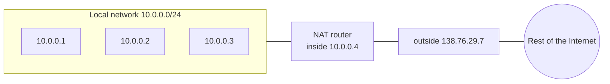
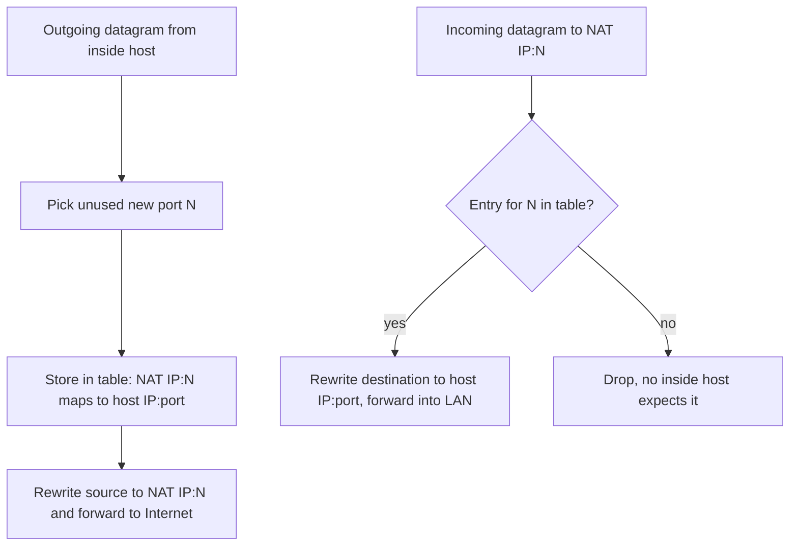
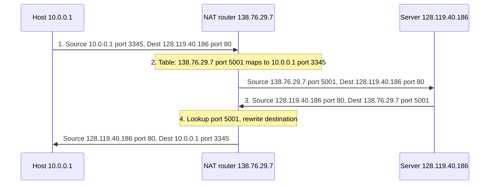

# Unit 4: Network Layer and Internet Protocol
## 4.4 NAT: Network Address Translation

> [!abstract] What this note covers
> All slides of the NAT deck: private address space, the idea that a whole local network shares one public IPv4 address, how a NAT router rewrites (address, port) pairs using a translation table, the full 4-step example (10.0.0.1:3345 ↔ 138.76.29.7:5001), the advantages, why NAT is controversial, and the NAT traversal fix (static port forwarding). I added how NAT works in detail (checksums, timeouts, limits), types of NAT, traversal techniques (UPnP, STUN, TURN), carrier-grade NAT, worked problems and practice questions.
> **"Beyond the slides"** = extra material. **"Slide caveat"** = slide wording/typo to be aware of.
> Related notes: [[IPv4_Addressing_DHCP_Notes]] (address exhaustion, DHCP), [[IP_Datagram_Format_Notes]] (header fields), [[Router_Architecture_Forwarding_Notes]], [[Network_Layer_Overview_Notes]].

## Table of contents
1. [[#1. Where we are]]
2. [[#2. Glossary]]
3. [[#3. Why NAT? The problem]]
4. [[#4. Private address space]]
5. [[#5. NAT: the big idea]]
6. [[#6. NAT implementation: what the router must do]]
7. [[#7. The 4-step example]]
8. [[#8. Advantages of NAT]]
9. [[#9. Why NAT is controversial]]
10. [[#10. NAT traversal]]
11. [[#11. Beyond the slides: details, types and limits]]
12. [[#12. Worked examples]]
13. [[#13. Practice questions with answers]]
14. [[#14. Cheat sheet]]

---

## 1. Where we are

| Section | Topic | Status |
|---|---|---|
| 4.1 to 4.3 | Network layer overview, router, switching | done |
| 4.4 | IP: datagram format, fragmentation, IPv4 addressing | done |
| **4.4** | **IP: NAT** | **this note** (last topic of 4.4) |
| 4.5 | DHCP, ICMP | DHCP done in [[IPv4_Addressing_DHCP_Notes]]; ICMP overview in [[IP_Datagram_Format_Notes#8. ICMP the network layer's error reporting]] |
| 4.6 | IPv6 addressing | next |
| 4.7 | Introduction to routing algorithms | later |

**Link with the previous deck:** in the IPv4 addressing deck's "last words", the slides said *"NAT (next) helps IPv4 address space exhaustion"* and that ICANN gave out the last IPv4 chunk in 2011. This deck explains **how**.

---

## 2. Glossary

> [!info] Read this first.

| Term | Definition |
|---|---|
| **NAT (Network Address Translation)** | A technique where a router rewrites the IP addresses (and port numbers) in datagrams as they cross between a private local network and the public Internet. |
| **NAT router / NAT box** | The router (often your home router) that performs the translation. |
| **Private (local) IP address** | An address from a reserved range that is valid **only inside a local network** and is not routed on the public Internet. |
| **Public (global) IP address** | An address that is unique on the Internet and routable. |
| **NAT IP address (WAN-side address)** | The single public address of the NAT router's external interface (138.76.29.7 in the slides). |
| **LAN side / WAN side** | LAN side = the local, inside network. WAN side = the outside, Internet-facing side. |
| **Port number** | 16-bit transport-layer (TCP/UDP) identifier of a process/socket. NAT uses ports to tell the inside hosts' connections apart. |
| **Socket (address, port) pair** | An IP address together with a port number, e.g. 10.0.0.1:3345. |
| **NAT translation table** | The table in the NAT router mapping each WAN-side (NAT IP, new port) to the corresponding LAN-side (private IP, port). |
| **Transparent** | The hosts inside and the servers outside do not know NAT is happening. |
| **PAT / NAPT** | Port Address Translation / Network Address and Port Translation: the form of NAT in the slides, where many private hosts share **one** public IP by using different ports. Also called "NAT overload". |
| **Static NAT** | Fixed one-to-one mapping between a private and a public address (or port). |
| **Dynamic NAT** | Private addresses are mapped to a *pool* of public addresses on demand. |
| **Port forwarding** | A static rule: traffic arriving at (NAT IP, port X) is always sent to (private host, port Y). |
| **NAT traversal** | Techniques that let an outside client reach (or two hosts behind NATs reach each other) a service that sits behind NAT. |
| **End-to-end argument** | Design principle: functions should be implemented at the end hosts, keeping the network core simple. |
| **Layer violation** | A device processing information belonging to a higher layer than it should (a router looking at port numbers). |
| **Middlebox** | A device in the network path (NAT, firewall...) that does more than forwarding. |
| **CGNAT (carrier-grade NAT)** | NAT done at the ISP/cellular network, serving many customers at once. |
| **IPv6** | The 128-bit address protocol that removes the need for NAT. |

---

## 3. Why NAT? The problem

- IPv4 has only $2^{32} \approx 4.3$ billion addresses; the last free blocks were allocated in 2011 ([[IPv4_Addressing_DHCP_Notes#11. IP addressing last words]]).
- A household or company may have dozens of devices (phones, laptops, TVs, IoT). Giving each device its own public address is impossible at scale.
- Changing ISP means renumbering (the addresses belong to the ISP's block, see route aggregation).

**NAT's trick:** let all devices inside use *private* addresses and make them **share one public address** towards the Internet.

---

## 4. Private address space

> [!quote] Slide
> All devices in the local network have **32-bit addresses in a "private" IP address space (10/8, 172.16/12, 192.168/16 prefixes)** that can **only be used in the local network**.

| Prefix | Range | Number of addresses | Classful equivalent |
|---|---|---|---|
| **10.0.0.0/8** | 10.0.0.0 to 10.255.255.255 | $2^{24} = 16{,}777{,}216$ | one Class A |
| **172.16.0.0/12** | 172.16.0.0 to **172.31.255.255** | $2^{20} = 1{,}048{,}576$ | 16 Class B blocks |
| **192.168.0.0/16** | 192.168.0.0 to 192.168.255.255 | $2^{16} = 65{,}536$ | 256 Class C blocks |

(These are defined in RFC 1918.)

**Properties**
- **Not unique globally**: your home network and mine can both use 192.168.1.0/24.
- **Not routable on the Internet**: ISP routers do not forward datagrams with private source or destination addresses (they drop them). That is exactly why a translator is needed to talk to the outside.
- **Free of charge**: no need to ask an ISP or registry.

**Why 172.16/12?** The prefix has 12 fixed bits: `10101100 0001` (172 = 10101100; the next 4 bits are 0001), so the second octet varies from `0001 0000` to `0001 1111`, i.e. **16 to 31**. So 172.15.x.x and 172.32.x.x are **public**, not private.

> [!note] Slide notation
> The slide writes the prefixes as **10/8, 172.16/12, 192.168/16** (dropping trailing zero octets) and the home network as **10.0.0/24**. They mean 10.0.0.0/8, 172.16.0.0/12, 192.168.0.0/16 and 10.0.0.0/24.

---

## 5. NAT: the big idea

> [!quote] Slide
> **NAT:** all devices in the local network **share just one IPv4 address as far as the outside world is concerned**.

Slide picture:
- **Local network (e.g. home network) 10.0.0/24** with hosts **10.0.0.1, 10.0.0.2, 10.0.0.3** and the router's inner interface **10.0.0.4**.
- The NAT router's outer interface has the single public address **138.76.29.7**, facing the **rest of the Internet**.

> [!quote] Slide
> - **All datagrams *leaving* the local network have the *same* source NAT IP address: 138.76.29.7, but *different* source port numbers.**
> - **Datagrams with source or destination in this network have a 10.0.0/24 address for source, destination (as usual).**

Inside: hosts talk with private addresses as usual. Outside: the world sees only **one address (138.76.29.7)**. The **ports** are what keep the different hosts' connections apart.

---

## 6. NAT implementation: what the router must do

> [!quote] Slide: implementation: the NAT router must (transparently)
> 1. **Outgoing datagrams:** replace **(source IP address, port #)** of every outgoing datagram with **(NAT IP address, new port #)**.
>    - Remote clients/servers will respond using **(NAT IP address, new port #)** as the destination address.
> 2. **Remember** (in the **NAT translation table**) every **(source IP address, port #) → (NAT IP address, new port #)** translation pair.
> 3. **Incoming datagrams:** replace **(NAT IP address, new port #)** in the destination fields of every incoming datagram with the corresponding **(source IP address, port #)** stored in the NAT table.

### Why ports are essential
If NAT only swapped the IP address, then when a reply arrives addressed to 138.76.29.7 the router could not tell **which inside host** it belongs to (they all share that address). The **new port number** is the unique key. 
- Two inside hosts may both use the same source port (e.g. 3345). NAT gives them **different** outside ports (e.g. 5001 and 5002), so there is no clash.

### What is "transparent"?
Neither the inside host nor the remote server knows about the translation: the host believes it uses 10.0.0.1:3345, the server believes it talks to 138.76.29.7:5001.

---

## 7. The 4-step example

> [!quote] Slide: NAT translation table
> **WAN side addr:** 138.76.29.7, 5001 ↔ **LAN side addr:** 10.0.0.1, 3345

Setup: NAT router with inside interface 10.0.0.4 and outside address 138.76.29.7. A web server is at **128.119.40.186**, port **80**.

| Step | What happens | Datagram (Source → Destination) |
|---|---|---|
| **1** | Host **10.0.0.1** sends a datagram to **128.119.40.186, 80** | **S: 10.0.0.1, 3345 → D: 128.119.40.186, 80** |
| **2** | NAT router **changes the source address** from 10.0.0.1, 3345 to **138.76.29.7, 5001** and **updates the table** (adds 138.76.29.7,5001 ↔ 10.0.0.1,3345) | **S: 138.76.29.7, 5001 → D: 128.119.40.186, 80** |
| **3** | **Reply arrives**; destination address is **138.76.29.7, 5001** | **S: 128.119.40.186, 80 → D: 138.76.29.7, 5001** |
| **4** | NAT looks up port 5001 in the table, **rewrites the destination** back to **10.0.0.1, 3345**, forwards into the LAN | **S: 128.119.40.186, 80 → D: 10.0.0.1, 3345** |

**What changed and what did not**
| Field | Outbound | Inbound |
|---|---|---|
| Source IP / port | **rewritten** (10.0.0.1:3345 → 138.76.29.7:5001) | unchanged (server's) |
| Destination IP / port | unchanged (server's) | **rewritten** (138.76.29.7:5001 → 10.0.0.1:3345) |

> [!tip] Beyond the slides: what else NAT must update
> Rewriting the IP address/port changes the packet, so NAT must also **recompute the IP header checksum** and the **TCP/UDP checksum** (the TCP/UDP checksum covers a "pseudo-header" that includes the IP addresses, plus the ports). That is another way NAT touches the transport layer.

---

## 8. Advantages of NAT

> [!quote] Slide: advantages
> - **Just *one* IP address needed from the provider ISP for *all* devices.**
> - **Can change addresses of hosts in the local network without notifying the outside world.**
> - **Can change ISP without changing addresses of devices in the local network.**
> - **Security: devices inside the local net are not directly addressable, visible by the outside world.**

| Advantage | Explanation |
|---|---|
| **One public address for all devices** | Conserves IPv4 addresses; cheaper (ISPs often charge per public address) |
| **Free renumbering inside** | Inside addresses are private and unknown to the world, so changing them (e.g. new DHCP range) needs no external announcement |
| **ISP independence** | Switching ISP only changes the NAT router's one external address; no need to renumber every host (contrast with ISP-allocated blocks, [[IPv4_Addressing_DHCP_Notes#8. Hierarchical addressing and route aggregation]]) |
| **Basic security** | Unsolicited incoming packets have no table entry and are dropped, so internal hosts cannot be directly reached/scanned from outside |

> [!warning] Be careful with "security"
> NAT hides inside hosts only as a side effect: it is not a real firewall (it doesn't inspect or filter content, and outbound malware connections pass freely). Treat it as a mild protective effect, not a security guarantee.

---

## 9. Why NAT is controversial

> [!quote] Slide: NAT has been controversial
> - **Routers "should" only process up to layer 3.**
> - **Address "shortage" should be solved by IPv6.**
> - **Violates the end-to-end argument** (port # manipulation by a network-layer device).
> - **NAT traversal:** what if a client wants to connect to a server behind NAT?
>
> **But NAT is here to stay:** extensively used in home and institutional nets, **4G/5G cellular nets**.

| Objection | Explanation |
|---|---|
| **Layer violation** | A router is a layer-3 device, but NAT reads and **modifies layer-4 port numbers** (and checksums). Routers are supposed to look only at the IP header. |
| **IPv6 is the real fix** | NAT is a patch for IPv4 exhaustion; IPv6's 128-bit space gives every device a unique address ([[IPv4_Addressing_DHCP_Notes#11. IP addressing last words]]). |
| **End-to-end argument violated** | Hosts should be able to address each other directly; the network core should be simple and transparent. NAT breaks end-to-end addressing: a host can't even know its own "public" address, and the network now holds **per-connection state** (the translation table). |
| **NAT traversal problem** | An outside client cannot initiate a connection to a host behind NAT: the NAT has no table entry (entries are created only by *outgoing* traffic). |
| *(Beyond the slides)* **Breaks some protocols** | Protocols that carry IP addresses/ports inside the payload (FTP, SIP/VoIP, some P2P) need special "application-level gateways" or workarounds. |
| *(Beyond the slides)* **Fragility / state** | Table entries time out; if the NAT reboots, all connections are lost. |

**Why it stays:** it works, it is cheap, it is already deployed in nearly every home router and in ISP networks; IPv6 adoption is gradual.

---

## 10. NAT traversal

> [!question] Slide
> What if a **client** wants to connect to a **server behind NAT**? In the picture: an outside client (?) wants to reach a server **10.0.0.1** inside; the NAT router's inner interface is 10.0.0.4 and its outer address is **138.76.29.7**.

**The problem:** the client can only see the NAT's public address. The client's first packet arrives at the NAT with no matching table entry, so the NAT doesn't know which inside machine should receive it, and drops it.

> [!quote] Slide: Solution
> **Statically configure NAT to forward incoming connection requests at a given port to the server**, e.g. **(123.76.29.7, port 25000) always forwarded to 10.0.0.1 port 25000.**

This is **static NAT / port forwarding**: a permanent table entry created by the administrator.

| WAN side (permanent entry) | LAN side |
|---|---|
| NAT IP, port 25000 | 10.0.0.1, port 25000 |

Now any outside client that connects to *(NAT IP, 25000)* is delivered to 10.0.0.1:25000. Different services can be mapped to different ports (e.g. port 8080 → camera at 10.0.0.7:80).

> [!note] Slide caveat
> The slide's figure labels the NAT's public address **138.76.29.7**, but the example text says **123.76.29.7**. They should be the same address; this is a typo on the slide. In your answers, use the NAT router's single public address consistently.

### 10.1 Other traversal techniques *(beyond the slides)*
1. **UPnP / IGD (Internet Gateway Device protocol):** an inside host *asks* the NAT router to create a port-forwarding rule automatically ("Learn my public address and add a mapping"). Used by games and P2P apps. Convenient but a security risk.
2. **Relaying (TURN):** if direct connection is impossible, both peers connect *outbound* to a public **relay server**, which forwards traffic between them (e.g. Skype's historical supernodes, WebRTC TURN).
3. **STUN / ICE / hole punching:** a host asks a public **STUN server** "what address and port do you see me as?", learns its NAT-mapped (public IP, port), and exchanges it with a peer; both then send packets to each other simultaneously, so each NAT creates an outgoing entry that admits the other's packets. **ICE** (used in WebRTC) tries direct, STUN-derived and relayed paths in order.

---

## 11. Beyond the slides: details, types and limits

### 11.1 How many connections can one public IP support?
The port field is 16 bits → at most $2^{16} = 65{,}536$ ports. Excluding well-known/reserved ports (0 to 1023), there are roughly **64,500 usable ports** per transport protocol per public address. Each simultaneous connection from inside needs its own NAT port, so one public IP can sustain **tens of thousands of simultaneous connections**. (In practice more, since entries are keyed by the full 5-tuple in some NATs.)

### 11.2 Types of NAT
| Type | What it does | Where used |
|---|---|---|
| **Static NAT** | Fixed 1-to-1 private↔public mapping | Servers needing a fixed public address |
| **Dynamic NAT** | Private hosts get a public address from a **pool** while they need it (1-to-1 at a time) | Companies with several public IPs |
| **PAT / NAPT (NAT overload)** | **Many private hosts → one public IP**, distinguished by port (the slide's NAT) | Home routers, most common |
| **Port forwarding** | Static rule for inbound traffic to a port | Hosting servers behind NAT |

*Behaviour classes (full-cone, restricted, port-restricted, symmetric)* describe how strict the NAT is about which outside hosts may send packets back through an entry; symmetric NAT is the hardest for peer-to-peer traversal.

### 11.3 NAT table entries and timeouts
- Entries are **created by outgoing packets** and **removed after inactivity** (e.g. UDP ~30 s to a few minutes; established TCP connections hours; TCP entries are removed after FIN/RST).
- If an entry expires while a connection is idle, the next incoming packet is dropped. Applications send periodic **keepalives** to keep the mapping alive.

### 11.4 Carrier-grade NAT (CGNAT)
ISPs (especially **4G/5G cellular networks**, as the slide notes) put customers behind **ISP-level NAT**: many subscribers share one public IP. Often a second NAT layer sits in the home router ("double NAT"). A special **shared address space 100.64.0.0/10** (RFC 6598) is reserved for the ISP-internal side of CGNAT. Consequences: port forwarding at home no longer works; some games/P2P need relays.

### 11.5 NAT and ICMP, fragmentation
- ICMP error messages carry a copy of the original header, so NAT must also rewrite the embedded addresses.
- Fragments after the first have no transport header (no ports), so NAT must reassemble or track fragments ([[IP_Fragmentation_Notes]]).

### 11.6 NAT vs IPv6
IPv6 gives every device a globally unique address, restoring end-to-end connectivity, so NAT is not needed (firewalls provide the protection NAT's side effect gave). 

---

## 12. Worked examples

### Example 1: Which addresses are private?
| Address | Private? | Reason |
|---|---|---|
| 10.200.3.4 | **Yes** | within 10.0.0.0/8 |
| 172.20.5.5 | **Yes** | second octet 20 within 16 to 31 |
| 172.32.0.1 | **No** | second octet 32 is outside 16 to 31 |
| 172.15.9.9 | **No** | 15 is below 16 |
| 192.168.100.1 | **Yes** | within 192.168.0.0/16 |
| 192.169.1.1 | **No** | second octet must be 168 |
| 11.0.0.1 | **No** | 10/8 only |
| 8.8.8.8 | **No** | public |

### Example 2: Two hosts, same source port
Hosts 10.0.0.1 and 10.0.0.2 both open connections from port 3345 to 128.119.40.186:80. NAT public IP 138.76.29.7.

| WAN side (NAT IP, port) | LAN side (host, port) |
|---|---|
| 138.76.29.7, **5001** | 10.0.0.1, 3345 |
| 138.76.29.7, **5002** | 10.0.0.2, 3345 |

Replies to ...:5001 go to 10.0.0.1, replies to ...:5002 go to 10.0.0.2. Without the distinct ports the replies would be ambiguous.

### Example 3: Build the datagrams for a 10.0.0.3 request
Host 10.0.0.3 (port 4400) contacts 93.184.216.34:443; NAT assigns port 6000.
- Inside: **S 10.0.0.3:4400 → D 93.184.216.34:443**
- Outside (after NAT): **S 138.76.29.7:6000 → D 93.184.216.34:443**
- Reply outside: **S 93.184.216.34:443 → D 138.76.29.7:6000**
- Reply inside (after NAT): **S 93.184.216.34:443 → D 10.0.0.3:4400**
- Table: 138.76.29.7,6000 ↔ 10.0.0.3,4400.

### Example 4: Unsolicited packet
A packet from 203.0.113.9:1234 arrives at 138.76.29.7:7777 and the table has no entry for port 7777 → NAT **drops** it (no inside host asked for it). That's the "security" side effect.

### Example 5: Port forwarding rule
Rule: (138.76.29.7, 25000) → (10.0.0.1, 25000). A client sends S 198.51.100.2:55555 → D 138.76.29.7:25000. NAT rewrites destination: **S 198.51.100.2:55555 → D 10.0.0.1:25000**. The server's reply S 10.0.0.1:25000 → D 198.51.100.2:55555 is rewritten to **S 138.76.29.7:25000 → D 198.51.100.2:55555**.

### Example 6: Capacity
Usable ports ≈ 64,500 per public IP. If each user keeps ~100 simultaneous connections, one public IP can support about 645 users. That's why CGNAT deployments assign each subscriber a **slice of ports** on a shared public address.

### Example 7: Checksum impact
NAT changes the source IP and port, so which checksums need recomputation? **IP header checksum** (address changed) and **TCP/UDP checksum** (pseudo-header contains IP addresses, header contains the port).

### Example 8: Address count of the private blocks
$2^{24} + 2^{20} + 2^{16} = 16{,}777{,}216 + 1{,}048{,}576 + 65{,}536 = 17{,}891{,}328$ addresses reserved for private use in total.

---

## 13. Practice questions with answers

**Q1. What is NAT and what problem does it solve?**
A router rewrites addresses/ports so that many devices with private addresses share one public IPv4 address, conserving scarce addresses.

**Q2. Name the private address ranges.**
10.0.0.0/8, 172.16.0.0/12 (172.16.0.0 to 172.31.255.255), 192.168.0.0/16.

**Q3. Why can't private addresses be used on the Internet?**
They are not globally unique and ISP routers do not route them; they are only valid inside local networks.

**Q4. What do the datagrams leaving the local network look like?**
All have the same source NAT IP address (e.g. 138.76.29.7) but different source port numbers.

**Q5. What three things must the NAT router do?**
Replace (source IP, port) of outgoing datagrams with (NAT IP, new port); remember each mapping in the NAT translation table; replace (NAT IP, new port) in incoming datagrams' destination with the stored (host IP, port).

**Q6. Why does NAT need port numbers?**
All inside hosts share one public IP, so the port number is the only way to know which inside host an incoming reply belongs to.

**Q7. Trace the slide example.**
10.0.0.1:3345 → 128.119.40.186:80; NAT rewrites source to 138.76.29.7:5001, table entry (138.76.29.7,5001 ↔ 10.0.0.1,3345); reply to 138.76.29.7:5001; NAT rewrites destination to 10.0.0.1:3345.

**Q8. List four advantages of NAT.**
One IP address for all devices; change inside addresses without telling the outside; change ISP without renumbering inside; devices not directly addressable or visible from outside.

**Q9. Why is NAT controversial? Give four reasons.**
Routers should process only up to layer 3; the shortage should be fixed by IPv6; it violates the end-to-end argument (port manipulation by a network-layer device); it makes it hard to reach servers behind NAT (traversal).

**Q10. Why is NAT "here to stay"?**
It works and is widely deployed in home and institutional networks and 4G/5G cellular networks; IPv6 adoption is slow.

**Q11. What is the NAT traversal problem?**
An outside client can't initiate a connection to a server behind NAT: the NAT has no table entry for the unsolicited packet and doesn't know which inside host to forward it to.

**Q12. How does static port forwarding solve it?**
The administrator configures a permanent rule, e.g. (NAT IP, port 25000) → (10.0.0.1, port 25000), so incoming connection requests at that port always reach the server.

**Q13. Name two other NAT traversal methods.**
UPnP/IGD (host asks the router for a mapping), STUN/ICE hole punching, or a relay (TURN).

**Q14. How many simultaneous connections can one public IP support with NAT?**
Limited by the 16-bit port space: up to about 65,536 ports, so tens of thousands of connections.

**Q15. Does NAT need to change checksums?**
Yes: IP header checksum and TCP/UDP checksum, because addresses/ports change.

**Q16. Is NAT a firewall?**
No. It blocks unsolicited inbound packets only as a side effect (no table entry); it doesn't inspect traffic or stop outbound attacks.

**Q17. What is CGNAT?**
Carrier-grade NAT at the ISP, common in cellular (4G/5G) networks: many subscribers share one public address, often using 100.64.0.0/10 internally.

**Q18. Is 172.32.5.6 private? Is 192.168.255.254?**
No (second octet 32 is outside 16 to 31). Yes (within 192.168.0.0/16).

**Q19. Which layer does a NAT router operate at, and why is this a problem?**
It is a network-layer device but changes transport-layer ports, violating the layering principle and the end-to-end argument.

**Q20. How does IPv6 remove the need for NAT?**
128-bit addresses give every device a globally unique address, so no sharing or translation is needed and end-to-end addressing is restored.

---

## 14. Cheat sheet

> [!summary] One-page revision

**Private ranges:** 10.0.0.0/8 · 172.16.0.0/12 (172.16 to 172.31) · 192.168.0.0/16. Only usable inside a local network.

**NAT idea:** all inside devices look like **one public IP** to the world; **ports** tell connections apart.

**NAT router must (transparently):**
1. **Outgoing:** (src IP, port) → (NAT IP, new port)
2. **Remember** the pair in the **NAT translation table**
3. **Incoming:** (NAT IP, new port) in destination → (host IP, port) from table

**Slide example**
| Step | Datagram |
|---|---|
| 1 | S 10.0.0.1:3345 → D 128.119.40.186:80 |
| 2 | S 138.76.29.7:5001 → D 128.119.40.186:80 (table: 138.76.29.7,5001 ↔ 10.0.0.1,3345) |
| 3 | S 128.119.40.186:80 → D 138.76.29.7:5001 |
| 4 | S 128.119.40.186:80 → D 10.0.0.1:3345 |

**Advantages:** one IP for all · change inside addresses freely · change ISP without renumbering · hosts not directly visible.

**Controversy:** only layer 3 · IPv6 is the real fix · breaks end-to-end argument · NAT traversal. **But** widely used (home, institutional, 4G/5G).

**NAT traversal fix:** static **port forwarding**, e.g. (NAT IP, 25000) → (10.0.0.1, 25000). Others: UPnP, STUN/ICE, TURN relay.

**Remember:** NAT = per-connection state in the network · must fix IP and TCP/UDP checksums · table entries time out · not a real firewall.

---
*Source: PES University Computer Networks, Team Networks, Unit 4 slides (4.4: NAT). Extra material follows the standard treatment in Kurose & Ross, "Computer Networking: A Top-Down Approach".*
