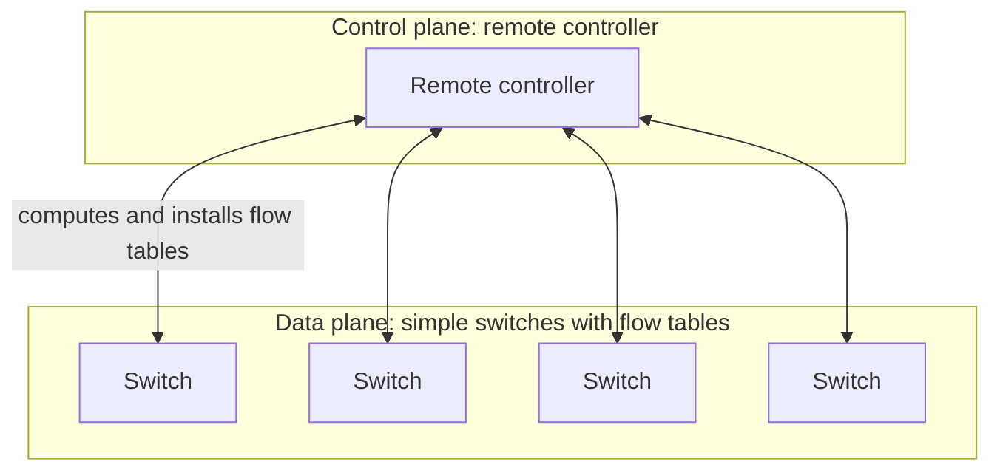
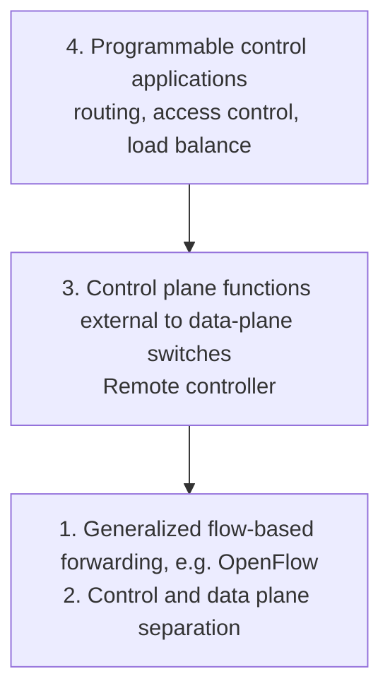
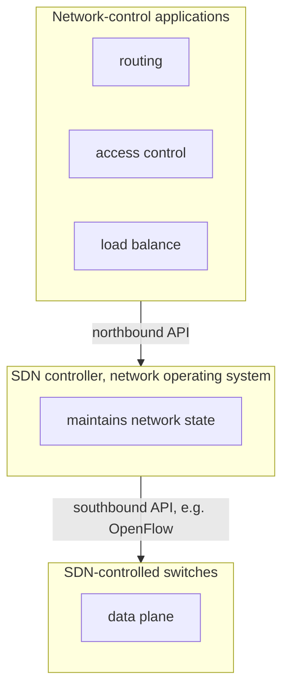
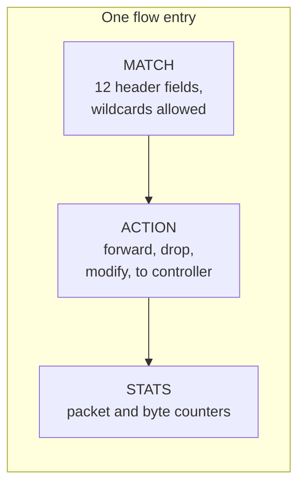
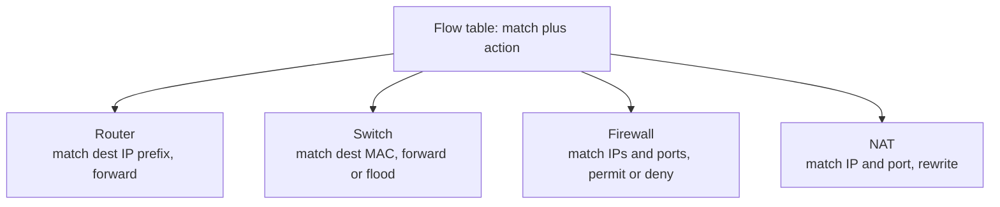
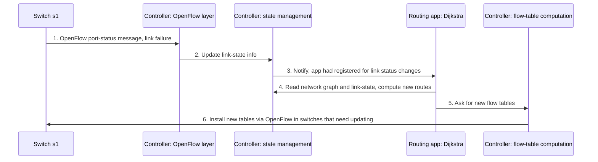

# Unit 4: Network Layer and Internet Protocol
## Software Defined Networking (SDN) and OpenFlow

> [!abstract] What this note covers
> All 31 slides of this deck: why the per-router control plane was rethought, the SDN idea (a remote, logically centralized controller computes and installs forwarding tables), why centralize, the mainframe-to-PC analogy, the **four key characteristics** of SDN, the architecture (data-plane switches, SDN controller with its northbound/southbound APIs, network-control apps), the three controller layers, the **OpenFlow protocol** and its messages, **generalized forwarding with flow tables (match, action, priority, counters)**, the OpenFlow match fields, the "one abstraction unifies router, switch, firewall and NAT" idea, all the OpenFlow examples, the 6-step link-failure interaction example, and the summary (P4). Expanded with definitions, worked flow-table problems, and practice questions.
> **"Beyond the slides"** = extra material. **"Slide caveat"** = slide wording/inconsistency to be aware of.
> Related notes: [[Network_Layer_Overview_Notes]] (forwarding vs routing, control vs data plane), [[Router_Architecture_Forwarding_Notes]] (match plus action, generalized forwarding), [[NAT_Notes]], [[Switching_Fabrics_Queueing_Notes]].

## Table of contents
1. [[#1. Where we are]]
2. [[#2. Glossary]]
3. [[#3. The traditional per-router control plane]]
4. [[#4. The SDN control plane]]
5. [[#5. Why a logically centralized control plane?]]
6. [[#6. Analogy: mainframe to PC]]
7. [[#7. The four key characteristics of SDN]]
8. [[#8. SDN architecture: switches, controller, applications]]
9. [[#9. Components of the SDN controller]]
10. [[#10. The OpenFlow protocol]]
11. [[#11. Generalized forwarding: match plus action]]
12. [[#12. Flow table entries and OpenFlow match fields]]
13. [[#13. One abstraction for many devices]]
14. [[#14. OpenFlow examples]]
15. [[#15. Control/data plane interaction: link failure example]]
16. [[#16. Generalized forwarding: summary]]
17. [[#17. Worked examples]]
18. [[#18. Practice questions with answers]]
19. [[#19. Cheat sheet]]

---

## 1. Where we are

> [!warning] Slide caveat: numbering
> This deck's roadmap slide is headed "**Unit – 3** Network Layer and Internet Protocol" (it should say Unit 4) and lists **4.5 Software Defined Networking (SDN)**. In the earlier decks, 4.5 was "Introduction to Network Layer Protocols (DHCP, ICMP)", with 4.6 IPv6 and 4.7 routing algorithms. The decks come from different versions of the course outline; don't worry about the section numbers, only the content.

| Topic | Status |
|---|---|
| 4.1 Network layer overview, 4.2 Router, 4.3 Switching | done |
| 4.4 IP: datagram, fragmentation, addressing, NAT | done |
| **SDN (this deck)** | **this note** |

**Link with earlier notes:** in [[Network_Layer_Overview_Notes#5. Interplay between routing and forwarding]] we learned that a **routing algorithm** (control plane) fills the **forwarding table** that the data plane uses; and in [[Router_Architecture_Forwarding_Notes#4.4 Two styles of forwarding]] we met **generalized forwarding** and "match plus action". SDN is where those two ideas come together.

---

## 2. Glossary

> [!info] Read this first.

| Term | Definition |
|---|---|
| **Control plane** | The network-wide logic that decides *how* packets should be forwarded (computing paths, filling forwarding tables). |
| **Data plane** | The per-packet forwarding hardware that executes the decisions. |
| **Per-router control plane** | Traditional design: every router runs its own control-plane software (routing protocols) and the routers cooperate to compute tables. |
| **Monolithic router** | A closed box combining switching hardware and a proprietary OS/software (e.g. Cisco IOS). |
| **Middlebox** | Specialised box for a network function: firewall, load balancer, NAT box. |
| **SDN (Software-Defined Networking)** | Architecture in which the control plane is separated from the data plane and implemented in software on remote servers (a controller) that program the switches. |
| **SDN controller (network OS)** | Software that maintains network state and provides APIs to control applications and to the switches. |
| **Logically centralized** | Appears as one central brain to applications, but is implemented as a distributed system of several servers for scalability and fault tolerance. |
| **Network-control application** | A program ("brains" of control) built on the controller's API: routing, access control, load balancing, etc. |
| **Northbound API** | Interface between the controller and the network-control applications above it (e.g. REST). |
| **Southbound API** | Interface between the controller and the switches below it (e.g. OpenFlow). |
| **SDN-controlled switch / data-plane switch** | A simple, fast device that forwards packets by looking up its **flow table**. |
| **Flow** | A set of packets identified by header field values (link, network and transport layers). |
| **Flow table (forwarding table)** | The table of match plus action rules in a switch. |
| **Flow entry (rule)** | One row: match, action, priority, counters. |
| **Match plus action** | Match header fields of an arriving packet, then apply the action of the matching entry. |
| **Wildcard (*)** | A match value meaning "any". |
| **Priority** | Number used to disambiguate overlapping patterns (highest priority wins). |
| **Counters** | Packet and byte counts kept per flow entry. |
| **OpenFlow** | The protocol (and abstraction) between an SDN controller and switches; also the name of the flow-table model. |
| **packet-in / packet-out** | OpenFlow messages: switch sends a packet to the controller / controller sends a packet out of a switch port. |
| **SNMP** | Simple Network Management Protocol, an older device-management protocol also used for controller-to-device communication. |
| **RESTful API** | Web-style API (HTTP) used e.g. by apps to talk to the controller. |
| **Intent** | A high-level policy ("what", not "how") that the controller translates into flow rules. |
| **P4** | A language for programming how the data plane processes packets. |
| **Active networking** | Early (1990s) research idea of programmable per-packet processing, the historical root of SDN. |

---

## 3. The traditional per-router control plane

> [!quote] Slide: Software Defined Networking (SDN)
> - Internet network layer: **historically implemented via a distributed, per-router control approach**:
>   - **monolithic router** contains switching hardware, runs **proprietary implementation of Internet standard protocols (IP, RIP, IS-IS, OSPF, BGP)** in **proprietary router OS** (e.g. Cisco IOS)
>   - different **"middleboxes"** for different network-layer functions: **firewalls, load balancers, NAT boxes, ...**
> - **~2005: renewed interest in rethinking the network control plane.**

> [!quote] Slide: Per-router control plane
> **Individual routing algorithm components *in each and every router* interact in the control plane to compute forwarding tables.**

The slide's figure: every router has a **routing algorithm** box (control plane, above the dashed line) that exchanges messages with the routing algorithms in the other routers; each computes its own **local forwarding table** (e.g. header 0100 → output 3, 0110 → 2, 0111 → 2, 1001 → 1) used by the **data plane**. An arriving packet with header value 0111 is sent out of link 2.

**Problems with this model**
| Problem | Explanation |
|---|---|
| **Closed, proprietary boxes** | Each vendor's hardware, OS and protocol implementation are bundled together; operators can't change behaviour. |
| **Slow innovation** | New features need new standards and new vendor firmware. |
| **Complex distributed algorithm** | The forwarding behaviour *emerges* from many routers' protocols; hard to reason about or change globally. |
| **Misconfiguration** | Each router is configured separately, so mistakes are common. |
| **Many specialised middleboxes** | A separate box for each function (firewall, load balancer, NAT) raises cost and complexity. |

---

## 4. The SDN control plane

> [!quote] Slide
> **Software-Defined Networking (SDN) control plane: a remote controller computes and installs forwarding tables in routers.**



Compared with the per-router picture, the routing algorithm boxes **moved out of the routers** into a **remote controller**. Each router/switch keeps only a small agent ("CA", control agent) that talks to the controller and a flow table used for forwarding. The arriving packet (header 0111) is still forwarded by the **local table** at line speed.

| | **Per-router control (traditional)** | **SDN** |
|---|---|---|
| Where are control decisions made? | In every router (distributed) | In a remote controller (logically centralized) |
| Router software | Proprietary OS with all routing protocols | Simple forwarding + agent |
| Who computes the tables? | Routers cooperatively via protocols (OSPF, BGP...) | Controller applications, then installs tables via OpenFlow |
| Programmability | Limited by vendor | Open APIs, third-party applications |
| Hardware | Specialised | Commodity switches |

---

## 5. Why a logically centralized control plane?

> [!quote] Slide
> - **Easier network management:** avoid router misconfigurations, greater flexibility of traffic flows.
> - **Table-based forwarding (OpenFlow API) allows "programming" routers.**
>   - **Centralized "programming" is easier:** compute tables centrally and distribute.
>   - **Distributed "programming" is more difficult:** compute tables as the result of a distributed algorithm (protocol) implemented in each-and-every router.
> - **Open (non-proprietary) implementation of the control plane** → **foster innovation: "let 1000 flowers bloom".**

| Reason | Explanation |
|---|---|
| **Easier management** | One place to configure/inspect the whole network; fewer inconsistencies; flexible traffic engineering (e.g. split traffic over several paths). |
| **Easier "programming"** | Writing a centralized program that looks at the whole network graph is easier than designing a distributed protocol that converges correctly. |
| **Openness** | Anyone can write control applications; no vendor lock-in; innovation ("1000 flowers"). |

> [!note] Beyond the slides
> "Logically centralized" does **not** mean one server: a single server would be a bottleneck and a single point of failure. Real controllers run on a **cluster** of servers (e.g. ONOS, OpenDaylight) that appear as one.

---

## 6. Analogy: mainframe to PC

> [!quote] Slide: SDN analogy: mainframe to PC revolution (slide courtesy N. McKeown)

| | **Mainframe era = today's routers** | **PC era = SDN** |
|---|---|---|
| Structure | **Vertically integrated**: specialised applications on a specialised OS on specialised hardware | **Horizontal** layers with **open interfaces**: many apps / Windows, Linux, Mac OS / microprocessor |
| Openness | **Closed, proprietary** | **Open interfaces** |
| Innovation | **Slow** | **Rapid** |
| Industry | **Small** | **Huge** |

Just as the PC separated hardware, operating system and applications with open interfaces (so a huge industry grew), SDN separates **switch hardware**, the **controller (network OS)** and **network-control applications**, connected by open interfaces (OpenFlow southbound, northbound API).

---

## 7. The four key characteristics of SDN

The slide's figure labels four numbered features:



> [!quote] 1. Generalized "flow-based" forwarding (e.g. OpenFlow)
> Packet forwarding by SDN-controlled switches can be based on **any number of header field values in the transport-layer, network-layer, or link-layer header**. The OpenFlow abstraction allows forwarding based on **eleven different header field values**. This contrasts sharply with the traditional approach where forwarding of IP datagrams was based **solely on the destination IP address**. Forwarding rules are specified in the switch's **flow table**; it is the job of the SDN control plane to **compute, manage and install flow table entries in all of the network's switches**.

> [!quote] 2. Control and data plane separation
> The **data plane** consists of the network's **switches**: relatively **simple (but fast)** devices that execute the **"match plus action" rules in their flow tables**. The **control plane** consists of **servers and software** that determine and manage the switches' flow tables.

> [!quote] 3. Network control plane functions: external to data-plane switches
> The SDN control plane is **implemented in software** that executes on **servers distinct and remote from the switches**. It consists of **two components**: an **SDN controller (network operating system)** and a set of **network-control applications**. The controller **maintains accurate network state information** (state of links, switches, hosts), **provides this information to the applications**, and provides the means through which they can **monitor, program and control** the underlying devices. The controller is only **logically centralized**: typically implemented on several servers for **coordinated, scalable performance and high availability**.

> [!quote] 4. Programmable control applications
> The network is programmable through the **network-control applications** running in the control plane: the **"brains"** of the control plane, using the controller's APIs to specify and control the data plane. For example, a **routing application** determines end-to-end paths; another might perform **server load balancing**; another **access control** (firewall).

| # | Characteristic | One-line meaning |
|---|---|---|
| 1 | Flow-based generalized forwarding | Match on many header fields (L2, L3, L4), not just destination IP |
| 2 | Control/data plane separation | Dumb fast switches vs smart software controller |
| 3 | Control functions external to switches | Controller runs on remote servers (logically centralized, physically distributed) |
| 4 | Programmable control applications | Network behaviour = software apps on the controller API |

> [!warning] Slide caveat: "eleven header fields"
> Slide 9 says OpenFlow matches "eleven different header field values". The match-field picture (slide 23) shows **12 boxes**: *Ingress Port* plus **11 header fields** (Src MAC, Dst MAC, Eth Type, VLAN ID, VLAN Pri, IP Src, IP Dst, IP Proto, IP ToS, TCP/UDP Src Port, TCP/UDP Dst Port). So: **11 header fields + the ingress port = a 12-tuple** (this is OpenFlow 1.0; later versions add more fields).

---

## 8. SDN architecture: switches, controller, applications

### 8.1 Three tiers


### 8.2 Data-plane switches
> [!quote] Slide
> **Data-plane switches:**
> - **fast, simple, commodity switches** implementing generalized data-plane forwarding in hardware
> - **flow (forwarding) table** computed, installed **under controller supervision**
> - **API for table-based switch control (e.g. OpenFlow)**: defines **what is controllable, what is not**
> - **protocol for communicating with the controller (e.g. OpenFlow)**

### 8.3 The SDN controller (network OS)
> [!quote] Slide
> **SDN controller (network OS):**
> - **maintain network state information**
> - interacts with **network-control applications "above" via the northbound API**
> - interacts with **network switches "below" via the southbound API**
> - **implemented as a distributed system** for performance, scalability, fault-tolerance, robustness

### 8.4 Network-control applications
> [!quote] Slide
> **Network-control apps:**
> - the **"brains" of control**: implement control functions using lower-level services, the API provided by the SDN controller
> - **unbundled:** can be provided by **3rd parties**: distinct from the routing vendor or the SDN controller

*Unbundled* means the applications can come from anyone (like apps on a smartphone OS), not necessarily from the switch vendor.

| Interface | Direction | Between | Typical protocol |
|---|---|---|---|
| **Northbound API** | up | controller ↔ network-control apps | RESTful API, intent |
| **Southbound API** | down | controller ↔ switches | **OpenFlow**, SNMP |

*(Mnemonic: the controller is in the middle; "north" = applications at the top of the diagram, "south" = devices at the bottom.)*

---

## 9. Components of the SDN controller

The slide shows the controller as **three layers** (top to bottom):

> [!quote] Slide: Components of SDN controller
> - **Interface layer to network control apps:** abstractions **API**
> - **Network-wide state management:** state of network links, switches, services: **a distributed database**
> - **Communication:** communicate between the SDN controller and controlled switches

```
 Network-control apps:  routing | access control | load balance
 ------------------------------------------------------------
 | Interface layer: network graph | RESTful API | ... | intent |
 | State management: statistics | flow tables | link-state info |
 |                   host info | switch info   (distributed DB)  |
 | Communication:    OpenFlow | SNMP                             |
 ------------------------------------------------------------
 Controlled switches / network
```

| Layer | Role | Details (from the slides) |
|---|---|---|
| **Interface layer** (northbound) | Lets applications use the controller | Lets applications **read/write network state and flow tables**; applications can **register to be notified of state-change events** and react |
| **Network-wide state management** | Keeps an up-to-date picture of the network | Information about **hosts, links, switches and other devices**; **flow table counters** are available to applications; the controller may keep **a copy of the flow tables** |
| **Communication layer** (southbound) | Talks to the switches | A protocol to transfer information **between the controller and devices**; devices report **locally observed events** (a link up/down, a device joined, heartbeat) so the controller has an up-to-date view. **OpenFlow is implemented in most, if not all, SDN controllers** |

> [!quote] Slide: southbound / northbound
> The communication between the controller and the controlled devices crosses what is known as the controller's **"southbound" interface**. The controller interacts with network-control applications through its **"northbound" interface**.

---

## 10. The OpenFlow protocol

> [!quote] Slide: OpenFlow protocol
> - Operates **between controller and switch**
> - Operates **over TCP, default port number 6653**
> - **TCP used to exchange messages**, with **optional encryption**
> - **Three classes of OpenFlow messages:** **controller-to-switch**, **asynchronous (switch to controller)**, **symmetric (misc.)**
> - **Distinct from the OpenFlow API:** the API is used to specify **generalized forwarding actions**

So there are two different things named OpenFlow:
| | **OpenFlow protocol** | **OpenFlow API / abstraction** |
|---|---|---|
| What | Messages exchanged between controller and switch | The model for specifying generalized forwarding (match fields, actions) |
| Transport | TCP (default port **6653**), optionally encrypted (TLS) | n/a |

### 10.1 Controller-to-switch messages
> [!quote] Slide: key controller-to-switch messages
> - **features:** controller **queries switch features**, switch replies
> - **configure:** controller **queries/sets switch configuration parameters**
> - **modify-state:** **add, delete, modify flow entries** in the OpenFlow tables
> - **packet-out:** controller can **send this packet out of a specific switch port**

### 10.2 Switch-to-controller (asynchronous) messages
> [!quote] Slide: key switch-to-controller messages
> - **packet-in:** transfer packet (and its control) to the controller (see packet-out from the controller)
> - **flow-removed:** flow table entry **deleted at the switch**
> - **port status:** inform the controller of a **change on a port**

### 10.3 Symmetric messages *(beyond the slides)*
Either side can send: **hello** (handshake), **echo request/reply** (keepalive and latency), **experimenter** (vendor extensions).

| Class | Direction | Examples |
|---|---|---|
| Controller-to-switch | controller → switch | features, configure, **modify-state**, **packet-out** |
| Asynchronous | switch → controller | **packet-in**, **flow-removed**, **port-status** |
| Symmetric | either | hello, echo |

> [!quote] Slide
> **Fortunately, network operators don't "program" switches by creating/sending OpenFlow messages directly. Instead they use a higher-level abstraction at the controller.**

I.e. operators write applications/policies; the controller generates the OpenFlow messages.

> [!example] Beyond the slides: reactive flow setup with packet-in
> 1. The first packet of a new flow arrives at a switch with **no matching flow entry**.
> 2. The switch sends a **packet-in** to the controller.
> 3. The controller decides what to do, and sends **modify-state (flow-mod)** to install a flow entry in the switches along the path, plus a **packet-out** to send the waiting packet on its way.
> 4. All later packets of that flow match the new entry and are forwarded **in hardware at line speed** without involving the controller.
> *(The alternative, "proactive" mode, pre-installs rules before traffic arrives.)*

---

## 11. Generalized forwarding: match plus action

> [!quote] Slide: Generalized forwarding: match plus action
> **Review:** each router contains a **forwarding table (aka flow table)**.
> - **"match plus action" abstraction:** match bits in the arriving packet, take action
>   - **destination-based forwarding:** forward based on destination IP address
>   - **generalized forwarding:**
>     - **many header fields can determine the action**
>     - **many actions possible:** drop / copy / modify / log packet

| | **Destination-based forwarding** (traditional) | **Generalized forwarding** (SDN) |
|---|---|---|
| Match | Destination IP address (longest prefix match) | Any combination of link-, network-, transport-layer fields |
| Action | Forward out a link | Forward, drop, copy, modify header fields, log, send to controller |
| Table | Forwarding table | **Flow table** |

(See also [[Router_Architecture_Forwarding_Notes#4.4 Two styles of forwarding]] and the earlier forwarding-table example in [[Network_Layer_Overview_Notes#5. Interplay between routing and forwarding]].)

### 11.1 Flow table abstraction

> [!quote] Slide: Flow table abstraction
> - **flow:** defined by header field values (in **link-, network-, transport-layer** fields)
> - **generalized forwarding: simple packet-handling rules**
>   - **match:** pattern values in packet header fields
>   - **actions:** for a matched packet: **drop, forward, modify** the matched packet, or **send the matched packet to the controller**
>   - **priority:** **disambiguate overlapping patterns**
>   - **counters:** **#bytes and #packets**
>
> The router's flow table defines the router's match plus action rules.

| Element | Purpose |
|---|---|
| **Match** | Which packets this rule applies to (header-field pattern, `*` = wildcard) |
| **Action** | What to do with matching packets |
| **Priority** | Resolves conflicts when several rules match the same packet; the **highest priority** rule wins |
| **Counters** | Statistics (packets and bytes) per entry, readable by the controller |

### 11.2 The slide's example flow table

| Match | Action |
|---|---|
| src = *.*.*.* , dest = **3.4.*.*** | **forward(2)** |
| src = **1.2.*.***, dest = *.*.*.* | **drop** |
| src = **10.1.2.3**, dest = *.*.*.* | **send to controller** |

(`*` is a wildcard; the switch in the slide has ports 1 to 4.)

Reading it:
- **Rule 1:** any packet whose destination is in 3.4.0.0/16 goes out of port 2.
- **Rule 2:** drop everything coming from the 1.2.0.0/16 source block (a firewall-like rule).
- **Rule 3:** packets from the single host 10.1.2.3 are sent to the controller (e.g. for inspection).

**Overlap:** a packet from 1.2.3.4 to 3.4.5.6 matches **both rule 1 and rule 2**. The **priority** field decides: if rule 2 has the higher priority the packet is dropped; if rule 1 has the higher priority it is forwarded out of port 2. That is exactly why the slide lists "priority: disambiguate overlapping patterns".

> [!tip] Beyond the slides
> A packet that matches **no** entry is a **table miss**. Typically a table-miss entry (lowest priority, match everything) sends it to the controller (packet-in) or drops it.

---

## 12. Flow table entries and OpenFlow match fields

> [!quote] Slide: OpenFlow flow table entries
> Each entry has **Match | Action | Stats**.
> - **Stats:** **packet + byte counters**
> - **Actions:** 1. **Forward packet to port(s)** · 2. **Drop packet** · 3. **Modify fields in header(s)** · 4. **Encapsulate and forward to controller**
> - **Header fields to match:**

| Layer | Fields |
|---|---|
| (switch metadata) | **Ingress Port** |
| **Link layer** | **Src MAC**, **Dst MAC**, **Eth Type**, **VLAN ID**, **VLAN Pri** |
| **Network layer** | **IP Src**, **IP Dst**, **IP Proto**, **IP ToS** |
| **Transport layer** | **TCP/UDP Src Port**, **TCP/UDP Dst Port** |

12 columns in total: ingress port + 5 link-layer + 4 network-layer + 2 transport-layer fields = **1 + 5 + 4 + 2 = 12**; excluding the ingress port that's the "eleven header fields" the slides mention.



*Beyond the slides:* flow tables are usually implemented in **TCAM** for wildcard matching at line speed ([[Router_Architecture_Forwarding_Notes#7. TCAMs how it is done at line speed]]).

---

## 13. One abstraction for many devices

> [!quote] Slide: OpenFlow abstraction
> **match plus action: abstraction unifies different kinds of devices.**

| Device | Match | Action |
|---|---|---|
| **Router** | **longest destination IP prefix** | **forward out a link** |
| **Switch** (link-layer) | **destination MAC address** | **forward or flood** |
| **Firewall** | **IP addresses and TCP/UDP port numbers** | **permit or deny** |
| **NAT** | **IP address and port** | **rewrite address and port** |

This is the big payoff of generalized forwarding: **the same flow-table hardware can act as a router, a switch, a firewall or a NAT**, just by installing different rules. It replaces the separate "middleboxes" listed on the first slide ([[NAT_Notes#6. NAT implementation what the router must do]] showed NAT as rewriting (IP, port): exactly the "NAT" row here).



---

## 14. OpenFlow examples

All examples use the full 12-column match header (`*` = wildcard): **Switch Port, MAC src, MAC dst, Eth type, VLAN ID, VLAN Pri, IP Src, IP Dst, IP Prot, IP ToS, TCP s-port, TCP d-port → Action**.

### 14.1 Destination-based forwarding
| IP Dst | Action |
|---|---|
| **51.6.0.8** | **port6** |
(all other fields `*`)

> **IP datagrams destined to IP address 51.6.0.8 should be forwarded to router output port 6.**

### 14.2 Firewall: block a service
| TCP d-port | Action |
|---|---|
| **22** | **drop** |

> **Block (do not forward) all datagrams destined to TCP port 22 (the ssh port number).**

### 14.3 Firewall: block a host
| IP Src | Action |
|---|---|
| **128.119.1.1** | **drop** |

> **Block (do not forward) all datagrams sent by host 128.119.1.1.**

### 14.4 Layer 2 destination-based forwarding
| MAC dst | Action |
|---|---|
| **22:A7:23:11:E1:02** | **port3** |

> **Layer 2 frames with destination MAC address 22:A7:23:11:E1:02 should be forwarded to output port 3.**

| Example | Fields matched | Layer(s) | Action |
|---|---|---|---|
| 14.1 | IP dst | network (L3) | forward to port 6 |
| 14.2 | TCP dst port | transport (L4) | drop |
| 14.3 | IP src | network (L3) | drop |
| 14.4 | Ethernet dst MAC | link (L2) | forward to port 3 |

Notice that the **same table format** expresses a router rule (14.1), two firewall rules (14.2, 14.3) and a layer-2 switch rule (14.4).

---

## 15. Control/data plane interaction: link failure example

> [!quote] Slide: SDN: control/data plane interaction example
> Network of switches **s1, s2, s3, s4**; the controller contains a **Dijkstra's link-state routing** application, **network graph**, **link-state info**, **host info**, **switch info**, **flow tables**, **statistics**, **RESTful API**, **intent**, and OpenFlow/SNMP communication.

| Step | What happens |
|---|---|
| **1** | **S1, experiencing a link failure, uses an OpenFlow port-status message to notify the controller.** |
| **2** | **The SDN controller receives the OpenFlow message and updates its link status info.** |
| **3** | **Dijkstra's routing algorithm application had previously registered to be called whenever link status changes. It is called.** |
| **4** | **Dijkstra's routing algorithm accesses network graph info and link-state info in the controller and computes new routes.** |
| **5** | **The link-state routing app interacts with the flow-table-computation component in the SDN controller, which computes the new flow tables needed.** |
| **6** | **The controller uses OpenFlow to install new tables in the switches that need updating.** |



**Why this example matters:** it shows all the pieces working together: the **southbound** message (port status), **state management** (link-state info), a **northbound** application (Dijkstra) that registered for events, and the **southbound** installation of flow tables. The routing logic (Dijkstra) is just an *application* running on the controller, not code in each router. (Dijkstra's algorithm itself is covered under routing algorithms.)

**Contrast with a traditional network:** every router would detect the failure, flood link-state advertisements, and each would re-run Dijkstra locally. Here **one** application computes new routes centrally and **pushes** exactly the tables that changed.

---

## 16. Generalized forwarding: summary

> [!quote] Slide
> - **"match plus action" abstraction:** match bits in the arriving packet header(s) **in any layers**, take action
>   - matching over **many fields (link-, network-, transport-layer)**
>   - **local actions:** drop, forward, modify, or send the matched packet to the controller
>   - **"program" network-wide behaviours**
> - **simple form of "network programmability"**
>   - **programmable, per-packet "processing"**
>   - **historical roots: active networking**
>   - **today: more generalized programming: P4** (see p4.org)

- **Network programmability:** the network's behaviour is defined by software (rules/applications), not by fixed vendor firmware.
- **Active networking (1990s):** early idea of letting packets or users inject programs into network nodes; ahead of its time, but the ancestor of SDN.
- **P4:** a language for describing **how a switch parses and processes packets**, so the data plane itself (not just the table contents) becomes programmable; OpenFlow only lets you fill a fixed set of match fields, P4 lets you define new headers and processing pipelines.

**Suggested readings (slide):** *Software Defined Networks: A Comprehensive Approach* (Goransson and Black); *Software-Defined Networks: A Systems Approach* (sdn.systemsapproach.org); textbook Chapters 4 and 5 (sections 4.4 and 5.5).

*Beyond the slides, challenges of SDN:* **controller scalability and failure** (need clusters), **latency of reactive flow setup** (packet-in round trip), **limited flow-table size** (TCAM is expensive), **security** (the controller is a high-value target), and **consistency of updates** across many switches.

---

## 17. Worked examples

### Example 1: Apply the slide's flow table
Flow table (priority: rule 2 > rule 1 > rule 3 in this example):
1. dest = 3.4.*.* → forward(2)
2. src = 1.2.*.* → drop
3. src = 10.1.2.3 → send to controller

| Packet (src → dst) | Matching rules | Result |
|---|---|---|
| 9.9.9.9 → 3.4.5.6 | 1 | **forward(2)** |
| 1.2.3.4 → 3.4.5.6 | 1 and 2 | **drop** (rule 2 has higher priority). If rule 1 had higher priority: forward(2) |
| 10.1.2.3 → 7.7.7.7 | 3 | **send to controller** |
| 8.8.8.8 → 5.5.5.5 | none | **table miss** (default action: to controller or drop) |
| 10.1.2.3 → 3.4.9.9 | 1 and 3 | priority decides: forward(2) or to controller |

### Example 2: Write flow entries for a requirement
**Requirement:** (a) forward traffic for 51.6.0.8 out port 6; (b) block ssh; (c) block host 128.119.1.1.

| Priority | IP Src | IP Dst | TCP d-port | Action |
|---|---|---|---|---|
| 200 | 128.119.1.1 | * | * | drop |
| 200 | * | * | 22 | drop |
| 100 | * | 51.6.0.8 | * | port6 |

(All other fields `*`. The drop rules have higher priority so they take precedence over forwarding. E.g. ssh to 51.6.0.8 is dropped.)

### Example 3: Implement NAT with flow entries
The NAT example from the earlier note: host 10.0.0.1 (port 3345) → server 128.119.40.186:80, NAT address 138.76.29.7 port 5001. Two entries:

| Match | Action |
|---|---|
| IP Src = 10.0.0.1, TCP s-port = 3345, IP Dst = 128.119.40.186 | **modify** IP Src → 138.76.29.7, s-port → 5001; forward to outside port |
| IP Dst = 138.76.29.7, TCP d-port = 5001 | **modify** IP Dst → 10.0.0.1, d-port → 3345; forward to inside port |

This is the "NAT: match IP address and port, action rewrite address and port" row of section 13.

### Example 4: Counting header fields
Ingress port + Src MAC + Dst MAC + Eth type + VLAN ID + VLAN Pri + IP src + IP dst + IP proto + IP ToS + TCP/UDP src port + TCP/UDP dst port = **12 match fields** (11 header fields).

### Example 5: Reactive flow setup
A new TCP connection's first packet reaches switch s1; no match. Messages: s1 → controller **packet-in**; controller computes the path (s1 → s3 → s4); controller → s1, s3, s4 **modify-state** (install entries); controller → s1 **packet-out** (release the buffered packet). Subsequent packets: forwarded in hardware with no controller involvement.

### Example 6: Which API?
| Interaction | API |
|---|---|
| Load-balancing app asks the controller for the network graph | **Northbound** |
| Controller installs a flow entry in s2 | **Southbound** (OpenFlow modify-state) |
| s1 reports port 3 went down | **Southbound** (OpenFlow port-status) |
| An operator's script uses REST to request a policy | **Northbound** |

---

## 18. Practice questions with answers

**Q1. How was the Internet network layer traditionally implemented?**
A distributed, per-router control approach: monolithic routers with switching hardware plus proprietary software (IP, RIP, IS-IS, OSPF, BGP in e.g. Cisco IOS), and separate middleboxes (firewalls, load balancers, NAT boxes).

**Q2. What is SDN?**
An architecture where a remote, logically centralized controller computes and installs the forwarding tables in simple switches, separating the control plane from the data plane.

**Q3. Why a logically centralized control plane? Give three reasons.**
Easier network management (fewer misconfigurations, flexible traffic flows); centralized programming is easier than a distributed algorithm; an open implementation fosters innovation ("let 1000 flowers bloom").

**Q4. Explain the mainframe-to-PC analogy.**
Routers today are vertically integrated, closed and slow-innovating (like mainframes). SDN is horizontal with open interfaces (like PCs: hardware, OS, apps), giving rapid innovation and a huge industry.

**Q5. List the four key characteristics of SDN.**
(1) Generalized flow-based forwarding (OpenFlow); (2) control/data plane separation; (3) control plane functions external to data-plane switches; (4) programmable control applications.

**Q6. What does "logically centralized" mean?**
Applications see one controller, but it is implemented as a distributed system (several servers) for scalability and fault tolerance.

**Q7. Describe the three tiers of an SDN architecture.**
Network-control applications (routing, access control, load balancing) on top; the SDN controller (network OS) in the middle; SDN-controlled data-plane switches at the bottom.

**Q8. Differentiate northbound and southbound APIs.**
Northbound: controller to network-control applications (e.g. REST). Southbound: controller to switches (e.g. OpenFlow).

**Q9. Name the three layers of the SDN controller and their roles.**
Interface layer to network-control apps (abstractions/API); network-wide state management (link, host, switch info, statistics, flow tables, kept as a distributed database); communication layer (OpenFlow, SNMP).

**Q10. What are the data-plane switches in SDN like?**
Fast, simple, commodity switches implementing generalized forwarding in hardware; flow tables installed under controller supervision.

**Q11. State the properties of the OpenFlow protocol.**
Between controller and switch; over TCP, default port 6653; optional encryption; three message classes (controller-to-switch, asynchronous, symmetric); distinct from the OpenFlow API for specifying forwarding actions.

**Q12. List key controller-to-switch and switch-to-controller messages.**
Controller-to-switch: features, configure, modify-state, packet-out. Switch-to-controller: packet-in, flow-removed, port-status.

**Q13. Do operators write OpenFlow messages by hand?**
No; they use higher-level abstractions at the controller, which generates the messages.

**Q14. What is generalized forwarding and how does it differ from destination-based forwarding?**
Match on any set of link/network/transport header fields and take any action (drop, forward, modify, copy, log, send to controller), versus forwarding based only on the destination IP address.

**Q15. What does a flow table entry contain?**
Match (header-field pattern), action, priority (to resolve overlaps) and counters (packets and bytes).

**Q16. List the OpenFlow actions.**
Forward to port(s); drop; modify header fields; encapsulate and forward to the controller.

**Q17. How many header fields can OpenFlow match, and name the layers?**
11 header fields plus the ingress port (12-tuple): link layer (src/dst MAC, Eth type, VLAN ID, VLAN priority), network layer (IP src, dst, protocol, ToS), transport layer (TCP/UDP src and dst port).

**Q18. How does one abstraction unify router, switch, firewall and NAT?**
Router: match longest dest IP prefix, forward. Switch: match dest MAC, forward or flood. Firewall: match IPs and ports, permit/deny. NAT: match IP and port, rewrite address and port.

**Q19. Write a flow entry to drop all ssh traffic.**
Match TCP destination port = 22 (all other fields wildcard), action = drop.

**Q20. Describe the six steps when a link fails in the slide example.**
(1) s1 sends an OpenFlow port-status message; (2) controller updates link status; (3) the Dijkstra routing app, previously registered for link changes, is called; (4) it reads network graph/link-state and computes new routes; (5) it interacts with the flow-table computation component, which computes new flow tables; (6) controller installs the new tables in the affected switches via OpenFlow.

**Q21. What is P4 and how does it relate to OpenFlow?**
A language for programming the data plane's packet processing (new headers, pipelines), a more general form of programmability than OpenFlow's fixed match fields.

**Q22. What are the historical roots of SDN?**
Active networking (programmable per-packet processing); renewed interest in rethinking the control plane around 2005.

---

## 19. Cheat sheet

> [!summary] One-page revision

**Traditional:** per-router control plane, monolithic proprietary routers (IP, RIP, IS-IS, OSPF, BGP) + separate middleboxes (firewall, load balancer, NAT).

**SDN:** **remote controller computes and installs forwarding (flow) tables**; switches become simple and fast.

**Why:** easier management, easier central programming, open implementation ("1000 flowers"). Analogy: mainframe → PC (vertical/closed/slow → horizontal/open/rapid).

**4 characteristics:** 1) generalized flow-based forwarding · 2) control/data plane separation · 3) control functions external to switches (logically centralized controller) · 4) programmable control applications.

**Architecture:** apps ⇄ **northbound API** ⇄ **controller (network OS)** ⇄ **southbound API (OpenFlow)** ⇄ switches.

**Controller layers:** interface to apps (network graph, REST, intent) · state management (link-state, host, switch info, statistics, flow tables) · communication (OpenFlow, SNMP).

**OpenFlow protocol:** TCP port **6653**; messages: controller-to-switch (**features, configure, modify-state, packet-out**), asynchronous (**packet-in, flow-removed, port-status**), symmetric.

**Flow table entry:** **Match + Action + Priority + Counters**.
- Match fields (12): ingress port; Src/Dst MAC, Eth type, VLAN ID, VLAN pri (L2); IP src/dst/proto/ToS (L3); TCP/UDP src/dst port (L4).
- Actions: forward, drop, modify, send to controller.

**Unified abstraction:** Router (dest IP prefix → forward) · Switch (dest MAC → forward/flood) · Firewall (IP+ports → permit/deny) · NAT (IP+port → rewrite).

**Examples:** dst 51.6.0.8 → port6 · TCP d-port 22 → drop · src 128.119.1.1 → drop · MAC 22:A7:23:11:E1:02 → port3.

**Link-failure example:** port-status → update state → Dijkstra app called → new routes → flow-table computation → install via OpenFlow.

**Summary:** match plus action = network programmability; roots in active networking; today P4.

---
*Source: PES University Computer Networks, Team Networks, SDN slides. Extra material follows the standard treatment in Kurose & Ross, "Computer Networking: A Top-Down Approach" (Chapters 4 and 5).*
