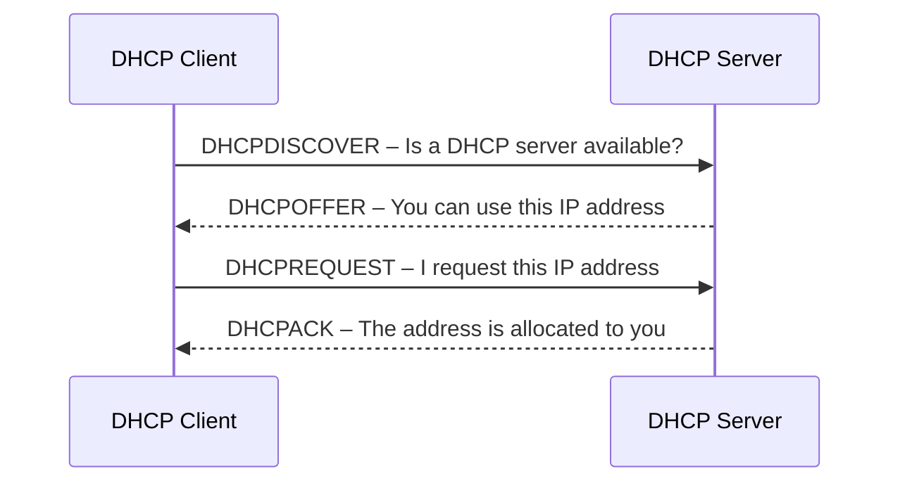

# Unit 4 – Network Layer and Internet Protocol

> [!info] Scope of this PDF
> This 14-page deck teaches **DHCP** and **ICMP**. IPv6 Addressing and Routing Algorithms are mentioned in the unit outline, but their actual explanations are **not present in this PDF**. They are not expanded here.

## 1. IP addresses: how does a host get one? (Slide 4)

The slide separates IP-address allocation into two different questions:

1. **How does a host get an IP address within its network?** This concerns the host portion of the address.
2. **How does a network get an IP address for itself?** This concerns the network portion of the address.

### Ways a host gets its IP address

- **Manual/static configuration:** A system administrator writes the IP configuration into a configuration file. The slide gives `/etc/rc.config` on UNIX as an example.
- **DHCP:** The host obtains an IP address dynamically from a DHCP server.

**Plug-and-play** means a device can join the network and obtain its network configuration automatically, rather than requiring the user to configure an IP address manually.

> [!warning] Scope gap in the slide
> The slide asks how a network obtains its own network address, but the remaining slides in this PDF explain only how a host obtains its address. The network-side allocation question is not answered here.

---

## 2. DHCP – Dynamic Host Configuration Protocol (Slides 5–10)

### 2.1 Purpose of DHCP (Slide 5)

**DHCP dynamically provides a host with an IP address when it joins a network.** The address is assigned by a DHCP server.

Why DHCP is useful:

- **Address lease:** The host receives an address for a limited lease period and can renew the lease while using it.
- **Address reuse:** An address does not need to remain reserved for a device that has left the network. It can be allocated to another device.
- **Mobility:** Devices can join and leave networks without requiring manual IP configuration each time.
- **Plug-and-play:** Network configuration is obtained automatically.

### 2.2 DHCP message sequence – DORA (Slides 5 and 7)

The usual four-message exchange is remembered as **DORA**:

| Order | Message | Sender → receiver | Purpose |
|---|---|---|---|
| 1 | **Discover** | Client → broadcast | Client searches for a DHCP server. |
| 2 | **Offer** | DHCP server → client | Server offers an IP address that the client can use. |
| 3 | **Request** | Client → broadcast | Client requests the offered address. |
| 4 | **ACK (Acknowledgement)** | DHCP server → client | Server confirms the allocation. |



**Meaning of the four messages:**

1. **DHCP Discover:** A newly connected client does not yet have an assigned IP address. It broadcasts a message to locate a DHCP server.
2. **DHCP Offer:** A DHCP server responds and proposes an available IP address, along with the lease lifetime.
3. **DHCP Request:** The client broadcasts that it wants to use the offered IP address.
4. **DHCP ACK:** The server confirms the allocation. The client can then use the assigned configuration.

The slide marks **Discover and Offer as optional in the reuse case**: they can be skipped when a client remembers a previously allocated network address and wants to reuse it (the slide cites RFC 2131). The client can then proceed with a request for that address.

### 2.3 DHCP client-server network diagram (Slide 6)

The diagram shows a router connecting three subnets:

- Subnet `223.1.1.x`: hosts include `223.1.1.1`, `223.1.1.2`, and `223.1.1.3`.
- Subnet `223.1.2.x`: hosts include `223.1.2.1` and `223.1.2.2`; the DHCP server is `223.1.2.5`.
- Subnet `223.1.3.x`: hosts include `223.1.3.1` and `223.1.3.2`.

The router interfaces shown are `223.1.1.4`, `223.1.2.9`, and `223.1.3.27`.

**What the diagram explains:**

- A new DHCP client arrives on the `223.1.2.x` network and needs an address from that network.
- The DHCP server is shown on the `223.1.2.x` subnet.
- A DHCP server is typically co-located with the router and can serve the subnets to which that router is attached.

The important point is that DHCP is used when a new host joins a network and needs an address valid for that network.

### 2.4 DORA packet details (Slide 7)

The slide gives the following example values:

- DHCP server IP: `223.1.2.5`
- Offered/assigned client IP (`yiaddr`): `223.1.2.4`
- Lease lifetime: `3600 seconds` = **1 hour**
- Client-side UDP port: `68`
- Server-side UDP port: `67`
- Limited broadcast IP address: `255.255.255.255`

| Message | Source IP : UDP port | Destination IP : UDP port | Address / other field shown |
|---|---|---|---|
| Discover | `0.0.0.0 : 68` | `255.255.255.255 : 67` | `yiaddr = 0.0.0.0`; transaction ID printed as `654` |
| Offer | `223.1.2.5 : 67` | `255.255.255.255 : 68` | Offers `223.1.2.4`; lifetime `3600 s`; transaction ID `654` |
| Request | `0.0.0.0 : 68` | `255.255.255.255 : 67` | Requests `223.1.2.4`; lifetime `3600 s`; transaction ID printed as `655` |
| ACK | `223.1.2.5 : 67` | `255.255.255.255 : 68` | Confirms `223.1.2.4`; lifetime `3600 s`; transaction ID `655` |

**How to read the addresses and ports:**

- `0.0.0.0` is used as the source IP because the new client does not yet have its assigned IP address.
- `255.255.255.255` is the broadcast destination, allowing the message to reach DHCP servers on the local network.
- UDP port **68** is used by the DHCP client; UDP port **67** is used by the DHCP server.
- `yiaddr` means the IP address being offered/assigned to the client. In this example it is `223.1.2.4`.
- The `3600-second` lifetime is the lease duration shown in the example.

> [!warning] Transaction-ID inconsistency in Slide 7
> The slide prints transaction ID **654** for Discover and Offer, but **655** for Request and ACK. These values are inconsistent within the illustrated DORA exchange. Treat this as a likely slide typo; do not learn it as a rule that the transaction ID changes between these four messages.

### 2.5 DHCP provides more than an IP address (Slide 8)

DHCP can also provide the client with:

1. **First-hop router address:** The address of the router the client uses to reach destinations outside its local subnet. This is commonly called the **default gateway**.
2. **DNS server name and IP address:** The client uses the DNS server to resolve domain names to IP addresses.
3. **Network mask (subnet mask):** Identifies which portion of the IP address represents the network and which portion represents the host.

Therefore, DHCP can supply the main configuration a host needs to communicate on the network, not merely its own IP address.

### 2.6 DHCP request: encapsulation and delivery (Slide 9)

The slide follows a connecting laptop sending a DHCP REQUEST to a router that has a DHCP server built into it.

**Encapsulation order at the client:**

```text
DHCP message
    ↓ carried inside
UDP segment
    ↓ carried inside
IP datagram
    ↓ carried inside
Ethernet frame
    ↓ sent over
Physical medium
```

Key points from the diagram:

- The **DHCP REQUEST** is encapsulated in UDP, then IP, then Ethernet.
- The Ethernet frame is broadcast on the LAN. Its destination MAC address is `FF:FF:FF:FF:FF:FF` (all ones).
- The broadcast frame reaches the router running the DHCP server.
- At the router, the received data is **de-multiplexed** (decapsulated) upward: Ethernet → IP → UDP → DHCP.

**Encapsulation** means adding the headers of the lower protocol layers around the message. **De-multiplexing/decapsulation** means processing those layers at the receiver and passing the payload to the correct upper-layer protocol.

### 2.7 DHCP ACK: server response (Slide 10)

After processing the request, the DHCP server formulates a **DHCP ACK** containing:

- The client's allocated IP address.
- The IP address of the client's first-hop router.
- The name and IP address of the DNS server.

The server's reply is encapsulated for transmission and forwarded to the client. At the client, the message is de-multiplexed through the protocol layers until it reaches DHCP.

**Result:** The client now knows its own IP address, the first-hop router's IP address, and the DNS server's name and IP address.

---

## 3. ICMP – Internet Control Message Protocol (Slides 11–13)

### 3.1 Purpose and position of ICMP (Slide 12)

**ICMP is used by hosts and routers to communicate network-layer information.** Its typical use is reporting errors, such as an unreachable host, network, port, or protocol.

Examples:

- Destination network unreachable.
- Destination host unreachable.
- Destination port unreachable.

ICMP also supports **Echo Request and Echo Reply**, which are used by the `ping` utility.

### 3.2 Where ICMP fits in the protocol stack

- ICMP messages are carried as **IP payloads**.
- ICMP is often considered part of IP because it supports IP network-layer operation.
- Architecturally, ICMP lies **just above IP**.

The key relationship is:

```text
ICMP message
    ↓ carried inside
IP datagram
```

### 3.3 ICMP Type and Code fields (Slide 12)

Every ICMP message has a **Type** field and a **Code** field:

- **Type:** Identifies the general kind of ICMP message.
- **Code:** Gives a more specific reason or subtype within that type.

| Type | Code | Description shown in the slide |
|---:|---:|---|
| 0 | 0 | Echo Reply (ping) |
| 3 | 0 | Destination network unreachable |
| 3 | 1 | Destination host unreachable |
| 3 | 2 | Destination protocol unreachable |
| 3 | 3 | Destination port unreachable |
| 3 | 6 | Destination network unknown |
| 3 | 7 | Destination host unknown |
| 4 | 0 | Source Quench (congestion control – **not used**) |
| 8 | 0 | Echo Request (ping) |
| 9 | 0 | Route advertisement |
| 10 | 0 | Router discovery |
| 11 | 0 | TTL expired |
| 12 | 0 | Bad IP header |

**Important examples to remember:**

- Type `8`, Code `0` = Echo Request.
- Type `0`, Code `0` = Echo Reply.
- Type `3` = Destination Unreachable; the code specifies what is unreachable.
- Type `11`, Code `0` = TTL Expired.
- Type `12`, Code `0` = Bad IP Header.
- Type `4`, Code `0` = Source Quench; the slide explicitly says it is not used.

### 3.4 ICMP for network diagnostics (Slide 13)

The slide identifies two diagnostic utilities that use ICMP:

- **Ping:** Uses ICMP Echo Request and Echo Reply to test whether a destination can be reached and responds.
- **Traceroute:** Uses the TTL mechanism and ICMP Time Exceeded messages to reveal the routers along a path.

Other ICMP messages listed on the slide:

| ICMP message | Meaning |
|---|---|
| Source Quench | Congestion-related message; the previous slide notes that it is not used. |
| Parameter Problem | Indicates a problem with the IP header. The type/code table lists Bad IP Header as Type `12`, Code `0`. |
| Time Exceeded | The packet's TTL has expired. The table lists Type `11`, Code `0`. |
| Destination Unreachable | The destination network, host, protocol, or port cannot be reached. |
| Redirection | A router sends a redirection message to indicate that the host should use a different route/next hop. |

### 3.5 Understanding the traceroute diagram (Slide 13)

The bottom diagram shows a source (`SRC`) sending packets through Router 1, Router 2, Router 3, and Router 4 to a destination (`DST`). The probe packets use progressively larger TTL values.

**TTL = Time To Live.** Each router decreases the packet's TTL as it forwards the packet. When the TTL expires, the router does not forward that packet further; it sends an ICMP **Time Exceeded** message back to the source.

| Probe TTL shown | Where it expires / arrives | ICMP response shown |
|---:|---|---|
| 1 | Router 1 | ICMP TTL Exceeded |
| 2 | Router 2 | ICMP TTL Exceeded |
| 3 | Router 3 | ICMP TTL Exceeded |
| 4 | Router 4 | ICMP TTL Exceeded |
| 5 | Destination | ICMP Destination Unreachable is labelled as the final response in the diagram |

**How traceroute discovers the path:**

1. The source first sends a probe with TTL = 1. It expires at the first router, which returns ICMP Time Exceeded.
2. The source sends another probe with TTL = 2. It reaches the second router before expiring, so that router returns ICMP Time Exceeded.
3. The source repeats this process with increasing TTL values.
4. The returned ICMP messages reveal the routers/hops along the route. The diagram labels the final response from the destination as ICMP Destination Unreachable.

> [!important] Ping vs traceroute
> **Ping** uses Echo Request and Echo Reply. **Traceroute** uses increasing TTL values and observes ICMP Time Exceeded responses from intermediate routers to identify the route.

---

## 4. Unit outline and slide-order notes (Slides 2, 3 and 11)

The outline slides show these topics:

- Introduction to Network Layer Protocols: DHCP and ICMP.
- IPv6 Addressing.
- Introduction to Routing Algorithms.

**Numbering inconsistency in the deck:**

- Slide 2 labels the sections as `4.6`, `4.7`, and `4.8`.
- Slides 3 and 11 show the network-layer protocols section as `4.5`, IPv6 as `4.6`, and routing algorithms as `4.7`.

Use the topic names rather than relying on the inconsistent section numbers. This PDF contains detailed slides for DHCP and ICMP only.

## 5. Quick revision sheet

### DHCP

- Full form: **Dynamic Host Configuration Protocol**.
- Purpose: Dynamically assigns an IP address when a host joins a network.
- DORA: **Discover → Offer → Request → ACK**.
- DHCP client UDP port: **68**.
- DHCP server UDP port: **67**.
- Initial client source IP in the example: `0.0.0.0`.
- Broadcast destination IP in the example: `255.255.255.255`.
- Ethernet broadcast destination MAC: `FF:FF:FF:FF:FF:FF`.
- Example DHCP server: `223.1.2.5`.
- Example offered client IP: `223.1.2.4`.
- Example lease lifetime: `3600 seconds` (1 hour).
- DHCP can also provide the first-hop router/default gateway, DNS server details, and subnet mask.
- DHCP REQUEST is encapsulated as DHCP → UDP → IP → Ethernet → Physical.

### ICMP

- Full form: **Internet Control Message Protocol**.
- Purpose: Communicates network-layer information and reports errors.
- Carried inside IP; architecturally just above IP.
- Every ICMP message has **Type** and **Code** fields.
- Ping: Echo Request `8/0`; Echo Reply `0/0`.
- Destination Unreachable: Type `3` (codes in the slide include `0`, `1`, `2`, `3`, `6`, `7`).
- TTL Exceeded: Type `11`, Code `0`.
- Bad IP Header: Type `12`, Code `0`.
- Source Quench: Type `4`, Code `0`; marked **not used** in the slide.
- Ping and traceroute are the diagnostic utilities named in the deck.
- Traceroute uses increasing TTL values; intermediate routers return ICMP Time Exceeded messages when TTL expires.

## 6. Final coverage audit – all 14 PDF pages

- [x] **Page 1:** Computer Networks title slide and department/team identification.
- [x] **Page 2:** Unit outline and topic list.
- [x] **Page 3:** Unit outline with DHCP highlighted; section numbering discrepancy recorded.
- [x] **Page 4:** Two IP-address allocation questions; manual configuration and DHCP.
- [x] **Page 5:** DHCP purpose, lease renewal, address reuse, mobile users, and DORA overview.
- [x] **Page 6:** Three-subnet DHCP client-server diagram, router interfaces, and co-located DHCP server.
- [x] **Page 7:** DORA message flow, IP addresses, UDP ports, offered address, lease, optional initial steps, and transaction-ID inconsistency.
- [x] **Page 8:** Additional DHCP configuration: first-hop router, DNS, and network mask.
- [x] **Page 9:** DHCP REQUEST encapsulation, Ethernet broadcast, and receiver-side de-multiplexing.
- [x] **Page 10:** DHCP ACK contents, response delivery, client-side de-multiplexing, and resulting configuration.
- [x] **Page 11:** Unit outline with ICMP highlighted.
- [x] **Page 12:** ICMP purpose, position relative to IP, Type/Code fields, and every listed Type/Code pair.
- [x] **Page 13:** Ping, traceroute, additional ICMP messages, TTL progression, and the router-hop diagram.
- [x] **Page 14:** Closing slide.

> [!note] Study boundary
> IPv6 Addressing and Routing Algorithms are listed in the outline but have no explanatory slides in this PDF. Use the corresponding lecture material for those topics rather than treating this note as complete coverage of them.
