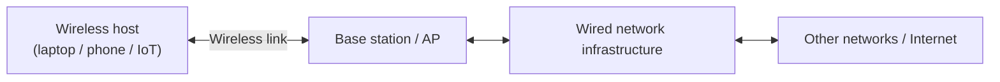
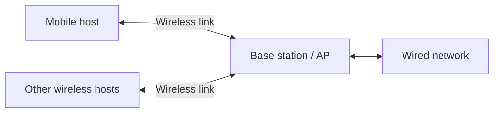
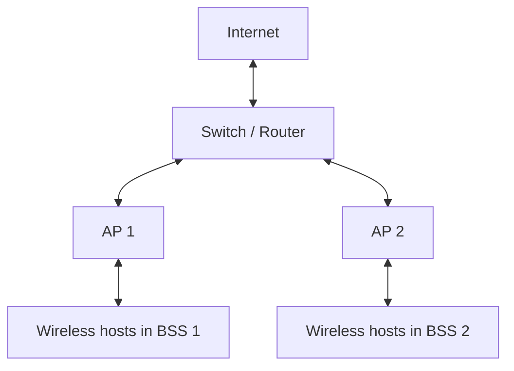
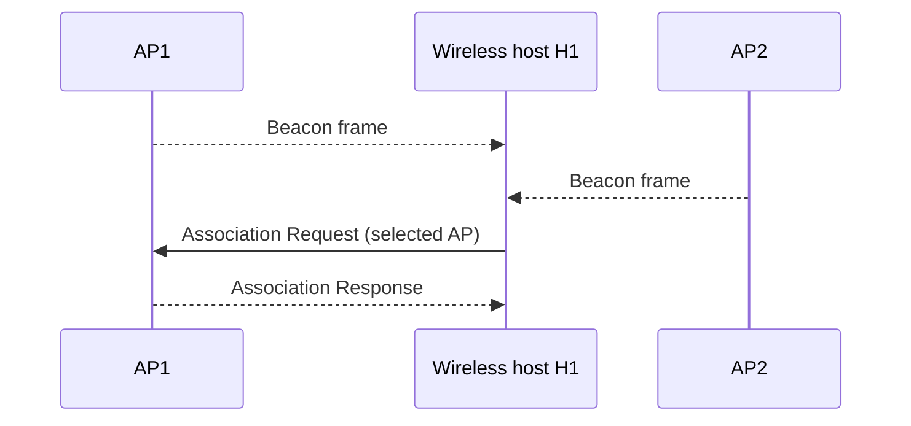
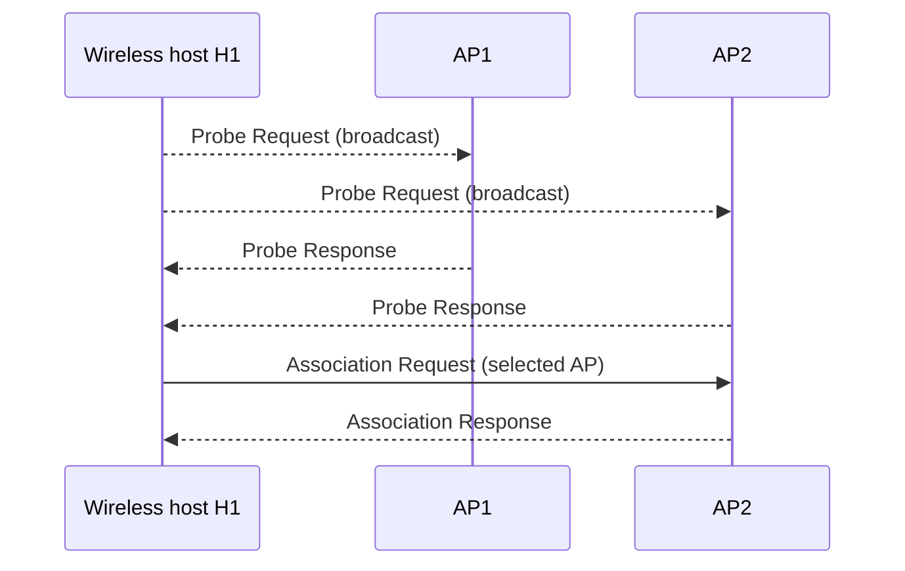
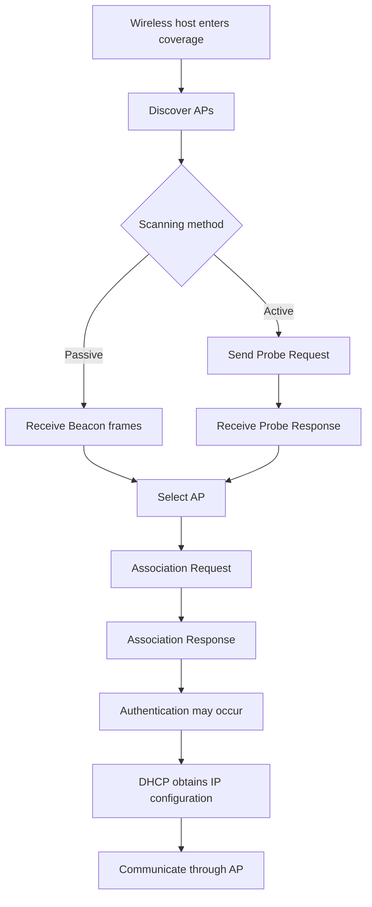

# Computer Networks – Wireless LANs (IEEE 802.11)

> [!info] Scope of this note
> These notes cover all **17 pages** of the supplied PDF. The material focuses on wireless-network fundamentals and IEEE 802.11 (Wi-Fi): wireless-network elements, infrastructure and ad hoc modes, wireless-network taxonomy, 802.11 standards, BSS architecture, channels, association, and active/passive scanning.
>
> Figures and data rates below are transcribed from the slides. Values such as the market comparisons on slide 3 are explicitly dated **2019** and should be treated as historical statements from the deck, not current statistics.

## 1. Wireless Networks: Context

### 1.1 Why wireless networks matter

The slides use two 2019 comparisons to motivate the growth of wireless networking:

- Mobile-phone subscribers were stated to exceed fixed (wired) phone subscribers by **10:1**.
- Mobile-broadband-connected devices were stated to exceed fixed-broadband-connected devices by **5:1**.
- 4G/5G cellular networks were described as adopting the Internet protocol stack, including Software-Defined Networking (SDN).

The important conceptual distinction is between **wireless communication** and **mobility**.

| Concept | Meaning |
|---|---|
| Wireless | Communication takes place over a wireless link. |
| Mobility | A user/device changes its point of attachment to the network. |

A wireless device does not have to be moving. A laptop connected to Wi-Fi while sitting on a desk is wireless but stationary.

> [!important] Do not confuse the two
> **Wireless** describes the communication medium. **Mobility** describes a change in the device's network attachment point.

## 2. Wireless Applications and Their Needs

### 2.1 Six application areas

The slide lists six broad application areas:

1. **Wide-area mobile wireless Internet access** – Internet access over a large geographic area while the user moves.
2. **Local-area mobile wireless Internet access** – wireless access over a smaller area, such as a building or campus.
3. **Fixed wireless Internet access** – wireless connectivity where the endpoint is generally installed at a fixed location.
4. **Satellite networks for Internet access and sensing** – satellite links used to provide connectivity and support sensing applications.
5. **Cable replacement** – replacing a physical cable connection with a wireless link.
6. **Internet of Things (IoT)** – connecting large numbers of devices and sensors.

### 2.2 Application requirements

The radar-style diagram on slide 4 identifies six dimensions used to describe application needs:

| Requirement | What it represents |
|---|---|
| Mobility | How much the application must support moving users/devices. |
| User data rate | The data rate required by an individual user/device. |
| Energy efficiency | How carefully the network must use device energy. |
| Device density | How many devices must be supported in an area. |
| Latency | How much delay the application can tolerate. |
| Area traffic capacity | The total traffic capacity needed across a geographic area. |

The diagram uses low, medium, and high importance rings. It is a **qualitative comparison**, not a numerical scoring chart. Different wireless applications place different priorities on these dimensions.

**Example interpretation:** an IoT deployment may contain many devices and need good energy efficiency, while a high-data-rate mobile access service places greater emphasis on user data rate and mobility. The exact priority depends on the application.

## 3. Elements of a Wireless Network

The slides build the network diagram progressively. The main components are wireless hosts, base stations, wireless links, and wired network infrastructure.

### 3.1 Wireless hosts

- Examples: laptops, smartphones, and IoT devices.
- They run network applications.
- A wireless host may be **stationary or mobile**.

> [!important] Wireless does not always mean mobility
> A device can use a wireless connection without changing its physical location.

### 3.2 Base station

A base station:

- Is typically connected to the wired network.
- Relays packets between the wired network and wireless hosts in its coverage area.
- Acts as the point through which wireless hosts access the wider network in infrastructure mode.

Examples shown in the slides:
- Cellular towers.
- IEEE 802.11 Wi-Fi access points (APs).

### 3.3 Wireless link

A wireless link:

- Commonly connects a mobile host to a base station.
- May also be used as a backbone link between network components.
- Uses a multiple-access protocol to coordinate access to the shared wireless medium.
- Can operate with different transmission rates, distances, and frequency bands.

### 3.4 Wired network infrastructure

The diagram on slides 5–8 shows multiple wireless coverage areas connected through a wired network infrastructure. This infrastructure connects wireless access networks to one another and to the wider network.

### 3.5 How the elements work together

1. A wireless host runs an application.
2. It communicates over a wireless link.
3. In infrastructure mode, the base station/AP receives and relays the packets.
4. The base station forwards packets into the wired network infrastructure.
5. Packets can then travel toward their destination.

## 4. Characteristics of Selected Wireless Links

### 4.1 Two key dimensions

Slide 9 highlights two factors for comparing wireless links:

1. **Coverage area** – how far the wireless link can reach.
2. **Link rate** – the data rate the link can provide.

A higher link rate does not automatically mean a longer range. The technology and its operating environment matter.

### 4.2 Coverage categories shown in the slide

| Coverage category | Approximate distance shown |
|---|---:|
| Indoor | 10–30 m |
| Outdoor | 50–200 m |
| Midrange outdoor | 200 m–4 km |
| Long-range outdoor | 4–15 km |

### 4.3 Wireless technologies and rates shown

The following are the approximate rate labels shown in the slide's comparison graphic:

| Technology | Rate shown in slide |
|---|---:|
| Bluetooth | 2 Mbps |
| IEEE 802.11b (Wi-Fi 1, as labelled in slide) | 11 Mbps |
| IEEE 802.11g (Wi-Fi 3) | 54 Mbps |
| IEEE 802.11n (Wi-Fi 4) | 600 Mbps |
| IEEE 802.11ac (Wi-Fi 5) | 3.5 Gbps |
| IEEE 802.11ax (Wi-Fi 6) | 14 Gbps |
| 4G LTE | Shown as a high-rate, wide-coverage technology; no single rate printed in the chart |
| 5G | 10 Gbps |
| IEEE 802.11af / 802.11ah (White-Fi / HaLow) | Shown for midrange outdoor coverage |

> [!note] Reading the chart
> Slide 9 is a visual comparison of rate and coverage, not a complete specification sheet. Use the exact standards table on slide 13 for the individual 802.11 values listed there. Do not infer a precise rate for 4G LTE from the chart when no single value is printed.

## 5. Infrastructure Mode and Ad Hoc Mode

Wireless networks can be organised in different ways.

### 5.1 Infrastructure mode

In infrastructure mode:

- A base station connects wireless hosts to the wired network.
- The base station provides the connection between wireless devices and the wider network.
- A mobile host may move from one base station to another.

**Handoff** is the process in which a mobile host changes the base station that provides its connection to the wired network.

### 5.2 Ad hoc mode

In ad hoc mode:

- There are **no base stations**.
- Nodes communicate directly with other nodes within wireless-link coverage.
- The nodes organise themselves into a network.
- The network may need to handle functions such as:
  - Routing.
  - Address assignment.
  - DNS-like name translation.

An ad hoc network is therefore not simply a Wi-Fi network with a different name. Its nodes organise communication without depending on a central base station.

### 5.3 Infrastructure mode vs ad hoc mode

| Feature | Infrastructure mode | Ad hoc mode |
|---|---|---|
| Base station | Present | Absent |
| Communication | Host communicates through a base station/AP | Nodes communicate directly within link coverage |
| Wider network access | Base station typically connects to wired infrastructure | No base station; nodes organise their own network |
| Example context | Wi-Fi network using an AP; cellular network | Direct/ad hoc device network |

## 6. Wireless Network Taxonomy

The taxonomy combines two independent questions:

- Is there **infrastructure** (such as an access point/base station)?
- Is communication **single-hop or multiple-hop**?

### 6.1 Four categories

| Network type | Single hop | Multiple hops |
|---|---|---|
| **Infrastructure** | Host connects to a base station, which connects to the larger Internet. Examples: Wi-Fi, cellular, 4G LTE. | Host may relay through several wireless nodes to reach the larger Internet. Example: mesh network. |
| **Infrastructure-less** | No base station and no connection to the larger Internet; devices communicate within range. Examples: Bluetooth, ad hoc networks. | No base station and no direct connection to the larger Internet; nodes may relay to reach one another. Examples: MANET, VANET. |

### 6.2 Key terminology

- **Single hop:** communication reaches the required next point in one wireless link.
- **Multiple hops:** packets are relayed through intermediate wireless nodes.
- **Mesh network:** a network in which traffic can be relayed through several nodes.
- **MANET:** Mobile Ad hoc Network.
- **VANET:** Vehicular Ad hoc Network.

> [!tip] Classification method
> First ask whether a base station/AP is part of the network. Then ask whether the source can reach the destination in one wireless hop or needs intermediate relays.

## 7. IEEE 802.11 Wireless LAN (Wi-Fi)

IEEE 802.11 is the family of wireless LAN standards covered by the slides.

### 7.1 Standards table from slide 13

| IEEE 802.11 standard | Year shown | Maximum data rate shown | Range shown | Frequency shown |
|---|---:|---:|---:|---|
| 802.11b | 1999 | 11 Mbps | 30 m | 2.4 GHz |
| 802.11g | 2003 | 54 Mbps | 30 m | 2.4 GHz |
| 802.11n (Wi-Fi 4) | 2009 | 600 Mbps* | 70 m | 2.4, 5 GHz |
| 802.11ac (Wi-Fi 5) | 2013 | 3.47 Gbps | 70 m | 5 GHz |
| 802.11ax (Wi-Fi 6) | 2020 | 14 Gbps | 70 m | 2.4, 5 GHz |
| 802.11af | 2014 | 35–560 Mbps | 1 km | Unused TV bands (54–790 MHz) |
| 802.11ah | 2017 | 347 Mbps | 1 km | 900 MHz |

\*The slide prints `600` without writing the unit in that table; the earlier comparison slide labels the 802.11n value as **600 Mbps**.

### 7.2 Shared properties stated in the slide

The slide states that these standards:
- Use **CSMA/CA** for multiple access.
- Have both base-station and ad hoc network versions.

> [!important] CSMA/CA
> The slide identifies CSMA/CA as the multiple-access mechanism used by the 802.11 standards. Do not confuse it with Ethernet's historical shared-medium CSMA/CD.

## 8. The 802.11 LAN Architecture

### 8.1 Access Point (AP)

- A wireless host communicates with a base station.
- In Wi-Fi, the base station is called an **Access Point (AP)**.
- The AP connects wireless hosts to the wired network, commonly through a switch or router.

### 8.2 Basic Service Set (BSS)

A **Basic Service Set (BSS)** is also called a **cell** in the slide.

In infrastructure mode, a BSS contains:
- Wireless hosts.
- An Access Point (AP), which acts as the base station.

In ad hoc mode, the BSS contains hosts only; there is no AP.

The slide's diagram shows two BSSs connected through a switch/router to the Internet.

## 9. IEEE 802.11: Channels and Association

### 9.1 Channels

- The wireless spectrum is divided into channels at different frequencies.
- An AP assigns/advertises a **Service Set Identifier (SSID)**.
- The AP administrator chooses the frequency/channel used by the AP.
- The slide identifies the 2.4 GHz band as **2.4 GHz to 2.4835 GHz**.
- Nearby APs may choose the same channel, causing interference. The slide calls a crowded environment with overlapping Wi-Fi channels a **“Wi-Fi Jungle.”**

### 9.2 What is an SSID?

The **SSID (Service Set Identifier)** is the network name advertised by an access point. It helps a device identify the Wi-Fi network it is considering joining.

### 9.3 Association process

An arriving wireless host must associate with an AP before using that infrastructure BSS.

The slide describes this sequence:

1. **Scan channels:** the host listens for beacon frames.
2. **Discover APs:** beacon frames contain the AP's SSID and MAC address.
3. **Select AP:** the host chooses an AP with which to associate.
4. **Authenticate:** authentication may be performed.
5. **Obtain IP configuration:** the host typically runs DHCP to get an IP address in the AP's subnet.

> [!important] Association vs DHCP
> Association connects the wireless host to an AP at the Wi-Fi/link layer. DHCP then provides IP configuration. They are separate steps.

## 10. 802.11 Active and Passive Scanning

Before associating, a host must discover available APs. The slides show two approaches.

### 10.1 Passive scanning

In passive scanning, the APs announce themselves by transmitting beacon frames.

Sequence:

1. APs transmit **Beacon** frames.
2. Host H1 receives the beacons and selects an AP.
3. H1 sends an **Association Request** to the selected AP.
4. The selected AP sends an **Association Response** to H1.

**Key point:** passive scanning starts with beacon frames sent by the APs. The host listens.

### 10.2 Active scanning

In active scanning, the host actively asks nearby APs to identify themselves.

Sequence:

1. H1 broadcasts a **Probe Request**.
2. APs that receive it send **Probe Response** frames.
3. H1 selects an AP and sends it an **Association Request**.
4. The selected AP sends an **Association Response** to H1.

### 10.3 Passive vs active scanning

| Point | Passive scanning | Active scanning |
|---|---|---|
| Who initiates discovery? | APs | Wireless host |
| First frame | Beacon | Probe Request |
| AP response during discovery | Beacon is transmitted periodically/by AP | Probe Response is sent after Probe Request |
| Association Request | Host → selected AP | Host → selected AP |
| Association Response | Selected AP → host | Selected AP → host |

> [!tip] Exam memory cue
> **Passive = Listen for Beacons.**  
> **Active = Send Probe Request, receive Probe Response.**  
> Both methods finish with Association Request followed by Association Response.

## 11. Complete Wireless-Host Connection Flow

The separate concepts can be arranged into one sequence:

1. A wireless host enters the coverage area.
2. It discovers nearby APs using passive or active scanning.
3. It selects an AP.
4. It sends an Association Request.
5. The AP returns an Association Response.
6. Authentication may take place.
7. The host typically uses DHCP to obtain an IP address in the AP's subnet.
8. The host can now communicate through the AP and the wired network infrastructure.

## 12. Important Terms – Quick Revision

| Term | Meaning |
|---|---|
| Wireless | Communication over a wireless link |
| Mobility | User/device changes its point of attachment |
| Wireless host | Laptop, smartphone, IoT device, etc. |
| Base station | Relay between wireless hosts and wired network |
| AP | Wi-Fi base station |
| Wireless link | Wireless connection between devices, often host and AP |
| Infrastructure mode | Wireless hosts communicate through a base station/AP |
| Handoff | Mobile host changes its serving base station |
| Ad hoc mode | No base station; nodes organise communication themselves |
| Single hop | One wireless link to reach the next destination |
| Multiple hops | Packets pass through intermediate wireless nodes |
| Mesh network | Multiple wireless nodes relay traffic |
| MANET | Mobile Ad hoc Network |
| VANET | Vehicular Ad hoc Network |
| BSS | Basic Service Set; also called a cell |
| SSID | Service Set Identifier; Wi-Fi network name |
| Beacon | AP announcement frame used in passive scanning |
| Probe Request | Host's discovery request in active scanning |
| Probe Response | AP's response to a Probe Request |
| Association | Host joins a selected AP/BSS |

## 13. Exam-Focused Distinctions

### Wireless vs mobility
- Wireless: medium/communication method.
- Mobility: changing attachment point.
- A wireless host can be stationary.

### Infrastructure vs infrastructure-less
- Infrastructure: base station/AP exists.
- Infrastructure-less: no base station; nodes organise communication.

### Single-hop vs multiple-hop
- Single-hop: no intermediate wireless relay is needed.
- Multiple-hop: one or more intermediate nodes relay packets.

### Infrastructure mode vs ad hoc mode
- Infrastructure: host communicates through AP/base station.
- Ad hoc: hosts communicate directly; no AP/base station.

### Passive vs active scanning
- Passive: AP sends Beacon; host listens.
- Active: host sends Probe Request; AP sends Probe Response.
- Both finish with Association Request and Association Response.

### Association vs authentication vs DHCP
- Association: establish the host's relationship with an AP.
- Authentication: may be performed after AP selection/association as described in the slide.
- DHCP: obtain IP configuration for the AP's subnet.

## 14. Slide-by-Slide Coverage Audit

| PDF page | Slide/topic | Coverage in these notes |
|---:|---|---|
| 1 | Title page | Identified as source deck |
| 2 | Unit 4 roadmap; Wireless LAN highlighted | Scope recorded |
| 3 | Wireless networks: context | Section 1 |
| 4 | Wireless applications and their needs | Section 2 |
| 5 | Elements of a wireless network – overview diagram | Section 3 |
| 6 | Wireless hosts | Section 3.1 |
| 7 | Base station | Section 3.2 |
| 8 | Wireless link | Section 3.3 |
| 9 | Characteristics of selected wireless links | Section 4 |
| 10 | Infrastructure mode and handoff | Section 5.1 |
| 11 | Ad hoc mode | Section 5.2 |
| 12 | Wireless network taxonomy | Section 6 |
| 13 | IEEE 802.11 standards table | Section 7 |
| 14 | 802.11 LAN architecture and BSS | Section 8 |
| 15 | Channels, SSID and association | Section 9 |
| 16 | Active/passive scanning diagrams | Section 10 |
| 17 | Thank-you page | Counted in audit |

> [!success] Audit result
> **17/17 pages accounted for.** The notes retain the slide's concepts, examples, standards table, diagrams, and scan/association sequences. The roadmap topics outside the highlighted wireless LAN section are not expanded because this PDF does not teach them.

## 15. Last-Minute Revision

- Wireless communication and mobility are different concepts.
- Main wireless-network elements: **wireless hosts, base stations, wireless links, wired infrastructure**.
- A base station relays packets between wireless hosts and the wired network.
- Infrastructure mode uses a base station/AP; ad hoc mode does not.
- Handoff means changing the serving base station.
- Wireless taxonomy is based on **infrastructure vs infrastructure-less** and **single-hop vs multiple-hop**.
- Wi-Fi is based on IEEE 802.11.
- The slide states that 802.11 uses **CSMA/CA**.
- A BSS is also called a cell.
- SSID is the Wi-Fi network name.
- Beacon frames are used in passive scanning.
- Probe Request and Probe Response are used in active scanning.
- Both scanning methods finish with Association Request and Association Response.
- A host typically runs DHCP after AP association to obtain an IP address in the AP's subnet.
