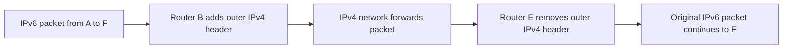

# Computer Networks – Unit 4: IPv6

> [!info] Scope of this note
> These notes cover **all 22 slides** of the supplied PDF, in slide order. The deck focuses on **IPv6 addressing, IPv6 datagram format, and the transition from IPv4 to IPv6 using tunnelling**.
>
> The agenda also mentions DHCP, ICMP and Routing Algorithms, but those topics are not explained in this particular PDF. DHCP and ICMP were covered in the previous file; Routing Algorithms require a separate set of slides/notes.

## 1. IPv6 at a glance

IPv6 (Internet Protocol version 6) is the successor to IPv4. Its most visible change is the address size:

| Feature | IPv4 | IPv6 |
|---|---:|---:|
| Address size | 32 bits | 128 bits |
| Address capacity | \(2^{32}\) | \(2^{128}\) |
| Address representation | Dotted-decimal | Colon-separated hexadecimal |
| Base header | Variable length | Fixed 40 bytes |
| Header checksum | Present | Removed |
| Broadcast | Supported | No broadcast; multicast is used |

IPv6 has \(2^{128}\) possible addresses. Compared with IPv4's \(2^{32}\), this is \(2^{96}\) times as many addresses.

---

# 2. Slide-by-slide notes

## Slide 1 – Title slide

Introduces the Computer Networks presentation prepared by Team Networks, Department of Computer Science and Engineering. No technical concept is introduced.

## Slide 2 – Unit 4 outline

The slide places IPv6 Addressing under **Unit 4: Network Layer and Internet Protocol**. The overall unit outline shown is:

- Introduction to Network Layer Protocols: DHCP and ICMP.
- IPv6 Addressing.
- Introduction to Routing Algorithms.

> [!warning] Coverage check
> This presentation proceeds with IPv6. It does **not** explain Routing Algorithms. Do not assume that the heading in the outline means routing algorithms are covered in the remaining slides.

## Slide 3 – IPv6 Protocol: Rationale for Change

### Why was IPv6 introduced?

The initial motivation was that the 32-bit IPv4 address space was expected to become completely allocated. IPv6 provides a much larger address space and also changes the packet-header design.

The slide lists these reasons/features:

1. **Larger address space:** 128-bit addresses provide a much larger number of unique addresses.
2. **Better header format:** the header is redesigned to make forwarding and processing more efficient.
3. **New options:** IPv6 supports additional functionality.
4. **Allowance for extension:** optional information can be carried using extension headers rather than making every base header larger.
5. **Support for resource allocation:** the protocol can distinguish traffic flows for different network-layer treatment.
6. **Support for more security:** IPv6 includes support for security-related extension mechanisms.

### Specific changes mentioned in the slide

- **Checksum removed:** IPv6 removes the IP-header checksum to reduce processing at every router hop.
- **Options moved outside the base header:** options are carried through extension headers. The `Next Header` field identifies what follows.
- **ICMPv6:** IPv6 has a new version of ICMP called ICMPv6.
- **Fragmentation/reassembly:** the slide states that fragmentation/reassembly is not part of the IPv6 base-header operation.
- **Fixed 40-byte header:** a fixed-length base header helps speed packet processing and forwarding.
- **Flow treatment:** IPv6 supports identifying packets belonging to the same flow so that they can receive appropriate network-layer treatment.

> [!note] Main idea
> IPv6 was introduced primarily to solve IPv4 address exhaustion, while also simplifying the base header and providing extension and flow-related capabilities.

## Slide 4 – IPv6 Datagram Format

An IPv6 datagram consists of a **base header** followed by its **payload**.

The diagram highlights the following fields:

| Field | Purpose / meaning |
|---|---|
| Version (`ver`) | Identifies the IP version. For IPv6, the value is 6. |
| Priority / traffic class | Identifies the priority or class of traffic. The slide calls this `priority`; the later header diagram calls it `Traffic Class`. |
| Flow Label | Identifies datagrams belonging to the same flow. The slide notes that the exact concept of a flow is not well defined there. |
| Payload Length | Gives the length of the payload following the base header. |
| Next Header | Identifies the next extension header or upper-layer protocol. |
| Hop Limit | Limits how many router hops the packet may traverse. Routers reduce it as the packet is forwarded. |
| Source Address | 128-bit IPv6 address of the sender. |
| Destination Address | 128-bit IPv6 address of the receiver. |
| Payload | Carries data from the upper layer, and may include extension headers. |

### What is absent compared with IPv4?

The slide explicitly identifies three omissions:

- **No header checksum:** reduces processing at routers.
- **No fragmentation/reassembly in the base header:** the IPv6 base header has no IPv4-style fragmentation fields.
- **No options inside the base header:** optional information is carried outside it, using extension headers identified through `Next Header`.

> [!important] Remember
> IPv6 has a **fixed 40-byte base header**. Optional extension headers, when present, are placed after the base header and before the upper-layer data.

## Slide 5 – Introduction to IPv6 Addressing

### IPv6 address structure

- An IPv6 address contains **128 bits**.
- It is written as **eight 16-bit blocks**.
- The blocks are separated by colons (`:`).
- Each block is written in hexadecimal.
- One hexadecimal digit represents 4 bits; therefore, one 16-bit block contains four hexadecimal digits.
- The slide gives the total number of possible addresses as:

`340,282,366,920,938,463,374,607,431,768,211,456`

It describes this as approximately **340 undecillion addresses** and states that IPv6 has \(2^{96}\) times the address space of IPv4.

### Hexadecimal values

| Decimal | Binary | Hexadecimal | Decimal | Binary | Hexadecimal |
|---:|---|---|---:|---|---|
| 0 | 0000 | 0 | 8 | 1000 | 8 |
| 1 | 0001 | 1 | 9 | 1001 | 9 |
| 2 | 0010 | 2 | 10 | 1010 | A |
| 3 | 0011 | 3 | 11 | 1011 | B |
| 4 | 0100 | 4 | 12 | 1100 | C |
| 5 | 0101 | 5 | 13 | 1101 | D |
| 6 | 0110 | 6 | 14 | 1110 | E |
| 7 | 0111 | 7 | 15 | 1111 | F |

### IPv6 abbreviation rules

**Rule 1 – Remove leading zeros in a block**

Remove zeros at the beginning of an individual 16-bit block. Do not remove zeros from the middle or end of the block.

Example:

`000A` → `A`

`0063` → `63`

**Rule 2 – Compress a consecutive run of zero blocks**

A consecutive sequence of one or more complete `0000` blocks can be replaced by a double colon (`::`). This is called **zero compression**.

Example:

`FDEC:0000:0000:0000:0000:BBFF:0000:FFFF`

becomes:

`FDEC::BBFF:0:FFFF`

**Rule 3 – Use `::` at most once**

Only one continuous run of zero blocks may be replaced by `::` in a single IPv6 address. Using `::` twice would make it impossible to know how many zero blocks each occurrence represents.

> [!warning] Do not confuse the two rules
> - Rule 1 shortens a block by removing its **leading** zeros.
> - Rule 2 replaces a **continuous sequence of complete zero blocks** with `::`.
> - Rule 3 prevents ambiguity: `::` must appear no more than once.

**Terminology note:** the slide calls the eight 16-bit groups “octets.” In precise networking terminology, an octet is 8 bits; these IPv6 colon-separated 16-bit groups are commonly called *hextets*. In these notes, “16-bit block” is used to avoid confusion.

## Slide 6 – IPv6 notation, zero compression and CIDR example

The slide shows how a 128-bit address is represented in colon-hexadecimal notation, how zero blocks are compressed, and how a prefix length is appended.

### A. Colon-hexadecimal notation

Example shown:

`FDEC:BA98:7654:3210:ADBF:BBFF:2922:FFFF`

There are eight groups, each containing 16 bits (four hexadecimal digits when fully written).

### B. Zero compression

Original address:

`FDEC:0:0:0:0:BBFF:0:FFFF`

Zero-compressed address:

`FDEC::BBFF:0:FFFF`

The four consecutive zero blocks are represented by one `::`. The isolated zero block before `FFFF` remains as `0` because it is not part of that same consecutive run.

### C. CIDR address

The slide shows:

`FDEC::BBFF:0:FFFF/60`

`/60` is the **prefix length**. It says that the first 60 bits belong to the network prefix.

### D. Applying Rule 1 and Rule 2

Original:

`2001:0000:3238:DFE1:0063:0000:0000:FEFB`

After Rule 1 (remove leading zeros in blocks):

`2001:0:3238:DFE1:63:0:0:FEFB`

After Rule 2 (compress the consecutive zero blocks):

`2001:0:3238:DFE1:63::FEFB`

The slide also shows the equivalent intermediate form:

`2001:0000:3238:DFE1:63::FEFB`

Both illustrate the use of leading-zero removal and zero compression.

## Slide 7 – Why `::` can be used only once

The slide explains the ambiguity caused by using two double-colon symbols.

Incorrect compressed address:

`2001::abcd::1234`

This is ambiguous because either `::` could represent different numbers of zero blocks. For example, the slide lists several possible expansions:

```text
2001:0000:0000:0000:0000:abcd:0000:1234
2001:0000:0000:0000:abcd:0000:0000:1234
2001:0000:0000:abcd:0000:0000:0000:1234
2001:0000:abcd:0000:0000:0000:0000:1234
```

Each expansion places the zero blocks differently. Therefore, the original address cannot be uniquely reconstructed.

> [!important] Exam rule
> An IPv6 address may contain **only one `::`**. It represents one contiguous sequence of zero blocks, not multiple separate sequences.

## Slide 8 – Expanding IPv6 addresses: worked questions

The question asks for the **unabbreviated colon-hexadecimal form** of four addresses.

### (a) 64 zeros followed by 64 ones

- 64 bits = four 16-bit blocks.
- Four blocks of all zeros are `0000`.
- Four blocks of all ones are `FFFF`.

Answer:

`0000:0000:0000:0000:FFFF:FFFF:FFFF:FFFF`

### (b) 128 zeros

All eight 16-bit blocks contain zeros.

Answer:

`0000:0000:0000:0000:0000:0000:0000:0000`

### (c) 128 ones

Each 16-bit block of all ones is `FFFF`.

Answer:

`FFFF:FFFF:FFFF:FFFF:FFFF:FFFF:FFFF:FFFF`

### (d) 128 alternating 1s and 0s

The slide uses the repeating pattern `1010` in each four-bit group. Binary `1010` is hexadecimal `A`, so each 16-bit block becomes `AAAA`.

Answer:

`AAAA:AAAA:AAAA:AAAA:AAAA:AAAA:AAAA:AAAA`

## Slide 9 – Zero-contracted answers to Slide 8

The slide writes the previous answers using zero compression wherever possible.

| Part | Unabbreviated form | Zero-contracted form |
|---|---|---|
| (a) | `0000:0000:0000:0000:FFFF:FFFF:FFFF:FFFF` | `::FFFF:FFFF:FFFF:FFFF` |
| (b) | Eight zero blocks | `::` |
| (c) | Eight `FFFF` blocks | `FFFF:FFFF:FFFF:FFFF:FFFF:FFFF:FFFF:FFFF` |
| (d) | Eight `AAAA` blocks | `AAAA:AAAA:AAAA:AAAA:AAAA:AAAA:AAAA:AAAA` |

Only (a) and (b) contain compressible zero blocks. In (c) and (d), there are no zero blocks to compress.

## Slide 10 – Abbreviating IPv6 addresses

The task is to shorten each fully written address using leading-zero removal and, where possible, one `::`.

### (a)

Given:

`0000:0000:FFFF:0000:0000:0000:0000:0000`

- Remove leading zeros from each block.
- Compress the longest consecutive zero run (the five zero blocks at the end).

Answer shown in the slide:

`0:0:FFFF::`

### (b)

Given:

`1234:2346:0000:0000:0000:0000:0000:1111`

The five consecutive zero blocks are compressed.

Answer:

`1234:2346::1111`

### (c)

Given:

`0000:0001:0000:0000:0000:0000:1200:1000`

- The first block becomes `0`.
- The second block becomes `1`.
- The four consecutive zero blocks in the middle are compressed.

Answer:

`0:1::1200:1000`

### (d)

Given:

`0000:0000:0000:0000:0000:FFFF:24.123.12.6`

The initial zero blocks are compressed, while the final IPv4-style dotted-decimal portion is retained.

Answer:

`::FFFF:24.123.12.6`

> [!tip] Compression procedure
> 1. Split the address into its eight 16-bit blocks (unless a dotted-decimal IPv4 portion is present).
> 2. Remove leading zeros from each block.
> 3. Identify a continuous run of zero blocks.
> 4. Replace one such run with `::`.
> 5. Never use a second `::`.

## Slide 11 – Decompressing IPv6 addresses

The task is the reverse: expand an abbreviated address into **exactly eight 16-bit blocks**, padding each block to four hexadecimal digits.

### Method

1. Count the explicit 16-bit blocks on both sides of `::`.
2. Subtract that count from 8.
3. Replace `::` with the required number of `0000` blocks.
4. Pad every short block with leading zeros until it has four hexadecimal digits.

### (a) `1111::2222`

Two explicit blocks are present (`1111` and `2222`). Therefore, `::` represents six zero blocks.

Answer:

`1111:0000:0000:0000:0000:0000:0000:2222`

### (b) `::`

No explicit blocks are present. All eight blocks are zero.

Answer:

`0000:0000:0000:0000:0000:0000:0000:0000`

### (c) `0:1::`

Two explicit blocks are present, so `::` represents six zero blocks. The first two blocks must also be padded to four digits.

Answer:

`0000:0001:0000:0000:0000:0000:0000:0000`

### (d) `AAAA:A:AA::1234`

Four explicit blocks are present (`AAAA`, `A`, `AA`, `1234`). Thus, `::` represents four zero blocks. Pad the short blocks:

- `AAAA` stays `AAAA`.
- `A` becomes `000A`.
- `AA` becomes `00AA`.
- `1234` stays `1234`.

Answer:

`AAAA:000A:00AA:0000:0000:0000:0000:1234`

> [!important] Decompression check
> The final expanded address must contain exactly **eight blocks**, and every block must contain exactly **four hexadecimal digits**.

## Slide 12 – IPv6 Prefix Notation

A **prefix length** is a decimal number that identifies how many leftmost bits of an IP address make up the network portion.

Example from the slide:

`2001:aaaa:bbbb:cccc:0:0:0:10/64`

- `/64` means the first 64 bits are the network portion.
- The remaining 64 bits are the host/interface portion.
- Since each colon-separated block represents 16 bits, the first four blocks make up the 64-bit network prefix.

Subnet:

`2001:aaaa:bbbb:cccc::/64`

Example node address within that subnet:

`2001:aaaa:bbbb:cccc::10`

### Understanding the prefix diagram

The slide shows this address:

`2001:0df8:00f2:0000:0000:06ee:0000:0f11`

Each block represents 16 bits. The marked prefix boundaries include:

- `/16` – first 16 bits (one block).
- `/32` – first 32 bits (two blocks).
- `/48` – first 48 bits (three blocks).
- `/52`, `/56`, `/60`, `/64` – progressively include more bits of the next block(s).

A prefix boundary does not have to fall exactly on a colon. For example, `/52` includes 48 bits from the first three blocks plus 4 bits from the fourth block.

> [!tip] Quick calculation
> Number of complete 16-bit blocks in a prefix = prefix length ÷ 16, when the prefix length is divisible by 16. For a prefix such as `/52`, divide it into 48 bits (three complete blocks) + 4 additional bits.

## Slide 13 – Three IPv6 Address Types

IPv6 destination addresses are classified into three main types in the slide.

### 1. Unicast – one-to-one

- Identifies a single interface on a computer or router.
- A packet sent to a unicast address is delivered to the interface configured with that address.
- Think: one sender to one destination interface.

### 2. Multicast – one-to-many

- Identifies a group of interfaces/computers.
- Every member of the multicast group receives a copy of the packet.
- Think: one sender to a selected group of receivers.

### 3. Anycast – one-to-nearest

- The same anycast address is assigned to multiple interfaces.
- A packet sent to that address is delivered to the “closest” interface in the group.
- “Closest” is determined using the best routing metric, not necessarily physical distance.

### What about broadcast?

IPv6 has **no broadcast addresses**. Broadcast-like functionality is implemented using multicast addresses.

| Address type | Delivery | Key point |
|---|---|---|
| Unicast | One-to-one | One interface receives the packet. |
| Multicast | One-to-many | All members of the addressed group receive a copy. |
| Anycast | One-to-nearest | The best/nearest route to one member is selected. |
| Broadcast | Not used in IPv6 | Similar group delivery is achieved through multicast. |

## Slide 14 – IPv6 Address Types: hierarchy diagram

The diagram breaks IPv6 addresses into **Unicast**, **Multicast**, and **Anycast**, then gives examples/subcategories.

### A. Unicast categories shown

| Category | Prefix/value shown in the slide | What to recognise |
|---|---|---|
| Global Unicast | `2000::/3` | Global unicast range shown in the diagram. |
| Link-Local | `fe80::/10` | Link-local address range. |
| Loopback | `::1/128` | Address used by a host to refer to itself. |
| Unspecified | `::/128` | All-zero address. |
| Unique Local | `fc00::/7` | Unique-local address range. |
| Embedded IPv4 | `::/80` | Prefix label printed in the slide's diagram. |

### B. Multicast categories shown

| Category | Prefix shown in the slide |
|---|---|
| Well-Known | `ff00::/12` |
| Transient | `ff10::/12` |
| Solicited-Node | `ff02:0:0:0:0:1:ff00::/104` |

### C. Anycast

Anycast is shown as a separate main category. The slide does not provide a separate anycast prefix in this hierarchy diagram.

> [!note] How to read this diagram
> First identify the main type (Unicast, Multicast or Anycast). Then identify the relevant subcategory and its prefix/value as printed in the diagram.

## Slide 15 – Address Space Allocation

The slide represents the full IPv6 address space as:

`2^128 addresses`

The upper bar is divided into **eight equal portions**, each representing one-eighth of the total address space. In the diagram, the **second one-eighth** is highlighted as Global Unicast; the first and last portions are labelled Reserved/Assigned, and the intervening portions are labelled Reserved.

### Labels in the allocation diagram

| Label | Allocation shown | Fraction shown |
|---|---|---:|
| A | IPv4 Compatible | 1/256 |
| B | Reserved | 1/256 |
| C | Reserved | 1/128 |
| D | Reserved | 1/64 |
| E | Reserved | 1/32 |
| F | Reserved | 1/16 |
| G | Reserved | 1/16 |
| H | Reserved | 1/32 |
| I | Reserved | 1/64 |
| J | Unique Local Unicast | 1/128 |
| K | Reserved | 1/512 |
| L | Link Local | 1/1024 |
| M | Reserved | 1/256 |
| N | Multicast | 1/256 |

### What the diagram is communicating

- IPv6 has an extremely large total address space of \(2^{128}\).
- The allocation is not one undivided pool; different ranges are assigned to categories or reserved.
- The diagram specifically calls out Global Unicast, Unique Local Unicast, Link Local and Multicast.
- The A–N labels show smaller ranges and their fractions as presented in the lecture slide.

> [!warning] Source-specific detail
> The fractions and category labels above are transcribed from the PDF's allocation diagram. Treat them as the **lecture-slide representation**; the slide does not explain the allocation history or provide a standards reference for each range.

## Slide 16 – IPv6 Datagram Format: base header and extension headers

This slide revisits the IPv6 datagram structure in more detail.

### Overall packet layout

- **Base header:** fixed length of 40 bytes.
- **Payload:** up to 65,535 bytes as indicated in the slide.
- **Extension headers:** optional headers may appear between the base header and the upper-layer data packet.
- **Upper-layer data:** the actual data from a protocol such as TCP or UDP.

A simplified structure is:

```text
+------------------------------+
| IPv6 Base Header (40 bytes)  |
+------------------------------+
| Optional Extension Header(s) |
+------------------------------+
| Upper-layer data (TCP/UDP...) |
+------------------------------+
```

### Base-header field sizes

The diagram is drawn as 32-bit rows. The fields are:

| Field | Size | Meaning |
|---|---:|---|
| Version | 4 bits | Identifies IPv6. |
| Traffic Class | 8 bits | Traffic priority/class information. |
| Flow Label | 20 bits | Identifies packets belonging to the same flow. |
| Payload Length | 16 bits | Length of the payload after the base header. |
| Next Header | 8 bits | Identifies the next extension header or upper-layer protocol. |
| Hop Limit | 8 bits | Limits the number of hops. |
| Source Address | 128 bits | Sender's IPv6 address. |
| Destination Address | 128 bits | Receiver's IPv6 address. |

The fixed fields total:

`4 + 8 + 20 + 16 + 8 + 8 + 128 + 128 = 320 bits = 40 bytes`

### Next Header codes printed in the slide

The `Next Header` field tells the receiver what header or protocol comes next.

| Code | Next Header label in the PDF |
|---:|---|
| 0 | Hop-by-hop option |
| 2 | ICMP |
| 6 | TCP |
| 17 | UDP |
| 43 | Source routing |
| 44 | Fragmentation |
| 50 | Encrypted security payload |
| 51 | Authentication |
| 59 | Null (No next header) |
| 60 | Destination option |

> [!warning] Verify this table entry
> The source slide prints **code 2 – ICMP**. This note preserves the slide exactly rather than silently changing its entry. Confirm this particular code with your instructor or the prescribed reference before treating the table as an authoritative protocol-code list.

### Flow Label

The flow label is used to identify datagrams belonging to the same **flow**. The lecture slide explicitly notes that the concept of a flow is not well defined in its explanation.

### Why extension headers matter

IPv6 keeps the base header fixed and moves optional information into extension headers. The `Next Header` field links the base header to an extension header or directly to an upper-layer protocol.

## Slide 17 – Transition from IPv4 to IPv6

### Why is transition difficult?

- All routers on the Internet cannot be upgraded to IPv6 simultaneously.
- There cannot be one universal “flag day” on which every router changes version.
- Networks must continue operating while IPv4 and IPv6 routers coexist.

### Tunnelling

**Tunnelling** allows an IPv6 datagram to travel across an IPv4 network by carrying the complete IPv6 datagram as the payload of an IPv4 datagram.

This is often described as a **packet within a packet**.

The outer IPv4 packet is used to cross the IPv4 portion of the network. Once it reaches the other end of the tunnel, the outer IPv4 header is removed and the original IPv6 datagram can continue.

The slide also notes that tunnelling is used extensively in other contexts, including 4G/5G networks.

### What the encapsulation diagram shows

- The **outer IPv4 header** contains IPv4 source and destination addresses for the tunnel endpoints.
- Inside it is the original **IPv6 datagram**, including its IPv6 source and destination addresses.
- The IPv6 datagram itself still contains the upper-layer TCP/UDP payload.

## Slide 18 – Tunnelling and Encapsulation

The slide compares two situations.

### Case 1: Ethernet connects two IPv6 routers

- Routers A and B are IPv6 routers; routers E and F are also IPv6 routers.
- The link-layer frame carries the IPv6 datagram as its payload.
- This is ordinary link-layer encapsulation, not IPv6-over-IPv4 tunnelling.

### Case 2: An IPv4 network connects two IPv6 routers

- The network between the two IPv6 parts is an IPv4 network.
- The routers at the tunnel endpoints must support both IPv6 and IPv4 (dual-stack IPv6/IPv4 routers in the diagram).
- The IPv6 datagram is encapsulated in an IPv4 datagram while crossing the IPv4 network.

> [!important] Distinction
> - **Normal Ethernet encapsulation:** an IPv6 datagram is carried inside a link-layer frame.
> - **IPv6 tunnelling through IPv4:** an IPv6 datagram is carried inside an IPv4 datagram.

## Slide 19 – Tunnelling and Encapsulation: packet comparison

This slide repeats the two network layouts and makes the packet structure explicit.

### Ordinary Ethernet connection

```text
Link-layer frame
└── IPv6 datagram
    └── Upper-layer data
```

The IPv6 datagram is the payload of the link-layer frame.

### IPv4 tunnel connecting IPv6 routers

```text
IPv4 datagram
└── IPv6 datagram
    └── Upper-layer data
```

The complete IPv6 datagram becomes the payload of an IPv4 datagram. The tunnel's IPv4 network forwards the outer IPv4 packet.

The central point of the slide is the **extra outer IPv4 header** used for the tunnel.

## Slide 20 – Tunnelling: logical view vs physical view

This is the most detailed tunnelling diagram in the deck.

### Logical view

The IPv4 tunnel makes the network appear as though the two dual-stack tunnel endpoints are directly connected:

`A (IPv6) → B (IPv6/IPv4) → IPv4 tunnel → E (IPv6/IPv4) → F (IPv6)`

The IPv4 routers inside the tunnel are hidden in this logical view.

### Physical view

The actual path contains the IPv4 routers:

`A → B → C → D → E → F`

- A and F use IPv6.
- B and E support both IPv6 and IPv4; they are the tunnel endpoints.
- C and D are IPv4 routers inside the tunnel.

### What happens to the packet?

Assume the original IPv6 packet has:

- Flow: X
- Source: A
- Destination: F
- Data: application/upper-layer data

**1. A to B – normal IPv6 forwarding**

A sends the original IPv6 datagram towards B. Its IPv6 source and destination are A and F.

**2. B to C – encapsulation begins**

At B, the original IPv6 datagram is placed inside a new IPv4 datagram. The outer IPv4 header uses:

- Source: B
- Destination: E

The inner IPv6 datagram still has source A and destination F.

**3. C to D – forwarding inside the IPv4 network**

C forwards the outer IPv4 datagram towards E. The inner IPv6 packet remains encapsulated inside it.

**4. D to E – reaches the tunnel exit**

The outer IPv4 datagram reaches E. E removes the outer IPv4 header (decapsulation) and retrieves the original IPv6 datagram.

**5. E to F – normal IPv6 forwarding resumes**

E forwards the original IPv6 datagram towards F using IPv6.

### Address fields to remember

| Header | Source | Destination | Used by |
|---|---|---|---|
| Inner IPv6 header | A | F | Original end-to-end IPv6 packet |
| Outer IPv4 header | B | E | Delivery across the IPv4 tunnel |

> [!danger] Common exam trap
> The IPv6 source and destination addresses do **not** change to B and E. B and E appear in the **outer IPv4 header** used for tunnelling. The inner IPv6 header continues to identify the original endpoints A and F.

### Encapsulation and decapsulation summary



## Slide 21 – IPv6 Adoption

The slide provides historical adoption indicators and a graph.

It states:

- **Google (2023):** approximately 40% of clients accessed services via IPv6.
- **NIST:** one-third of all US government domains were IPv6-capable.
- It provides an Akamai IPv6 adoption visualization link.

### Graph interpretation

The graph shows IPv6 adoption increasing over time:

- Adoption is near zero at the beginning of the timeline.
- The curve rises progressively through the following years.
- By the right end of the graph, the plotted percentage is above 40%.

> [!note] Date awareness
> The percentages are the figures printed in this lecture slide (including the explicit 2023 reference). They are historical slide data, not a live measurement of IPv6 adoption today.

## Slide 22 – Thank you

Closing slide. No additional networking concept is introduced.

---

# 3. Important procedures and worked-method summaries

## A. How to abbreviate an IPv6 address

1. Write the address as eight 16-bit blocks if it is fully expanded.
2. In each block, remove only the leading zeros. Example: `0063` → `63`; `0000` → `0` if it is not compressed.
3. Find a continuous sequence of complete zero blocks.
4. Replace one such sequence with `::`.
5. Use `::` only once in the entire address.
6. Keep all non-zero blocks in their original order.

## B. How to expand an IPv6 address

1. Count the blocks explicitly written before and after `::`.
2. Calculate missing blocks: `8 − number of explicit blocks`.
3. Replace `::` with that many `0000` blocks.
4. Pad every other block to four hexadecimal digits.
5. Verify that the result has exactly eight blocks.

## C. How to interpret an IPv6 prefix

For an address written as `address/prefix`:

- The number after `/` is the number of leftmost network bits.
- The bits after the prefix belong to the interface portion.
- A `/64` prefix uses the first four 16-bit blocks as its network part.
- A prefix such as `/52` ends partway through a 16-bit block.

## D. How IPv6 tunnelling works

1. The IPv6 packet reaches the tunnel entry router (dual-stack router B).
2. B encapsulates the complete IPv6 packet inside an IPv4 packet.
3. The IPv4 network forwards the outer packet using the tunnel endpoint addresses.
4. The tunnel exit router (dual-stack router E) removes the outer IPv4 header.
5. E forwards the original IPv6 packet towards its destination.

---

# 4. High-yield revision table

| Topic | Must remember |
|---|---|
| IPv6 address size | 128 bits |
| Number of IPv6 blocks | 8 blocks of 16 bits each |
| Hexadecimal digits | 0–9 and A–F; one digit = 4 bits |
| IPv6 address separator | Colon (`:`) |
| Zero compression | Consecutive complete zero blocks can be replaced with `::` |
| Number of `::` symbols allowed | One per address |
| Prefix length | Number of leftmost network bits |
| `/64` | First 64 bits are network; remaining 64 are interface portion |
| IPv6 base-header size | 40 bytes |
| IPv6 base-header checksum | Removed |
| IPv6 broadcast | Not used; multicast provides group delivery |
| Unicast | One-to-one |
| Multicast | One-to-many |
| Anycast | One-to-nearest / best routing metric |
| Tunnelling | IPv6 datagram encapsulated inside IPv4 datagram |
| Tunnel entry/exit | Dual-stack routers at both ends |
| Inner IPv6 addresses | Preserve original endpoints A and F |
| Outer IPv4 addresses | Identify tunnel endpoints B and E |

# 5. Common mistakes to avoid

- Do not treat an IPv6 address as four or six groups; the fully expanded form has **eight 16-bit blocks**.
- Do not remove zeros from the middle or end of a block under Rule 1. Only leading zeros are removed.
- Do not use `::` more than once.
- Do not forget to count the missing blocks when decompressing `::`.
- Do not leave a decompressed block shorter than four hexadecimal digits.
- Do not assume `/64` means 64 blocks; it means 64 bits.
- Do not confuse unicast, multicast and anycast delivery.
- Do not write that IPv6 has broadcast addressing; the slide explicitly says there is no broadcast address in IPv6.
- Do not confuse link-layer encapsulation (IPv6 inside an Ethernet frame) with IPv6-over-IPv4 tunnelling (IPv6 inside an IPv4 datagram).
- Do not replace the original IPv6 source/destination addresses with the tunnel endpoint addresses. Tunnel endpoints belong in the outer IPv4 header.

# 6. Slide coverage audit

| Slide | Content | Covered |
|---:|---|:---:|
| 1 | Title slide | ✅ |
| 2 | Unit 4 outline and topic placement | ✅ |
| 3 | IPv6 rationale and changes from IPv4 | ✅ |
| 4 | IPv6 datagram format and missing IPv4 fields | ✅ |
| 5 | IPv6 address structure, hexadecimal and compression rules | ✅ |
| 6 | Colon notation, zero compression and CIDR example | ✅ |
| 7 | Why `::` can appear only once | ✅ |
| 8 | Four address expansion questions | ✅ |
| 9 | Zero-contracted forms of previous answers | ✅ |
| 10 | IPv6 abbreviation problems | ✅ |
| 11 | IPv6 decompression problems | ✅ |
| 12 | Prefix notation and `/16` to `/64` boundaries | ✅ |
| 13 | Unicast, multicast, anycast and no broadcast | ✅ |
| 14 | IPv6 address-type hierarchy and prefixes | ✅ |
| 15 | Address-space allocation diagram | ✅ |
| 16 | Base header, extension headers and Next Header table | ✅ |
| 17 | IPv4-to-IPv6 transition and tunnelling | ✅ |
| 18 | Ethernet encapsulation vs IPv4 network between IPv6 routers | ✅ |
| 19 | IPv4 tunnel packet encapsulation diagram | ✅ |
| 20 | Logical/physical tunnel views and inner/outer addresses | ✅ |
| 21 | IPv6 adoption statistics and graph | ✅ |
| 22 | Closing slide | ✅ |

> [!success] Final audit
> All 22 slides have a corresponding section above. Text, numerical examples, address prefixes, tables, and the major diagrams are represented. Source-specific entries that may need instructor confirmation are flagged rather than silently changed.
