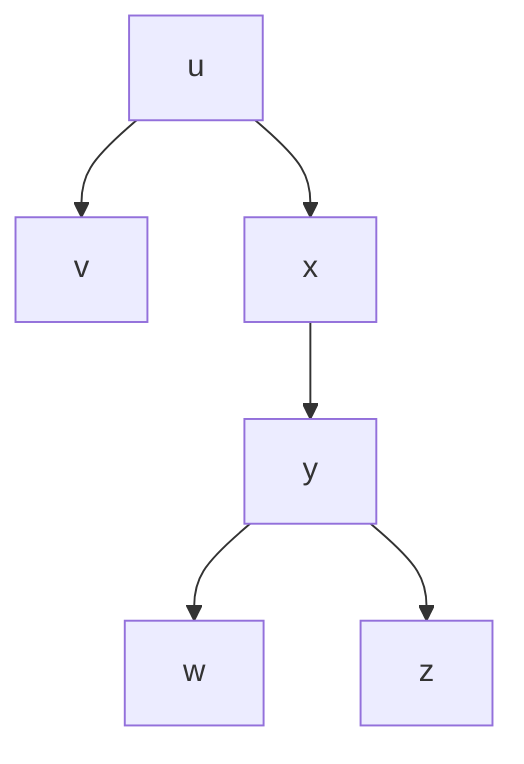
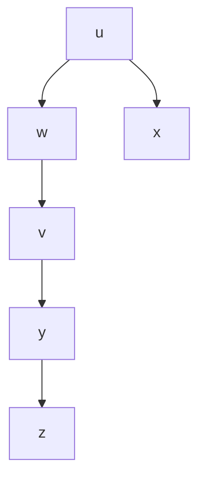

# Unit 4 – Routing Protocols and Routing Algorithms

> [!info] Scope of this PDF
> This 22-slide deck introduces routing protocols, represents a network as a weighted graph, classifies routing algorithms, and explains **Dijkstra’s link-state routing algorithm** through two complete worked examples. The deck does not provide a worked distance-vector algorithm; distance vector appears in the classification diagram only.

## 1. Routing Protocols – Purpose and Basic Terms

### 1.1 Goal of a routing protocol (Slide 3)

A **routing protocol** determines a good path (route) for packets to travel from a sending host to a receiving host through a network of routers.

- **Path / route:** A sequence of routers that a packet traverses from the source host toward the destination host.
- **Good path:** A path selected according to a measure such as:
  - least total cost,
  - fastest path, or
  - least congested path.
- **Routing:** The process of selecting paths through a network. The slide highlights routing as a major networking challenge because a real network may include mobile networks, ISPs, enterprise networks and data-centre networks.

A routing protocol helps routers determine where packets should be forwarded next. The exact meaning of “best” depends on the metric used by the network.

### 1.2 Routing protocol versus forwarding

- **Routing** determines paths and builds the information needed to reach destinations.
- **Forwarding** uses the router’s forwarding table to send an arriving packet through the appropriate outgoing link.

The distinction becomes important in the Dijkstra example: the algorithm finds least-cost paths from source router `u`, and the result is converted into a forwarding table at `u`.

## 2. Routing Algorithm Classification

### 2.1 Routing protocol hierarchy (Slide 4)

The slide’s hierarchy is:

```text
Dynamic Routing Protocols
├── Interior Gateway Protocols (IGPs)
│   ├── Distance Vector Routing Protocols
│   │   ├── RIP v1
│   │   ├── IGRP
│   │   ├── RIP v2
│   │   └── EIGRP
│   └── Link-State Routing Protocols
│       ├── OSPF
│       └── IS-IS
└── Exterior Gateway Protocols (EGPs)
    └── Path-Vector Routing Protocol
        └── BGP
```

- **IGP (Interior Gateway Protocol):** Routing within one autonomous system / administrative routing domain.
- **EGP (Exterior Gateway Protocol):** Routing between autonomous systems.
- **Distance vector:** Routers exchange route information with neighbouring routers.
- **Link state:** Routers build a view of network topology and link costs; Dijkstra’s algorithm is the link-state algorithm developed in this deck.
- **Path vector:** The category shown for BGP in the slide.

> [!note] Protocol names shown in the slide
> RIP v1, IGRP, RIP v2, EIGRP, OSPF, IS-IS and BGP are all included because they appear in the diagram. The deck does not explain their individual operation here.

### 2.2 Two independent ways to classify routing algorithms (Slide 6)

The slide classifies algorithms along two dimensions.

#### A. Based on how routing information is known

| Type | Meaning | Algorithm family |
|---|---|---|
| **Global** | All routers have complete network-topology and link-cost information. | Link-state |
| **Decentralized** | Routers compute iteratively and exchange information with neighbours. Initially, a router knows only the link costs to its directly attached neighbours. | Distance vector |

**Global / link-state:** Each router has the same topology and link-cost information. Dijkstra’s algorithm can then be run from a selected source router.

**Decentralized / distance vector:** Each router begins with local neighbour information. It exchanges information with neighbours, updates its estimates and repeats the process.

#### B. Based on how quickly routes change

| Type | Meaning |
|---|---|
| **Static** | Routes change slowly over time. |
| **Dynamic** | Routes can change more quickly, for example through periodic updates or in response to link-cost changes. |

> [!important] Do not mix up the two dimensions
> **Global/decentralized** describes how routing information is obtained. **Static/dynamic** describes how quickly routes change. They answer different questions.

## 3. Representing a Network as a Weighted Graph (Slide 5)

Routing algorithms can operate on a graph abstraction of the network.

### 3.1 Graph representation

A network graph is written as:

\[
G=(N,E)
\]

- `N` = set of router nodes.
- `E` = set of direct links connecting routers.
- A **link cost** is the numerical cost assigned to a direct link.

For nodes `a` and `b`:

\[
c_{a,b}=\text{cost of the direct link between }a\text{ and }b
\]

If there is no direct link between the nodes:

\[
c_{a,b}=\infty
\]

The slide gives examples `c(w,z) = 5` and `c(u,z) = ∞`.

### 3.2 How link cost may be chosen

The network operator defines the cost. The slide gives examples:

- Every link could have cost `1`.
- Cost could be inversely related to bandwidth: higher bandwidth can correspond to lower cost.
- Cost could be inversely related to congestion: a more congested link can be assigned a higher cost.

A path’s total cost is the sum of the costs of its links.

For example, if a route uses links with costs `2`, `3` and `1`:

\[
\text{Path cost}=2+3+1=6
\]

The least-cost path is the route with the smallest sum of link costs, not necessarily the route with the fewest hops.

### 3.3 Graph shown in the first Dijkstra example

The nodes are:

\[
N=\{u,v,w,x,y,z\}
\]

The diagram shows these weighted links:

| Direct link | Cost |
|---|---:|
| `u–v` | 2 |
| `u–x` | 1 |
| `u–w` | 5 |
| `v–x` | 2 |
| `v–w` | 3 |
| `x–w` | 3 |
| `x–y` | 1 |
| `w–y` | 1 |
| `w–z` | 5 |
| `y–z` | 2 |

> [!warning] Source-slide inconsistency – Slide 5
> The edge-set text printed below the graph lists nine links and **omits `(u,w)`**. However, the graph visibly draws a direct `u–w` link with cost `5`, and the Dijkstra initialization table on Slide 9 sets `D(w)=5` with predecessor `u`. The worked example therefore uses the drawn `u–w` link. This note preserves the discrepancy instead of silently treating the printed edge list as complete.

## 4. Dijkstra’s Link-State Routing Algorithm

### 4.1 What the algorithm does (Slide 7)

**Dijkstra’s algorithm** finds the least-cost paths from one selected source node to every other node in the network graph.

The slide describes it as:

- **Centralized:** The network topology and link costs are known to all nodes.
- **Link-state based:** This information is obtained through link-state broadcast, so all nodes have the same network information.
- **Iterative:** After each iteration, one more destination’s least-cost path becomes definite.
- **Output:** A forwarding table for the selected source router.

### 4.2 Notation used in the slides

| Symbol | Meaning |
|---|---|
| `c(x,y)` | Cost of the direct link from node `x` to node `y`; it is `∞` if they are not direct neighbours. |
| `D(v)` | Current estimate of the least cost from the source to destination `v`. |
| `p(v)` | Predecessor node of `v` on the currently known least-cost path from the source. |
| `N′` | Set of nodes whose least-cost paths have been definitively determined. |

**Important difference:** `D(v)` is the current best-known cost. It becomes final only after `v` is selected and added to `N′`.

**Predecessor `p(v)`:** The node immediately before `v` on the selected path. Following predecessor links backwards allows us to reconstruct the complete path.

### 4.3 Dijkstra’s algorithm – pseudocode (Slide 8)

Assume the source node is `u`.

```text
Initialization:
    N′ = {u}

    for every node v:
        if v is directly connected to u:
            D(v) = c(u,v)
            p(v) = u
        else:
            D(v) = ∞

Loop:
    choose node w not in N′ with the smallest D(w)
    add w to N′

    for every neighbour v of w where v is not in N′:
        D(v) = min(D(v), D(w) + c(w,v))

    repeat until every node is in N′
```

The source slide writes the update as:

\[
D(v)=\min\big(D(v),\ D(w)+c_{w,v}\big)
\]

### 4.4 Understanding the update formula

The algorithm compares two possible ways to reach node `v`:

1. **Existing route:** The current estimate `D(v)`.
2. **Route through the newly selected node `w`:** First travel from the source to `w` at cost `D(w)`, then take the direct link from `w` to `v` at cost `c(w,v)`.

Therefore:

\[
\boxed{\text{New }D(v)=\min(\text{old }D(v),\ D(w)+c(w,v))}
\]

- If the new route is cheaper, replace `D(v)` and set `p(v)=w`.
- If the old route is cheaper or equal, retain the old cost and predecessor.
- Only neighbours of the newly selected node need to be checked.
- Nodes already in `N′` are not updated because their least-cost paths are final.

### 4.5 How to solve a Dijkstra problem in an exam

1. Identify the **source** node.
2. Put only the source in `N′`.
3. Write direct-link costs from the source as the initial `D` values. Write `∞` for nodes not directly connected.
4. Select the unvisited node with the smallest tentative `D` value.
5. Add it to `N′`.
6. Relax each of its unvisited neighbours using `min(old cost, selected-node cost + direct-link cost)`.
7. Record the predecessor whenever a shorter route is found.
8. Continue until all nodes are selected.
9. Trace predecessor links to build the shortest-path tree and forwarding table.

> [!tip] Handling ties
> If two unvisited nodes have the same smallest tentative cost, either can be selected first. The slide’s second example explicitly notes that ties can exist and can be broken arbitrarily. The final least-cost values remain valid, although the predecessor tree can differ when multiple equal-cost paths exist.

## 5. Worked Example 1 – Source Router `u` (Slides 9–20)

This is the main worked example in the slide deck. The graph has six routers: `u`, `v`, `w`, `x`, `y` and `z`. The source is `u`.

### 5.1 Initialisation – Step 0 (Slide 9)

Initially:

\[
N′=\{u\}
\]

Use the direct links from `u`:

- `u–v` has cost `2`.
- `u–w` has cost `5`.
- `u–x` has cost `1`.
- There are no direct links from `u` to `y` or `z`.

| Destination | Initial `D(destination)` | Predecessor |
|---|---:|---|
| `v` | 2 | `u` |
| `w` | 5 | `u` |
| `x` | 1 | `u` |
| `y` | ∞ | — |
| `z` | ∞ | — |

At this stage, these are tentative values. Only the source `u` is in `N′`.

### 5.2 Step 1 – Select `x` (Slide 10)

The smallest tentative cost is:

\[
D(x)=1
\]

Add `x` to the confirmed set:

\[
N′=\{u,x\}
\]

Now inspect links from `x` to unconfirmed neighbours.

**Update `v`:**

\[
D(v)=\min(2,1+2)=\min(2,3)=2
\]

The direct path `u→v` remains cheaper. Predecessor stays `u`.

**Update `w`:**

\[
D(w)=\min(5,1+3)=\min(5,4)=4
\]

The route `u→x→w` is cheaper than the direct route `u→w`. Set `p(w)=x`.

**Update `y`:**

\[
D(y)=\min(\infty,1+1)=2
\]

Set `p(y)=x`.

`z` is not directly connected to `x` in this graph, so its estimate stays `∞`.

| Destination | Updated cost | Predecessor | Reason |
|---|---:|---|---|
| `v` | 2 | `u` | Existing route `u→v` is cheaper than `u→x→v`. |
| `w` | 4 | `x` | `1+3=4`, better than 5. |
| `y` | 2 | `x` | `1+1=2`. |
| `z` | ∞ | — | No route found yet. |

### 5.3 Step 2 – Select `y` (Slides 11–12)

The smallest remaining tentative costs are tied:

\[
D(v)=2,\qquad D(y)=2
\]

The slide chooses `y` first. This is valid because ties can be broken arbitrarily.

Add `y`:

\[
N′=\{u,x,y\}
\]

Check its unconfirmed neighbours.

**Update `w`:**

\[
D(w)=\min(4,2+1)=\min(4,3)=3
\]

The route `u→x→y→w` has cost `3`, which is better than the previous cost `4`. Set `p(w)=y`.

**Update `z`:**

\[
D(z)=\min(\infty,2+2)=4
\]

Set `p(z)=y`.

The cost to `v` remains `2` through `u`.

| Destination | Updated cost | Predecessor |
|---|---:|---|
| `v` | 2 | `u` |
| `w` | 3 | `y` |
| `z` | 4 | `y` |

### 5.4 Step 3 – Select `v` (Slide 14)

The smallest remaining tentative cost is:

\[
D(v)=2
\]

Add `v`:

\[
N′=\{u,x,y,v\}
\]

Check the unconfirmed neighbour `w`.

\[
D(w)=\min(3,2+3)=\min(3,5)=3
\]

The existing route through `y` is cheaper, so `D(w)=3` and predecessor `p(w)=y` remain unchanged.

### 5.5 Step 4 – Select `w` (Slides 15–17)

The smallest remaining tentative cost is:

\[
D(w)=3
\]

Add `w`:

\[
N′=\{u,x,y,v,w\}
\]

Check its remaining neighbour `z`:

\[
D(z)=\min(4,3+5)=\min(4,8)=4
\]

The existing route through `y` remains cheaper. Therefore `D(z)=4` and `p(z)=y` do not change.

### 5.6 Step 5 – Select `z` (Slides 18–19)

The last unconfirmed node is `z`, with:

\[
D(z)=4
\]

Add it:

\[
N′=\{u,x,y,v,w,z\}
\]

All nodes are now in `N′`. The algorithm is complete. The cost estimates are final.

### 5.7 Complete iteration table – Example 1

The table below combines the successive slide updates into one exam-revision table. Each cell is `cost, predecessor`.

| Step | `N′` | `D(v), p(v)` | `D(w), p(w)` | `D(x), p(x)` | `D(y), p(y)` | `D(z), p(z)` |
|---:|---|---|---|---|---|---|
| 0 | `{u}` | `2,u` | `5,u` | `1,u` | `∞,—` | `∞,—` |
| 1 | `{u,x}` | `2,u` | `4,x` | Confirmed | `2,x` | `∞,—` |
| 2 | `{u,x,y}` | `2,u` | `3,y` | Confirmed | Confirmed | `4,y` |
| 3 | `{u,x,y,v}` | Confirmed | `3,y` | Confirmed | Confirmed | `4,y` |
| 4 | `{u,x,y,v,w}` | Confirmed | Confirmed | Confirmed | Confirmed | `4,y` |
| 5 | `{u,x,y,v,w,z}` | Confirmed | Confirmed | Confirmed | Confirmed | Confirmed |

### 5.8 Final least-cost paths from `u`

| Destination | Least cost | Shortest path | Predecessor |
|---|---:|---|---|
| `u` | 0 | `u` | — |
| `v` | 2 | `u → v` | `u` |
| `x` | 1 | `u → x` | `u` |
| `y` | 2 | `u → x → y` | `x` |
| `w` | 3 | `u → x → y → w` | `y` |
| `z` | 4 | `u → x → y → z` | `y` |

The shortest-path tree is formed by tracing each destination’s predecessor:



### 5.9 Forwarding table at router `u` (Slide 20)

A forwarding table tells router `u` which **outgoing link / next hop** to use for each destination.

| Destination | Outgoing link from `u` | Explanation |
|---|---|---|
| `v` | `(u,v)` | Reach `v` directly. |
| `x` | `(u,x)` | Reach `x` directly. |
| `y` | `(u,x)` | Route is `u→x→y`; first hop is `x`. |
| `w` | `(u,x)` | Route is `u→x→y→w`; first hop is `x`. |
| `z` | `(u,x)` | Route is `u→x→y→z`; first hop is `x`. |

> [!warning] Source-slide typo – Slide 20
> The printed forwarding table appears to list destination `x` twice, with the last row repeating `x`. The shortest-path tree and the graph’s destination set show that the final destination should be **`z`**, also reached through outgoing link `(u,x)`. The table above uses `z` for that final row and records the apparent slide typo.

> [!important] Main lesson from Example 1
> The shortest path is not always the direct link. For example, `u→w` directly costs `5`, but `u→x→y→w` costs only `1+1+1=3`. Dijkstra’s algorithm finds the smaller total cost.

## 6. Worked Example 2 – Another Graph (Slide 21)

The final slide provides a second graph and a completed Dijkstra table. It reinforces predecessor tracking and the fact that multiple equal-cost choices may exist.

### 6.1 Initial values

The source is again `u`.

| Destination | Initial cost | Predecessor |
|---|---:|---|
| `v` | 7 | `u` |
| `w` | 3 | `u` |
| `x` | 5 | `u` |
| `y` | ∞ | — |
| `z` | ∞ | — |

### 6.2 Iterations shown in the slide

**Step 1 – Select `w` (cost 3):**

- Update `v`: `min(7, 3+3) = 6`, predecessor becomes `w`.
- `x` remains `5` through `u` because the route through `w` costs `3+4=7`.
- The graph also provides a route to `y` through `w` with cost `3+8=11`; the table displays `11,w` in its subsequent row.

**Step 2 – Select `x` (cost 5):**

- `v` remains `6,w`.
- Update `y`: compare the existing `11,w` with the route through `x`, `5+7=12`. Keep `11,w`.
- Update `z`: `min(∞,5+9)=14`, predecessor becomes `x`.

**Step 3 – Select `v` (cost 6):**

- Update `y`: `min(11,6+4)=10`.
- Set predecessor of `y` to `v`.
- `z` remains `14,x`.

**Step 4 – Select `y` (cost 10):**

- Update `z`: `min(14,10+2)=12`.
- Set predecessor of `z` to `y`.

**Step 5 – Select `z` (cost 12):**

All nodes are now included in `N′` and the algorithm terminates.

### 6.3 Completed iteration table – Example 2

| Step | `N′` | `D(v),p(v)` | `D(w),p(w)` | `D(x),p(x)` | `D(y),p(y)` | `D(z),p(z)` |
|---:|---|---|---|---|---|---|
| 0 | `{u}` | `7,u` | `3,u` | `5,u` | `∞,—` | `∞,—` |
| 1 | `{u,w}` | `6,w` | Confirmed | `5,u` | `11,w`* | `∞,—` |
| 2 | `{u,w,x}` | `6,w` | Confirmed | Confirmed | `11,w` | `14,x` |
| 3 | `{u,w,x,v}` | Confirmed | Confirmed | Confirmed | `10,v` | `14,x` |
| 4 | `{u,w,x,v,y}` | Confirmed | Confirmed | Confirmed | Confirmed | `12,y` |
| 5 | `{u,w,x,v,y,z}` | Confirmed | Confirmed | Confirmed | Confirmed | Confirmed |

`*` The slide’s extracted table layout places the `11,w` entry on the step-2 row. However, using the algorithm and the graph, that estimate is obtained when `w` is processed at step 1 because `y` is a neighbour of `w`. The value and predecessor remain the same; the placement in the slide table appears delayed or unclear.

### 6.4 Final least-cost paths from `u`

| Destination | Least cost | Shortest path | Predecessor |
|---|---:|---|---|
| `v` | 6 | `u → w → v` | `w` |
| `w` | 3 | `u → w` | `u` |
| `x` | 5 | `u → x` | `u` |
| `y` | 10 | `u → w → v → y` | `v` |
| `z` | 12 | `u → w → v → y → z` | `y` |

Shortest-path tree based on the predecessors:



### 6.5 What Slide 21 emphasises

- Trace predecessor nodes to construct the least-cost-path tree.
- Equal-cost paths (ties) can exist.
- When there is a tie, a choice can be made arbitrarily; the resulting predecessor tree may differ while still representing least-cost routes.

## 7. Quick Revision – High-Value Points

### 7.1 Definitions to remember

| Term | Meaning |
|---|---|
| Routing protocol | Determines good paths through a network of routers. |
| Path / route | Sequence of routers traversed from source toward destination. |
| Link cost | Cost assigned to a direct link. |
| `G=(N,E)` | Graph: routers are nodes, direct connections are edges. |
| Link-state | Global topology and link-cost knowledge; associated here with Dijkstra. |
| Distance vector | Decentralized iterative computation and neighbour information exchange. |
| Static routing | Routes change slowly. |
| Dynamic routing | Routes change more quickly due to periodic updates or link-cost changes. |
| `D(v)` | Current least-cost estimate from the source to `v`. |
| `p(v)` | Predecessor of `v` on the current least-cost path. |
| `N′` | Nodes whose least-cost paths are final. |

### 7.2 Dijkstra formula

\[
\boxed{D(v)=\min\left(D(v),D(w)+c(w,v)\right)}
\]

Meaning: retain the old route if it is cheaper; otherwise use the route through the newly selected node `w`.

### 7.3 Dijkstra procedure in one line

**Initialise → select minimum tentative cost → add to `N′` → update neighbours → repeat → trace predecessors → build forwarding table.**

### 7.4 Common exam mistakes

- Do not select the node with the largest tentative cost; select the **smallest** value outside `N′`.
- Do not confuse a tentative distance `D(v)` with a final distance. It is final after `v` enters `N′`.
- Do not add link costs without checking that the links are directly connected.
- Do not update nodes already in `N′`.
- When a shorter path is found, update both the distance and its predecessor.
- The forwarding table stores the **first outgoing link from the source**, not the entire path.
- The route with fewer hops is not necessarily the least-cost route.
- When two tentative costs tie, either tied node may be selected.

## 8. Slide-by-Slide Coverage Audit

| Slide | Source content | Covered in these notes |
|---:|---|---|
| 1 | Computer Networks title slide | Identified as course/deck context. |
| 2 | Unit 4 outline; routing algorithms highlighted | Scope noted. |
| 3 | Routing protocol goal, path and good-path criteria; network illustration | Section 1.1. |
| 4 | Routing protocol hierarchy: IGP, EGP, distance vector, link state, path vector and examples | Section 2.1. |
| 5 | Graph abstraction, link costs, `G=(N,E)`, example network | Section 3. |
| 6 | Global/decentralized and static/dynamic classification | Section 2.2. |
| 7 | Dijkstra description and notation | Sections 4.1–4.2. |
| 8 | Dijkstra initialisation, loop and update formula | Sections 4.3–4.5. |
| 9 | Example 1 graph and initial table | Section 5.1. |
| 10 | Select `x` and update costs | Section 5.2. |
| 11 | Relaxation calculations after selecting `x` | Section 5.2. |
| 12 | Select `y` | Section 5.3. |
| 13 | Relaxation calculations after selecting `y` | Section 5.3. |
| 14 | Select `v` | Section 5.4. |
| 15 | Relaxation after selecting `v` | Section 5.4. |
| 16 | Select `w` | Section 5.5. |
| 17 | Relaxation after selecting `w` | Section 5.5. |
| 18 | Select `z`; all nodes confirmed | Section 5.6. |
| 19 | Final Dijkstra table / completion | Sections 5.6–5.7. |
| 20 | Least-cost-path tree and forwarding table from `u` | Sections 5.8–5.9. |
| 21 | Second Dijkstra example and tie note | Section 6. |
| 22 | Thank-you slide | Included in coverage audit; no technical content. |

> [!success] Audit result
> All 22 slides have been accounted for. Both Dijkstra examples, the classification diagram, graph abstraction, pseudocode, iteration tables, shortest-path trees and forwarding-table diagram are explained. Source inconsistencies or ambiguous slide-table placement are explicitly flagged above.
