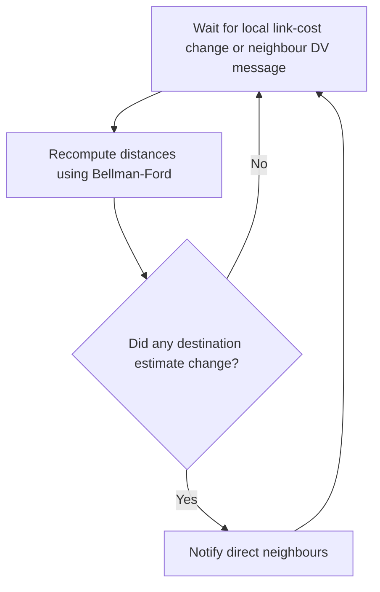

# Computer Networks - Unit 4: Distance Vector Routing (Bellman-Ford)

> [!info] Source coverage
> Prepared from the uploaded **27-page PDF**. The teaching content covers the Bellman-Ford distance-vector algorithm, iterative neighbour exchanges, distance-vector examples, link-cost changes, count-to-infinity, and a comparison with link-state routing. Slide/page references below follow the PDF page numbers.

## What you need to know

1. Bellman-Ford equation and how a router chooses its next hop.
2. How distance-vector routing works through repeated exchanges with direct neighbours.
3. Why the algorithm is iterative, asynchronous, distributed, and self-stopping.
4. How to calculate a router's updated distance vector from its neighbours' vectors.
5. How information spreads through a network over successive rounds.
6. What happens when link costs change: good news versus bad news.
7. The count-to-infinity problem.
8. How to read and update distance tables, and how distance vector differs from link state.

---

# 1. Routing protocol and distance-vector basics

## 1.1 What is a routing protocol?

A **routing protocol** determines suitable paths (routes) through a network of routers, allowing packets to travel from a source host to a destination host.

- **Path:** A sequence of routers that a packet traverses from the source host to the destination host.
- **Good path:** A path that is considered preferable according to a routing metric, such as:
  - least cost,
  - fastest path,
  - least congested path.

The network operator defines how link cost is assigned. A cost might simply be 1 for every link, or it might be related to bandwidth or congestion.

## 1.2 Routing protocol classification (slide 4 diagram)

The slide organises dynamic routing protocols into two broad groups:

- **IGP (Interior Gateway Protocol):** Used for routing within an autonomous system.
  - **Distance-vector routing protocols:** the diagram includes RIP v1 and IGRP, with RIP v2 and EIGRP shown beneath them.
  - **Link-state routing protocols:** OSPF and IS-IS.
- **EGP (Exterior Gateway Protocol):** Used for routing between autonomous systems.
  - **Path-vector routing protocol:** BGP.

The main topic developed in this PDF is distance-vector routing using the Bellman-Ford equation.

## 1.3 What is a distance vector?

A **distance vector (DV)** is a router's set of current distance estimates to destinations in the network.

For example, router `a` may store:

- distance to itself = 0,
- distance to directly connected neighbour `b` = 8,
- distance to directly connected neighbour `d` = 1,
- distance to destinations it has not yet learned about = infinity.

Each router shares its own distance-vector estimates with its **direct neighbours**. It does not initially need to know the entire network topology.

---

# 2. Bellman-Ford equation

## 2.1 The equation (slide 3)

The distance-vector algorithm is based on the Bellman-Ford (BF) equation, a dynamic-programming relation:

\[
D_x(y)=\min_{v\in N(x)}\left\{c_{x,v}+D_v(y)\right\}
\]

Where:

| Symbol | Meaning |
|---|---|
| \(D_x(y)\) | Router `x`'s current estimate of the least-cost path from `x` to destination `y`. |
| \(c_{x,v}\) | Direct link cost from router `x` to its neighbour `v`. |
| \(D_v(y)\) | Neighbour `v`'s estimated cost to reach destination `y`. |
| \(N(x)\) | Set of direct neighbours of router `x`. |
| \(\min\) | Selects the smallest candidate total cost among all neighbours. |

**How to read the equation:** To reach destination `y`, router `x` considers going first to each direct neighbour `v`, then following that neighbour's known route to `y`. It adds the cost of the first link to the neighbour's advertised cost and chooses the smallest total.

- If there is no direct link between two nodes, the direct-link cost is treated as \(\infty\).
- The neighbour that gives the minimum is the **next hop** for that destination.
- The equation is applied separately for every destination.

> [!important] Do not mix up these two values
> - \(D_x(y)\): the router's current **estimate**.
> - \(d_x(y)\): the **actual least-path cost**. Under the conditions stated in the slides, the estimates converge to the actual least costs.

## 2.2 Bellman-Ford worked example (slide 4)

Router `u` wants to calculate its least-cost route to destination `z`. Its neighbours are `v`, `x`, and `w`.

Values supplied by the slide:

| Candidate next hop | Direct cost from `u` | Neighbour's estimate to `z` | Total candidate |
|---|---:|---:|---:|
| `v` | \(c_{u,v}=2\) | \(D_v(z)=5\) | \(2+5=7\) |
| `x` | \(c_{u,x}=1\) | \(D_x(z)=3\) | \(1+3=4\) |
| `w` | \(c_{u,w}=5\) | \(D_w(z)=3\) | \(5+3=8\) |

Apply the equation:

\[
D_u(z)=\min\{2+5,\ 1+3,\ 5+3\}=\min\{7,4,8\}=4
\]

**Result:** Router `u` estimates the least cost to `z` as **4**, and chooses **`x` as the next hop** because `x` produces the minimum.

> [!tip] Exam method
> For every possible neighbour, write `link cost to neighbour + neighbour's advertised cost to destination`. Compare the totals. The smallest total gives the updated distance and next hop.

---

# 3. How the distance-vector algorithm operates

## 3.1 Key idea (slide 5)

- From time to time, each router sends its current distance-vector estimate to its neighbours.
- When router `x` receives a new distance vector from a neighbour, it updates its own estimate using Bellman-Ford:

\[
D_x(y)\leftarrow\min_{v\in N(x)}\{c_{x,v}+D_v(y)\}
\]

This calculation is performed for each destination \(y\) in the network.

Under the minor, natural conditions referred to in the slides, the estimates \(D_x(y)\) converge to the actual least costs \(d_x(y)\).

## 3.2 The algorithm at each router (slide 6)

Each router follows this process:

1. **Wait** for either a local link-cost change or a distance-vector message from a neighbour.
2. **Recompute** its distance-vector estimates using the received neighbour vectors and its direct link costs.
3. **Notify neighbours** only when its own distance vector has changed.
4. If no destination estimate changes, it sends no update.

### Why the slide calls it iterative, asynchronous, distributed, and self-stopping

| Property | Meaning |
|---|---|
| **Iterative** | Routers repeatedly recompute estimates as new information arrives. |
| **Asynchronous** | A local iteration can be triggered by a local link-cost change or by a neighbour's update; routers do not need to calculate in one global synchronized round. |
| **Distributed** | Each router performs its own calculation using information exchanged with neighbours. |
| **Self-stopping** | A router notifies neighbours only if its DV changes. When no more updates are received and no local cost changes occur, no further action is needed. |

### Flow of the algorithm



> [!important] Core distinction
> A distance-vector router learns about the network through its **neighbours' advertised distance vectors**. It does not build its calculation from a complete, globally collected topology database.

---

# 4. Distance-vector exchange on the 3 x 3 network

Slides 7-13 illustrate how routing information spreads through a network over successive iterations.

## 4.1 Network and initial state: t = 0 (slide 7)

The diagram contains nine routers arranged in a grid:

```text
a ----8---- b ----1---- c
|           |           |
1           1           [missing link shown in diagram]
|           |           |
d ----1---- e ----1---- f
|           |           |
1           1           1
g ----1---- h ----1---- i
```

The figure highlights two asymmetries:

- One link has a larger cost (the `a-b` link has cost 8).
- A link is missing (the slide explicitly calls out a missing link; do not assume every visually aligned pair is connected).

At \(t=0\):

- Each router knows the cost to itself (0) and its directly connected neighbours.
- It has no information yet about non-neighbour destinations, so those estimates are \(\infty\).
- Each router sends its local distance vector to its direct neighbours.

Example: the initial vector at `a` shown in the slide is:

| Destination | \(D_a(\cdot)\) at t = 0 |
|---|---:|
| a | 0 |
| b | 8 |
| c | \(\infty\) |
| d | 1 |
| e, f, g, h, i | \(\infty\) |

## 4.2 First iteration: t = 1 (slides 8-10)

At \(t=1\), each router:

1. Receives distance vectors from its neighbours.
2. Computes its new local distance vector.
3. Sends the new local distance vector to neighbours.

Slide 9 highlights the **computation** at all routers. Slide 10 highlights the **sending** of the new vectors. The repeated exchange allows information to travel farther than one link.

## 4.3 Second iteration: t = 2 (slides 11-12)

At \(t=2\), routers again receive vectors, calculate their estimates and update their local vectors. The slide shows the updated local computation across the grid.

Slide 13 then shows routers sending the new vectors and states that the process continues: **"... and so on"** until the estimates stabilise.

### What the three slides are demonstrating

- A router initially knows only its directly connected links.
- A neighbour's vector gives it information about destinations beyond the neighbour.
- Repeating the exchange spreads route information across multiple hops.
- Convergence is reached when routers no longer change their estimates.

The deck does not provide a complete numeric distance vector for every router at every iteration in slides 7-13; these slides primarily illustrate the exchange process.

---

# 5. Detailed grid example: updating router b and router c

Slides 14-17 zoom in on the same grid to show the arithmetic performed by individual routers.

## 5.1 Initial vectors supplied to b (slide 14)

At \(t=1\), router `b` receives distance vectors from its neighbours `a`, `c`, and `e`.

The relevant neighbour vectors shown are:

**Vector at `a`:**

| Destination | a | b | c | d | e | f | g | h | i |
|---|---:|---:|---:|---:|---:|---:|---:|---:|---:|
| \(D_a\) | 0 | 8 | \(\infty\) | 1 | \(\infty\) | \(\infty\) | \(\infty\) | \(\infty\) | \(\infty\) |

**Vector at `c`:**

| Destination | a | b | c | d | e | f | g | h | i |
|---|---:|---:|---:|---:|---:|---:|---:|---:|---:|
| \(D_c\) | \(\infty\) | 1 | 0 | \(\infty\) | \(\infty\) | \(\infty\) | \(\infty\) | \(\infty\) | \(\infty\) |

**Vector at `e`:**

| Destination | a | b | c | d | e | f | g | h | i |
|---|---:|---:|---:|---:|---:|---:|---:|---:|---:|
| \(D_e\) | \(\infty\) | 1 | \(\infty\) | 1 | 0 | 1 | \(\infty\) | 1 | \(\infty\) |

The link costs from `b` to its neighbours are:

- \(c_{b,a}=8\)
- \(c_{b,c}=1\)
- \(c_{b,e}=1\)

## 5.2 Calculate b's updated vector (slide 15)

For each destination, router `b` compares the routes through `a`, `c`, and `e`.

| Destination | Calculation | New estimate at b |
|---|---|---:|
| a | \(\min\{8+0,\ 1+\infty,\ 1+\infty\}\) | 8 |
| c | \(\min\{8+\infty,\ 1+0,\ 1+\infty\}\) | 1 |
| d | \(\min\{8+1,\ 1+\infty,\ 1+1\}\) | 2 |
| e | \(\min\{8+\infty,\ 1+\infty,\ 1+0\}\) | 1 |
| f | \(\min\{8+\infty,\ 1+\infty,\ 1+1\}\) | 2 |
| g | \(\min\{\infty,\ \infty,\ \infty\}\) | \(\infty\) |
| h | \(\min\{8+\infty,\ 1+\infty,\ 1+1\}\) | 2 |
| i | \(\min\{\infty,\ \infty,\ \infty\}\) | \(\infty\) |

Including the distance to itself, the updated vector at `b` is:

| Destination | a | b | c | d | e | f | g | h | i |
|---|---:|---:|---:|---:|---:|---:|---:|---:|---:|
| \(D_b\) | 8 | 0 | 1 | 2 | 1 | 2 | \(\infty\) | 2 | \(\infty\) |

### Example calculation: b to d

- Through `a`: \(8 + D_a(d) = 8+1=9\)
- Through `c`: \(1 + D_c(d) = 1+\infty=\infty\)
- Through `e`: \(1 + D_e(d) = 1+1=2\)

Therefore:

\[
D_b(d)=\min\{9,\infty,2\}=2
\]

The best route from `b` to `d` is through `e`.

## 5.3 Router c receives b's vector (slides 16-17)

Slide 16 shows that `c` receives the distance vector from its neighbour `b`. The direct link cost is \(c_{c,b}=1\).

Using the **neighbour vector printed in the calculation panel on slide 17**, the calculations are:

| Destination | Slide's calculation | Value implied by the calculation |
|---|---|---:|
| a | \(1+D_b(a)=1+8\) | 9 |
| b | \(1+D_b(b)=1+0\) | 1 |
| d | \(1+D_b(d)=1+\infty\) | \(\infty\) |
| e | \(1+D_b(e)=1+1\) | 2 |
| f | \(1+D_b(f)=1+\infty\) | \(\infty\) |
| g | \(1+D_b(g)=1+\infty\) | \(\infty\) |
| h | \(1+D_b(h)=1+\infty\) | \(\infty\) |
| i | \(1+D_b(i)=1+\infty\) | \(\infty\) |

The slide's calculation therefore implies:

- \(D_c(a)=9\)
- \(D_c(b)=1\)
- \(D_c(c)=0\)
- \(D_c(d)=\infty\)
- \(D_c(e)=2\)
- all other listed destinations remain \(\infty\) in that displayed calculation.

> [!warning] Source-slide inconsistency - slide 17
> The equations on slide 17 calculate \(D_c(d)=1+\infty=\infty\) and \(D_c(e)=1+1=2\). However, the small **"DV in c"** result box displays `D_c(d) = 2` and `D_c(e) = infinity`. The two entries are swapped relative to the equations. For the worked arithmetic, follow the displayed equations: **d = infinity, e = 2**. This note preserves and flags the mismatch rather than treating the result box as correct.

---

# 6. Detailed grid example: updating router e (slide 18)

Slide 18 asks: **What is the new distance vector computed at `e` at t = 1?** It shows that `e` receives vectors from neighbours `b`, `d`, `f`, and `h`.

The direct link cost from `e` to each of these four neighbours is 1.

## 6.1 Neighbour information shown in the slide

Read the node labels in the diagram as follows:

- `b` advertises: \(D_b(a)=8\), \(D_b(c)=1\), \(D_b(e)=1\); other displayed destinations are infinity.
- `d` advertises: \(D_d(a)=1\), \(D_d(d)=0\), \(D_d(e)=1\), \(D_d(g)=1\); the other displayed destinations are infinity.
- `f` advertises: \(D_f(e)=1\), \(D_f(f)=0\), \(D_f(i)=1\); the other displayed destinations are infinity.
- `h` advertises: \(D_h(e)=1\), \(D_h(g)=1\), \(D_h(h)=0\), \(D_h(i)=1\); the other displayed destinations are infinity.

## 6.2 Calculate e's vector from those neighbour values

For each destination, add the cost 1 to the relevant neighbour's advertised distance and select the minimum.

| Destination | Best calculation from a neighbour | Updated estimate at e |
|---|---|---:|
| a | via d: \(1+1=2\) | 2 |
| b | via b: \(1+0=1\) | 1 |
| c | via b: \(1+1=2\) | 2 |
| d | via d: \(1+0=1\) | 1 |
| e | distance to itself | 0 |
| f | via f: \(1+0=1\) | 1 |
| g | via d: \(1+1=2\), or via h: \(1+1=2\) | 2 |
| h | via h: \(1+0=1\) | 1 |
| i | via f: \(1+1=2\), or via h: \(1+1=2\) | 2 |

So, using the neighbour values shown in the diagram, the calculated vector at `e` is:

| Destination | a | b | c | d | e | f | g | h | i |
|---|---:|---:|---:|---:|---:|---:|---:|---:|---:|
| \(D_e\) | 2 | 1 | 2 | 1 | 0 | 1 | 2 | 1 | 2 |

For destinations `g` and `i`, two neighbours produce equal minimum costs in the displayed information. Either tied next hop gives the same distance estimate.

> [!note] How this answer was obtained
> Slide 18 poses this as a question and does not print a completed answer. The vector above is calculated from the neighbour-vector values and unit link costs displayed on that slide.

> [!warning] Source-slide notation issue - slide 18
> The left-side boxes are titled **DV in d**, **DV in h**, and **DV in f**, but several entries inside them are printed with a `D_c(...)` subscript. These are copied/mislabeled subscripts. The node headings and the values' placement indicate that they are intended to be the vectors for `d`, `h`, and `f` respectively.

---

# 7. Distance-vector state information diffusion (slide 19)

The slide explains how information originating at node `c` spreads through the network over successive iterations.

| Time | Where the original state at c may influence DV computation, as listed on the slide |
|---|---|
| \(t=0\) | At `c` only. |
| \(t=1\) | Reaches `b`; may influence computation one hop away. |
| \(t=2\) | May influence `b`, and now `a` and `e` (up to two hops in the slide's illustration). |
| \(t=3\) | May influence `b`, `a`, `e`, and now `c`, `f`, and `h`. |
| \(t=4\) | May influence `b`, `a`, `e`, `c`, `f`, `h`, and now `g` and `i`. |

**Main point:** Iterative communication and computation gradually diffuse information through the network. A destination's cost information does not become known everywhere at once.

---

# 8. Distance-vector routing when link costs change

## 8.1 General response to a link-cost change (slides 20-21)

When a router detects a local link-cost change:

1. It updates its routing information.
2. It recalculates its local distance vector.
3. If its vector changes, it notifies its neighbours.
4. Neighbours may then recalculate and notify their own neighbours if needed.

The slides distinguish **good news travels fast** from **bad news travels slow**.

## 8.2 Good news travels fast (slide 20)

The slide illustrates a link-cost decrease in the three-node network `x-y-z`:

- The `y-x` link cost is shown changing from 4 to 1.
- The `y-z` link cost is 1.
- The `x-z` link cost is 50.

Sequence:

- \(t_0\): `y` detects the link-cost change, updates its DV, and informs its neighbours.
- \(t_1\): `z` receives the update from `y`, updates its table, recalculates its least cost to `x`, and sends its DV to neighbours.
- \(t_2\): `y` receives `z`'s update and updates its distance table. Its least costs do not change, so it does not send another message to `z`.

**Why it is called good news:** A lower cost is quickly reflected in neighbour calculations. The update can improve the route estimate and then stop propagating once no further local estimate changes.

## 8.3 Bad news travels slow: count-to-infinity (slide 21)

The slide demonstrates the **count-to-infinity problem**, where routers keep increasing a route metric because they rely on stale information from one another.

Values and setup shown:

- `y` detects that its direct link to `x` now has cost **60**.
- `y-z` has cost **1**.
- `x-z` has cost **50**.
- `z` still advertises an old route to `x` with cost **5**.

The sequence in the slide:

1. `y` sees its direct cost to `x` is now 60, but `z` advertises a route cost of 5. So `y` calculates a route cost of \(1+5=6\) via `z` and advertises 6 to `z`.
2. `z` hears that `y` can reach `x` at cost 6. It calculates \(1+6=7\) via `y` and advertises 7.
3. `y` hears 7 and calculates \(1+7=8\) via `z`.
4. `z` hears 8 and calculates \(1+8=9\) via `y`.
5. The repeated increase continues: 6, 7, 8, 9, ...

The routers are effectively using each other's outdated route information to believe that the other router has a path to `x`.

> [!important] Count-to-infinity
> A route that has become unreachable or expensive may be advertised through a neighbour that is itself relying on the old route. The metric then increases step by step instead of immediately reflecting the true route cost. This is why the slide says **bad news travels slow**.

The slide refers readers to the textbook for solutions; it does not explain those solutions in this deck.

---

# 9. Distance-vector worked example with three routers (slides 22-23)

This example uses three routers: `x`, `y`, and `z`.

The link costs shown are:

- `x-y` = 2
- `y-z` = 1
- `x-z` = 7

The network is a triangle:

```text
       y
      / \
    2/   \1
    /     \
   x-------z
       7
```

## 9.1 Initial distance information (slide 22)

At the beginning, each router knows its own distances and direct link costs only.

**Initial vector at x:**

| From x | Cost to x | Cost to y | Cost to z |
|---|---:|---:|---:|
| x | 0 | 2 | 7 |
| y | \(\infty\) | \(\infty\) | \(\infty\) |
| z | \(\infty\) | \(\infty\) | \(\infty\) |

**Initial vector at y:**

| From y | Cost to x | Cost to y | Cost to z |
|---|---:|---:|---:|
| x | \(\infty\) | \(\infty\) | \(\infty\) |
| y | 2 | 0 | 1 |
| z | \(\infty\) | \(\infty\) | \(\infty\) |

**Initial vector at z:**

| From z | Cost to x | Cost to y | Cost to z |
|---|---:|---:|---:|
| x | \(\infty\) | \(\infty\) | \(\infty\) |
| y | \(\infty\) | \(\infty\) | \(\infty\) |
| z | 7 | 1 | 0 |

## 9.2 Update router x using y and z (slide 22)

For destination `z`, router `x` compares:

- Via `y`: \(c_{x,y}+D_y(z)=2+1=3\)
- Via `z`: \(c_{x,z}+D_z(z)=7+0=7\)

Therefore:

\[
D_x(z)=\min\{2+1,\ 7+0\}=3
\]

For destination `y`:

- Via `y`: \(2+0=2\)
- Via `z`: \(7+1=8\)

Therefore:

\[
D_x(y)=\min\{2+0,\ 7+1\}=2
\]

The new vector at `x` is **(0, 2, 3)** for destinations `(x, y, z)`.

## 9.3 Converged vectors (slide 23)

After the information has propagated and the routers have updated their estimates, the converged vectors shown are:

| Router | Cost to x | Cost to y | Cost to z |
|---|---:|---:|---:|
| x | 0 | 2 | 3 |
| y | 2 | 0 | 1 |
| z | 3 | 1 | 0 |

The important improvement is that the direct `x-z` link costs 7, but `x` can reach `z` more cheaply through `y` at cost 3. Likewise, `z` reaches `x` through `y` at cost 3 instead of using the direct cost-7 link.

---

# 10. Distance Vector vs Link State (slides 24-25)

The final comparison table is an important revision section.

## 10.1 Operating principle and updates (slide 24)

| Comparison | Distance Vector | Link State |
|---|---|---|
| Primary principle | Sends the entire routing table to its neighbours. | Provides link-state information. |
| Learning about the network | Learns about the network only from neighbours. | Learns about the network from all routers. |
| Building the routing table | Based on inputs from neighbours. | Based on a complete database collected from all routers. |
| Advertisement of updates | Periodic updates every 30-90 seconds; broadcasts updates (as stated in the slide). | Triggered updates only when there is a change; multicasts updates (as stated in the slide). |
| Routing loops | Vulnerable. | Less prone to routing loops. |

## 10.2 Convergence, resources, cost, scalability and examples (slide 25)

| Comparison | Distance Vector | Link State |
|---|---|---|
| Convergence (stabilisation) | Slow. | Fast. |
| Resources | Less CPU power and memory. | More CPU power and memory required. |
| Cost | The slide leaves this cell blank. | More than Distance Vector. |
| Scalability | The slide leaves this cell blank. | More scalable than Distance Vector. |
| Examples | RIP, IGRP. | OSPF, IS-IS. |

> [!note] Preserve the slide's blank cells
> The PDF explicitly leaves the Distance Vector entries for **Cost** and **Scalability** blank. The Link State column states that it costs more and is more scalable than Distance Vector. Do not mistake those missing cells for additional values printed in the slide.

### Quick way to remember the comparison

- **Distance Vector:** routers exchange their distance tables with neighbours; lower resource requirement in the slide; slower convergence; more vulnerable to routing loops.
- **Link State:** routers distribute link-state information; routers build a full network database; higher CPU/memory requirement in the slide; faster convergence and less prone to routing loops.

---

# 11. Slide-by-slide coverage checklist

Use this to verify that no slide has been skipped.

| PDF page | Topic / content covered in these notes |
|---:|---|
| 1 | Cover: Computer Networks - Team Networks. |
| 2 | Unit 4 outline and routing-algorithm section marker. |
| 3 | Distance-vector algorithm and Bellman-Ford equation. |
| 4 | Bellman-Ford numeric example: `u` to `z`, next hop `x`. |
| 5 | Key idea: periodic DV exchange, recomputation, convergence. |
| 6 | Wait-recompute-notify process; iterative, asynchronous, distributed, self-stopping. |
| 7 | 3 x 3 network at t=0 and initial vector at `a`. |
| 8 | First iteration: receive neighbour vectors. |
| 9 | First iteration: routers compute new vectors. |
| 10 | First iteration: routers send new vectors. |
| 11 | Second iteration: receive vectors at t=2. |
| 12 | Second iteration: compute new vectors. |
| 13 | Second iteration: send vectors and continue until convergence. |
| 14 | `b` receives vectors from `a`, `c`, and `e`; initial neighbour information. |
| 15 | Full arithmetic for `b`'s updated distance vector. |
| 16 | `c` receives the vector from `b`. |
| 17 | `c`'s calculation and inconsistent result box, flagged. |
| 18 | `e` receives from `b`, `d`, `f`, `h`; new vector calculated; subscript errors flagged. |
| 19 | State information diffusion from `c` over t=0 to t=4. |
| 20 | Link-cost decrease: good news travels fast. |
| 21 | Link-cost increase: bad news travels slowly; count-to-infinity. |
| 22 | Three-router distance-vector example and calculations at `x`. |
| 23 | Updated distance tables and converged vectors. |
| 24 | Distance Vector vs Link State: operating principle and update behaviour. |
| 25 | Distance Vector vs Link State: convergence, resources, cost, scalability, examples. |
| 26 | Suggested-readings / Q&A slide; no specific readable reference is listed. |
| 27 | Thank-you slide. |

---

# 12. Important formulas and facts for quick revision

## Bellman-Ford equation

\[
\boxed{D_x(y)=\min_{v\in N(x)}\{c_{x,v}+D_v(y)\}}
\]

## Distance-vector update

\[
\boxed{D_x(y)\leftarrow\min_{v\in N(x)}\{c_{x,v}+D_v(y)\}}
\]

## Algorithm sequence

**Wait -> Recompute -> If changed, notify neighbours -> Repeat.**

## Key terms

| Term | Meaning |
|---|---|
| Distance vector | A router's current estimated costs to destinations. |
| Neighbour | A router directly connected by a link. |
| Link cost | Cost assigned to a direct link. |
| Convergence | The stage at which routers' distance estimates stop changing. |
| Next hop | The neighbour that gives the least candidate path cost. |
| Count-to-infinity | Repeated metric increase caused by routers relying on stale information about a route. |

## Protocol examples from the slides

- Distance Vector: **RIP, IGRP**.
- Link State: **OSPF, IS-IS**.
- Path Vector / EGP branch: **BGP**.

---

# 13. Common exam mistakes

1. **Adding the wrong quantities:** Always add the direct cost from the current router to a neighbour to that neighbour's advertised cost to the destination.
2. **Taking the minimum too early:** Calculate every candidate next-hop cost before choosing the minimum.
3. **Treating infinity as zero:** If a neighbour has no known route, its advertised cost is \(\infty\); adding a finite link cost still gives \(\infty\).
4. **Assuming global topology knowledge:** Distance-vector routers learn from their neighbours' vectors, not from a complete global topology database.
5. **Forgetting the next hop:** The neighbour producing the minimum is the next hop; the minimum is the total path cost.
6. **Saying updates are always sent:** A router notifies neighbours only when its own vector changes, as described on slide 6.
7. **Confusing good news and bad news:** A cost decrease can propagate quickly; a cost increase can cause count-to-infinity.
8. **Ignoring ties:** Two neighbours may produce the same minimum cost, as in the calculated routes from `e` to `g` and `i`. The cost is the same even if either next hop can be selected.
9. **Copying slide 17's swapped values:** The equations show `D_c(d) = infinity` and `D_c(e) = 2`; the small result box reverses them.
10. **Copying slide 18's wrong subscripts:** The vectors are identified by the node headings (`d`, `h`, `f`), although some entries use `D_c` by mistake.

---

# 14. What this PDF does not explain in detail

- Slide 21 says **"see text for solutions"** to the count-to-infinity problem but does not explain the remedies in this deck.
- Slide 26 is a suggested-readings/Q&A divider and does not contain a readable list of book chapters or references.
- The slide deck gives a qualitative comparison of Distance Vector and Link State, but it does not derive the internal link-state algorithm here.

These topics have not been silently expanded beyond the information in the uploaded slides.
