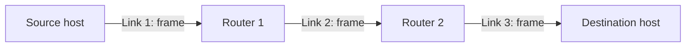
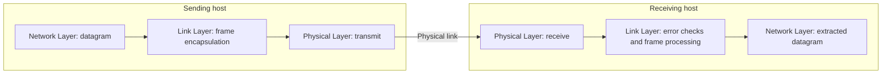

# Computer Networks - Link Layer and LAN

> [!info] Scope of this PDF
> This 11-page deck introduces the **Link Layer**: its role, terminology, context, services, implementation in a host, and communication between network interfaces. The roadmap also lists other Unit 4 topics, but those topics are **not explained in this PDF**. They are identified at the end so they are not mistaken for covered material.

## 1. Where the Link Layer fits

The **Link Layer** is responsible for transferring a network-layer datagram from one node to a **physically adjacent node** over a single communication link.

- It handles one hop at a time, not the entire end-to-end journey across the Internet.
- The network-layer datagram is encapsulated inside a Link-Layer packet called a **frame**.
- A path may contain several links, and different links can use different link-layer protocols.

### Important terminology

| Term | Meaning |
|---|---|
| **Node** | A device participating in network communication. The slides include hosts, routers, switches and Wi-Fi access points. |
| **Link** | A communication channel connecting two adjacent nodes along a communication path. |
| **Wired link** | A link that carries signals through a physical medium, such as a cable. |
| **Wireless link** | A link that carries signals wirelessly, such as a Wi-Fi or cellular connection. |
| **Datagram** | The network-layer packet that the Link Layer receives and encapsulates. |
| **Frame** | The Link-Layer packet; it encapsulates a datagram and adds Link-Layer framing information. |
| **NIC** | Network Interface Card; the network interface that implements the Link Layer and Physical Layer functions. |

> [!important] Frame vs Datagram
> A **datagram** is the packet handled by the Network Layer. A **frame** is the Link-Layer packet that carries that datagram over one link. Do not use the two terms interchangeably.

### One-hop delivery

Suppose a packet travels from a laptop to a web server through several routers. The Link Layer transfers the datagram between adjacent devices on each individual link. At a router, the incoming frame is processed and the datagram is carried onward in a new frame for the next link.

The slide's network illustration (PDF page 5) shows mobile, enterprise, ISP and datacenter networks connected through multiple routers and links. The key idea is that the Link Layer operates across each adjacent-node connection.

## 2. Link Layer context: different links, different protocols

A datagram can cross different kinds of links during one end-to-end journey.

Example from the slide:
- The first link may use **Wi-Fi**.
- The next link may use **Ethernet**.
- Further links may use other wired or wireless link technologies.

Each link-layer protocol can provide a different set of services. For example, a protocol may or may not provide reliable data transfer over its link.

### Transportation analogy from the slide

The slide compares a trip from Princeton to Lausanne with a datagram travelling through a network:

| Transportation example | Networking equivalent |
|---|---|
| Tourist | Datagram |
| Transportation segment / journey leg | Communication link |
| Transportation mode (limousine, plane, train) | Link-Layer protocol |
| Travel agent | Routing algorithm |

The trip uses a limousine from Princeton to JFK, a plane from JFK to Geneva, and a train from Geneva to Lausanne. Likewise, a datagram can be carried over different links using different Link-Layer protocols.

> [!note] What the analogy demonstrates
> The **routing algorithm** determines the route through the network, while the **Link-Layer protocol** provides the method of carrying the datagram across an individual link.

## 3. Link Layer services

The slides group the services into framing/link access, reliable delivery, flow control, error detection, error correction, and duplex operation.

### 3.1 Framing and link access

**Framing** means encapsulating a network-layer datagram inside a frame.

The Link Layer:
1. Takes the datagram from the Network Layer.
2. Adds a frame header and trailer.
3. Places the datagram inside the frame.

**Link access** concerns how a node gets permission to transmit when the communication medium is shared by multiple nodes.

The frame header contains **MAC addresses**, which identify the source and destination at the link layer.

- MAC addresses are different from IP addresses.
- The slide specifically highlights that source and destination MAC addresses are carried in the frame header.
- The detailed MAC-address format and channel-access protocols are not covered in this PDF.

### 3.2 Reliable delivery between adjacent nodes

A Link-Layer protocol may provide reliable data delivery between two adjacent nodes.

- Reliability here is for a particular link, not automatically an end-to-end guarantee across the complete path.
- The slide notes that reliable delivery is rarely used on low-bit-error links such as coaxial cable and fiber.
- Wireless links generally have higher error rates, so reliability can be more useful there.

The slide does not explain a particular retransmission protocol or its detailed operation.

### 3.3 Flow control

**Flow control** is the pacing of data between adjacent sending and receiving nodes.

Its purpose is to prevent a sender from transmitting faster than the adjacent receiver can handle. It regulates the rate of transfer across that link.

### 3.4 Error detection

Errors can be caused by:
- Signal attenuation.
- Noise.

In error detection:
1. The receiver checks whether the received frame contains an error.
2. If an error is detected, the receiver may signal for retransmission.
3. Alternatively, the receiver may drop the frame.

**Error detection identifies that an error has occurred; it does not itself correct the erroneous bit.**

### 3.5 Error correction

**Error correction** allows the receiver to identify and correct bit error(s) without requiring retransmission.

| Error detection | Error correction |
|---|---|
| Detects that an error is present. | Detects and corrects bit error(s). |
| The receiver may request retransmission or drop the frame. | Correction is performed without retransmission. |

> [!warning] Do not confuse these
> Detection tells the receiver that something is wrong. Correction attempts to repair the received data itself.

The PDF introduces these two functions but does **not** teach particular techniques such as parity checks, checksums, CRC, or Hamming codes.

### 3.6 Half-duplex and full-duplex

- **Half-duplex:** Both ends of a link can transmit, but **not at the same time**.
- **Full-duplex:** Both ends can transmit **at the same time**. This is the standard contrast implied by the slide's heading; the slide explicitly defines only half-duplex.

| Mode | Transmission behaviour |
|---|---|
| Half-duplex | Both directions are possible, but the two ends take turns. |
| Full-duplex | Both directions can operate simultaneously. |

## 4. Where is the Link Layer implemented?

The Link Layer is implemented in **every host**.

It is usually implemented in a **Network Interface Card (NIC)** or directly on a chip.

Examples shown in the slide:
- Ethernet card or chip.
- Wi-Fi card or chip.

Key points:
- The network interface implements the **Link Layer and Physical Layer**.
- It attaches to the host's system bus (the slide gives PCI as an example).
- Its implementation is a combination of **hardware, software and firmware**.

### Understanding the NIC diagram (PDF page 9)

The diagram shows the host's CPU and memory connected through the host bus. The network interface is attached to that bus and contains the control and physical components used for network communication.

- **CPU and memory:** Part of the host system.
- **Host bus:** Connects the network interface to the host system; PCI is given as an example.
- **Network interface / controller:** Carries out interface-related control and Link-Layer work.
- **Physical component:** Handles the physical side of sending and receiving signals over the link.

The main takeaway is that Link-Layer processing is not performed only by an abstract software layer: it is implemented through the host's network interface using hardware, software and firmware.

## 5. Network interfaces communicating

PDF page 10 shows two hosts communicating through their network interfaces.

### Sending side

The sending interface:
1. Receives a datagram from the Network Layer.
2. Encapsulates the datagram inside a frame.
3. Adds error-checking bits.
4. Performs any supported reliable-data-transfer and flow-control functions.
5. Passes the frame to the Physical Layer for transmission over the link.

### Receiving side

The receiving interface:
1. Receives the transmitted frame through the Physical Layer.
2. Checks for errors.
3. Performs any supported reliable-data-transfer and flow-control functions.
4. Extracts the original datagram from the frame.
5. Passes the datagram to the upper layer (the Network Layer).

> [!important] Sender vs Receiver
> **Sender:** encapsulates the datagram into a frame and adds the required framing/error-checking information.  
> **Receiver:** checks the frame, processes it, extracts the datagram and passes it upward.

## 6. Important comparisons for revision

### Datagram vs Frame

| Datagram | Frame |
|---|---|
| Network-Layer packet. | Link-Layer packet. |
| Passed to the Link Layer for transmission. | Encapsulates the datagram for one link. |

### MAC address vs IP address

| MAC address | IP address |
|---|---|
| Identifies source and destination in the frame header. | Used at the Network Layer for network-level addressing. |
| Mentioned in the Link-Layer framing discussion. | Not the addressing field used by the frame header in the slide. |

### Link Layer vs Physical Layer

| Link Layer | Physical Layer |
|---|---|
| Frames datagrams and provides link-level services. | Handles transmission of signals/bits over the physical medium. |
| Implemented in the network interface. | Also implemented in the network interface. |

### Error detection vs Error correction

| Detection | Correction |
|---|---|
| Identifies that an error occurred. | Identifies and corrects bit error(s). |
| May lead to retransmission or frame drop. | Does not require retransmission for the correction described in the slide. |

### Half-duplex vs Full-duplex

| Half-duplex | Full-duplex |
|---|---|
| Both ends may transmit, but not simultaneously. | Both ends may transmit simultaneously. |

## 7. Quick revision points

- The Link Layer transfers a datagram between **physically adjacent nodes** over a link.
- A Link-Layer packet is called a **frame**.
- A frame encapsulates a Network-Layer datagram.
- Nodes include hosts, routers, switches and Wi-Fi access points.
- Links can be wired or wireless.
- Different links along one path can use different Link-Layer protocols and offer different services.
- Framing adds a header and trailer around the datagram.
- MAC addresses in the frame header identify the source and destination at the link layer; they are different from IP addresses.
- Reliable delivery, flow control, error detection and error correction are link-level services that a protocol may provide.
- Error detection may result in retransmission or frame drop; error correction repairs bit errors without retransmission.
- Half-duplex allows transmission in both directions, but not at the same time.
- The NIC implements Link-Layer and Physical-Layer functions and may be a separate card or on-chip component.
- A network interface combines hardware, software and firmware and connects to the host through a system bus.
- The sender encapsulates; the receiver checks and extracts.

## 8. Topics listed in the roadmap but not explained in this PDF

The roadmap on PDF page 3 lists the following Unit 4 topics. They are **not developed in the remaining slides of this file**:

- Error-detection and error-correction techniques.
- Multiple-access protocols.
- LAN addressing and ARP.
- Ethernet.
- Switches.
- VLANs.
- A day in the life of a web request.
- Physical Layer in detail.
- Wireless LANs: IEEE 802.11.

> [!note] Study boundary
> These notes cover everything taught in this introductory PDF. The roadmap is not a substitute for the separate lecture slides on the topics above.

## 9. Slide-by-slide coverage audit

| PDF page | Slide content | Included in these notes |
|---:|---|---|
| 1 | Computer Networks / Team Networks title page | Title and source context |
| 2 | Link Layer and LAN section title | Unit context |
| 3 | Unit 4 roadmap | Full roadmap and scope boundary |
| 4 | Roadmap highlighting Introduction | Progression into the introductory topic |
| 5 | Introduction to Link Layer; nodes, links, frame, one-hop responsibility | Section 1 |
| 6 | Link Layer context; different link protocols and transportation analogy | Section 2 |
| 7 | Services: framing, link access, MAC addresses, reliable delivery | Sections 3.1-3.2 |
| 8 | Services: flow control, error detection/correction, duplex | Sections 3.3-3.6 |
| 9 | Link Layer implementation in each host; NIC diagram | Section 4 |
| 10 | Sending and receiving interfaces communicating | Section 5 |
| 11 | Thank-you slide | Closing page; no additional technical content |

---

## End-of-deck checklist

- [x] All 11 PDF pages reviewed.
- [x] Every technical topic appearing in the slides is represented.
- [x] The key network topology, transportation analogy, NIC and communicating-interface diagrams are explained.
- [x] Similar concepts are separated in comparison tables.
- [x] Roadmap topics not taught in this PDF are explicitly identified.
