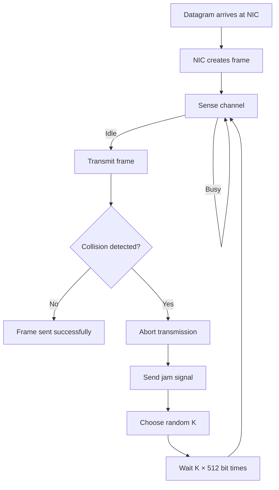

# Computer Networks – Multiple Access Protocols

> [!info] Scope of this PDF
> This 13-page deck covers **multiple-access links and MAC protocols**, with emphasis on **CSMA and Ethernet CSMA/CD**. The roadmap also lists error detection, LAN addressing/ARP, Ethernet, switches, VLANs, physical layer and Wi-Fi, but those topics are not developed in this particular PDF. Wi-Fi and cellular appear only as examples of shared broadcast media.

## Contents
- [[#1. Multiple-access links and protocols]]
- [[#2. Multiple-access problem and collisions]]
- [[#3. Shared vs private links]]
- [[#4. Requirements of an ideal MAC protocol]]
- [[#5. MAC protocol taxonomy]]
- [[#6. CSMA – Carrier Sense Multiple Access]]
- [[#7. Why collisions can still occur with CSMA]]
- [[#8. CSMA/CD – Collision Detection]]
- [[#9. Ethernet CSMA/CD algorithm]]
- [[#10. Is collision detection still used?]]
- [[#11. Quick revision]]
- [[#12. Slide coverage audit]]

---

## 1. Multiple-access links and protocols

### 1.1 Two types of links (PDF page 3)

**Point-to-point link**
- Connects exactly two nodes.
- Example shown: a direct connection between an Ethernet switch and a host.
- Protocol examples in the slide: **PPP** and **HDLC**.
- Since only two endpoints share the link, there is no competition among multiple senders for that same channel.

**Broadcast link (shared wire or medium)**
- Multiple nodes use the same communication medium.
- All share the channel, so their transmissions can interfere.
- Examples in the slide:
  - Old-fashioned/shared-medium Ethernet.
  - Upstream HFC in cable-based access networks.
  - IEEE 802.11 wireless LAN (Wi-Fi).
  - 4G/5G cellular radio.
  - Satellite links.

### 1.2 Why a MAC protocol is needed

A shared broadcast channel needs rules to decide **which node may transmit and when**. The slide compares this to a group conversation: people take turns, avoid interrupting, and do not monopolise the conversation.

- **MAC** means *Medium Access Control*.
- A **multiple-access protocol** coordinates access to a shared channel.
- The coordination messages themselves must use the shared channel; the slide notes that there is **no separate out-of-band coordination channel**.

> [!tip] Analogy
> The shared channel is like a room in which everyone can speak. A MAC protocol is the set of rules that helps people avoid speaking over one another.

---

## 2. Multiple-access problem and collisions

(PDF page 4)

A multiple-access network has **one shared broadcast channel**.

- If two or more nodes transmit at the same time, their signals can interfere.
- A **collision** occurs when a node receives two or more signals at the same time.
- A collision can make the transmitted frames undecodable, wasting channel capacity.

### Definition: Multiple-access protocol

A multiple-access protocol is a **distributed algorithm** that determines how nodes share a channel, specifically deciding when a node is allowed to transmit.

Important points:
1. The protocol coordinates access among multiple nodes.
2. It is distributed across the participating nodes.
3. Communication about channel sharing uses the channel itself.
4. The slide assumes there is no separate out-of-band channel for coordination.

---

## 3. Shared vs private links

(PDF page 5)

The slide asks whether other nodes compete for the same channel.

| Link | Classification in the slide | Reason |
|---|---|---|
| Laptop cable connected to a switch port | **Private** (one device at each end) | A dedicated cable connects the laptop and one switch port. |
| Wi-Fi in a classroom | **Shared** | Devices use the same radio channel. |
| Cable-TV Internet upstream | **Shared** | Homes share the cable medium when sending upstream. |
| Phone communicating with a cell tower | **Shared** | Multiple phones share radio resources; the tower schedules access. |

**Key distinction:** a private point-to-point link has two endpoints on that link. A shared link allows multiple devices to contend for the same medium or radio resources.

---

## 4. Requirements of an ideal MAC protocol

(PDF page 6)

Given a multiple-access channel with rate **R bits per second (bps)**, the slide specifies four desirable properties.

1. **One active sender:** when only one node wants to transmit, it should be able to use the full channel rate, **R**.
2. **M active senders:** when M nodes want to transmit, each should obtain an average rate of **R/M**.
3. **Fully decentralised:**
   - No special node should be required to coordinate all transmissions.
   - Nodes should not need synchronised clocks or time slots.
4. **Simple:** the protocol should be straightforward to implement and operate.

> [!example] Throughput sharing
> If the shared channel has rate R and four nodes are active, the ideal average share per node is R/4. If only one node is active, it should be able to use R rather than being restricted to a permanently reserved fraction.

---

## 5. MAC protocol taxonomy

(PDF page 7)

The slide groups multiple-access protocols into **three broad classes**.

### 5.1 Channel partitioning

The channel is divided into smaller pieces, and a piece is allocated for a node's exclusive use.

The pieces may be:
- **Time slots** – TDMA (Time Division Multiple Access).
- **Frequencies** – FDMA (Frequency Division Multiple Access).
- **Codes** – CDMA (Code Division Multiple Access).

The key idea is to avoid competing transmissions by assigning each user a separate resource.

### 5.2 Random access

- The channel is **not divided** into fixed pieces.
- Nodes transmit when they have data, so collisions are possible.
- Protocols provide a way to recover from or respond to collisions.

Examples listed in the slide:
- ALOHA.
- Slotted ALOHA.
- CSMA.
- CSMA/CD.
- CSMA/CA.

### 5.3 Taking turns / controlled access

- Nodes take turns using the channel.
- A node with more data to send may be allowed a longer turn.
- The taxonomy diagram gives these controlled-access examples:
  - Reservation.
  - Polling.
  - Token passing.

### Taxonomy summary

| Broad class | How access is organised | Examples shown |
|---|---|---|
| Channel partitioning (channelization) | Divide channel into time, frequency or code resources | TDMA, FDMA, CDMA |
| Random access | Nodes contend; collisions can occur and are handled | ALOHA, Slotted ALOHA, CSMA, CSMA/CD, CSMA/CA |
| Taking turns (controlled access) | Nodes receive turns to transmit | Reservation, Polling, Token passing |

> [!note] Syllabus marking on the slide
> The slide explicitly marks the **random-access protocols** branch (including CSMA variants) as included in the syllabus. The remaining taxonomy items are still part of the classification shown.

---

## 6. CSMA – Carrier Sense Multiple Access

(PDF page 8)

**Carrier sensing** means listening to the channel before transmitting.

### 6.1 Simple CSMA: listen before transmit

1. A node senses the channel.
2. If the channel is **idle**, the node transmits the entire frame.
3. If the channel is **busy**, the node defers transmission and waits.

The slide's human analogy is: **do not interrupt others**.

### 6.2 CSMA/CD: CSMA with Collision Detection

CSMA/CD extends CSMA by detecting a collision while transmission is in progress.

- A collision is detected within a short time.
- The colliding transmissions are aborted.
- Aborting early reduces the amount of channel time wasted on a damaged frame.
- Collision detection is relatively easy in wired networks but difficult in wireless networks.

The slide compares this to a polite conversationalist who stops speaking after noticing that someone else started speaking at the same time.

| Mechanism | What it does |
|---|---|
| Carrier sensing | Listen before transmitting. |
| Collision detection | Detect another transmission while sending. |
| Abort | Stop a colliding transmission to reduce wasted time. |

---

## 7. Why collisions can still occur with CSMA

(PDF page 9)

**Carrier sensing does not guarantee collision-free transmission.** The reason is propagation delay.

- A signal takes time to travel from one node to another.
- Two distant nodes may both sense the channel as idle because neither has yet heard the other's newly started transmission.
- Both may begin transmitting.
- Their signals then overlap, causing a collision.

### What the spatial diagram illustrates

The page shows several nodes positioned along a shared medium and a time direction. A node's transmission takes time to propagate across the medium. Before the first transmission reaches another node, that second node may still believe the channel is idle and begin its own transmission.

**Consequences:**
- The whole packet transmission can be wasted when a collision is not detected until late or is not detected at all.
- The probability of collision depends partly on node distance and propagation delay.

> [!important] Exam point
> CSMA reduces collisions compared with transmitting without sensing, but it cannot eliminate them because of propagation delay.

---

## 8. CSMA/CD – Collision Detection

(PDF page 10)

CSMA/CD reduces the time wasted during collisions.

- A node senses the medium and begins transmitting when it is idle.
- If another transmission overlaps with its own, the node detects the collision.
- It **aborts transmission** rather than continuing to send the entire frame.

### Diagram explanation

The diagram uses a spatial layout of nodes and shaded transmission regions. The overlap represents the collision. The marked collision-detection/abort interval shows that the sender stops after detecting the collision, so it does not waste the time required to transmit the remainder of the frame.

**Difference to remember:**
- CSMA: listen before transmitting.
- CSMA/CD: listen before transmitting **and** detect/abort if a collision occurs during transmission.

---

## 9. Ethernet CSMA/CD algorithm

(PDF page 11)

The slide describes the Ethernet NIC's procedure as follows.

### Step-by-step procedure

1. **Frame creation:** the NIC receives a datagram from the network layer and creates a link-layer frame.
2. **Sense the channel:**
   - If idle, start transmitting the frame.
   - If busy, wait until the channel becomes idle, then transmit.
3. **Successful transmission:** if the NIC transmits the entire frame without detecting a collision, it is done with that frame.
4. **Collision detected:** if the NIC detects another transmission while sending:
   - Abort the current frame transmission.
   - Send a **jam signal**.
5. **Binary (exponential) backoff:** after the collision, the NIC waits for a randomly selected interval before trying again.

### Binary exponential backoff

After **n collisions**, the NIC chooses a random integer:

\[
K \in \{0,1,2,\ldots,2^m-1\}
\]

It then waits:

\[
\text{Backoff time}=K\times512\text{ bit times}
\]

After waiting, it returns to Step 2 and senses the channel again.

- More collisions lead to a longer possible backoff interval.
- The random waiting time reduces the chance that the same nodes will collide again immediately.

> [!note] Notation in the source slide
> The slide uses **m** in the range `0` through `2^m − 1`, but does not define how m is selected or capped. Retain the formula as presented in the lecture material; the slide's key concept is that the backoff window grows after repeated collisions.

### Flow of the algorithm

---

## 10. Is collision detection still used?

(PDF page 12)

The slide contrasts older shared Ethernet with modern switched Ethernet.

### 10.1 Earlier Ethernet: shared cable or hub

- Multiple hosts shared one cable or collision domain.
- Two or more hosts could transmit at the same time over the shared medium.
- Their signals could collide.
- CSMA/CD was needed to detect collisions and recover.

### 10.2 Modern switched Ethernet: one cable per device

- Each device has its own cable connected to a switch port.
- Each cable has two ends: the device and its switch port. There is no third sender sharing that cable.
- In full-duplex operation, each direction has its own channel, allowing both ends to send at the same time.
- Therefore, the link does not have the shared-medium collision situation handled by CSMA/CD.

### 10.3 What happens to contention?

The slide explains that contention can move into the switch:
- If multiple incoming frames need the same output port, they may wait in that port's queue.
- If the queue becomes full, frames are dropped.
- This is **output-port contention/queueing**, not a collision on a shared Ethernet cable.

### 10.4 Wi-Fi remains shared

- Wi-Fi devices use a shared radio channel.
- Collisions can still occur on that shared medium.
- The slide points out that collision detection is difficult in wireless; it does not teach the detailed Wi-Fi access procedure in this deck.

> [!success] Main conclusion from page 12
> **Switched, full-duplex Ethernet has no shared-medium collisions, so collision detection is switched off.**

### Old vs modern Ethernet

| Feature | Shared cable / hub Ethernet | Switched, full-duplex Ethernet |
|---|---|---|
| Medium | Multiple hosts share one medium | One cable per device and switch port |
| Simultaneous transmissions | Can collide | Both directions can transmit simultaneously on separate channels |
| Collision detection | Needed in the shared-medium case | Switched off |
| Main contention issue | Collision on shared medium | Frames may queue for the same output port |

---

## 11. Quick revision

### Definitions

| Term | Meaning |
|---|---|
| Point-to-point link | Link connecting two endpoints. |
| Broadcast/shared link | Medium shared by multiple nodes. |
| MAC | Medium Access Control. |
| Multiple-access protocol | Distributed rules that determine when nodes may use a shared channel. |
| Collision | A node receives overlapping transmissions from two or more nodes. |
| Carrier sensing | Listening to the channel before transmitting. |
| CSMA/CD | CSMA with collision detection and abort. |
| Jam signal | Signal sent after collision detection in the Ethernet algorithm shown. |
| Binary exponential backoff | Random delay whose possible range grows after repeated collisions. |

### Formulas to remember

Given channel rate `R` and `M` active nodes, the ideal average rate per node is:

\[
\frac{R}{M}
\]

The backoff delay shown in the slide is:

\[
K\times512\text{ bit times},\qquad K\in\{0,1,\ldots,2^m-1\}
\]

### Common exam distinctions

| Question | Correct distinction |
|---|---|
| CSMA vs CSMA/CD | CSMA senses before transmitting; CSMA/CD also detects and aborts on a collision. |
| Why can CSMA still collide? | Propagation delay means another node may not yet hear a transmission. |
| Why abort after collision? | To reduce time wasted transmitting a frame that has collided. |
| Why use random backoff? | To reduce the chance of immediate repeated collisions. |
| Why is CSMA/CD off in switched full-duplex Ethernet? | Each device has a dedicated full-duplex link to the switch; there is no shared-medium collision. |
| What contention remains in a switch? | Multiple frames may compete for the same output port and queue. |
| Is Wi-Fi shared? | Yes; multiple stations use a shared radio channel. |

---

## 12. Slide coverage audit

| PDF page | Content | Covered |
|---:|---|:---:|
| 1 | Cover – Computer Networks | ✅ |
| 2 | Link Layer and LAN roadmap; multiple-access topic highlighted | ✅ |
| 3 | Point-to-point and broadcast links; examples and human analogy | ✅ |
| 4 | Shared broadcast channel, interference, collision and MAC definition | ✅ |
| 5 | Shared vs private link question and answers | ✅ |
| 6 | Ideal MAC protocol requirements | ✅ |
| 7 | MAC protocol taxonomy and examples | ✅ |
| 8 | CSMA and CSMA/CD principles | ✅ |
| 9 | Collisions caused by propagation delay | ✅ |
| 10 | CSMA/CD collision detection and abort diagram | ✅ |
| 11 | Ethernet CSMA/CD algorithm, jam signal and binary exponential backoff | ✅ |
| 12 | Shared Ethernet vs switched full-duplex Ethernet; switch queues and Wi-Fi | ✅ |
| 13 | Thank-you slide | ✅ |

> [!warning] Topics listed in the roadmap but not taught here
> This PDF does **not** explain channel-partitioning algorithms in depth, ALOHA variants, CSMA/CA operation, Ethernet frame format, ARP, switching, VLANs, the physical layer or IEEE 802.11 details. They are either named in the taxonomy or listed in the unit roadmap only.

---

**End of notes – Multiple Access Protocols**
