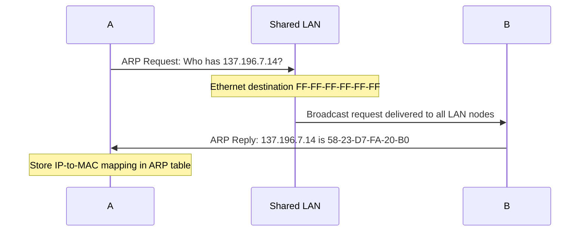
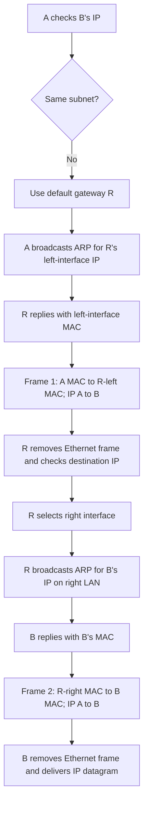

# Switched LANs: MAC Addressing, ARP, Ethernet, Switches and VLANs

> [!info] Scope of this PDF
> This is a **60-page slide deck**. It covers MAC addressing and private Wi-Fi addresses, ARP, addressing across subnets, Ethernet, Ethernet switches, switch learning/forwarding, switch-vs-router differences, and VLANs. The unit roadmap also lists a day in the life of a web request, the physical layer and IEEE 802.11 wireless LANs, but those subjects are **not taught in detail in this PDF**.

## Contents

- [[#1. MAC addressing]]
- [[#2. Private Wi-Fi MAC addresses]]
- [[#3. ARP - Address Resolution Protocol]]
- [[#4. Sending a datagram to another subnet]]
- [[#5. Ethernet]]
- [[#6. Ethernet switches]]
- [[#7. Switches vs routers]]
- [[#8. Virtual LANs - VLANs]]
- [[#9. Quick revision tables]]
- [[#10. Slide-by-slide coverage checklist]]

---

# 1. MAC addressing

## 1.1 IP address vs MAC address

A network interface has both a **network-layer address** and a **link-layer address**. They serve different purposes.

| Feature | IP address | MAC address |
|---|---|---|
| Layer | Network layer (Layer 3) | Link layer (Layer 2) |
| Length in the slide | 32 bits (IPv4) | 48 bits for most LANs |
| Main purpose | Network-layer forwarding/routing | Local frame delivery between physically connected interfaces on a LAN |
| Scope | Depends on the IP subnet/network | Used on the local link/LAN |
| Example | `128.119.40.136` | `1A-2F-BB-76-09-AD` |
| Address structure | Network + host portions | Flat address in the slide's description |

**Core distinction:** IP addresses identify the source and destination at the network layer. MAC addresses identify the interfaces used for delivery over the current local link.

A MAC address is also called a **LAN address**, **physical address**, or **Ethernet address** in the slides.

### MAC address representation

- Usually 48 bits, or 6 bytes.
- Written in hexadecimal (base 16).
- One hexadecimal digit represents 4 bits.
- Example: `1A-2F-BB-76-09-AD` contains 12 hexadecimal digits = 48 bits.
- The address is commonly stored in the NIC (Network Interface Card) ROM, although software-assigned or software-settable addresses are also possible.

## 1.2 Interfaces on a LAN

Each interface on the illustrated LAN has:

- A unique 48-bit MAC address.
- A locally unique 32-bit IP address.

The slide 4 diagram shows four interfaces on LAN `137.196.7.0/24`:

| IP address | MAC address |
|---|---|
| `137.196.7.78` | `1A-2F-BB-76-09-AD` |
| `137.196.7.23` | `71-65-F7-2B-08-53` |
| `137.196.7.14` | `58-23-D7-FA-20-B0` |
| `137.196.7.88` | `0C-C4-11-6F-E3-98` |

The diagram's point is that **one interface has both an IP address and a MAC address**. The two addresses are not interchangeable.

## 1.3 MAC allocation and portability

- MAC address allocation is administered by the **IEEE**.
- A manufacturer obtains a portion of the MAC address space to help ensure uniqueness.
- The slides use this analogy:
  - MAC address is like an identity number.
  - IP address is like a postal address.
- A MAC address is described as a **flat address** and is portable: an interface can move from one LAN to another and retain its MAC address.
- An IP address is not generally portable in the same way because it depends on the subnet to which the node is attached.

> [!tip] Remember
> **MAC = local interface identity. IP = network location/address used for Layer 3 forwarding.**

---

# 2. Private Wi-Fi MAC addresses

## 2.1 Why a fixed MAC address creates a privacy issue

Wi-Fi frames expose the MAC address over the wireless link. If a device uses the same factory MAC address everywhere, nearby networks can observe the same identifier at different locations.

The slide 6 example uses one factory address at three places:

| Place | Factory MAC address |
|---|---|
| Mall | `58-23-D7-FA-20-B0` |
| Airport | `58-23-D7-FA-20-B0` |
| Campus | `58-23-D7-FA-20-B0` |

Because the address is unchanged, visits can be associated with the same device.

## 2.2 Private/randomized address

A device can use a locally generated MAC address for each Wi-Fi network. The example in the slide is:

| Place | Private MAC address |
|---|---|
| Mall | `6A-41-9C-0E-77-15` |
| Airport | `3E-D0-52-B8-19-A4` |
| Campus | `D2-7B-E3-46-0F-C9` |

Different networks see different addresses, making straightforward cross-location tracking harder. The slides note that some phones may also change the private address periodically.

The slide identifies the second hexadecimal digit values `2`, `6`, `A`, or `E` as examples indicating the **locally administered** flag. This is associated with the locally assigned bit in the MAC address.

### Trade-off / possible side effects

Some systems may rely on a stable MAC address, for example:

- Sign-ins or access records tied to an address.
- Device allow-lists.
- Reservations or other systems that expect the same address.

Changing the address can therefore cause compatibility or administration problems.

> [!important] Main idea from the slide
> A MAC address only needs to be unique within the relevant LAN. A device can therefore use a different private address on different Wi-Fi networks.

---

# 3. ARP - Address Resolution Protocol

## 3.1 Why ARP is needed

**Question:** Given the IP address of an interface on the local LAN, how does a host find that interface's MAC address?

ARP (Address Resolution Protocol) performs this IP-to-MAC address resolution.

Each IP node on a LAN, such as a host or router, maintains an **ARP table** containing some known mappings.

### ARP table entry

The slide gives the entry structure as:

`<IP address; MAC address; TTL>`

- **IP address:** the network-layer address being resolved.
- **MAC address:** the corresponding local-link hardware address.
- **TTL (Time To Live):** how long the mapping remains in the cache before it is forgotten.
- The slide says TTL values are typically measured in minutes and vary.

ARP tables are caches; a node does not need to keep permanent entries for every device on the LAN.

## 3.2 ARP request and reply: same-LAN example

Assume host A wants to send a datagram to host B on the same LAN, but A does not know B's MAC address.

The diagram uses:

| Node | IP address | MAC address |
|---|---|---|
| A | `137.196.7.23` | `71-65-F7-2B-08-53` |
| B | `137.196.7.14` | `58-23-D7-FA-20-B0` |

### Step 1 - A broadcasts an ARP request

A sends an ARP query asking which interface owns B's IP address.

- Target IP in the request: `137.196.7.14`.
- Ethernet destination MAC: `FF-FF-FF-FF-FF-FF`.
- This is the Ethernet broadcast address.
- Every node on the LAN receives the broadcast frame.
- Only the node whose IP matches the requested target IP should answer the query.

The slide's example request contains:

- Source MAC: `71-65-F7-2B-08-53`.
- Source IP: `137.196.7.23`.
- Target IP: `137.196.7.14`.

### Step 2 - B sends an ARP reply

B recognises its own IP address in the request and sends a reply to A.

- Target IP: `137.196.7.14`.
- Target MAC: `58-23-D7-FA-20-B0`.
- The reply is sent to A's MAC address: `71-65-F7-2B-08-53`.
- Unlike the request, the reply is unicast to A.

### Step 3 - A updates its ARP table

A records:

| IP address | MAC address | TTL (shown in slide) |
|---|---|---:|
| `137.196.7.14` | `58-23-D7-FA-20-B0` | `500` |

The slide uses `500` as the example TTL value; it is an illustrative cache lifetime, not a universal fixed ARP TTL.

### ARP message flow



## 3.3 What happens to the other LAN nodes?

The quiz on slide 11 asks who receives a broadcast ARP request and who answers.

- All nodes on the LAN receive the broadcast, because the destination MAC is all ones.
- Only B answers because only B owns the queried IP address.
- B sends the response directly to A.

<badge color="success">Slide 11 answer: B</badge>

## 3.4 Whose ARP tables are updated?

The quiz on slide 12 asks whose tables gain a new entry after A asks and B replies.

- A learns B's IP-to-MAC mapping from B's reply.
- B can learn A's IP-to-MAC mapping from the sender information in A's ARP request.
- C and D usually ignore the exchange for their own ARP tables.

<badge color="success">Slide 12 answer: A and B</badge>

### ARP security point

The slide warns that **ARP trusts what it hears**: a device can send a reply claiming that an IP address maps to its MAC address. This creates the possibility of false ARP information being accepted (ARP spoofing/poisoning is the familiar security concern associated with this weakness).

---

# 4. Sending a datagram to another subnet

This is one of the most important worked sequences in the deck. It demonstrates the difference between the **end-to-end IP addresses** and the **per-hop MAC addresses**.

## 4.1 Network layout and addresses

Host A wants to send an IP datagram to host B. They are on different `/24` subnets, so router R forwards the datagram between them.

### Device address table from slides 13-14

| Device/interface | IP address | MAC address |
|---|---|---|
| A (upper-left host) | `111.111.111.111` | `74-29-9C-E8-FF-55` |
| Left lower host | `111.111.111.112` | `CC-49-DE-D0-AB-7D` |
| R - left interface | `111.111.111.110` | `E6-E9-00-17-BB-4B` |
| R - right interface | `222.222.222.220` | `1A-23-F9-CD-06-9B` |
| Right lower host | `222.222.222.221` | `88-B2-2F-54-1A-0F` |
| B (upper-right host) | `222.222.222.222` | `49-BD-D2-C7-56-2A` |

The two LANs are:

- Left subnet: `111.111.111.0/24`.
- Right subnet: `222.222.222.0/24`.

The router has an interface in each subnet.

## 4.2 Which ARP entries are created?

The slide 14 table shows the four mappings created during this A-to-B transfer, assuming the relevant ARP caches start empty:

| Device/cache | Mapping learned |
|---|---|
| A on left subnet | `111.111.111.110` → `E6-E9-00-17-BB-4B` (R's left interface) |
| R's left interface | `111.111.111.111` → `74-29-9C-E8-FF-55` (A) |
| R's right interface | `222.222.222.222` → `49-BD-D2-C7-56-2A` (B) |
| B on right subnet | `222.222.222.220` → `1A-23-F9-CD-06-9B` (R's right interface) |

**Important:** A does not learn B's MAC address, and B does not learn A's MAC address through this exchange. ARP requests are local-link broadcasts and are not forwarded across the router.

The two other hosts (`111.111.111.112` and `222.222.222.221`) are not part of this exchange unless they generate their own traffic.

## 4.3 Why A sends to router R instead of directly to B

A compares its own IP address with B's IP address using the subnet mask.

- A belongs to `111.111.111.0/24`.
- B belongs to `222.222.222.0/24`.
- The network portions differ.
- Therefore B is not on A's local LAN.
- A sends the datagram to its **default gateway**, router R.

This network-layer next-hop decision occurs before A sends the ARP request. A needs R's local MAC address, not B's MAC address, for the first Ethernet frame.

## 4.4 Hop 1 - A resolves the router's left-interface MAC

Assume A's ARP cache is empty.

1. A broadcasts an ARP request on the left LAN:
   - "Who has `111.111.111.110`? Tell `111.111.111.111`."
   - Ethernet destination: `FF-FF-FF-FF-FF-FF`.
2. All devices on the left LAN receive the request, including the lower-left host.
3. R recognises `111.111.111.110` as its own left-interface IP.
4. R replies directly to A:
   - `111.111.111.110` is at `E6-E9-00-17-BB-4B`.
5. A caches this mapping.

## 4.5 Frame 1 - A sends the datagram to R

A creates an IP datagram addressed to B, then encapsulates it in an Ethernet frame addressed to R's left interface.

| Field | Value |
|---|---|
| Ethernet source MAC | `74-29-9C-E8-FF-55` (A) |
| Ethernet destination MAC | `E6-E9-00-17-BB-4B` (R, left interface) |
| IP source | `111.111.111.111` (A) |
| IP destination | `222.222.222.222` (B) |

**Why are the destinations different?** The IP datagram is addressed to the final destination B. The local Ethernet frame is addressed to the next hop R.

## 4.6 R receives the frame and decides where to forward

1. R's left interface receives the Ethernet frame.
2. R removes (strips) the Ethernet header/trailer and extracts the IP datagram.
3. R passes the datagram to its network layer.
4. R examines the destination IP address `222.222.222.222`.
5. Its routing table indicates that the datagram must leave through the right interface onto `222.222.222.0/24`.

## 4.7 Hop 2 - R resolves B's MAC on the right LAN

R's right-interface ARP cache is initially empty.

1. R broadcasts on the right LAN: "Who has `222.222.222.222`? Tell `222.222.222.220`."
2. B recognises its own IP address.
3. B replies to R with its MAC address: `49-BD-D2-C7-56-2A`.
4. R caches the mapping.

## 4.8 Frame 2 - R sends the datagram to B

R encapsulates the same IP datagram in a **new Ethernet frame**.

| Field | Value |
|---|---|
| Ethernet source MAC | `1A-23-F9-CD-06-9B` (R, right interface) |
| Ethernet destination MAC | `49-BD-D2-C7-56-2A` (B) |
| IP source | `111.111.111.111` (A, unchanged) |
| IP destination | `222.222.222.222` (B, unchanged) |

B's NIC accepts the frame because its destination MAC matches B's interface. B removes the Ethernet encapsulation and passes the IP datagram to the network layer.

### End-to-end addressing vs per-hop addressing

| Item | Frame 1: A → R | Frame 2: R → B |
|---|---|---|
| Source MAC | A | R's right interface |
| Destination MAC | R's left interface | B |
| Source IP | A | A |
| Destination IP | B | B |

> [!important] Exam rule
> **IP source and destination remain A and B end-to-end in this example. MAC source and destination are rewritten at each hop to identify the sender and next-hop receiver on that LAN.**

### Complete A-to-B sequence



### Slide 24: frame-by-frame summary

| Step | Sender → receiver | Message/action | Ethernet destination |
|---:|---|---|---|
| 1 | A (internal decision) | A determines B is on another subnet and chooses R | Not a frame |
| 2 | A → all devices on left LAN | ARP request for `111.111.111.110` | Broadcast `FF-FF-FF-FF-FF-FF` |
| 3 | R → A | ARP reply with R-left MAC | A's MAC |
| 4 | A → R | Frame 1 containing IP datagram A-to-B | R-left MAC |
| 5 | R (internal decision) | R reads destination IP and selects right interface | Not a frame |
| 6 | R → all devices on right LAN | ARP request for `222.222.222.222` | Broadcast `FF-FF-FF-FF-FF-FF` |
| 7 | B → R | ARP reply with B's MAC | R-right MAC |
| 8 | R → B | Frame 2 containing the same IP datagram | B's MAC |

---

# 5. Ethernet

## 5.1 Why Ethernet became dominant

The slides describe Ethernet as the dominant wired LAN technology because it was:

- The first widely used LAN technology.
- Simpler and cheaper than competing technologies.
- Able to keep pace with increasing data rates.
- Available in multiple speeds using integrated/single-chip implementations.

The slide lists Token Ring, FDDI and ATM as alternatives that were more complex and expensive, while Ethernet operated at equal or higher data rates.

The slide's cited speed range is `10 Mbps` to `800 Gbps`, with `1.6 Tbps` described as on the way. Treat these as figures quoted by this slide deck, not as a current standards-status update.

## 5.2 Ethernet physical topologies

### Bus topology

- Popular through the mid-1990s, as stated in the slide.
- Nodes share one coaxial cable.
- All nodes belong to the same collision domain.
- Multiple simultaneous transmissions can collide.

### Switched topology

- Prevails in the slide's description of modern Ethernet.
- A Layer 2 switch is placed at the centre.
- Each host has a separate link (a spoke) to the switch.
- Each spoke runs its own Ethernet link, so nodes on different switch ports do not collide with each other.

### Hub vs switch question (slide 28)

Eight PCs are connected to one hub; another eight PCs are connected to one switch.

- Hub: **1 collision domain**. A hub repeats incoming bits to all ports, so the eight PCs share the same medium.
- Switch: **8 separate collision domains** in the slide's framing, one per port/link. On full-duplex switched links, collisions do not occur.

<badge color="success">Slide 28 answer: (a) Hub: 1; switch: 8</badge>

## 5.3 Ethernet frame structure

The sending interface encapsulates an IP datagram (or another network-layer packet) inside an Ethernet frame.

```text
+----------+---------------+---------------+----------+----------------+---------+
| Preamble | Destination   | Source        | Type     | Data / Payload | CRC     |
|          | MAC address   | MAC address   |          |                |         |
+----------+---------------+---------------+----------+----------------+---------+
```

| Field | Size / purpose |
|---|---|
| Preamble | 8 bytes total; synchronises sender and receiver clock rates |
| Destination address | 6-byte destination MAC address |
| Source address | 6-byte source MAC address |
| Type | 2 bytes; identifies the higher-layer protocol carried in the payload |
| Data/payload | 46 to 1500 bytes in the slide's standard frame example |
| CRC | 4 bytes; used by the receiver for error detection |

### Preamble details

- First 7 bytes: `10101010` repeated.
- Final byte: `10101011`.
- Purpose: synchronisation between sender and receiver clock rates.

### MAC address fields

- Source and destination MAC addresses are each 6 bytes.
- Destination address comes first so the receiving adapter can decide early whether the frame is intended for it.
- If the destination matches the adapter's address, or is the broadcast address, the adapter passes the payload to the appropriate network-layer protocol.
- Otherwise, the adapter discards the frame.

### Type field

- Identifies the higher-layer protocol.
- IP is common, but the slide lists Novell IPX and AppleTalk as other examples.
- The receiver uses this field to demultiplex the payload to the correct higher-layer protocol.

### CRC field

- CRC (Cyclic Redundancy Check) is used for error detection.
- If the receiver detects an error, the Ethernet frame is dropped.

## 5.4 Smallest and largest Ethernet frame

The slide gives the following field sizes:

| Field | Size |
|---|---:|
| Destination MAC | 6 bytes |
| Source MAC | 6 bytes |
| Type | 2 bytes |
| Data | 46–1500 bytes |
| CRC | 4 bytes |

**Smallest frame:**

\[
6+6+2+46+4=64\text{ bytes}
\]

**Largest frame:**

\[
6+6+2+1500+4=1518\text{ bytes}
\]

- The 8-byte preamble is not included in either frame-size calculation in the slide.
- If the real data is shorter than 46 bytes, padding is added.
- Example from the slide: 20 bytes of data requires 26 bytes of padding to reach 46 bytes.
- The minimum frame is 64 bytes = 512 bits, linked by the slide to the collision budget discussed earlier in the course.

<badge color="success">Slide 31 answer: minimum 64 bytes; maximum 1518 bytes</badge>

## 5.5 Ethernet is connectionless and unreliable

**Connectionless** means:

- No handshaking between the sending and receiving NICs before sending a frame.

**Unreliable** means:

- The receiving NIC does not send ACKs or NAKs to the sending NIC.
- If a frame is dropped because of an error, Ethernet itself does not arrange retransmission.
- Lost data may be recovered by a higher-layer reliable protocol such as TCP.
- If no higher layer provides recovery, the dropped data remains lost.

The slide states that Ethernet's MAC protocol on shared links is unslotted CSMA/CD with binary backoff.

### Quiz: who retransmits after an Ethernet CRC failure? (slide 33)

Ethernet silently drops the corrupted frame; it does not ask the previous router/NIC to resend. TCP at the original sender can detect missing bytes and retransmit the segment end-to-end.

<badge color="success">Slide 33 answer: (b) TCP at the sender notices the gap and resends</badge>

## 5.6 IEEE 802.3 Ethernet standards

The deck highlights that Ethernet standards share a common MAC protocol and frame format, while physical-layer details vary.

Differences include:

- Data rate: the slide lists examples such as 2 Mbps, 10 Mbps, 100 Mbps, 1 Gbps, 10 Gbps and 40 Gbps.
- Physical medium: fibre or copper cable.

The slide diagram lists standards including:

- `100BASE-TX`
- `100BASE-T4`
- `100BASE-T2`
- `100BASE-FX`
- `100BASE-SX`
- `100BASE-BX`

The diagram groups examples into copper (twisted-pair) and fibre physical layers.

### Reading an Ethernet name (slide 35)

- `100` = speed in megabits per second.
- `BASE` = baseband signalling (the slide describes it as one signal on the wire).
- `TX` / `FX` = medium designation.

| Standard | Meaning in slide |
|---|---|
| `100BASE-TX` | 100 Mb/s over twisted-pair copper |
| `100BASE-FX` | 100 Mb/s over optical fibre |

**Key point:** different cable/media options can carry the same Ethernet frame format and use the same MAC addressing structure.

---

# 6. Ethernet switches

## 6.1 What is a switch?

A switch is a **Layer 2 (link-layer) device** that takes an active role in forwarding Ethernet frames.

Its functions include:

- Stores and forwards Ethernet frames.
- Examines the destination MAC address in an incoming frame.
- Selectively forwards the frame to one or more outgoing links when needed.
- Buffers frames when an outgoing port is not immediately available.
- Is transparent to hosts: hosts do not need to know that a switch is present.

### Plug-and-play and self-learning

- **Plug-and-play:** the basic frame-forwarding function does not require manual configuration of every host-to-port mapping.
- **Self-learning:** the switch learns which MAC addresses are reachable through which ports by examining incoming frames.
- Managed switches can still be configured for features such as VLANs and security; plug-and-play describes basic forwarding-table learning, not the absence of all switch configuration.

> [!note] Link access wording in the slides
> Slide 37 refers to CSMA/CD for accessing a segment. Slides 38-39 then explain that dedicated full-duplex switch links do not collide. Keep the context straight: collision detection is relevant to shared/half-duplex Ethernet; modern full-duplex switched links do not need CSMA/CD.

## 6.2 Multiple simultaneous transmissions

In the six-interface switch diagram (slides 38-39):

- Hosts have dedicated direct connections to switch ports.
- Each incoming link uses Ethernet independently.
- The switch buffers frames.
- Each link is its own collision domain in the slide's description.
- With full-duplex links, collisions do not occur on those links.

### When can transmissions happen simultaneously?

- A-to-A' and B-to-B' can occur simultaneously because they use different links and different switch ports.
- A-to-A' and C-to-A' cannot both be delivered simultaneously through the same outgoing port to A'. They contend for the same output link/port; the switch buffers frames as needed.

## 6.3 Switch forwarding table

A switch maintains a table similar in purpose to a routing/forwarding table.

The slide gives each entry as:

`(MAC address of host, interface/port to reach host, time stamp)`

Example from slide 40:

| MAC address / host label | Interface | Aging/time information |
|---|---:|---:|
| A | 1 | 60 s |
| A' | 4 | 60 s |
| B | 2 | 60 s |

The time information allows old/inactive entries to age out rather than remaining indefinitely.

## 6.4 Self-learning: how the switch builds its table

When a frame arrives, the switch can learn the location of the **source** MAC address.

1. Read the incoming interface/port.
2. Read the source MAC address in the frame.
3. Record the pair `source MAC → incoming port` in the switch table.
4. Refresh the aging/timestamp information for that entry.

The switch does not need a separate routing protocol to learn the directly observed source locations in the examples.

## 6.5 Frame filtering and forwarding algorithm

The sequence in slide 42 is:

1. Record the incoming link and source MAC address.
2. Look up the destination MAC address in the switch table.
3. If the destination entry is found:
   - If the destination is on the same segment/port from which the frame arrived, **filter/drop** the frame; there is no need to send it back out the same segment.
   - Otherwise, forward the frame through the interface recorded for the destination.
4. If the destination is not in the table, **flood** the frame on all interfaces except the incoming interface.
5. Frames addressed to `FF-FF-FF-FF-FF-FF` are broadcast and are flooded.

### Filtering vs forwarding vs flooding

| Situation | Switch action |
|---|---|
| Destination known on another port | Forward only on the learned destination port |
| Destination known on the same incoming port | Filter/drop; do not send back to the same segment |
| Destination unknown | Flood to all ports except the incoming port |
| Broadcast destination | Flood to all relevant ports except the incoming port |

## 6.6 Self-learning example: A sends to A'

The slide 43 sequence begins with an empty switch table.

1. A sends a frame to A'.
2. The switch learns `A → port 1` from the source address.
3. A' is not yet in the table, so the switch floods the frame to all ports except port 1.
4. A' receives the frame and replies to A.
5. The reply arrives on A''s port (port 4), so the switch learns `A' → port 4`.
6. The destination A is known to be on port 1, so the switch forwards A''s reply only through port 1.

This is why the switch can start with an empty table and learn through normal traffic.

## 6.7 Interconnecting multiple switches

Switches can be connected to each other. The same self-learning rule works across a network of switches.

In slide 44, when A sends a frame to G, S1 does not need a manually configured route to G in the example. Unknown-destination flooding propagates the frame through the connected switched network; the switches learn source locations from the frames they receive. Subsequent traffic can be selectively forwarded using the learned tables.

## 6.8 Multi-switch worked example: C sends to I, then I replies to C

Slide 45 asks for the switch tables after C sends a frame to I and I responds to C.

The resulting tables shown are:

| Switch | Learned address | Port |
|---|---|---:|
| S1 | C | 1 |
| S1 | I | 4 |
| S2 | C | 4 |
| S3 | C | 4 |
| S3 | I | 3 |
| S4 | C | 1 |
| S4 | I | 3 |

The table entries come from the source MAC addresses observed by each switch and the port on which the frame arrives.

### Why does S2 not learn I? (slide 46)

- C's initial frame to I is flooded because I is initially unknown.
- The switches that receive this first frame learn C's location from its source address.
- I's reply is addressed to C.
- S4 already knows that C is reachable back toward S1, so it forwards I's reply in that direction without sending the reply through S2.
- S2 does not receive a frame sourced by I, so it does not learn I's MAC address.

<badge color="success">Slide 46 answer: (a)</badge>

## 6.9 Small institutional network

Slide 47 shows a small institutional network:

- A router connects the internal IP subnet to an external network.
- A switch connects internal hosts and servers.
- The subnet includes examples such as a mail server and a web server.
- Multiple end hosts connect through the switched LAN.

The diagram illustrates a common organisation network: switched connectivity within the site and a router at the edge for communication with external networks.

---

# 7. Switches vs routers

Both switches and routers commonly use **store-and-forward** operation, but they work at different layers and use different addressing information.

| Feature | Switch | Router |
|---|---|---|
| Layer | Link layer (Layer 2) | Network layer (Layer 3) |
| Examines | Link-layer header (e.g. Ethernet MAC addresses) | Network-layer header (e.g. IP addresses) |
| Forwarding information | MAC forwarding table | IP routing/forwarding table |
| How table is built in the slides | Self-learning through source-MAC learning, flooding and forwarding | Routing algorithms compute routes/table entries |
| Typical job | Forward frames within a LAN/VLAN | Forward datagrams between IP networks/subnets |

### Broadcast-domain example (slide 49)

In the depicted institutional LAN, a laptop sends an ARP broadcast.

- Switches flood broadcast frames across their relevant ports.
- Therefore devices throughout the switched building/LAN can receive the ARP broadcast.
- The router does not forward that Layer 2 broadcast into external networks.
- The whole building in the example is one broadcast domain until VLANs are introduced.

<badge color="success">Slide 49 answer: (c) Every device on every switch, up to the router</badge>

> [!important] Why VLANs are introduced next
> A large LAN with one common broadcast domain allows ARP, DHCP and unknown-destination traffic to reach a large number of hosts. VLANs create separate logical Layer 2 broadcast domains.

---

# 8. Virtual LANs - VLANs

## 8.1 What is a VLAN?

A **Virtual Local Area Network (VLAN)** divides one physical switched network into multiple logical LANs.

- Devices in the same VLAN communicate as if they were connected to the same physical LAN.
- Devices can belong to the same VLAN even when connected to different physical switches or different locations.
- A VLAN is a logical Layer 2 network/broadcast domain.

## 8.2 Why VLANs are needed

A traditional switched LAN can form one large broadcast domain.

As the LAN grows:

- Layer 2 broadcast traffic increases.
- ARP, DHCP and unknown-destination MAC frames may reach many hosts.
- This can reduce efficiency and create scaling problems.
- A large shared broadcast domain can introduce security and privacy concerns.

### Administrative motivation

The slide 51 example: a Computer Science (CS) user moves physically to an Electrical Engineering (EE) office/switch but should remain logically connected to the CS network.

- Without VLANs, physical switch attachment can determine the user's LAN.
- With VLANs, the user can remain in the CS logical LAN even when physically connected elsewhere.

**Main idea:** VLANs separate logical membership from physical location.

## 8.3 The 4-byte VLAN tag (802.1Q)

A VLAN-aware Ethernet frame adds a 4-byte tag after the source MAC address and before the original Type field.

### Tagged Ethernet frame layout

| Field | Size |
|---|---:|
| Destination MAC address | 6 bytes |
| Source MAC address | 6 bytes |
| VLAN tag | 4 bytes |
| Type | 2 bytes |
| Data | 46–1500 bytes |
| CRC | 4 bytes (recomputed) |

The 4-byte VLAN tag contains:

| Component | Size | Purpose in the slide |
|---|---:|---|
| Tag marker `81-00` | 16 bits | Identifies that a VLAN tag follows; appears where the type field was |
| Priority | 3 bits | Priority values 0–7; determines which frames should be sent first when a queue fills; voice is commonly shown as priority 5 |
| Drop flag | 1 bit | Indicates which frames are eligible to be discarded first if the switch is overloaded |
| VLAN number | 12 bits | Identifies the VLAN |

### VLAN number range

- 12 bits produce 4096 possible values (`0` through `4095`).
- The slides mark VLAN IDs `0` and `4095` as reserved.
- Therefore, **4094 VLAN numbers are usable** in the slide's explanation.

### Effect on frame size

The VLAN tag adds 4 bytes:

- Untagged largest frame in the previous Ethernet slide: 1518 bytes.
- Tagged largest frame: 1522 bytes.
- The CRC is recomputed for the tagged frame, as shown on slide 52.

## 8.4 Access ports, trunk ports and native VLAN

### Access port

- Carries traffic for one VLAN.
- Frames sent to/from the end device are untagged.
- The switch associates the port with its configured VLAN.

### Trunk port

- Carries traffic for multiple VLANs over one physical link, commonly between switches.
- Frames carry VLAN tags so the receiving switch knows which VLAN each frame belongs to.
- A trunk should be configured to carry only the VLANs required on the far side (allowed VLAN list).

### Untagged/native VLAN

- The slide shows one VLAN crossing a trunk without a tag.
- Both ends of the trunk must agree on which VLAN is untagged (the native VLAN).

### Voice VLAN example

A desk phone and a PC share one wall port:

- PC data traffic is untagged and placed in the data VLAN.
- The phone's voice traffic is tagged and assigned to the voice VLAN.
- The phone's frames can be given a higher priority (the slide uses priority 5).

## 8.5 How a VLAN-aware switch forwards frames

A VLAN-aware switch uses the VLAN as part of its forwarding decision.

### Example table from slide 54

| VLAN | MAC | Port |
|---:|---|---:|
| 10 | A | 1 |
| 10 | B | 2 |
| 20 | C | 5 |
| 20 | D | 6 |
| 10, 20 | Trunk | 8 |

### Forwarding process

1. **Identify the VLAN.**
   - On an access port, the switch determines the VLAN from the port configuration.
   - On a trunk, the VLAN is read from the frame's tag (except for the configured untagged/native VLAN).
2. **Learn the source.**
   - Record `(VLAN, source MAC) → port`.
3. **Look up the destination within that VLAN.**
   - Known destination: send through the learned port.
   - Unknown unicast or broadcast: flood only within the same VLAN, including trunk ports that carry that VLAN.
4. **Tag or untag for the outgoing link.**
   - Add the VLAN tag on trunk ports.
   - Remove the tag on access ports.

**Critical point:** every lookup and every flood is restricted to the relevant VLAN. A VLAN-aware switch does not flood a VLAN 20 broadcast into VLAN 10.

## 8.6 VLAN broadcast example (slide 55)

Given:

- PC sends a broadcast from access port 5 in VLAN 20.
- Ports 1–2 belong to VLAN 10.
- Ports 5–6 belong to VLAN 20.
- Port 8 is a trunk carrying VLANs 10 and 20.

The broadcast is forwarded:

- To port 6, untagged, because it is an access port in VLAN 20.
- To port 8, tagged with VLAN 20, because the trunk carries VLAN 20.
- Not to ports 1–2, because they belong to VLAN 10.

<badge color="success">Slide 55 answer: (b)</badge>

## 8.7 Port-based VLANs

A VLAN-capable switch can be configured so that groups of physical ports behave like separate virtual switches.

The slide's example divides ports into:

- EE VLAN: ports 1–8.
- CS VLAN: ports 9–15.

### Benefits described in slide 56

1. **Traffic isolation:** frames to/from ports 1–8 can reach only ports in that VLAN (ports 1–8 in the example).
2. **Dynamic membership:** switch ports can be reassigned dynamically among VLANs.
3. **Membership can also be MAC-based:** a VLAN can be assigned based on endpoint MAC addresses rather than only the physical switch port.
4. **Forwarding between VLANs requires routing:** VLANs behave like separate LANs; inter-VLAN traffic is routed.

The slide notes that vendors commonly sell combined switch/router devices.

## 8.8 Getting from one VLAN to another

A Layer 2 switch keeps VLANs separate. Communication between different VLANs requires a Layer 3 routing function.

The slide shows two arrangements:

### A. Router connected through one trunk

- One trunk carries multiple VLANs between the switch and router.
- Traffic from VLAN 10 travels up to the router.
- The router routes it and sends a new frame back down the trunk in VLAN 20.

### B. Layer 3 switch (switch that can also route)

- Routing is performed inside the switch.
- Each VLAN has its own gateway address.

### Key points

- Each VLAN is its own IP network.
- Each VLAN has a gateway address on the router or Layer 3 switch.
- Crossing from one VLAN to another means routing, not ordinary Layer 2 switching.
- The router/firewall is where rules governing which VLANs may communicate can be enforced.

## 8.9 VLANs spanning multiple switches

A VLAN can extend across more than one physical switch.

- A trunk port carries frames belonging to multiple VLANs between switches.
- Frames crossing between switches must retain VLAN ID information.
- The slide states that frames forwarded within a VLAN between switches cannot be untagged Ethernet frames; the VLAN identity must be carried.
- IEEE 802.1Q adds/removes the additional tag fields on trunk links.

The diagram shows the EE VLAN and CS VLAN spanning the two switches while each switch has its own local port assignments.

## 8.10 VLANs on a real campus

Slide 59 provides this example VLAN plan:

| VLAN ID | Group/device type | May reach |
|---:|---|---|
| 10 | Staff | Staff systems, internet |
| 20 | Students | Learning portal, internet |
| 30 | Teaching labs | Lab servers |
| 40 | Cameras, IoT | Video recorder only |
| 50 | Guest Wi-Fi | Internet only |
| 99 | Switch management | Network admins only |

### How a device is assigned to a VLAN

- **By port:** a lab desk socket is configured for VLAN 30; any device plugged into that socket is placed in VLAN 30.
- **By Wi-Fi network name (SSID):** Staff Wi-Fi may map to VLAN 10, Guest Wi-Fi to VLAN 50.
- **By login:** the network checks the user's credentials and assigns the appropriate VLAN, potentially from different physical ports.

> [!important] VLAN design principle
> Group devices by identity, role and what they are permitted to access - not merely by where they are physically located.

---

# 9. Quick revision tables

## 9.1 IP vs MAC vs ARP

| Term | What it does | Key point |
|---|---|---|
| IP address | Identifies source/destination for network-layer forwarding | End-to-end addressing in the A-to-B example |
| MAC address | Identifies local-link interfaces for frame delivery | Changes at each routed hop |
| ARP | Finds a local MAC address when its IP address is known | Request is broadcast; reply is normally unicast |
| ARP table | Caches IP-to-MAC mappings | Entries have a TTL and expire |

## 9.2 Ethernet facts to memorise

| Item | Value / rule |
|---|---|
| MAC address size | 6 bytes |
| Type field | 2 bytes |
| Minimum payload in slide | 46 bytes |
| Maximum payload in slide | 1500 bytes |
| CRC | 4 bytes |
| Preamble | 8 bytes, excluded from the 64–1518 byte frame calculation |
| Minimum frame | 64 bytes |
| Maximum frame | 1518 bytes |
| Maximum tagged frame shown | 1522 bytes |
| Ethernet delivery | Connectionless and unreliable at the link layer |

## 9.3 Switch forwarding actions

| Destination state | Action |
|---|---|
| Known on another interface | Selectively forward on that interface |
| Known on incoming interface | Filter/drop |
| Unknown | Flood except incoming interface |
| Broadcast | Flood except incoming interface, subject to VLAN boundaries |

## 9.4 Switch vs router vs VLAN

| Concept | Role |
|---|---|
| Layer 2 switch | Forwards frames based on MAC addresses |
| Router | Forwards datagrams between IP networks using IP addresses |
| VLAN | Creates a separate logical Layer 2 network/broadcast domain on shared physical switching infrastructure |
| Trunk | Carries multiple VLANs between network devices using VLAN tags |
| Access port | Connects an endpoint to one VLAN, normally with untagged frames |
| Inter-VLAN routing | Layer 3 forwarding between VLAN IP networks |

## 9.5 Common exam distinctions

- **A MAC address is not an IP address.** A device can have both.
- **ARP request = broadcast; ARP reply = unicast** in the illustrated exchange.
- **ARP is local to a LAN.** A router does not forward ARP broadcasts to the next subnet.
- **A host sending to another subnet resolves the default gateway's MAC**, not the remote host's MAC.
- **IP addresses remain A-to-B; MAC addresses change hop by hop** in the routing example.
- **Hub = one shared collision domain; switch = separate port/link collision domains** in the slide's question.
- **Ethernet drops a bad-CRC frame; Ethernet does not retransmit it.** TCP may recover end-to-end.
- **Switch learns source MAC address**, then looks up destination MAC address.
- **Unknown unicast and broadcast are flooded** (except back out the incoming port); known unicast is selectively forwarded.
- **A router stops a Layer 2 broadcast from crossing to another IP network.**
- **VLANs restrict flooding to members of the same VLAN.**
- **Inter-VLAN traffic needs routing.**

---

# 10. Slide-by-slide coverage checklist

Use this to verify that every page has been accounted for.

| PDF page | Slide/topic | Covered in notes |
|---:|---|---|
| 1 | Cover | Yes - source identification |
| 2 | Unit 4 Link Layer and LAN roadmap | Yes - scope and topics not taught here noted |
| 3 | MAC address vs IP address | Yes |
| 4 | MAC and IP addresses on a LAN diagram | Yes |
| 5 | IEEE MAC allocation and portability | Yes |
| 6 | Private Wi-Fi MAC addresses and privacy | Yes |
| 7 | ARP and ARP table format/TTL | Yes |
| 8 | ARP request broadcast | Yes |
| 9 | ARP reply unicast | Yes |
| 10 | A updates ARP table | Yes |
| 11 | ARP broadcast quiz | Yes - answer and explanation |
| 12 | ARP cache learning and trust/security point | Yes - answer and explanation |
| 13 | Routing A-to-B through R: topology and assumptions | Yes |
| 14 | Device address and ARP-table values | Yes |
| 15 | Why router/default gateway is needed; first ARP | Yes |
| 16 | A creates frame addressed to R | Yes |
| 17 | Frame 1 reaches R; decapsulation | Yes |
| 18 | Steps 4-6: first frame, route decision, ARP for B | Yes |
| 19 | R creates frame to B | Yes |
| 20 | R transmits second-hop frame | Yes |
| 21 | Steps 7-8: re-encapsulation and B receives | Yes |
| 22 | B removes frame and passes datagram to IP | Yes |
| 23 | Repeated final delivery diagram | Yes |
| 24 | Complete eight-step frame-by-frame sequence | Yes |
| 25 | Roadmap transition to Ethernet | Yes |
| 26 | Ethernet dominance and success | Yes |
| 27 | Bus vs switched Ethernet topology | Yes |
| 28 | Hub vs switch collision-domain quiz | Yes - answer and explanation |
| 29 | Ethernet frame structure and preamble | Yes |
| 30 | Ethernet addresses, Type and CRC | Yes |
| 31 | Minimum/maximum Ethernet frame calculation | Yes - full calculation |
| 32 | Ethernet connectionless/unreliable properties | Yes |
| 33 | Ethernet CRC failure/TCP recovery quiz | Yes - answer and explanation |
| 34 | IEEE 802.3 standards and media | Yes |
| 35 | Reading 100BASE-TX and 100BASE-FX | Yes - answer and explanation |
| 36 | Roadmap transition to switches | Yes |
| 37 | Ethernet switch functions, transparency and learning | Yes |
| 38 | Simultaneous transmissions on different switch ports | Yes |
| 39 | Output-port contention | Yes |
| 40 | Switch forwarding table and aging | Yes |
| 41 | Self-learning from source MAC | Yes |
| 42 | Frame filtering/forwarding algorithm | Yes |
| 43 | Flooding unknown destination and selective forwarding | Yes |
| 44 | Interconnected switches and self-learning | Yes |
| 45 | Multi-switch C-to-I worked example and tables | Yes |
| 46 | Why S2 does not learn I quiz | Yes - answer and explanation |
| 47 | Small institutional network diagram | Yes |
| 48 | Switches vs routers | Yes |
| 49 | Broadcast-domain quiz | Yes - answer and explanation |
| 50 | VLAN definition and motivation | Yes |
| 51 | VLAN administrative and scaling motivation | Yes |
| 52 | 802.1Q 4-byte VLAN tag | Yes - field sizes and values |
| 53 | Access/trunk/native VLAN/voice VLAN | Yes |
| 54 | VLAN-aware switch forwarding algorithm | Yes |
| 55 | VLAN-specific broadcast quiz | Yes - answer and explanation |
| 56 | Port-based VLANs and inter-VLAN routing | Yes |
| 57 | Router-on-a-trunk and Layer 3 switch | Yes |
| 58 | VLAN trunking across multiple switches | Yes |
| 59 | Real-campus VLAN plan and assignment methods | Yes |
| 60 | Thank-you slide | Yes - source identification |

---

> [!success] Final coverage audit
> All 60 PDF pages have been mapped. The notes include the MAC/IP distinction, all ARP stages, both hops of the cross-subnet walkthrough, Ethernet frame fields and size arithmetic, switch-learning/forwarding behaviour, the multi-switch example, switch/router comparison, VLAN tag fields, trunk/access/native VLANs, and every quiz answer present in the slides.
