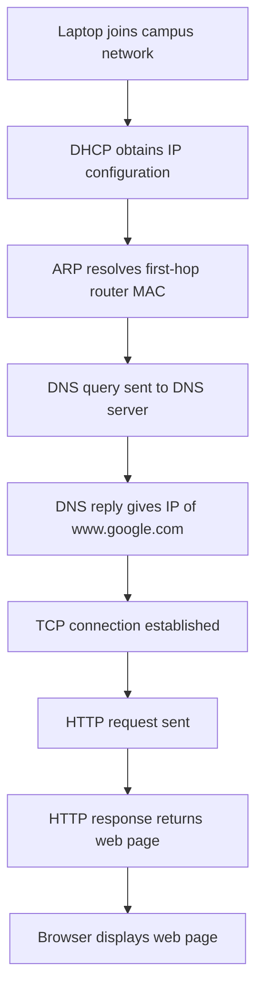
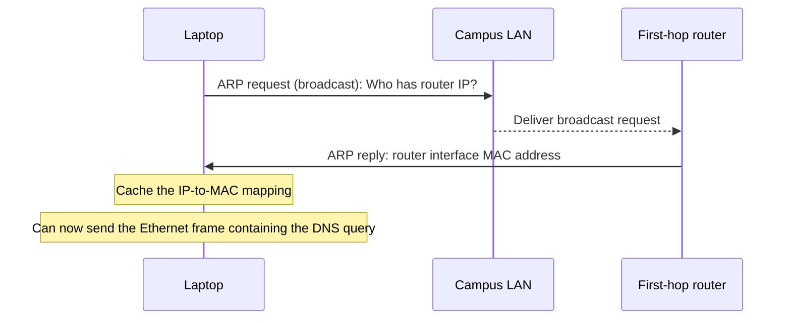
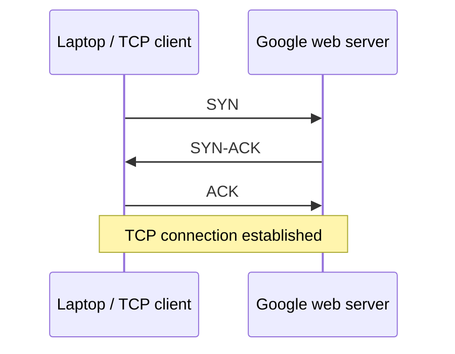

# A Day in the Life of a Web Request

> [!abstract] What this lecture explains
> This lecture combines the protocols studied at different layers into one end-to-end example: a student connects a laptop to the campus network and requests `www.google.com`. The request looks simple to the user, but several protocols cooperate before the web page appears.

## 1. Learning objective and scenario

The protocol-stack journey covered in the lecture includes four layers:

1. **Application layer** – DHCP, DNS and HTTP.
2. **Transport layer** – UDP and TCP.
3. **Network layer** – IP addressing and routing.
4. **Link layer** – Ethernet framing, MAC addressing, ARP and LAN switching.

**Scenario:** A student attaches a laptop to the campus network and requests the web page `www.google.com`.

The lecture follows the request in the order in which the laptop needs network information and then communicates with the web server.

## 2. Network topology shown in the slides

The diagram on page 4 contains three main network areas:

| Network / device | Address shown in the slide | Role in the example |
|---|---|---|
| School network | `68.80.2.0/24` | Network to which the student's laptop connects |
| Comcast network | `68.80.0.0/13` | Intermediate provider network through which traffic is routed |
| Google network | `64.233.160.0/19` | Network containing the destination web server |
| Google web server | `64.233.169.105` | Server hosting the requested web page |
| DNS server | Address not specified in this slide | Resolves `www.google.com` to an IP address |

**Diagram interpretation:** The laptop first communicates with devices on its local campus LAN. Its traffic then passes through the first-hop router and across provider networks before reaching the DNS server or Google web server, depending on the current step.

> [!note] Keep the two server roles separate
> The **DNS server** supplies the IP address associated with `www.google.com`. The **Google web server** at `64.233.169.105` supplies the requested web page. DNS resolution happens before the laptop can address the web request to the destination web server.

## 3. Complete process at a glance

The sequence in the lecture is:

1. **DHCP:** the arriving laptop obtains its IP configuration, first-hop router address and DNS-server information.
2. **ARP:** the laptop discovers the MAC address of its first-hop router so it can send a frame on the local LAN.
3. **DNS:** the laptop sends a DNS query; the DNS server returns the IP address of `www.google.com`.
4. **TCP:** the laptop opens a TCP connection to the Google web server.
5. **HTTP:** the laptop sends the HTTP request; the server returns the web page in an HTTP reply.



---

# Part A – Getting connected: DHCP

## 4. Why DHCP is needed

When the laptop first attaches to the campus network, it needs configuration before it can communicate normally. The slide identifies three pieces of information it needs:

- Its own **IP address**.
- The IP address of its **first-hop router** (default gateway).
- The address of the **DNS server**.

The laptop uses **DHCP (Dynamic Host Configuration Protocol)** to obtain this information.

## 5. DHCP request: encapsulation and broadcast

The page 5 diagram shows the arriving laptop acting as a DHCP client and the router having a DHCP server.

### Sender-side encapsulation

The DHCP request is encapsulated layer by layer:

```text
DHCP message
    ↓ encapsulated in
UDP segment
    ↓ encapsulated in
IP datagram
    ↓ encapsulated in
802.3 Ethernet frame
    ↓ transmitted over
Physical medium
```

The Ethernet frame is broadcast on the LAN using destination MAC address:

`FF-FF-FF-FF-FF-FF`

A broadcast frame is delivered to all devices on that local LAN. The router running the DHCP server receives and processes the request.

### Receiver-side demultiplexing

At the router, the encapsulation is removed in the reverse order:

1. Ethernet processing identifies the network-layer packet.
2. IP processing passes the segment to UDP.
3. UDP passes the DHCP message to the DHCP service.

This is **demultiplexing**: each layer examines its protocol information and passes the payload to the appropriate upper-layer protocol.

> [!important] Encapsulation vs demultiplexing
> - **Encapsulation:** each lower layer wraps the data from the layer above with its own header (and, where applicable, trailer).
> - **Demultiplexing:** the receiver processes those headers and delivers the payload to the correct upper-layer protocol.

## 6. DHCP ACK: client receives its configuration

The page 6 slide shows the DHCP server creating a **DHCP ACK** containing:

- The client's IP address.
- The IP address of the client's first-hop router.
- The name and IP address of the DNS server.

The server encapsulates its reply and sends it through the LAN. The slide specifically notes that the Ethernet frame is forwarded using **switch learning**. At the client, the message is demultiplexed up the protocol stack until it reaches DHCP.

After receiving the DHCP ACK, the laptop knows:

1. Its own IP address.
2. The name and IP address of its DNS server.
3. The IP address of its first-hop router.

> [!success] Result of DHCP
> The laptop now has the basic network configuration needed to communicate beyond its local machine.

---

# Part B – Finding the first-hop router: ARP

## 7. Why ARP is needed before DNS traffic can be sent

The laptop wants to find the IP address of `www.google.com`. It must contact a DNS server to do that.

The DNS query can be prepared at the application/transport/network layers, but to transmit it over the local Ethernet LAN, the laptop needs the **MAC address of the next-hop router interface**.

The slide's sequence is:

1. Create a DNS query.
2. Encapsulate it in UDP.
3. Encapsulate the UDP segment in an IP datagram.
4. Encapsulate the IP datagram in an Ethernet frame.
5. Before sending the frame to the router, discover the router interface's MAC address using **ARP**.

ARP stands for **Address Resolution Protocol**. It resolves a local IPv4 address to the corresponding MAC address.

## 8. ARP request and ARP reply

The arriving laptop broadcasts an ARP query on the local LAN. The router receives the query and responds with an ARP reply containing the MAC address of its local interface.



**Important distinction:** ARP is used here to find the MAC address of the **first-hop router**, not the MAC address of the remote Google web server. ARP operates on the local LAN; the laptop does not use ARP to resolve a host on a remote network.

## 9. The laptop can now send the DNS query

Once the laptop knows the router interface's MAC address, it can transmit the Ethernet frame containing the DNS query to the first-hop router.

The frame is sent across the local LAN, with the LAN switch forwarding it toward the router. The router then forwards the IP datagram toward the DNS server.

---

# Part C – Resolving the name: DNS

## 10. DNS query travels to the DNS server

The page 8 slide shows the IP datagram containing the DNS query being forwarded:

1. From the laptop through the campus LAN switch.
2. From the switch to the first-hop router.
3. From the campus network into the Comcast network.
4. Across the routed network toward the DNS server.

The slide names the following routing protocols as examples of protocols that may have created the routing tables used along the way:

- RIP
- OSPF
- IS-IS
- BGP

The DNS server receives the message. The data is demultiplexed up the protocol stack to DNS.

## 11. DNS reply

The DNS server replies to the laptop with the IP address corresponding to `www.google.com`.

The key result is that the laptop now has the destination IP address required to contact the Google web server.

> [!important] DNS vs ARP
> | Protocol | What it resolves / provides | Scope in this example |
> |---|---|---|
> | DNS | Host name (`www.google.com`) to an IP address | Used to discover the web server's IP address |
> | ARP | Local IPv4 address to a MAC address | Used to discover the first-hop router's local MAC address |

---

# Part D – Establishing transport communication: TCP

## 12. TCP connection carrying HTTP

After DNS returns the IP address, the laptop can start communicating with the Google web server. The page 9 slide says that the client first opens a **TCP socket** to the web server.

The slide illustrates the first two messages of the TCP three-way handshake:

1. **SYN:** the client sends a TCP SYN segment. This is step 1 of the three-way handshake. The segment is routed across networks toward the web server.
2. **SYN-ACK:** the web server responds with a TCP SYN-ACK. This is step 2 shown in the slide.
3. **ACK:** the standard TCP three-way handshake completes with the client's acknowledgement.

The slide labels the connection as established after showing SYN and SYN-ACK; its diagram does not separately draw the final ACK packet.



> [!note] What the diagram depicts
> The source slide explicitly labels SYN as step 1 and SYN-ACK as step 2. The final ACK is not drawn in that slide. It is included in the standard three-way handshake sequence above to show the complete handshake.

---

# Part E – Requesting and receiving the page: HTTP

## 13. HTTP request

Once the TCP connection is established, the browser sends the HTTP request through the TCP socket.

The request is carried through the protocol stack:

```text
HTTP request
    ↓
TCP segment
    ↓
IP datagram
    ↓
Ethernet frame on each local link
    ↓
Network transmission toward www.google.com
```

The IP datagram containing the HTTP request is routed toward `www.google.com`.

## 14. HTTP reply

The Google web server receives and processes the HTTP request. It sends an **HTTP reply containing the requested web page**.

The IP datagram carrying the HTTP reply is routed back to the client. At the laptop, the data is passed up the protocol stack to the browser, which displays the web page.

**Destination shown in the slides:** Google web server at `64.233.169.105`.

> [!success] Final result
> The browser displays the requested web page. The apparently simple action of opening `www.google.com` required DHCP, ARP, DNS, TCP, HTTP, IP routing and link-layer forwarding.

---

# 15. Layer-by-layer summary

| Layer | Protocol / mechanism in this scenario | Purpose |
|---|---|---|
| Application | DHCP | Obtain the client's network configuration |
| Application | DNS | Resolve `www.google.com` to an IP address |
| Application | HTTP | Request and receive the web page |
| Transport | UDP | Carry DHCP and DNS messages in the slide's examples |
| Transport | TCP | Establish a connection and carry HTTP data |
| Network | IP | Address datagrams and route them between networks |
| Link | ARP | Discover the first-hop router's MAC address |
| Link | Ethernet | Encapsulate IP datagrams in frames on the LAN |
| Link | LAN switch | Forward frames across the local LAN; DHCP reply forwarding uses switch learning in the slide |
| Physical | Physical medium | Carry the transmitted bits |

## 16. Important distinctions for revision

### DHCP, ARP, DNS, TCP and HTTP are not interchangeable

| Protocol | Main question it answers |
|---|---|
| DHCP | What IP configuration should this laptop use? |
| ARP | What MAC address belongs to the local next-hop IPv4 address? |
| DNS | What IP address corresponds to this host name? |
| TCP | Can the two endpoints establish a reliable transport connection? |
| HTTP | What web resource is being requested, and what response is returned? |

### IP address vs MAC address in the overall journey

- The **IP datagram** identifies the source and destination at the network layer and is routed across networks.
- The **MAC address** is used to deliver a frame across the current local link, such as from the laptop to its first-hop router.
- The laptop therefore needs the router's MAC address to transmit the DNS query over the campus LAN, even though the DNS query is ultimately intended for the DNS server.

### DNS must happen before the HTTP request in this scenario

The laptop starts with the name `www.google.com`, not the web server's IP address. DNS provides the IP address, after which the client can establish TCP communication with the web server and send the HTTP request.

---

# 17. Slide-by-slide coverage checklist

| PDF page | Slide title / content | Covered |
|---:|---|:---:|
| 1 | Computer Networks – title | ✅ |
| 2 | Unit 4 Link Layer and LAN roadmap; highlights the web-request synthesis topic | ✅ |
| 3 | Synthesis: objective, protocol layers and student-laptop scenario | ✅ |
| 4 | Network topology: school, Comcast and Google networks; DNS and web server roles | ✅ |
| 5 | DHCP request, encapsulation and Ethernet broadcast | ✅ |
| 6 | DHCP ACK, switch forwarding and client configuration | ✅ |
| 7 | ARP before DNS and HTTP; resolving the router MAC | ✅ |
| 8 | DNS query routing and DNS reply | ✅ |
| 9 | TCP connection setup: SYN and SYN-ACK | ✅ |
| 10 | HTTP request, HTTP reply and browser display | ✅ |
| 11 | Thank-you slide | ✅ |

---

# 18. Quick revision – read this before the exam

1. Laptop joins the campus network → **DHCP** provides its IP address, first-hop router address and DNS-server information.
2. Laptop needs to send a DNS query → **ARP** discovers the first-hop router's MAC address.
3. Laptop sends DNS query → carried in **UDP → IP → Ethernet** and routed to the DNS server.
4. DNS server replies → provides the IP address for `www.google.com` (`64.233.169.105` in the slide's example).
5. Laptop opens a TCP socket → **TCP three-way handshake** establishes the connection.
6. Browser sends **HTTP request** → carried by TCP and routed to the Google web server.
7. Server sends **HTTP reply** → contains the web page and is routed back to the laptop.
8. Browser receives the response → web page is displayed.

> [!tip] Most important exam idea
> Do not start the story with HTTP. The laptop must first configure itself using DHCP, discover the local router's MAC address using ARP, and obtain the web server's IP address using DNS. Only then does it establish TCP and exchange HTTP messages.

---

## Source boundary

These notes cover the content of the supplied 11-page PDF. The roadmap slide lists other Link Layer and LAN topics, but this file's teaching sequence focuses on the integrated “A day in the life of a web request” example. No additional treatment of those other roadmap topics is implied here.
