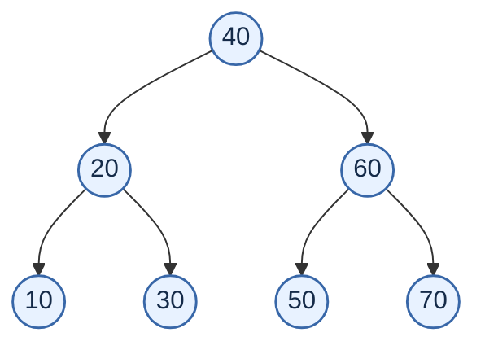
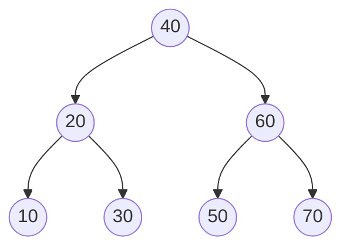

# 🌳 01 — Tree Implementations

> [!abstract] Scope
> This note transcribes the **text source files** found in `1.zip`, including the nested `L25_L26_all.zip`. Source code is copied as found in the archive; it has **not** been silently corrected or refactored. Compiled `.exe` and `.o` files are listed in the inventory but are not pasted as code.

> [!tip] Obsidian rendering
> The tree diagrams below use **Mermaid**, which Obsidian supports natively. No community plugin is required to render them. If a diagram does not render, make sure Mermaid diagrams are enabled in Obsidian's editor/preview settings.

## Contents

- [[#1. Archive layout|Archive layout]]
- [[#2. What each numbered folder contains|What each numbered folder contains]]
- [[#3. Binary-tree visualisations|Binary-tree visualisations]]
- [[#4. Source files — tree/one/|Folder one — insertion and inorder traversal]]
- [[#5. Source files — tree/two/|Folder two — node and leaf counts]]
- [[#6. Source files — tree/three/|Folder three — copying and comparing trees]]
- [[#7. Source files — tree/four/|Folder four — preorder, postorder, inorder]]
- [[#8. Source files — tree/five/|Folder five — deleting nodes]]
- [[#9. Nested archive — tree/L25_L26_all.zip|Nested archive]]
- [[#10. Source observations (not edits)|Source observations]]

---

## 1. Archive layout

```text
tree/
├── one/
│   ├── client.c
│   ├── makefile
│   ├── tree.c
│   └── tree.h
├── two/
│   ├── client.c
│   ├── makefile
│   ├── tree.c
│   └── tree.h
├── three/
│   ├── client.c
│   ├── client.exe       [compiled binary]
│   ├── client.o         [compiled object]
│   ├── makefile
│   ├── tree.c
│   ├── tree.h
│   └── tree.o           [compiled object]
├── four/
│   ├── client.c
│   ├── makefile
│   ├── tree.c
│   └── tree.h
├── five/
│   ├── client.c
│   ├── client.exe       [compiled binary]
│   ├── client.o         [compiled object]
│   ├── makefile
│   ├── tree.c
│   ├── tree.h
│   └── tree.o           [compiled object]
└── L25_L26_all.zip
    ├── one/
    │   ├── client.c
    │   ├── makefile
    │   ├── tree.c
    │   └── tree.h
    └── two/
        ├── client.c
        ├── makefile
        ├── tree.c
        └── tree.h
```

### File inventory

| Location | Files | Main functionality visible in the source |
|---|---|---|
| `tree/one/` | `client.c`, `makefile`, `tree.c`, `tree.h` | BST insertion, inorder display, cleanup |
| `tree/two/` | Same four source/build files | Adds node count and leaf count |
| `tree/three/` | Four source/build files plus `.exe` and `.o` artifacts | Adds tree copy and structural comparison |
| `tree/four/` | Four source/build files | Preorder, postorder and inorder traversals |
| `tree/five/` | Four source/build files plus `.exe` and `.o` artifacts | BST deletion using inorder successor |
| `tree/L25_L26_all.zip` | Nested `one/` and `two/` copies | Contains copies of the first two folder versions |

## 2. What each numbered folder contains

<details>
<summary>Folder one — core BST</summary>

- Node contains a key and left/right pointers.
- Insertion uses a recursive helper.
- Display uses inorder traversal.
- Deinitialisation frees nodes recursively.
</details>

<details>
<summary>Folder two — counting nodes and leaves</summary>

- Builds on folder one.
- Adds `number_of_nodes()` and `number_of_leaves()` and their recursive helpers.
</details>

<details>
<summary>Folder three — copy and compare</summary>

- Adds `copy()` to duplicate a tree and `are_same()` to compare tree shape and keys.
- The `client.c` code is transcribed as written; see [[#10. Source observations (not edits)|source observations]] for a notable detail in its test code.
</details>

<details>
<summary>Folder four — three traversal orders</summary>

- Implements preorder, postorder and inorder display.
</details>

<details>
<summary>Folder five — deletion</summary>

- Adds `delete_key()`.
- The implementation handles leaves, nodes with only one child, and nodes with two children using the inorder successor.
</details>

---

## 3. Binary-tree visualisations

### 3.1 BST formed by `{40, 20, 60, 10, 70, 30, 50}`

This is the insertion sequence used by the client programs. The resulting BST is:



**Inorder:** `10 20 30 40 50 60 70`

**Preorder:** `40 20 10 30 60 50 70`

**Postorder:** `10 30 20 50 70 60 40`

### 3.2 BST formed by ascending input

The insertion sequence `{10, 20, 30, 40, 50, 60, 70}` gives a right-skewed BST:


> [!important] Why the shape changes
> A normal BST's shape depends on insertion order. Inserting ascending values repeatedly follows the right pointer, producing a skewed tree rather than a balanced one.

### 3.3 Deletion cases represented in folder five

Starting tree:



The client calls deletion in this order: `10`, `20`, `60`, `40`, `70`, `50`, `30`.

| Key deleted | Case the implementation exercises at that moment | Inorder result after deletion |
|---:|---|---|
| `10` | Leaf | `20 30 40 50 60 70` |
| `20` | No left child; has right child `30` | `30 40 50 60 70` |
| `60` | Two children; successor is `70` | `30 40 50 70` |
| `40` | Two children; successor is `50` | `30 50 70` |
| `70` | Leaf | `30 50` |
| `50` | Has one child (`30` after previous deletions) | `30` |
| `30` | Last remaining node | *(empty tree)* |

> [!note] Diagram rule
> These Mermaid diagrams are explanatory visualisations of the source's insertion/deletion behaviour. They do not replace the verbatim code sections below.

---

# 4. Source files — tree/one/

> [!info] Version focus
> Initial node-based BST implementation: insert, inorder display, initialise, and free the tree.

### `tree/one/client.c`

```c
#include <stdio.h>
#include "tree.h"

int main()
{
	// case 1
	tree_t t1;
	init(&t1);
		int a1[] = {40, 20, 60, 10, 70, 30, 50};
	int n1 = 7;
	for(int i = 0; i < n1; ++i)
	{
		insert(&t1, a1[i]);
	}
	disp(&t1);
	deinit(&t1);
	
	// case 2
	tree_t t2;
	init(&t2);
	
	int a2[] = {10, 20, 30, 40, 50, 60, 70};
	int n2 = 7;
	for(int i = 0; i < n2; ++i)
	{
		insert(&t2, a2[i]);
	}
	disp(&t2);	
	deinit(&t2);
	
	// case 3
	tree_t t3;
	init(&t3);
	disp(&t3);	
	deinit(&t3);

}
```

### `tree/one/makefile`

```makefile
client.exe : client.o tree.o 
	gcc client.o tree.o -o client.exe
tree.o : tree.c tree.h 
	gcc -Wall -c tree.c 
client.o : client.o tree.h 
	gcc -Wall -c client.c 
	
```

### `tree/one/tree.h`

```c
#ifndef TREE_H
#define TREE_H
struct node 
{
	int key_;
	struct node *left_;
	struct node *right_;
};
typedef struct node node_t;

struct tree 
{
	
	node_t *root_;
};
typedef struct tree tree_t;

void init(tree_t *ptr_tree);
void deinit(tree_t *ptr_tree);
void disp(tree_t *ptr_tree);
void insert(tree_t *ptr_tree, int key);
#endif
```

### `tree/one/tree.c`

```c
#include <stdio.h>
#include <stdlib.h>
#include "tree.h"
// node functions 
static void disp_recursive(node_t* temp)
{
	if(temp)
	{
		disp_recursive(temp->left_);
		printf("%d ", temp->key_);
		disp_recursive(temp->right_);
	}
}

static node_t* insert_recursive(node_t* root, node_t* temp)
{
	if(root == NULL)
	{
		root = temp;
	}
	else if(root->key_ > temp->key_)
	{
		root->left_ = insert_recursive(root->left_, temp);
	}
	else 
	{
		root->right_ = insert_recursive(root->right_, temp);
	}
	return root;
}

static void deinit_recursive(node_t* root)
{
	if(root)
	{
		deinit_recursive(root->left_);
		deinit_recursive(root->right_);
		free(root);
	}
}
// tree functions 
void init(tree_t *ptr_tree)
{
	ptr_tree->root_ = NULL;
}
void deinit(tree_t *ptr_tree)
{
	deinit_recursive(ptr_tree->root_);
	ptr_tree->root_ = NULL;
}
void disp(tree_t *ptr_tree)
{
	printf("Tree : ");
	disp_recursive(ptr_tree->root_);
	printf("\n");
}
void insert(tree_t *ptr_tree, int key)
{
	node_t *temp = (node_t*)malloc(sizeof(node_t));
	temp->key_ = key;
	temp->left_ = temp->right_ = NULL;
	ptr_tree->root_ = insert_recursive(ptr_tree->root_, temp);
}
```

---

# 5. Source files — tree/two/

> [!info] Version focus
> Adds recursive calculations for the total number of nodes and number of leaves.

### `tree/two/client.c`

```c
#include <stdio.h>
#include "tree.h"

int main()
{
	// case 1
	tree_t t1;
	init(&t1);
		int a1[] = {40, 20, 60, 10, 70, 30, 50};
	int n1 = 7;
	for(int i = 0; i < n1; ++i)
	{
		insert(&t1, a1[i]);
	}
	disp(&t1);
	
	// added 
	printf("# of nodes : %d\n", number_of_nodes(&t1));
	printf("# of leaves : %d\n", number_of_leaves(&t1));
	
	deinit(&t1);
	
	// case 2
	tree_t t2;
	init(&t2);
	
	int a2[] = {10, 20, 30, 40, 50, 60, 70};
	int n2 = 7;
	for(int i = 0; i < n2; ++i)
	{
		insert(&t2, a2[i]);
	}
	disp(&t2);	

	// added
	printf("# of nodes : %d\n", number_of_nodes(&t2));
	printf("# of leaves : %d\n", number_of_leaves(&t2));

	deinit(&t2);
	
	// case 3
	tree_t t3;
	init(&t3);
	disp(&t3);	
	
	// added
	printf("# of nodes : %d\n", number_of_nodes(&t3));
	printf("# of leaves : %d\n", number_of_leaves(&t3));
	
	deinit(&t3);

}
```

### `tree/two/makefile`

```makefile
client.exe : client.o tree.o 
	gcc client.o tree.o -o client.exe
tree.o : tree.c tree.h 
	gcc -Wall -c tree.c 
client.o : client.o tree.h 
	gcc -Wall -c client.c 
	
```

### `tree/two/tree.h`

```c
#ifndef TREE_H
#define TREE_H
struct node 
{
	int key_;
	struct node *left_;
	struct node *right_;
};
typedef struct node node_t;

struct tree 
{
	node_t *root_;
};
typedef struct tree tree_t;

void init(tree_t *ptr_tree);
void deinit(tree_t *ptr_tree);
void disp(tree_t *ptr_tree);
void insert(tree_t *ptr_tree, int key);

// adding 
// 1. find # of nodes 
int number_of_nodes(tree_t *ptr_tree);
// 2. find # of leaves 
int number_of_leaves(tree_t *ptr_tree);

#endif
```

### `tree/two/tree.c`

```c
#include <stdio.h>
#include <stdlib.h>
#include "tree.h"
// node functions 
static void disp_recursive(node_t* temp)
{
	if(temp)
	{
		disp_recursive(temp->left_);
		printf("%d ", temp->key_);
		disp_recursive(temp->right_);
	}
}

static node_t* insert_recursive(node_t* root, node_t* temp)
{
	if(root == NULL)
	{
		root = temp;
	}
	else if(root->key_ > temp->key_)
	{
		root->left_ = insert_recursive(root->left_, temp);
	}
	else 
	{
		root->right_ = insert_recursive(root->right_, temp);
	}
	return root;
}

static void deinit_recursive(node_t* root)
{
	if(root)
	{
		deinit_recursive(root->left_);
		deinit_recursive(root->right_);
		free(root);
	}
}
// tree functions 
void init(tree_t *ptr_tree)
{
	ptr_tree->root_ = NULL;
}
void deinit(tree_t *ptr_tree)
{
	deinit_recursive(ptr_tree->root_);
	ptr_tree->root_ = NULL;
}
void disp(tree_t *ptr_tree)
{
	printf("Tree : ");
	disp_recursive(ptr_tree->root_);
	printf("\n");
}
void insert(tree_t *ptr_tree, int key)
{
	node_t *temp = (node_t*)malloc(sizeof(node_t));
	temp->key_ = key;
	temp->left_ = temp->right_ = NULL;
	ptr_tree->root_ = insert_recursive(ptr_tree->root_, temp);
}

//--------------------------------------
// adding 

// node 

int number_of_nodes_recursive(node_t* temp)
{
	if(temp == NULL)
	{
		return 0;
	}
	else 
	{
		return 1 + number_of_nodes_recursive(temp->left_) 
			+ number_of_nodes_recursive(temp->right_);
	}
}

int number_of_leaves_recursive(node_t* temp)
{
	if(temp == NULL)
	{
		return 0;
	}
	else if(temp->left_ == NULL && temp->right_ == NULL)
	{
		return 1;
	}
	else
	{
		return number_of_leaves_recursive(temp->left_) 
			+ number_of_leaves_recursive(temp->right_);
	}
}

// tree 
int number_of_nodes(tree_t *ptr_tree)
{
	return number_of_nodes_recursive(ptr_tree->root_);
}

int number_of_leaves(tree_t *ptr_tree)
{
	return number_of_leaves_recursive(ptr_tree->root_);
}
```

---

# 6. Source files — tree/three/

> [!info] Version focus
> Adds deep copying of a tree and comparison of two trees by both key values and structure.

### `tree/three/client.c`

```c
#include <stdio.h>
#include "tree.h"

int main()
{
	tree_t t1;
	init(&t1);
	int a1[] = {40, 20, 60, 10, 70, 30, 50};
	int n1 = 7;
	for(int i = 0; i < n1; ++i)
	{
		insert(&t1, a1[i]);
	}
	disp(&t1);
	
	tree_t t2;
	init(&t2);
	copy(&t1, &t2);
	disp(&t2);
	printf("same : %d\n", are_same(&t1, &t2));
	
	tree_t t3;
	init(&t3);
	int a3[] = {10, 20, 30, 40, 50, 60, 70};
	int n3 = 7;
	for(int i = 0; i < n3; ++i)
	{
		insert(&t1, a3[i]);
	}
	printf("same : %d\n", are_same(&t1, &t3));
	
	
	
	#if 0
	// case 1
	tree_t t1;
	init(&t1);
		int a1[] = {40, 20, 60, 10, 70, 30, 50};
	int n1 = 7;
	for(int i = 0; i < n1; ++i)
	{
		insert(&t1, a1[i]);
	}
	disp(&t1);
	
	// added 
	printf("# of nodes : %d\n", number_of_nodes(&t1));
	printf("# of leaves : %d\n", number_of_leaves(&t1));
	
	deinit(&t1);
	
	// case 2
	tree_t t2;
	init(&t2);
	
	int a2[] = {10, 20, 30, 40, 50, 60, 70};
	int n2 = 7;
	for(int i = 0; i < n2; ++i)
	{
		insert(&t2, a2[i]);
	}
	disp(&t2);	

	// added
	printf("# of nodes : %d\n", number_of_nodes(&t2));
	printf("# of leaves : %d\n", number_of_leaves(&t2));

	deinit(&t2);
	
	// case 3
	tree_t t3;
	init(&t3);
	disp(&t3);	
	
	// added
	printf("# of nodes : %d\n", number_of_nodes(&t3));
	printf("# of leaves : %d\n", number_of_leaves(&t3));
	
	deinit(&t3);
	#endif
}
```

### `tree/three/makefile`

```makefile
client.exe : client.o tree.o 
	gcc client.o tree.o -o client.exe
tree.o : tree.c tree.h 
	gcc -Wall -c tree.c 
client.o : client.c tree.h 
	gcc -Wall -c client.c 
	
```

### `tree/three/tree.h`

```c
#ifndef TREE_H
#define TREE_H
struct node 
{
	int key_;
	struct node *left_;
	struct node *right_;
};
typedef struct node node_t;

struct tree 
{
	node_t *root_;
};
typedef struct tree tree_t;

void init(tree_t *ptr_tree);
void deinit(tree_t *ptr_tree);
void disp(tree_t *ptr_tree);
void insert(tree_t *ptr_tree, int key);

// adding 
// 1. find # of nodes 
int number_of_nodes(tree_t *ptr_tree);
// 2. find # of leaves 
int number_of_leaves(tree_t *ptr_tree);
// 3. copy tree 
void copy(tree_t* ptr_src, tree_t* ptr_dst);
// 4. compare tree
int are_same(tree_t* ptr_tree1, tree_t* ptr_tree2);
// 5. search 
// 6. delete 

#endif
```

### `tree/three/tree.c`

```c
#include <stdio.h>
#include <stdlib.h>
#include "tree.h"
// node functions 
static void disp_recursive(node_t* temp)
{
	if(temp)
	{
		disp_recursive(temp->left_);
		printf("%d ", temp->key_);
		disp_recursive(temp->right_);
	}
}

static node_t* insert_recursive(node_t* root, node_t* temp)
{
	if(root == NULL)
	{
		root = temp;
	}
	else if(root->key_ > temp->key_)
	{
		root->left_ = insert_recursive(root->left_, temp);
	}
	else 
	{
		root->right_ = insert_recursive(root->right_, temp);
	}
	return root;
}

static void deinit_recursive(node_t* root)
{
	if(root)
	{
		deinit_recursive(root->left_);
		deinit_recursive(root->right_);
		free(root);
	}
}
// tree functions 
void init(tree_t *ptr_tree)
{
	ptr_tree->root_ = NULL;
}
void deinit(tree_t *ptr_tree)
{
	deinit_recursive(ptr_tree->root_);
	ptr_tree->root_ = NULL;
}
void disp(tree_t *ptr_tree)
{
	printf("Tree : ");
	disp_recursive(ptr_tree->root_);
	printf("\n");
}
void insert(tree_t *ptr_tree, int key)
{
	node_t *temp = (node_t*)malloc(sizeof(node_t));
	temp->key_ = key;
	temp->left_ = temp->right_ = NULL;
	ptr_tree->root_ = insert_recursive(ptr_tree->root_, temp);
}

//--------------------------------------
// adding 

// node 

int number_of_nodes_recursive(node_t* temp)
{
	if(temp == NULL)
	{
		return 0;
	}
	else 
	{
		return 1 + number_of_nodes_recursive(temp->left_) 
			+ number_of_nodes_recursive(temp->right_);
	}
}

int number_of_leaves_recursive(node_t* temp)
{
	if(temp == NULL)
	{
		return 0;
	}
	else if(temp->left_ == NULL && temp->right_ == NULL)
	{
		return 1;
	}
	else
	{
		return number_of_leaves_recursive(temp->left_) 
			+ number_of_leaves_recursive(temp->right_);
	}
}

// tree 
int number_of_nodes(tree_t *ptr_tree)
{
	return number_of_nodes_recursive(ptr_tree->root_);
}

int number_of_leaves(tree_t *ptr_tree)
{
	return number_of_leaves_recursive(ptr_tree->root_);
}

// -----------------
// node 
node_t* copy_recursive(node_t* ptr_src)
{
	node_t *temp;
	if(ptr_src != NULL)
	{
		temp = (node_t*)malloc(sizeof(node_t));
		temp->key_ = ptr_src->key_;
		temp->left_ = copy_recursive(ptr_src->left_);
		temp->right_ = copy_recursive(ptr_src->right_);
		return temp;
	}
	else 
	{
		return NULL;
	}
}

// tree 
void copy(tree_t* ptr_src, tree_t* ptr_dst)
{
	ptr_dst->root_ = copy_recursive(ptr_src->root_);
}
// node 
int are_same_recursive(node_t* root1, node_t* root2)
{
	if(root1 == NULL && root2 == NULL)
		return 1;
	else if(root1 == NULL || root2 == NULL)
		return 0;
	else 
		return root1->key_ == root2->key_ &&
			are_same_recursive(root1->left_, root2->left_) &&
			are_same_recursive(root1->right_, root2->right_);
}
// tree 
int are_same(tree_t* ptr_tree1, tree_t* ptr_tree2)
{
	return are_same_recursive(ptr_tree1->root_, ptr_tree2->root_);
}
```

---

# 7. Source files — tree/four/

> [!info] Version focus
> Implements preorder (root–left–right), postorder (left–right–root), and inorder (left–root–right).

### `tree/four/client.c`

```c
#include <stdio.h>
#include "tree.h"

int main()
{
	tree_t t1;
	init(&t1);
	int a1[] = {40, 20, 60, 10, 70, 30, 50};
	int n1 = 7;
	for(int i = 0; i < n1; ++i)
	{
		insert(&t1, a1[i]);
	}
	disp_preorder(&t1);
	disp_postorder(&t1);
	disp_inorder(&t1);
	deinit(&t1);
	
	tree_t t2;
	init(&t2);
	int a2[] = {10, 20, 30, 40, 50, 60, 70};
	int n2 = 7;
	for(int i = 0; i < n2; ++i)
	{
		insert(&t2, a2[i]);
	}
	disp_preorder(&t2);
	disp_postorder(&t2);
	disp_inorder(&t2);
	deinit(&t2);

}
```

### `tree/four/makefile`

```makefile
client.exe : client.o tree.o 
	gcc client.o tree.o -o client.exe
tree.o : tree.c tree.h 
	gcc -Wall -c tree.c 
client.o : client.c tree.h 
	gcc -Wall -c client.c 
	
```

### `tree/four/tree.h`

```c
#ifndef TREE_H
#define TREE_H
struct node 
{
	int key_;
	struct node *left_;
	struct node *right_;
};
typedef struct node node_t;

struct tree 
{
	node_t *root_;
};
typedef struct tree tree_t;

void init(tree_t *ptr_tree);
void deinit(tree_t *ptr_tree);
void disp_preorder(tree_t *ptr_tree);
void disp_postorder(tree_t *ptr_tree);
void disp_inorder(tree_t *ptr_tree);
void insert(tree_t *ptr_tree, int key);


#endif
```

### `tree/four/tree.c`

```c
#include <stdio.h>
#include <stdlib.h>
#include "tree.h"
// node functions 


static node_t* insert_recursive(node_t* root, node_t* temp)
{
	if(root == NULL)
	{
		root = temp;
	}
	else if(root->key_ > temp->key_)
	{
		root->left_ = insert_recursive(root->left_, temp);
	}
	else 
	{
		root->right_ = insert_recursive(root->right_, temp);
	}
	return root;
}

static void deinit_recursive(node_t* root)
{
	if(root)
	{
		deinit_recursive(root->left_);
		deinit_recursive(root->right_);
		free(root);
	}
}
// tree functions 
void init(tree_t *ptr_tree)
{
	ptr_tree->root_ = NULL;
}
void deinit(tree_t *ptr_tree)
{
	deinit_recursive(ptr_tree->root_);
	ptr_tree->root_ = NULL;
}

static void disp_recursive_preorder(node_t* temp)
{
	if(temp)
	{
		printf("%d ", temp->key_);
		disp_recursive_preorder(temp->left_);
		disp_recursive_preorder(temp->right_);
	}
}
static void disp_recursive_postorder(node_t* temp)
{
	if(temp)
	{
		disp_recursive_postorder(temp->left_);
		disp_recursive_postorder(temp->right_);
		printf("%d ", temp->key_);
	}
}
static void disp_recursive_inorder(node_t* temp)
{
	if(temp)
	{
		disp_recursive_inorder(temp->left_);
		printf("%d ", temp->key_);
		disp_recursive_inorder(temp->right_);
	}
}
void disp_preorder(tree_t *ptr_tree)
{
	printf("Tree preorder: ");
	disp_recursive_preorder(ptr_tree->root_);
	printf("\n");
}
void disp_postorder(tree_t *ptr_tree)
{
	printf("Tree postorder: ");
	disp_recursive_postorder(ptr_tree->root_);
	printf("\n");
}void disp_inorder(tree_t *ptr_tree)
{
	printf("Tree inorder: ");
	disp_recursive_inorder(ptr_tree->root_);
	printf("\n");
}
void insert(tree_t *ptr_tree, int key)
{
	node_t *temp = (node_t*)malloc(sizeof(node_t));
	temp->key_ = key;
	temp->left_ = temp->right_ = NULL;
	ptr_tree->root_ = insert_recursive(ptr_tree->root_, temp);
}


```

---

# 8. Source files — tree/five/

> [!info] Version focus
> Implements BST deletion: leaf, one-child and two-child cases. For two children, it copies the inorder successor's key and recursively deletes the successor node.

### `tree/five/client.c`

```c
#include <stdio.h>
#include "tree.h"

int main()
{
	tree_t t1;
	init(&t1);
	int a1[] = {40, 20, 60, 10, 70, 30, 50};
	int n1 = 7;
	for(int i = 0; i < n1; ++i)
	{
		insert(&t1, a1[i]);
	}

	disp_inorder(&t1);
	// delete a leaf 
	delete_key(&t1, 10);
	printf("after deleting 10 : ");
	disp_inorder(&t1);
	
	// delete a node with no left subtree
	delete_key(&t1, 20);
	printf("after deleting 20 : ");
	disp_inorder(&t1);

	delete_key(&t1, 60);
	printf("after deleting 60 : ");
	disp_inorder(&t1);
	
	delete_key(&t1, 40);
	printf("after deleting 40 : ");
	disp_inorder(&t1);
	
	delete_key(&t1, 70);
	printf("after deleting 70 : ");
	disp_inorder(&t1);
	
	delete_key(&t1, 50);
	printf("after deleting 50 : ");
	disp_inorder(&t1);
	
	delete_key(&t1, 30);
	printf("after deleting 30 : ");
	disp_inorder(&t1);
	
	deinit(&t1);
	


}
```

### `tree/five/makefile`

```makefile
client.exe : client.o tree.o 
	gcc client.o tree.o -o client.exe
tree.o : tree.c tree.h 
	gcc -Wall -c tree.c 
client.o : client.c tree.h 
	gcc -Wall -c client.c 
	
```

### `tree/five/tree.h`

```c
#ifndef TREE_H
#define TREE_H
struct node 
{
	int key_;
	struct node *left_;
	struct node *right_;
};
typedef struct node node_t;

struct tree 
{
	node_t *root_;
};
typedef struct tree tree_t;

void init(tree_t *ptr_tree);
void deinit(tree_t *ptr_tree);

void disp_inorder(tree_t *ptr_tree);
void insert(tree_t *ptr_tree, int key);

void delete_key(tree_t *ptr_tree, int key);


#endif
```

### `tree/five/tree.c`

```c
#include <stdio.h>
#include <stdlib.h>
#include "tree.h"
// deletion


static node_t* insert_recursive(node_t* root, node_t* temp)
{
	if(root == NULL)
	{
		root = temp;
	}
	else if(root->key_ > temp->key_)
	{
		root->left_ = insert_recursive(root->left_, temp);
	}
	else 
	{
		root->right_ = insert_recursive(root->right_, temp);
	}
	return root;
}

static void deinit_recursive(node_t* root)
{
	if(root)
	{
		deinit_recursive(root->left_);
		deinit_recursive(root->right_);
		free(root);
	}
}
// tree functions 
void init(tree_t *ptr_tree)
{
	ptr_tree->root_ = NULL;
}
void deinit(tree_t *ptr_tree)
{
	deinit_recursive(ptr_tree->root_);
	ptr_tree->root_ = NULL;
}


static void disp_recursive_inorder(node_t* temp)
{
	if(temp)
	{
		disp_recursive_inorder(temp->left_);
		printf("%d ", temp->key_);
		disp_recursive_inorder(temp->right_);
	}
}
void disp_inorder(tree_t *ptr_tree)
{
	printf("Tree inorder: ");
	disp_recursive_inorder(ptr_tree->root_);
	printf("\n");
}
void insert(tree_t *ptr_tree, int key)
{
	node_t *temp = (node_t*)malloc(sizeof(node_t));
	temp->key_ = key;
	temp->left_ = temp->right_ = NULL;
	ptr_tree->root_ = insert_recursive(ptr_tree->root_, temp);
}
//-----------
node_t* inorder_successor(node_t* root)
{
	node_t* temp = root;
	while(temp->left_ != NULL)
		temp = temp->left_;
	return temp;
}

node_t* delete_key_recursive(node_t* root, int key)
{
	if(root == NULL)
	{
		return root;
	}
	else if(key < root->key_)
    {
        root->left_ = delete_key_recursive(root->left_, key);
    }
    else if (key > root->key_)
    {
        root->right_ = delete_key_recursive(root->right_, key);
    }
	else // key matches
	{
		// 1. leaf 
		if(root->left_ == NULL && root->right_ == NULL)
		{
			free(root);
			return NULL;
		}
		// 2. no left
		else if(root->left_ == NULL)
		{
			node_t* temp = root->right_;
			free(root);
			return temp;
		}
		// 3. no right 
		else if(root->right_ == NULL)
		{
			node_t* temp = root->left_;
			free(root);
			return temp;
		}		
		// 4. has both left and right 
		// find the inorder successor 
		else 
		{
			node_t* temp = inorder_successor(root->right_);
			root->key_ = temp->key_;
			root->right_ = delete_key_recursive(root->right_, temp->key_);
		}
	}
	return root;
}

void delete_key(tree_t *ptr_tree, int key)
{
	ptr_tree->root_ = delete_key_recursive(ptr_tree->root_, key);
}


```

---

# 9. Nested archive — tree/L25_L26_all.zip

The nested ZIP contains `one/` and `two/`, each with `client.c`, `makefile`, `tree.c`, and `tree.h`. The eight files were compared with `tree/one/` and `tree/two/` in the outer archive: **each corresponding file is identical**. They are still transcribed below by their nested paths so the archive's complete text content is represented.

## 9.1 Nested `one/`

### `nested/one/client.c`

```c
#include <stdio.h>
#include "tree.h"

int main()
{
	// case 1
	tree_t t1;
	init(&t1);
		int a1[] = {40, 20, 60, 10, 70, 30, 50};
	int n1 = 7;
	for(int i = 0; i < n1; ++i)
	{
		insert(&t1, a1[i]);
	}
	disp(&t1);
	deinit(&t1);
	
	// case 2
	tree_t t2;
	init(&t2);
	
	int a2[] = {10, 20, 30, 40, 50, 60, 70};
	int n2 = 7;
	for(int i = 0; i < n2; ++i)
	{
		insert(&t2, a2[i]);
	}
	disp(&t2);	
	deinit(&t2);
	
	// case 3
	tree_t t3;
	init(&t3);
	disp(&t3);	
	deinit(&t3);

}
```

### `nested/one/makefile`

```makefile
client.exe : client.o tree.o 
	gcc client.o tree.o -o client.exe
tree.o : tree.c tree.h 
	gcc -Wall -c tree.c 
client.o : client.o tree.h 
	gcc -Wall -c client.c 
	
```

### `nested/one/tree.h`

```c
#ifndef TREE_H
#define TREE_H
struct node 
{
	int key_;
	struct node *left_;
	struct node *right_;
};
typedef struct node node_t;

struct tree 
{
	
	node_t *root_;
};
typedef struct tree tree_t;

void init(tree_t *ptr_tree);
void deinit(tree_t *ptr_tree);
void disp(tree_t *ptr_tree);
void insert(tree_t *ptr_tree, int key);
#endif
```

### `nested/one/tree.c`

```c
#include <stdio.h>
#include <stdlib.h>
#include "tree.h"
// node functions 
static void disp_recursive(node_t* temp)
{
	if(temp)
	{
		disp_recursive(temp->left_);
		printf("%d ", temp->key_);
		disp_recursive(temp->right_);
	}
}

static node_t* insert_recursive(node_t* root, node_t* temp)
{
	if(root == NULL)
	{
		root = temp;
	}
	else if(root->key_ > temp->key_)
	{
		root->left_ = insert_recursive(root->left_, temp);
	}
	else 
	{
		root->right_ = insert_recursive(root->right_, temp);
	}
	return root;
}

static void deinit_recursive(node_t* root)
{
	if(root)
	{
		deinit_recursive(root->left_);
		deinit_recursive(root->right_);
		free(root);
	}
}
// tree functions 
void init(tree_t *ptr_tree)
{
	ptr_tree->root_ = NULL;
}
void deinit(tree_t *ptr_tree)
{
	deinit_recursive(ptr_tree->root_);
	ptr_tree->root_ = NULL;
}
void disp(tree_t *ptr_tree)
{
	printf("Tree : ");
	disp_recursive(ptr_tree->root_);
	printf("\n");
}
void insert(tree_t *ptr_tree, int key)
{
	node_t *temp = (node_t*)malloc(sizeof(node_t));
	temp->key_ = key;
	temp->left_ = temp->right_ = NULL;
	ptr_tree->root_ = insert_recursive(ptr_tree->root_, temp);
}
```

## 9.2 Nested `two/`

### `nested/two/client.c`

```c
#include <stdio.h>
#include "tree.h"

int main()
{
	// case 1
	tree_t t1;
	init(&t1);
		int a1[] = {40, 20, 60, 10, 70, 30, 50};
	int n1 = 7;
	for(int i = 0; i < n1; ++i)
	{
		insert(&t1, a1[i]);
	}
	disp(&t1);
	
	// added 
	printf("# of nodes : %d\n", number_of_nodes(&t1));
	printf("# of leaves : %d\n", number_of_leaves(&t1));
	
	deinit(&t1);
	
	// case 2
	tree_t t2;
	init(&t2);
	
	int a2[] = {10, 20, 30, 40, 50, 60, 70};
	int n2 = 7;
	for(int i = 0; i < n2; ++i)
	{
		insert(&t2, a2[i]);
	}
	disp(&t2);	

	// added
	printf("# of nodes : %d\n", number_of_nodes(&t2));
	printf("# of leaves : %d\n", number_of_leaves(&t2));

	deinit(&t2);
	
	// case 3
	tree_t t3;
	init(&t3);
	disp(&t3);	
	
	// added
	printf("# of nodes : %d\n", number_of_nodes(&t3));
	printf("# of leaves : %d\n", number_of_leaves(&t3));
	
	deinit(&t3);

}
```

### `nested/two/makefile`

```makefile
client.exe : client.o tree.o 
	gcc client.o tree.o -o client.exe
tree.o : tree.c tree.h 
	gcc -Wall -c tree.c 
client.o : client.o tree.h 
	gcc -Wall -c client.c 
	
```

### `nested/two/tree.h`

```c
#ifndef TREE_H
#define TREE_H
struct node 
{
	int key_;
	struct node *left_;
	struct node *right_;
};
typedef struct node node_t;

struct tree 
{
	node_t *root_;
};
typedef struct tree tree_t;

void init(tree_t *ptr_tree);
void deinit(tree_t *ptr_tree);
void disp(tree_t *ptr_tree);
void insert(tree_t *ptr_tree, int key);

// adding 
// 1. find # of nodes 
int number_of_nodes(tree_t *ptr_tree);
// 2. find # of leaves 
int number_of_leaves(tree_t *ptr_tree);

#endif
```

### `nested/two/tree.c`

```c
#include <stdio.h>
#include <stdlib.h>
#include "tree.h"
// node functions 
static void disp_recursive(node_t* temp)
{
	if(temp)
	{
		disp_recursive(temp->left_);
		printf("%d ", temp->key_);
		disp_recursive(temp->right_);
	}
}

static node_t* insert_recursive(node_t* root, node_t* temp)
{
	if(root == NULL)
	{
		root = temp;
	}
	else if(root->key_ > temp->key_)
	{
		root->left_ = insert_recursive(root->left_, temp);
	}
	else 
	{
		root->right_ = insert_recursive(root->right_, temp);
	}
	return root;
}

static void deinit_recursive(node_t* root)
{
	if(root)
	{
		deinit_recursive(root->left_);
		deinit_recursive(root->right_);
		free(root);
	}
}
// tree functions 
void init(tree_t *ptr_tree)
{
	ptr_tree->root_ = NULL;
}
void deinit(tree_t *ptr_tree)
{
	deinit_recursive(ptr_tree->root_);
	ptr_tree->root_ = NULL;
}
void disp(tree_t *ptr_tree)
{
	printf("Tree : ");
	disp_recursive(ptr_tree->root_);
	printf("\n");
}
void insert(tree_t *ptr_tree, int key)
{
	node_t *temp = (node_t*)malloc(sizeof(node_t));
	temp->key_ = key;
	temp->left_ = temp->right_ = NULL;
	ptr_tree->root_ = insert_recursive(ptr_tree->root_, temp);
}

//--------------------------------------
// adding 

// node 

int number_of_nodes_recursive(node_t* temp)
{
	if(temp == NULL)
	{
		return 0;
	}
	else 
	{
		return 1 + number_of_nodes_recursive(temp->left_) 
			+ number_of_nodes_recursive(temp->right_);
	}
}

int number_of_leaves_recursive(node_t* temp)
{
	if(temp == NULL)
	{
		return 0;
	}
	else if(temp->left_ == NULL && temp->right_ == NULL)
	{
		return 1;
	}
	else
	{
		return number_of_leaves_recursive(temp->left_) 
			+ number_of_leaves_recursive(temp->right_);
	}
}

// tree 
int number_of_nodes(tree_t *ptr_tree)
{
	return number_of_nodes_recursive(ptr_tree->root_);
}

int number_of_leaves(tree_t *ptr_tree)
{
	return number_of_leaves_recursive(ptr_tree->root_);
}
```

---

# 10. Source observations (not edits)

> [!warning] These are inspection notes, not modifications to the transcribed source.

- **Folder `three/client.c`:** the loop for array `a3` calls `insert(&t1, a3[i])`, although the surrounding code has just initialised `t3`. This is transcribed exactly as found. As written, the values are inserted into `t1`, while `t3` remains empty before `are_same(&t1, &t3)`.
- **Memory-allocation checks:** the `insert()` helpers in the supplied folder versions call `malloc()` and immediately dereference the result without checking for `NULL`. This note preserves the source rather than applying a fix.
- **Folder `four/tree.c`:** the source line joining `}` and `void disp_inorder(...)` appears as `}void disp_inorder(...)` in the original. It is retained exactly.
- **Makefiles:** the dependency for the `client.o` target is written as `client.o : client.o tree.h` in the supplied versions. That line is preserved as-is.
- **Compiled artifacts:** `tree/three/` and `tree/five/` include `client.exe`, `client.o`, and `tree.o`. They are binaries/object files, so their binary bytes are not meaningful as Markdown source blocks.

## Build command

From inside any one of the numbered source folders, the makefile's intended build entry is:

```bash
make
```

The precise build behaviour depends on the folder's actual makefile and toolchain. No build was run while transcribing this note.

---

## Archive fidelity checklist

- [x] Outer folders `one/`, `two/`, `three/`, `four/`, `five/` represented.
- [x] Every `client.c`, `makefile`, `tree.c`, and `tree.h` from the five outer folders transcribed.
- [x] Nested `L25_L26_all.zip` represented, including all text files from its `one/` and `two/` folders.
- [x] Binary artifacts identified in the inventory.
- [x] Mermaid tree diagrams included for Obsidian preview.
- [x] Source code preserved as supplied; observations are separated from code.
