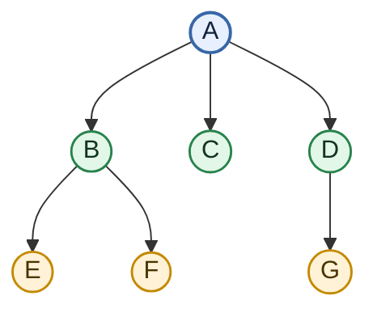
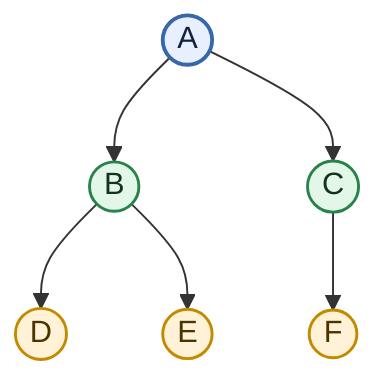
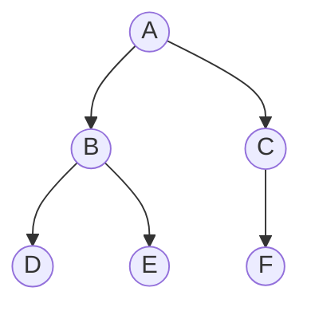
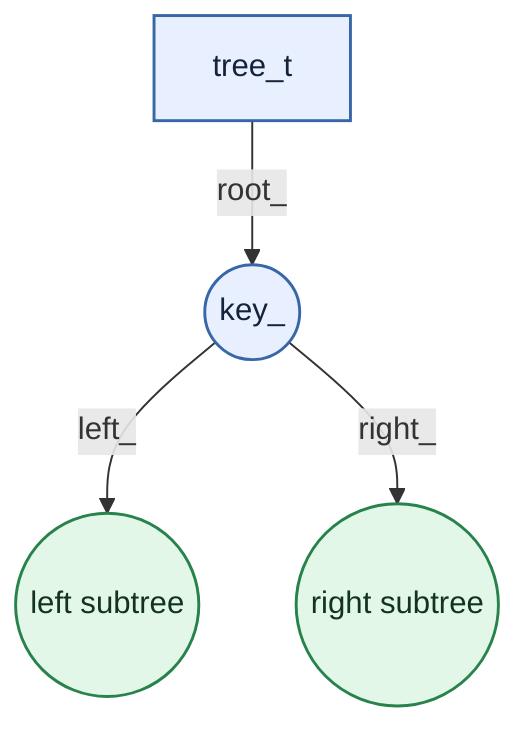
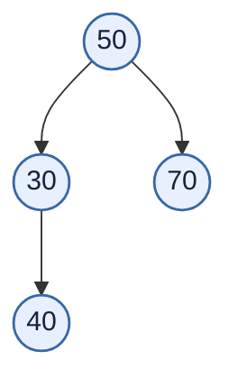
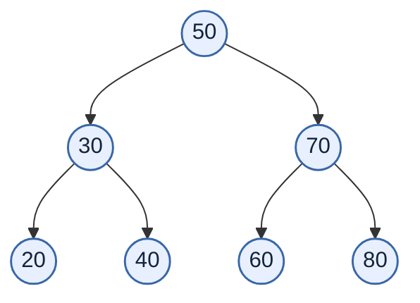
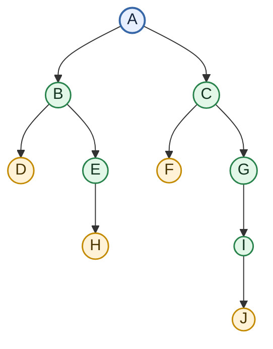

# 🌳 02 — Tree Fundamentals and Binary Search Trees

> [!abstract] Scope
> This note is based on **`2.docx`**, whose title is *Tree*. It covers general trees, binary trees, traversals, a pointer-based BST implementation in C, recursive operations, deletion cases, and reconstruction from traversals. Source wording and code are kept as close to the document as practical; line breaks and code-block formatting have been reorganised for readability. Any source wording that appears awkward is not silently rewritten.

> [!tip] Visualisation in Obsidian
> The diagrams use **Mermaid**, which Obsidian supports natively. No community plugin is required. Use Reading view or Live Preview to render them.

## Contents

- [[#1. Tree|Tree basics]]
- [[#2. General-tree abstract data type|General-tree ADT]]
- [[#3. Binary tree|Binary tree]]
- [[#4. Binary-tree abstract data type|Binary-tree ADT]]
- [[#5. Traversals|Inorder, preorder and postorder]]
- [[#6. Binary search tree|BST property and representation]]
- [[#7. Tree and node interfaces|C structures and interfaces]]
- [[#8. Traversal implementation|Recursive inorder traversal]]
- [[#9. Insertion|BST insertion]]
- [[#10. Deinitialisation|Freeing a tree]]
- [[#11. Counting, comparing and copying trees|Recursive tree operations]]
- [[#12. Searching for a key|BST search]]
- [[#13. Deleting a key|BST deletion]]
- [[#14. Storing and reconstructing a tree|Reconstruction from traversals]]
- [[#15. Source notes|Source notes]]

---

## 1. Tree

### A few points

So far, we have said that the tree is a non linear data structure. A tree is an acyclic, connected graph. A tree of `n` nodes has `n - 1` branches or edges. If we add an edge, a cycle is formed. If we remove an edge, the connectivity between every pair of nodes is lost.

A general tree is defined as:

1. Either empty, or
2. Has a root followed by number of subtrees.

Some of the terms we use with the tree are:

- Root, nodes, internal nodes, leaves, branches, path, ancestor, descendant
- Parent, child, grand parent, grandchild, siblings, uncle
- Height, depth, level
- Degree of a node

### General-tree example

The source diagram has root `A`; children `B`, `C`, and `D`; children `E` and `F` under `B`; and child `G` under `D`.



## 2. General-tree abstract data type

### A possible ADT for a general tree

- Create a tree
- Destroy the tree
- Check empty
- Check full
- Add a node
- Remove a node
- Traverse a tree
- Find root
- Find children
- Check whether leaf
- Find height of the tree
- Find the path from the root to a given node

---

## 3. Binary tree

A binary tree is a tree in which every node has at most two children. The two children are distinguished as the left child and right child.

A binary tree is either:

- An empty tree, or
- A root node together with two disjoint binary trees called its:
  - left subtree
  - right subtree

Please observe the recursive nature of this definition. As the data structure is inherently recursive, writing recursive functions to support the interface is easy.

### Example from the source

- `A` is the root.
- `B` is the left child of `A`.
- `C` is the right child of `A`.
- `D` and `E` are children of `B`.
- `F` is the right child of `C`.
- `D`, `E`, and `F` are leaves.



---

## 4. Binary-tree abstract data type

These are possible operations on a binary tree.

| Operation | Meaning stated in the source |
|---|---|
| `Create()` | Create an empty tree |
| `Destroy()` | Remove the tree |
| `root()` | Return the root of the tree. |
| `parent(p)` | Return the parent of node `p`. |
| `left(p)` | Return the left child of `p`. |
| `right(p)` | Return the right child of `p`. |
| `isLeaf(p)` | Test whether `p` is a leaf. |
| `component(p)` | Return the component stored at `p`. |
| `addRoot(x)` | Create a root containing `x`. |
| `addLeft(p, x)` | Add `x` as the left child of `p`. |
| `addRight(p, x)` | Add `x` as the right child of `p`. |
| `remove(p)` | Remove node `p` and its subtree. |
| `size()` | Return the number of nodes. |
| `Is_empty()` | Test whether the tree is empty. |
| `Is_full()` | Check whether a component can be added |
| `height()` | Return the height of the tree. |

We may implement a few of these interfaces in the next sections.

---

## 5. Traversals

### 5.1 Inorder traversal of a binary tree

We can visit all the components in an array or a list from one end to another. It is not possible to do so in case of a tree. One of the ways of visiting all the components in a binary tree is to visit the left subtree somehow and then the root and then the right subtree somehow. If the tree is empty, there is nothing to visit. As the left and the right subtrees are trees, we could apply this logic recursively.

For the example tree:



The source walks through the order as follows:

1. Before visiting `A`, we visit left sub tree of `A` – that is the subtree `B`.
2. Before visiting `B`, we visit left sub tree of `B` – that is the subtree `D`.
3. Left sub tree of `D` is empty. So visit `D`.
4. Right sub tree of `D` is empty. So the sub tree `D` has been visited.
5. Left sub tree of `B` has been visited. So visit `B`.
6. Now visit the right sub tree of `B`.
7. Next we visit `E`.
8. Now, the left sub tree of `A` is visited. So visit `A` and then its right subtree.
9. This results in visit `C` and then visit `F`.

So, the traversal of this tree will result in:

```text
D B E A C F
```

So, in inorder traversal of a binary tree:

- If the tree is not empty:
  1. We visit the left subtree in inorder.
  2. Then the root.
  3. Then visit the right subtree in inorder.

> [!example] Inorder pattern
> **Left → Root → Right**

### 5.2 Preorder traversal of a binary tree

In this traversal, if the tree is not empty:

1. We visit then the root.
2. Then left subtree in preorder.
3. Then visit the right subtree in preorder.

For the tree above, the preorder traversal will result in the following listing:

```text
A B D E C F
```

> [!example] Preorder pattern
> **Root → Left → Right**

### 5.3 Postorder traversal of a binary tree

In this traversal, if the tree is not empty:

1. We visit left subtree in postorder.
2. Then visit the right subtree in postorder.
3. Then the root.

For the tree above, the postorder traversal will result in the following listing:

```text
D E B F C A
```

> [!example] Postorder pattern
> **Left → Right → Root**

### Traversal comparison

| Traversal | Visit order | Output for the source example |
|---|---|---|
| Inorder | Left → Root → Right | `D B E A C F` |
| Preorder | Root → Left → Right | `A B D E C F` |
| Postorder | Left → Right → Root | `D E B F C A` |

---

## 6. Binary search tree

### Implementation of Binary Search Tree

To start with, we will make a simple example of binary trees. We will use a special binary tree called binary search tree.

In a binary search tree, every component has a key. The components are arranged based on the key.

- If the tree is empty, the component is put at the root.
- Otherwise, if the key in the component at the root is higher than the key in the new component, we will insert in the left subtree.
- Otherwise, we will in the right subtree.

You will observe that the insertion always happens as a leaf.

### Node-and-pointer representation

One of the implementations will be as follows.

The tree has a root. This is like a list having a head. The root points to a node structure. The node structure has a component – called key – in this example. Apart from that, it has two pointers – which point to the left and the right sub trees.



---

## 7. Tree and node interfaces

### Structures from the source

```c
struct tree
{
    node_t *root_;
};
typedef struct tree tree_t;

struct node
{
    int key_;
    struct node *left_;
    struct node *right_;
};
typedef struct node node_t;
```

### Basic interface

This is the simplest interface to start experimenting.

```c
void init(tree_t *ptr_tree);
```

Ground the root.

```c
void deinit(tree_t *ptr_tree);
```

Walk through the tree; remove the left subtree, remove the right subtree, and remove the root.

```c
void disp(tree_t *ptr_tree); // This is inorder traversal of the tree
```

If the tree is not empty:

1. Display the left subtree.
2. Display the root.
3. Display the right subtree.

```c
void insert(tree_t *ptr_tree, int key);
```

- If the tree is empty make this the root.
- Otherwise compare the keys.
- Decide to insert in the left subtree or the right subtree.

We mentioned that the tree is inherently a recursive data structure. But the tree structure by itself is not recursive – the node structure which is self-referential is recursive. So, the functions in the tree call their corresponding recursive counter part in nodes.

Let us have a look at them.

---

## 8. Traversal implementation

Observe that the tree function `disp_inorder` calls `disp_recursive_inorder` of the node. The `disp_recursive_inorder` function of the node calls itself on its left subtree, displays the root and calls itself on its right subtree.

### Tree-level function and recursive node-level function

```c
void disp_inorder(tree_t *ptr_tree)
{
    printf("Tree inorder: ");
    disp_recursive_inorder(ptr_tree->root_);
    printf("\n");
}

static void disp_recursive_inorder(node_t* temp)
{
    if(temp)
    {
        disp_recursive_inorder(temp->left_);
        printf("%d ", temp->key_);
        disp_recursive_inorder(temp->right_);
    }
}
```

The other two traversals are similar.

Check the files in the folder: `inorder-preorder-postorder`.

---

## 9. Insertion

### Tree-level insert function

```c
void insert(tree_t *ptr_tree, int key)
{
    node_t *temp = (node_t*)malloc(sizeof(node_t));
    temp->key_ = key;
    temp->left_ = temp->right_ = NULL;
    ptr_tree->root_ = insert_recursive(ptr_tree->root_, temp);
}
```

The above tree routine creates a node. Assumes that it succeeds in memory allocation. Populates the node. Calls the `insert_recursive` function of the node to return the root.

This function is very interesting. If the tree is empty, then this new node becomes the root. Otherwise based on the comparison of the key, we try to insert in the left subtree or the right subtree. If the insertion is in the left subtree, then left of the root is the root for that subtree.

Similarly, if the insertion is in the right subtree, the right of the root is the root for that subtree. So, the return value of the function is assigned to the appropriate root.

You may want to draw and check how this works for a tree of at least 3 nodes.

### Recursive insert function

```c
static node_t* insert_recursive(node_t* root, node_t* temp)
{
    if(root == NULL)
    {
        root = temp;
    }
    else if(root->key_ > temp->key_)
    {
        root->left_ = insert_recursive(root->left_, temp);
    }
    else 
    {
        root->right_ = insert_recursive(root->right_, temp);
    }
    return root;
}
```

### Insertion visualisation

For example, suppose the BST contains `50`, `30`, and `70`, and a new key `40` is inserted. The comparison sends `40` left from `50`, then right from `30`; it is attached as a leaf.



> [!note] Illustration note
> This is an explanatory illustration of the BST insertion rule, not a diagram copied from the document. The insertion function above is copied from the source.

---

## 10. Deinitialisation

Like other functions, `deinit` of tree calls the `deinit_recursive` of node.

```c
void deinit(tree_t *ptr_tree)
{
    deinit_recursive(ptr_tree->root_);
    ptr_tree->root_ = NULL;
}
```

This recursive function on the node clears the left subtree recursively, then the right subtree recursively and then the root.

Please node that the order matters.

```c
static void deinit_recursive(node_t* root)
{
    if(root)
    {
        deinit_recursive(root->left_);
        deinit_recursive(root->right_);
        free(root);
    }
}
```

> [!important] Why this order matters
> The recursive calls visit both child subtrees before `free(root)` releases the current node. Freeing the current node first would make its child pointers unavailable for traversal. This callout explains the order described by the source; the source's wording “Please node that the order matters” is retained above.

---

## 11. Counting, comparing and copying trees

### Recursive model used by these functions

Adding a few more functions in the interface of the tree: the following functions indicate how we formulate recursive routines on binary search trees.

Most of these functions use the simplest model of a binary tree:

- Empty
- Root followed by left and right subtrees

### Count the number of nodes

- If the root is `NULL`, return `0`.
- Else return `1 +` number of nodes in the left subtree `+` number of nodes in the right subtree.

### Count the number of leaves

- If the root is `NULL`, return `0`.
- Else if the left subtree and the right subtree of the root are empty, return `1`.
- Else return number of leaves in the left subtree and the number of leaves in the right subtree.

### Check whether two trees, say `T1` and `T2`, are same

- If `T1` and `T2` are empty, then return true.
- Else if `T1` or `T2` is empty, then return false.
- Else return: key of root of `T1` = key of root of `T2` **and** left subtree of `T1` = left subtree of `T2` **and** right subtree of `T1` = right subtree of `T2`.

Please check the folder `copy_and_compare` for the code.

```c
// node 
int are_same_recursive(node_t* root1, node_t* root2)
{
    if(root1 == NULL && root2 == NULL)
        return 1;
    else if(root1 == NULL || root2 == NULL)
        return 0;
    else 
        return root1->key_ == root2->key_ &&
            are_same_recursive(root1->left_, root2->left_) &&
            are_same_recursive(root1->right_, root2->right_);
}

// tree 
int are_same(tree_t* ptr_tree1, tree_t* ptr_tree2)
{
    return are_same_recursive(ptr_tree1->root_, ptr_tree2->root_);
}
```

### Copy one tree to another (say `T1` to `T2`)

- If `T1` is empty, make `T2` empty.
- Else:
  1. Make a node.
  2. Copy the key of root of `T1` to the new node.
  3. Copy the left subtree of `T1` to left subtree of the new node created.
  4. Copy the right subtree of `T1` to right subtree of the new node created.
  5. Return the new node.

Please check the folder `copy_and_compare` for the code.

```c
// node 
node_t* copy_recursive(node_t* ptr_src)
{
    node_t *temp;
    if(ptr_src != NULL)
    {
        temp = (node_t*)malloc(sizeof(node_t));
        temp->key_ = ptr_src->key_;
        temp->left_ = copy_recursive(ptr_src->left_);
        temp->right_ = copy_recursive(ptr_src->right_);
        return temp;
    }
    else 
    {
        return NULL;
    }
}

// tree 
void copy(tree_t* ptr_src, tree_t* ptr_dst)
{
    ptr_dst->root_ = copy_recursive(ptr_src->root_);
}
```

Observe the code is somewhat similar to that of insert. You may want to convince yourself why the `copy` function is `void`, but `copy_recursive` returns a pointer to a node.

---

## 12. Searching for a key

### Search for a key in a binary search tree

A binary search tree is organized based on a predicate applied at the root. We use this predicate while inserting as well as searching.

While inserting if the root is empty, the node with the key is made the root. Otherwise, we compare the key with the key at the root. If the key is less than the key at the root, we insert in the left subtree otherwise in the right subtree.

There are two aspects to searching in a tree:

- How to search?
- What to return?

- If the tree is empty, the key is not found.
- If the key matches the key at the root, the key is found at the root.
- Otherwise if key is less than the key at the root, we search the left subtree recursively.
- Else search the right subtree recursively.

### What should the search function return?

Is it meaningful if the search function displays a message? Absolutely NO. The client cannot access the information found. A function should output something on the screen only if it is for displaying.

Should be fine if the function returns true if the key is found otherwise false? Not really. The client may want to get the component found with respect to the key.

The right way is to have something called an iterator which represents the concept of position. But we are not discussing this in this course. So, we will return a pointer to a node which is not the best.

```c
node_t* search_recursive(node_t* root, int key)
{
    if(root == NULL)
        return NULL;
    else if(key == root->key_)
        return root; 
    else if(key < root->key_)
        return search_recursive(root->left_, key);
    else 
        return search_recursive(root->right_, key);
}

node_t* search(tree_t *ptr_tree, int key)
{
    return search_recursive(ptr_tree->root_, key);
}
```

The search function on the tree is non-recursive. It in turn calls the recursive function on the node.

Check the code in the folder `search_delete_key`.

---

## 13. Deleting a key

Delete key on the tree is delegated to `delete_key_recursive` function on node.

```c
void delete_key(tree_t *ptr_tree, int key)
{
    ptr_tree->root_ = delete_key_recursive(ptr_tree->root_, key);
}
```

There are many cases to consider. The source first introduces the recursive function with a placeholder:

```c
node_t* delete_key_recursive(node_t* root, int key)
{
    // code is here.
}
```

The following snippets describe the cases in sequence.

### Case 0 — empty tree

If the tree is empty, then nothing to do. We cannot delete a node with a given key.

```c
if(root == NULL)
{
    return NULL;
}
```

### Search for the key

If the key is less than the one at the root, call delete key on its left subtree:

```c
else if(key < root->key_)
{
    root->left_ = delete_key_recursive(root->left_, key);
}
```

If the key is greater than the one at the root, call delete key on its right subtree:

```c
else if (key > root->key_)
{
    root->right_ = delete_key_recursive(root->right_, key);
}
```

Now we have found the match for the key. We have consider 4 cases:

1. Key at the leaf.
2. Key at a node with no left subtree.
3. Key at a node with no right subtree.
4. Key at a node with both left and right subtree.

### Case 1 — key at a leaf

This is the simplest case.

```c
if(root->left_ == NULL && root->right_ == NULL)
{
    free(root);
    return NULL;
}
```

Remove the node and ground the pointer in its parent.

### Case 2 — node with no left subtree

Attach its right subtree to its parent.

```c
else if(root->left_ == NULL)
{
    node_t* temp = root->right_;
    free(root);
    return temp;
}
```

### Case 3 — node with no right subtree

Attach its left subtree to its parent.

```c
else if(root->right_ == NULL)
{
    node_t* temp = root->left_;
    free(root);
    return temp;
}
```

### Case 4 — node with both left and right subtrees

Find the inorder successor of what comes to the right.

```c
node_t* inorder_successor(node_t* root)
{
    node_t* temp = root;
    while(temp->left_ != NULL)
        temp = temp->left_;
    return temp;
}
```

Replace the key at the root with the successor. Modify the problem to remove this new key in the right subtree.

```c
else 
{
    node_t* temp = inorder_successor(root->right_);
    root->key_ = temp->key_;
    root->right_ = delete_key_recursive(root->right_, temp->key_);
}
```

Check the code in the folder `search_delete_key`.

### Deletion visualisation

Deleting a node with two children replaces its key with its inorder successor — the smallest key in its right subtree — and then deletes that successor from the right subtree.



> [!note] Illustration note
> This tree is an explanatory example of the successor rule. The source explains the rule but does not specify these numeric keys for its deletion example.

---

## 14. Storing and reconstructing a tree

### How to store a tree and how to restore a tree?

If a list has to be stored, we could traverse and right the components to a file. We can restore the list by reading the components from the file and attaching them at the end of the list.

A list is a linear data structure. So we cannot do the way we have stated above.

A tree is non linear. A single traversal will not define the tree completely.

For example, if a tree of 3 nodes has an inorder traversal `A B C`, there are 5 possible trees which can produce the same inorder traversal.

An inorder and a postorder traversals of a tree uniquely defines a tree. Given the two traversals, we can reconstruct the tree.

### Example from the source



There are exactly 10 nodes:

`A, B, C, D, E, F, G, H, I, J`

The inorder traversal of the tree:

```text
D B H E A F C G J I
```

The post order traversal of the tree:

```text
D H E B F J I G C A
```

To reconstruct the tree, traverse the post order traversal from the right. The last node `A` has to be the root of the whole tree. Therefore, `A` is the root and `A` divides the inorder traversal into two parts. All nodes to the left of `A` are in left subtree of `A` and all the nodes to the right of `A` in the right subtree.

So, we know the root of the tree.

Next to the right of `A` in postorder traversal is `C`. `C` is to the right of `A` in inorder traversal. `C` is the root of the right subtree of `A`.

This way we may continue to build the whole tree.

The rest of it is left as an exercise for the readers.

> [!summary] Reconstruction rule
> **Inorder + Postorder → uniquely defined binary tree** (as stated in the source). Start with the last item in postorder as the root, then use inorder to separate the left and right subtrees.

---

## 15. Source notes

> [!info] What was preserved
> - The source's main explanations, interface signatures, and code snippets are transcribed above.
> - Code is formatted into normal C code blocks instead of leaving each source line in a separate Word paragraph.
> - The source's incremental deletion snippets are retained as separate snippets; the original also introduces that function with the placeholder `// code is here.`
> - Mermaid diagrams reconstruct the tree relationships shown in the source and add a small number of clearly labelled explanatory visualisations. The numeric insertion/deletion visualisations are identified as illustrative rather than source diagrams.
> - The source mentions the folders `inorder-preorder-postorder`, `copy_and_compare`, and `search_delete_key`, but those folders belong to the associated code examples and are not contained in `2.docx` itself.

---

**End of `2.docx` transcription.**
