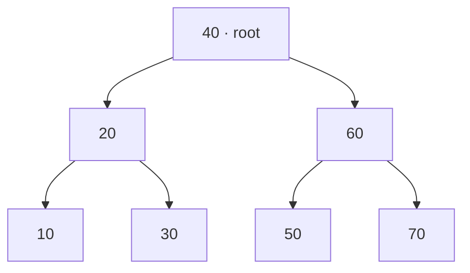
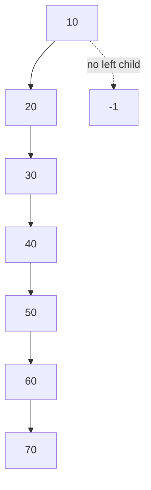
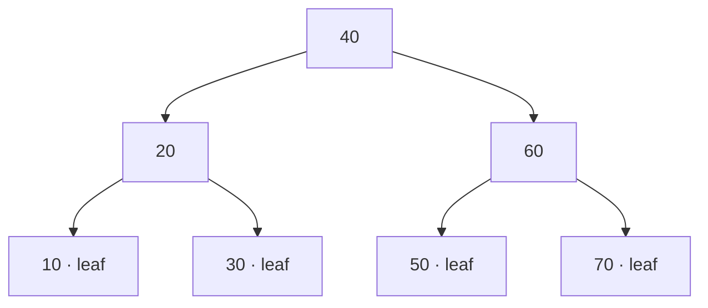
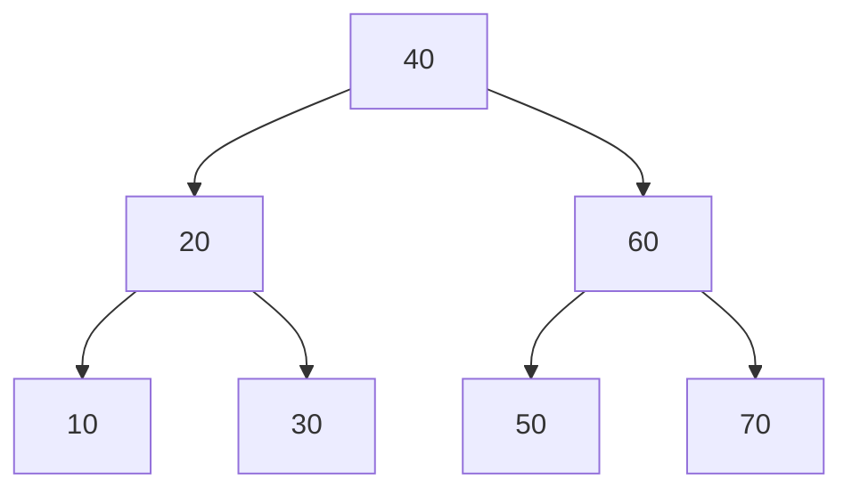

# 03 · BST Array Representation and Tree Operations

> [!info] Source and fidelity
> This note documents **`3(1).zip`**. The ZIP contains four folders: `one/`, `two/`, `three/`, and `four/`. Each folder has its own `client.c`, `makefile`, `tree.c`, and `tree.h`. The complete source files are reproduced in the sections below. Code has been copied from the archive without refactoring; observations about behavior or likely issues are kept separate from the source listings.

## Quick navigation
- [[#1. Archive layout|Archive layout]]
- [[#2. Conceptual overview|Conceptual overview]]
- [[#3. Folder one — basic array-backed BST|Folder one — basic BST]]
- [[#4. Folder two — count nodes and leaves|Folder two — node and leaf counts]]
- [[#5. Folder three — copy and compare trees|Folder three — copy and compare]]
- [[#6. Folder four — preorder, postorder, and inorder|Folder four — traversals]]
- [[#7. Build and run|Build and run]]
- [[#8. Source observations and pitfalls|Source observations and pitfalls]]

## 1. Archive layout

```text
3(1).zip/
├── one/
│   ├── client.c
│   ├── makefile
│   ├── tree.c
│   └── tree.h
├── two/
│   ├── client.c
│   ├── makefile
│   ├── tree.c
│   └── tree.h
├── three/
│   ├── client.c
│   ├── makefile
│   ├── tree.c
│   └── tree.h
├── four/
│   ├── client.c
│   ├── makefile
│   ├── tree.c
│   └── tree.h
```

| Folder | What it adds | Public interface / focus |
|---|---|---|
| `one/` | Base array-backed BST | Initialise, deinitialise, insert, inorder display |
| `two/` | Recursive counting | Number of nodes and number of leaves |
| `three/` | Copying and structural comparison | `copy()` and `are_same()` |
| `four/` | Three DFS traversals | Preorder, postorder, and inorder display |

> [!note] Important
> These are **separate versions** of the same general implementation pattern. Do not place all four `tree.c` or `tree.h` files into one directory together: their function sets overlap and each directory is intended to be built as its own program.

## 2. Conceptual overview

The tree is represented by an array of `node_t` entries. Each node stores a key and two **array indices** (`left_` and `right_`), not pointers. The value `-1` marks an absent child. `root_` stores the index of the root, and `count_` tracks how many slots have been allocated for inserted nodes.

```c
struct node
{
	int key_;
	int left_;
	int right_;
};

struct tree
{
	int root_;
	int count_;
	node_t elem_[MAXSIZE];
};
```

### 2.1 Tree formed by `{40, 20, 60, 10, 70, 30, 50}`

This insertion order produces a balanced-looking BST: smaller keys go left and keys greater than or equal to the current key go right.



The inorder traversal visits left subtree → node → right subtree, yielding `10 20 30 40 50 60 70`.

### 2.2 Tree formed by sorted input `{10, 20, 30, 40, 50, 60, 70}`

Each inserted key is greater than the keys already on the search path, so this BST becomes a right-skewed chain. It is still a BST, but its height is much larger than in the previous example.



> [!warning] A BST is not automatically balanced
> The insertion order changes the shape of the tree. The sorted sequence creates a chain, making operations that follow the tree potentially linear in the number of nodes.

### 2.3 Index-based representation

The following is the allocation/index order for the first sequence. These are the actual array slots assigned by `temp = ptr_tree->count_++`; links connect those slots into the BST.

| Array index | Key | Left index | Right index |
|---:|---:|---:|---:|
| 0 | 40 | 1 | 2 |
| 1 | 20 | 3 | 5 |
| 2 | 60 | 6 | 4 |
| 3 | 10 | -1 | -1 |
| 4 | 70 | -1 | -1 |
| 5 | 30 | -1 | -1 |
| 6 | 50 | -1 | -1 |

> [!tip] Read the indices, not the key order
> The left and right fields refer to positions in `elem_[]`, not to key values. For the above sequence, slot `0` contains root key `40`; its left child is slot `1` (key `20`) and right child is slot `2` (key `60`).

## 3. Folder one — basic array-backed BST

### Purpose
This is the baseline implementation. It initialises an empty tree using `root_ = -1` and `count_ = 0`, inserts keys into array slots, links the slots recursively according to BST ordering, and displays the keys using inorder traversal.

### `one/tree.h`

```c
#ifndef TREE_H
#define TREE_H
#define MAXSIZE 200
struct node 
{
	int key_;
	int left_;
	int right_;
};
typedef struct node node_t;

struct tree 
{
	int root_;
	int count_;
	node_t elem_[MAXSIZE];
};
typedef struct tree tree_t;

void init(tree_t *ptr_tree);
void deinit(tree_t *ptr_tree);
void disp(tree_t *ptr_tree);
void insert(tree_t *ptr_tree, int key);
#endif
```

### `one/tree.c`

```c
#include <stdio.h>
#include <stdlib.h>
#include "tree.h"
// node functions 
static void disp_recursive(node_t elem[], int temp)
{
	if(temp != -1)
	{
		disp_recursive(elem, elem[temp].left_);
		printf("%d ", elem[temp].key_);
		disp_recursive(elem, elem[temp].right_);
	}
}

static int insert_recursive(node_t elem[], int root, int temp)
{
	if(root == -1)
	{
		root = temp;
	}
	else if(elem[root].key_ > elem[temp].key_)
	{
		elem[root].left_ = insert_recursive(elem, elem[root].left_, temp);
	}
	else 
	{
		elem[root].right_ = insert_recursive(elem, elem[root].right_, temp);
	}
	return root;
}


// tree functions 
void init(tree_t *ptr_tree)
{
	ptr_tree->root_ = -1;
	ptr_tree->count_ = 0;
}
void deinit(tree_t *ptr_tree)
{
	ptr_tree->root_ = -1;
	ptr_tree->count_ = 0;
}
void disp(tree_t *ptr_tree)
{
	printf("Tree : ");
	disp_recursive(ptr_tree->elem_, ptr_tree->root_);
	printf("\n");
}
void insert(tree_t *ptr_tree, int key)
{
	if(ptr_tree->count_  == MAXSIZE)
	{
		printf("tree full\n");
		exit(1);
	}
	int temp = ptr_tree->count_++;
	ptr_tree->elem_[temp].key_ = key;
	ptr_tree->elem_[temp].left_ = ptr_tree->elem_[temp].right_ = -1;
	
	ptr_tree->root_ = insert_recursive(ptr_tree->elem_, ptr_tree->root_, temp);
}
```

### `one/client.c`

```c
#include <stdio.h>
#include "tree.h"

int main()
{
	// case 1
	tree_t t1;
	init(&t1);
	int a1[] = {40, 20, 60, 10, 70, 30, 50};
	int n1 = 7;
	for(int i = 0; i < n1; ++i)
	{
		insert(&t1, a1[i]);
	}
	disp(&t1);
	deinit(&t1);
	
	// case 2
	tree_t t2;
	init(&t2);
	
	int a2[] = {10, 20, 30, 40, 50, 60, 70};
	int n2 = 7;
	for(int i = 0; i < n2; ++i)
	{
		insert(&t2, a2[i]);
	}
	disp(&t2);	
	deinit(&t2);
	
	// case 3
	tree_t t3;
	init(&t3);
	disp(&t3);	
	deinit(&t3);

}
```

### `one/makefile`

```makefile
client.exe : client.o tree.o 
	gcc client.o tree.o -o client.exe
tree.o : tree.c tree.h 
	gcc -Wall -c tree.c 
client.o : client.o tree.h 
	gcc -Wall -c client.c 
	
```

### Expected display order
For the source client, the expected inorder key sequences are:

| Client case | Inserted sequence | Inorder output after `Tree :` |
|---|---|---|
| `t1` | `40, 20, 60, 10, 70, 30, 50` | `10 20 30 40 50 60 70` |
| `t2` | `10, 20, 30, 40, 50, 60, 70` | `10 20 30 40 50 60 70` |
| `t3` | no insertions | no keys printed |

## 4. Folder two — count nodes and leaves

### What changed from `one/`?
The basic insertion and inorder display remain. Folder `two/` adds two recursive functions:
- `number_of_nodes_recursive(...)`: returns `0` at an empty link (`-1`); otherwise returns `1 + left count + right count`.
- `number_of_leaves_recursive(...)`: returns `0` for an empty link; returns `1` if the current node has no left or right child; otherwise sums the counts from both subtrees.

### Visual check: leaves
For the first tree, the leaves are `10`, `30`, `50`, and `70`, so the result is four leaves. For the right-skewed tree, only `70` is a leaf.



### `two/tree.h`

```c
#ifndef TREE_H
#define TREE_H
#define MAXSIZE 200
struct node 
{
	int key_;
	int left_;
	int right_;
};
typedef struct node node_t;

struct tree 
{
	int root_;
	int count_;
	node_t elem_[MAXSIZE];
};
typedef struct tree tree_t;

void init(tree_t *ptr_tree);
void deinit(tree_t *ptr_tree);
void disp(tree_t *ptr_tree);
void insert(tree_t *ptr_tree, int key);

// adding 
// 1. find # of nodes 
int number_of_nodes(tree_t *ptr_tree);
// 2. find # of leaves 
int number_of_leaves(tree_t *ptr_tree);

#endif
```

### `two/tree.c`

```c
#include <stdio.h>
#include <stdlib.h>
#include "tree.h"

// node functions 
static void disp_recursive(node_t elem[], int temp)
{
	if(temp != -1)
	{
		disp_recursive(elem, elem[temp].left_);
		printf("%d ", elem[temp].key_);
		disp_recursive(elem, elem[temp].right_);
	}
}

static int insert_recursive(node_t elem[], int root, int temp)
{
	if(root == -1)
	{
		root = temp;
	}
	else if(elem[root].key_ > elem[temp].key_)
	{
		elem[root].left_ = insert_recursive(elem, elem[root].left_, temp);
	}
	else 
	{
		elem[root].right_ = insert_recursive(elem, elem[root].right_, temp);
	}
	return root;
}


// tree functions 
void init(tree_t *ptr_tree)
{
	ptr_tree->root_ = -1;
	ptr_tree->count_ = 0;
}
void deinit(tree_t *ptr_tree)
{
	ptr_tree->root_ = -1;
	ptr_tree->count_ = 0;
}
void disp(tree_t *ptr_tree)
{
	printf("Tree : ");
	disp_recursive(ptr_tree->elem_, ptr_tree->root_);
	printf("\n");
}
void insert(tree_t *ptr_tree, int key)
{
	if(ptr_tree->count_ == MAXSIZE)
	{
		printf("tree full\n");
		exit(1);
	}
	int temp = ptr_tree->count_++;
	ptr_tree->elem_[temp].key_ = key;
	ptr_tree->elem_[temp].left_ = ptr_tree->elem_[temp].right_ = -1;
	
	ptr_tree->root_ = insert_recursive(ptr_tree->elem_, ptr_tree->root_, temp);
}
//--------------------------------------
// adding 

// node 

int number_of_nodes_recursive(node_t elem[], int temp)
{
	if(temp == -1)
	{
		return 0;
	}
	else 
	{
		return 1 + number_of_nodes_recursive(elem, elem[temp].left_) 
			+ number_of_nodes_recursive(elem, elem[temp].right_);
	}
}

int number_of_leaves_recursive(node_t elem[], int temp)
{
	if(temp == -1)
	{
		return 0;
	}
	else if(elem[temp].left_ == -1 && elem[temp].right_ == -1)
	{
		return 1;
	}
	else
	{
		return number_of_leaves_recursive(elem, elem[temp].left_) 
			+ number_of_leaves_recursive(elem, elem[temp].right_);
	}
}

// tree 
int number_of_nodes(tree_t *ptr_tree)
{
	return number_of_nodes_recursive(ptr_tree->elem_, ptr_tree->root_);
}

int number_of_leaves(tree_t *ptr_tree)
{
	return number_of_leaves_recursive(ptr_tree->elem_, ptr_tree->root_);
}
```

### `two/client.c`

```c
#include <stdio.h>
#include "tree.h"

int main()
{
	// case 1
	tree_t t1;
	init(&t1);
		int a1[] = {40, 20, 60, 10, 70, 30, 50};
	int n1 = 7;
	for(int i = 0; i < n1; ++i)
	{
		insert(&t1, a1[i]);
	}
	disp(&t1);
	
	// added 
	printf("# of nodes : %d\n", number_of_nodes(&t1));
	printf("# of leaves : %d\n", number_of_leaves(&t1));
	
	deinit(&t1);
	
	// case 2
	tree_t t2;
	init(&t2);
	
	int a2[] = {10, 20, 30, 40, 50, 60, 70};
	int n2 = 7;
	for(int i = 0; i < n2; ++i)
	{
		insert(&t2, a2[i]);
	}
	disp(&t2);	

	// added
	printf("# of nodes : %d\n", number_of_nodes(&t2));
	printf("# of leaves : %d\n", number_of_leaves(&t2));

	deinit(&t2);
	
	// case 3
	tree_t t3;
	init(&t3);
	disp(&t3);	
	
	// added
	printf("# of nodes : %d\n", number_of_nodes(&t3));
	printf("# of leaves : %d\n", number_of_leaves(&t3));
	
	deinit(&t3);

}
```

### `two/makefile`

```makefile
client.exe : client.o tree.o 
	gcc client.o tree.o -o client.exe
tree.o : tree.c tree.h 
	gcc -Wall -c tree.c 
client.o : client.o tree.h 
	gcc -Wall -c client.c 
	
```

### Expected count results

| Client case | Number of nodes | Number of leaves |
|---|---:|---:|
| `t1`: first insertion order | 7 | 4 |
| `t2`: ascending insertion order | 7 | 1 |
| `t3`: empty tree | 0 | 0 |

These values follow from the function definitions in `two/tree.c` and the three test cases in `two/client.c`.

## 5. Folder three — copy and compare trees

### New functions
- `copy(ptr_src, ptr_dst)`: copies the source root index, count, and every element of the fixed-size `elem_` array into the destination.
- `are_same(...)`: recursively compares two trees. Two empty links compare equal; an empty link versus a non-empty link compares unequal; otherwise keys and both corresponding subtrees must match.

This comparison checks the **tree structure and keys**, not merely whether both trees contain the same set of keys.

### `three/tree.h`

```c
#ifndef TREE_H
#define TREE_H
#define MAXSIZE 200
struct node 
{
	int key_;
	int left_;
	int right_;
};
typedef struct node node_t;

struct tree 
{
	int root_;
	int count_;
	node_t elem_[MAXSIZE];
};
typedef struct tree tree_t; 

void init(tree_t *ptr_tree);
void deinit(tree_t *ptr_tree);
void disp(tree_t *ptr_tree);
void insert(tree_t *ptr_tree, int key);

// adding 
// 1. find # of nodes 
int number_of_nodes(tree_t *ptr_tree);
// 2. find # of leaves 
int number_of_leaves(tree_t *ptr_tree);
// 3. copy tree 
void copy(tree_t* ptr_src, tree_t* ptr_dst);
// 4. compare tree
int are_same(tree_t* tree1, tree_t* tree2);

#endif
```

### `three/tree.c`

```c
#include <stdio.h>
#include <stdlib.h>
#include "tree.h"
// node functions 
static void disp_recursive(node_t elem[], int temp)
{
	if(temp != -1)
	{
		disp_recursive(elem, elem[temp].left_);
		printf("%d ", elem[temp].key_);
		disp_recursive(elem, elem[temp].right_);
	}
}

static int insert_recursive(node_t elem[], int root, int temp)
{
	if(root == -1)
	{
		root = temp;
	}
	else if(elem[root].key_ > elem[temp].key_)
	{
		elem[root].left_ = insert_recursive(elem, elem[root].left_, temp);
	}
	else 
	{
		elem[root].right_ = insert_recursive(elem, elem[root].right_, temp);
	}
	return root;
}


// tree functions 
void init(tree_t *ptr_tree)
{
	ptr_tree->root_ = -1;
	ptr_tree->count_ = 0;
}
void deinit(tree_t *ptr_tree)
{
	ptr_tree->root_ = -1;
	ptr_tree->count_ = 0;
}
void disp(tree_t *ptr_tree)
{
	printf("Tree : ");
	disp_recursive(ptr_tree->elem_, ptr_tree->root_);
	printf("\n");
}
void insert(tree_t *ptr_tree, int key)
{
	if(ptr_tree->count_  == MAXSIZE)
	{
		printf("tree full\n");
		exit(1);
	}
	int temp = ptr_tree->count_++;
	ptr_tree->elem_[temp].key_ = key;
	ptr_tree->elem_[temp].left_ = ptr_tree->elem_[temp].right_ = -1;
	
	ptr_tree->root_ = insert_recursive(ptr_tree->elem_, ptr_tree->root_, temp);
}
//--------------------------------------
// adding 

// node 

int number_of_nodes_recursive(node_t elem[], int temp)
{
	if(temp == -1)
	{
		return 0;
	}
	else 
	{
		return 1 + number_of_nodes_recursive(elem, elem[temp].left_) 
			+ number_of_nodes_recursive(elem, elem[temp].right_);
	}
}

int number_of_leaves_recursive(node_t elem[], int temp)
{
	if(temp == -1)
	{
		return 0;
	}
	else if(elem[temp].left_ == -1 && elem[temp].right_ == -1)
	{
		return 1;
	}
	else
	{
		return number_of_leaves_recursive(elem, elem[temp].left_) 
			+ number_of_leaves_recursive(elem, elem[temp].right_);
	}
}

// tree 
int number_of_nodes(tree_t *ptr_tree)
{
	return number_of_nodes_recursive(ptr_tree->elem_, ptr_tree->root_);
}

int number_of_leaves(tree_t *ptr_tree)
{
	return number_of_leaves_recursive(ptr_tree->elem_, ptr_tree->root_);
}
// -----------------
// node 


// tree 
void copy(tree_t* ptr_src, tree_t* ptr_dst)
{
	ptr_dst->root_ = ptr_src->root_;
	ptr_dst->count_ = ptr_src->count_;
	for(int i = 0; i < MAXSIZE; ++i)
	{
		ptr_dst->elem_[i] = ptr_src->elem_[i];
	}
}
// node 
int are_same_recursive(node_t elem1[], int root1, node_t elem2[], int root2)
{
	if(root1 == -1 && root2 == -1)
		return 1;
	else if(root1 == -1 || root2 == -1)
		return 0;
	else 
		return elem1[root1].key_ == elem2[root2].key_ &&
			are_same_recursive(elem1, elem1[root1].left_, 
				elem2, elem2[root2].left_)  &&
			are_same_recursive(elem1, elem1[root1].right_, 
				elem2, elem2[root2].right_);
}
// tree 
int are_same(tree_t* ptr_tree1, tree_t* ptr_tree2)
{
	return are_same_recursive(ptr_tree1->elem_, ptr_tree1->root_, 
		ptr_tree2->elem_, ptr_tree2->root_);
}
```

### `three/client.c`

```c
#include <stdio.h>
#include "tree.h"

int main()
{
	tree_t t1;
	init(&t1);
	int a1[] = {40, 20, 60, 10, 70, 30, 50};
	int n1 = 7;
	for(int i = 0; i < n1; ++i)
	{
		insert(&t1, a1[i]);
	}
	disp(&t1);
	
	tree_t t2;
	init(&t2);
	copy(&t1, &t2);
	disp(&t2);
	printf("same : %d\n", are_same(&t1, &t2));
	
	tree_t t3;
	init(&t3);
	int a3[] = {10, 20, 30, 40, 50, 60, 70};
	int n3 = 7;
	for(int i = 0; i < n3; ++i)
	{
		insert(&t1, a3[i]);
	}
	printf("same : %d\n", are_same(&t1, &t3));
	
	
	
	#if 0
	// case 1
	tree_t t1;
	init(&t1);
		int a1[] = {40, 20, 60, 10, 70, 30, 50};
	int n1 = 7;
	for(int i = 0; i < n1; ++i)
	{
		insert(&t1, a1[i]);
	}
	disp(&t1);
	
	// added 
	printf("# of nodes : %d\n", number_of_nodes(&t1));
	printf("# of leaves : %d\n", number_of_leaves(&t1));
	
	deinit(&t1);
	
	// case 2
	tree_t t2;
	init(&t2);
	
	int a2[] = {10, 20, 30, 40, 50, 60, 70};
	int n2 = 7;
	for(int i = 0; i < n2; ++i)
	{
		insert(&t2, a2[i]);
	}
	disp(&t2);	

	// added
	printf("# of nodes : %d\n", number_of_nodes(&t2));
	printf("# of leaves : %d\n", number_of_leaves(&t2));

	deinit(&t2);
	
	// case 3
	tree_t t3;
	init(&t3);
	disp(&t3);	
	
	// added
	printf("# of nodes : %d\n", number_of_nodes(&t3));
	printf("# of leaves : %d\n", number_of_leaves(&t3));
	
	deinit(&t3);
	#endif
}
```

### `three/makefile`

```makefile
client.exe : client.o tree.o 
	gcc client.o tree.o -o client.exe
tree.o : tree.c tree.h 
	gcc -Wall -c tree.c 
client.o : client.c tree.h 
	gcc -Wall -c client.c 
	
```

### Trace of the active client code
1. `t1` is created and populated with seven keys.
2. `t2` is initialised, then `copy(&t1, &t2)` copies the tree representation.
3. `are_same(&t1, &t2)` returns `1` for the copied tree.
4. `t3` is initialised and remains empty.
5. The final insertion loop calls `insert(&t1, a3[i])`, not `insert(&t3, a3[i])`. It therefore modifies `t1` while `t3` remains empty.
6. `are_same(&t1, &t3)` returns `0`, because one tree is non-empty and the other is empty.

Expected comparison lines from the active code:
```text
same : 1
same : 0
```

> [!bug] Likely client mistake retained from the source
> The loop immediately after `t3` is initialised probably intends to insert into `t3`, but the archived code inserts into `t1`. This note preserves the code exactly and does not change it. The resulting second comparison is `0` as written.

> [!warning] Source-level caution in `copy()`
> The archived function copies all `MAXSIZE` entries, including array slots that may never have been initialised. Its intended observable purpose is to copy the tree representation, but reading uninitialised array members can be unsafe in C. This is an observation, not a source modification.

## 6. Folder four — preorder, postorder, and inorder

Folder `four/` keeps the array-backed BST and adds three traversal helpers. For every non-empty node:
- **Preorder:** visit node → left subtree → right subtree.
- **Inorder:** visit left subtree → node → right subtree.
- **Postorder:** visit left subtree → right subtree → node.



For the tree above, the traversal outputs are:

| Traversal | Output |
|---|---|
| Preorder | `40 20 10 30 60 50 70` |
| Inorder | `10 20 30 40 50 60 70` |
| Postorder | `10 30 20 50 70 60 40` |

For the ascending insertion sequence, the tree is a right-only chain:

| Traversal | Output |
|---|---|
| Preorder | `10 20 30 40 50 60 70` |
| Inorder | `10 20 30 40 50 60 70` |
| Postorder | `70 60 50 40 30 20 10` |

### `four/tree.h`

```c
#ifndef TREE_H
#define TREE_H

#define MAXSIZE 200
struct node 
{
	int key_;
	int left_;
	int right_;
};
typedef struct node node_t;

struct tree 
{
	int root_;
	int count_;
	node_t elem_[MAXSIZE];
};
typedef struct tree tree_t; 


void init(tree_t *ptr_tree);
void deinit(tree_t *ptr_tree);
void disp_preorder(tree_t *ptr_tree);
void disp_postorder(tree_t *ptr_tree);
void disp_inorder(tree_t *ptr_tree);
void insert(tree_t *ptr_tree, int key);


#endif
```

### `four/tree.c`

```c
#include <stdio.h>
#include <stdlib.h>
#include "tree.h"
// node functions 
static int insert_recursive(node_t elem[], int root, int temp)
{
	if(root == -1)
	{
		root = temp;
	}
	else if(elem[root].key_ > elem[temp].key_)
	{
		elem[root].left_ = insert_recursive(elem, elem[root].left_, temp);
	}
	else 
	{
		elem[root].right_ = insert_recursive(elem, elem[root].right_, temp);
	}
	return root;
}


// tree functions 
void init(tree_t *ptr_tree)
{
	ptr_tree->root_ = -1;
	ptr_tree->count_ = 0;
}
void deinit(tree_t *ptr_tree)
{
	ptr_tree->root_ = -1;
	ptr_tree->count_ = 0;
}

void insert(tree_t *ptr_tree, int key)
{
	if(ptr_tree->count_  == MAXSIZE)
	{
		printf("tree full\n");
		exit(1);
	}
	int temp = ptr_tree->count_++;
	ptr_tree->elem_[temp].key_ = key;
	ptr_tree->elem_[temp].left_ = ptr_tree->elem_[temp].right_ = -1;
	
	ptr_tree->root_ = insert_recursive(ptr_tree->elem_, ptr_tree->root_, temp);
}

static void disp_inorder_recursive(node_t elem[], int temp)
{
	if(temp != -1)
	{
		disp_inorder_recursive(elem, elem[temp].left_);
		printf("%d ", elem[temp].key_);
		disp_inorder_recursive(elem, elem[temp].right_);
	}
}
static void disp_preorder_recursive(node_t elem[], int temp)
{
	if(temp != -1)
	{
		printf("%d ", elem[temp].key_);
		disp_preorder_recursive(elem, elem[temp].left_);
		disp_preorder_recursive(elem, elem[temp].right_);
	}
}

static void disp_postorder_recursive(node_t elem[], int temp)
{
	if(temp != -1)
	{
		disp_postorder_recursive(elem, elem[temp].left_);
		disp_postorder_recursive(elem, elem[temp].right_);
		printf("%d ", elem[temp].key_);
	}
}

void disp_inorder(tree_t *ptr_tree)
{
	printf("Tree inorder: ");
	disp_inorder_recursive(ptr_tree->elem_, ptr_tree->root_);
	printf("\n");
}

void disp_preorder(tree_t *ptr_tree)
{
	printf("Tree preorder : ");
	disp_preorder_recursive(ptr_tree->elem_, ptr_tree->root_);
	printf("\n");
}

void disp_postorder(tree_t *ptr_tree)
{
	printf("Tree postorder: ");
	disp_postorder_recursive(ptr_tree->elem_, ptr_tree->root_);
	printf("\n");
}
```

### `four/client.c`

```c
#include <stdio.h>
#include "tree.h"

int main()
{
	tree_t t1;
	init(&t1);
	int a1[] = {40, 20, 60, 10, 70, 30, 50};
	int n1 = 7;
	for(int i = 0; i < n1; ++i)
	{
		insert(&t1, a1[i]);
	}
	disp_preorder(&t1);
	disp_postorder(&t1);
	disp_inorder(&t1);
	deinit(&t1);
	
	tree_t t2;
	init(&t2);
	int a2[] = {10, 20, 30, 40, 50, 60, 70};
	int n2 = 7;
	for(int i = 0; i < n2; ++i)
	{
		insert(&t2, a2[i]);
	}
	disp_preorder(&t2);
	disp_postorder(&t2);
	disp_inorder(&t2);
	deinit(&t2);

}
```

### `four/makefile`

```makefile
client.exe : client.o tree.o 
	gcc client.o tree.o -o client.exe
tree.o : tree.c tree.h 
	gcc -Wall -c tree.c 
client.o : client.c tree.h 
	gcc -Wall -c client.c 
	
```

## 7. Build and run

Compile each folder separately from inside that folder:

```bash
cd one
make
./client.exe
```

Repeat from `two/`, `three/`, or `four/` as needed. On environments where the executable extension is not used, the existing Makefile still names the output `client.exe`; run that generated file according to the local shell/environment.

> [!tip] Rebuild after changing folders
> Since each folder has files with the same names, run `make` from the intended folder. Do not compile a mixture of files from different folders unless you intentionally reconcile their interfaces.

## 8. Source observations and pitfalls

> [!bug] `one/makefile`: object target dependency
> The archived Makefile declares `client.o : client.o tree.h`, which makes `client.o` depend on itself. The recipe compiles `client.c`, but the dependency line appears to have a typo and likely should name `client.c`. The original text is preserved above.

> [!bug] `three/client.c`: the second test inserts into `t1`
> As traced above, the code inserts `a3` into `t1` even though `t3` is the empty tree later compared against it.

> [!warning] `deinit()` does not free or erase every array slot
> These versions use a fixed-size array, not individually allocated nodes. `deinit()` resets the root and count; it does not iterate over the array. This is how the archived implementation is written.

> [!info] Duplicate keys
> In `insert_recursive()`, the `else` branch handles every key that is **not less than** the current key, so equal keys are directed to the right subtree. This is visible in the original condition and is not changed here.

## End of item 3

**Source archive:** `3(1).zip`  ·  **Folders covered:** `one/`, `two/`, `three/`, `four/`  ·  **Source files included:** 16
