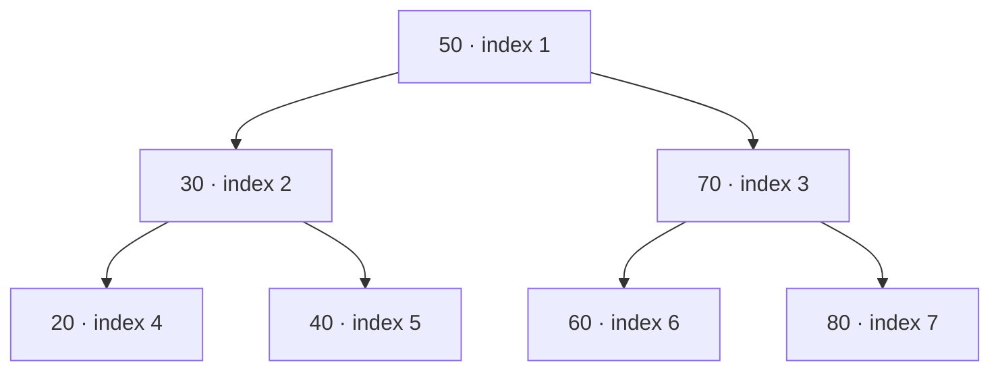
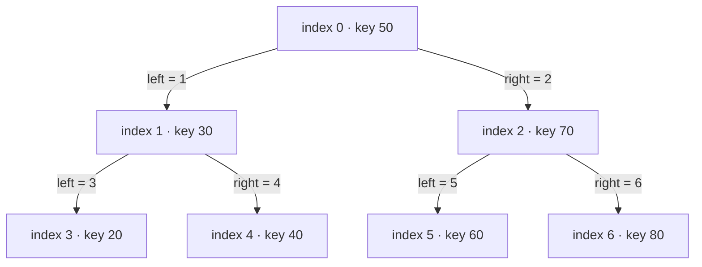
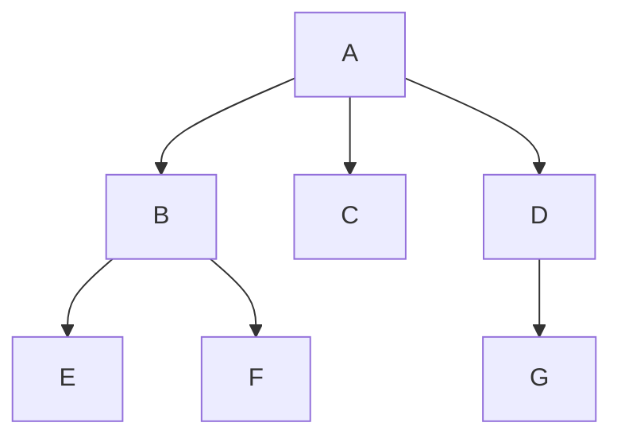
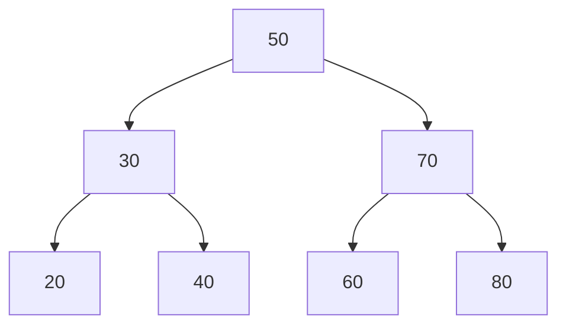

# Tree — Array-Based Node Implementation

> [!abstract] Source
> This note is based on **`4.docx`**, whose document title is **Tree**. The original sequence, terminology, interface names, code, and explanatory text are retained. Mermaid diagrams and navigation have been added to make it easier to study in Obsidian.

## Contents

- [[#1. A few points|1. A few points]]
- [[#2. Implementation of binary search tree|2. Implementation of binary search tree]]
  - [[#2.1 Node based implementation with dynamic memory|Node-based implementation with dynamic memory]]
  - [[#2.2 Array implementation of binary tree based on relating the parent and the two children|Array implementation using parent/child indices]]
  - [[#2.3 Array implementation of binary tree with the node structure|Array of nodes]]
- [[#3. Details of the implementation of a tree using an array of node structure|3. Array-of-nodes implementation]]
  - [[#3.1 Interface|Interface]]
  - [[#3.2 Initialization and deinitialization|Initialization and deinitialization]]
  - [[#3.3 Display|Display / inorder traversal]]
  - [[#3.4 Insert|Insert]]
- [[#4. Additional interface functions — folder two|4. Folder two: node and leaf counts]]
- [[#5. Copy and compare trees — folder three|5. Folder three: copy and compare]]
- [[#6. Tree traversals|6. Tree traversals]]
- [[#7. Quick visual reference|7. Quick visual reference]]

---

## 1. A few points

So far, we have discussed the concept of general trees, binary trees and binary search trees. We have discussed at length the interface of the binary search tree. We have also implemented a binary search tree using the node concept and dynamic memory. We shall discuss different ways of implementing the binary search tree in this unit and we will show one of these in detail.

## 2. Implementation of binary search tree

### 2.1 Node based implementation with dynamic memory

The following structure was used in the discussion in the last lecture.

```c
struct tree
{
    node_t *root_;
};
typedef struct tree tree_t;
```

```c
struct node
{
    int key_;
    struct node *left_;
    struct node *right_;
};
typedef struct node node_t;
```

### 2.2 Array implementation of binary tree based on relating the parent and the two children

This implementation will only store the components. It does not store indices or pointers to the left subtree and the right subtree.

We may or may not use the 0th location of the array. Depending on this, the mapping of the left subtree and the right subtree will vary.

**0 index based mapping:**

- Parent: `i`
- Left child: `2i + 1`
- Right child: `2i + 2`

**1 index based mapping:**

- Parent: `i`
- Left child: `2i`
- Right child: `2i + 1`

This arrangement is good only for complete binary trees where all nodes at higher levels are full and the lower level has all left nodes filled up.

Otherwise, there will be lots of slots in the array will not be filled up.

Finding whether the slot is filled up would require a dummy value to be filled which will not be a valid value in the node.

This method is used while creating heap trees. We shall be discussing later in this course.

#### Example: 1-indexed array representation

In this table, the key column represents the tree. This is 1 index based. The root has the index 1.

The left child of 1 is 2 and the right child of 1 is 3. The left child of 2 is 4 and the right child of 2 is 5.

| Index | Key |
|---:|---:|
| 0 | *(unused)* |
| 1 | 50 |
| 2 | 30 |
| 3 | 70 |
| 4 | 20 |
| 5 | 40 |
| 6 | 60 |
| 7 | 80 |



### 2.3 Array implementation of binary tree with the node structure

Each node has the element or the component, index of the left subtree and the index of the right subtree.

`root = 0`

The array content depends on the order in which the keys are inserted in this binary search tree.

Assuming that the keys are given as `50, 30, 70, 20, 40, 60, 80`, this will be the content of the array representing the tree.

This implementation is discussed in detail in this chapter.

#### Array contents

| Index | Left | Key | Right |
|---:|---:|---:|---:|
| 0 | 1 | 50 | 2 |
| 1 | 3 | 30 | 4 |
| 2 | 5 | 70 | 6 |
| 3 | -1 | 20 | -1 |
| 4 | -1 | 40 | -1 |
| 5 | -1 | 60 | -1 |
| 6 | -1 | 80 | -1 |



Whenever we get a new key, we must find a slot in the array to fill up. In our example, we have assumed that the next slot is available. But on deletion, slots may be available at different locations. To make this robust, we must implement a simple memory manager which keeps a list of free slots and gives a free slot when required and adds the slot to the list slot on deletion.

To make our example simple, we have not implemented the memory manager and also we have not implemented the deletion of a key from the tree.

---

## 3. Details of the implementation of a tree using an array of node structure

### 3.1 Interface

We are referring to the folder one. In this we refer to the header file `tree.h` to understand the structure of the tree.

The node structure is similar to the one implemented in the tree with dynamic allocation. The left and the right subtrees are indicated by indices and not pointers.

```c
#define MAXSIZE 200
struct node
{
    int key_;
    int left_;
    int right_;
};
typedef struct node node_t;
```

```c
struct tree
{
    int root_;
    int count_;
    node_t elem_[MAXSIZE];
};
typedef struct tree tree_t;
```

The tree has the root which shall be the index of the root element in the array. Initially, it will be `-1` to indicate the tree is empty – not a valid index. Once an element is added, it becomes `0`.

The `count_` indicates the number of elements filled up. It is also used to find the next slot where the insertion can be done. In a robust implementation, the location should come from the free list.

The interface functions remain unchanged.

```c
void init(tree_t *ptr_tree);
void deinit(tree_t *ptr_tree);
void disp(tree_t *ptr_tree);
void insert(tree_t *ptr_tree, int key);
```

### 3.2 Initialization and deinitialization

This code is from the folder one and the file `tree.c`.

Initialization and Deinitialization are similar. The tree is made empty and the number of elements is made 0.

```c
void init(tree_t *ptr_tree)
{
    ptr_tree->root_ = -1;
    ptr_tree->count_ = 0;
}
```

```c
void deinit(tree_t *ptr_tree)
{
    ptr_tree->root_ = -1;
    ptr_tree->count_ = 0;
}
```

### 3.3 Display

This is an inorder traversal of the tree.

The `disp` function calls the `disp_recursive` function with the `elem` array and the root.

Observe unlike the normal way of handling an array, the size of the array is not passed as argument.

You may want to reason think of the reason for this!

The recursive function checks if the tree is empty. If not, calls the same function recursively on its left subtree, displays the key, then calls the function recursively on its right subtree.

```c
static void disp_recursive(node_t elem[], int temp)
{
    if(temp != -1)
    {
        disp_recursive(elem, elem[temp].left_);
        printf("%d ", elem[temp].key_);
        disp_recursive(elem, elem[temp].right_);
    }
}
```

```c
void disp(tree_t *ptr_tree)
{
    printf("Tree : ");
    disp_recursive(ptr_tree->elem_, ptr_tree->root_);
    printf("\n");
}
```

> [!example] Inorder for the sample BST
> The inorder sequence for keys `50, 30, 70, 20, 40, 60, 80` is:
>
> `20 30 40 50 60 70 80`

### 3.4 Insert

The insert function checks whether the array is full. If we have a memory manager, then the list of free slots should indicate whether the tree is full.

The count will indicate the slot where the key can be inserted. Then the count is incremented to indicate the number of elements after insertion. The left and the right of the new node are always grounded.

Then, insert calls the recursive routine to insert this new node into the tree. This function passes the array of nodes, the root and the index where the new node has been inserted.

```c
void insert(tree_t *ptr_tree, int key)
{
    if(ptr_tree->count_ == MAXSIZE)
    {
        printf("tree full\n");
        exit(1);
    }
    int temp = ptr_tree->count_++;
    ptr_tree->elem_[temp].key_ = key;
    ptr_tree->elem_[temp].left_ = ptr_tree->elem_[temp].right_ = -1;

    ptr_tree->root_ = insert_recursive(ptr_tree->elem_, ptr_tree->root_, temp);
}
```

If the tree is empty, the index of the new node is the root of the tree.

Otherwise, based on the key, insert in the left subtree or the right subtree.

```c
static int insert_recursive(node_t elem[], int root, int temp)
{
    if(root == -1)
    {
        root = temp;
    }
    else if(elem[root].key_ > elem[temp].key_)
    {
        elem[root].left_ = insert_recursive(elem, elem[root].left_, temp);
    }
    else
    {
        elem[root].right_ = insert_recursive(elem, elem[root].right_, temp);
    }
    return root;
}
```

This function is very similar to the function we wrote for tree with dynamic allocation.

---

## 4. Additional interface functions — folder two

Let us examine a few more interface functions for this tree implementation.

These are found in folder two.

These functions are in `tree.h`.

```c
// 1. find # of nodes
int number_of_nodes(tree_t *ptr_tree);
// 2. find # of leaves
int number_of_leaves(tree_t *ptr_tree);
```

The corresponding function implementation are in `tree.c`.

### 4.1 Number of nodes

To find the number of nodes, this function `number_of_nodes` calls the corresponding recursive function with the `elem` array and the root.

```c
int number_of_nodes(tree_t *ptr_tree)
{
    return number_of_nodes_recursive(ptr_tree->elem_, ptr_tree->root_);
}
```

This recursive function returns `0` if the tree is empty.

Otherwise, this function counts the root as `1` and add to it the number of nodes in the left subtree and the number of nodes in the right subtree.

```c
int number_of_nodes_recursive(node_t elem[], int temp)
{
    if(temp == -1)
    {
        return 0;
    }
    else
    {
        return 1 + number_of_nodes_recursive(elem, elem[temp].left_)
                 + number_of_nodes_recursive(elem, elem[temp].right_);
    }
}
```

### 4.2 Number of leaves

To find the number of leaves, this function calls the corresponding recursive function with the array `elem` and the root.

```c
int number_of_leaves(tree_t *ptr_tree)
{
    return number_of_leaves_recursive(ptr_tree->elem_, ptr_tree->root_);
}
```

This recursive function returns `0` if the tree is empty, returns `1` if the root is a leaf else Returns the sum of the number of leaves in the left subtree and the number of leaves in the right subtree.

```c
int number_of_leaves_recursive(node_t elem[], int temp)
{
    if(temp == -1)
    {
        return 0;
    }
    else if(elem[temp].left_ == -1 && elem[temp].right_ == -1)
    {
        return 1;
    }
    else
    {
        return number_of_leaves_recursive(elem, elem[temp].left_)
             + number_of_leaves_recursive(elem, elem[temp].right_);
    }
}
```

---

## 5. Copy and compare trees — folder three

Let us examine two more functions – copy and compare trees.

These are in the folder three. The files are `tree.h` and `tree.c`.

The interface for copy and compare have not changed from the previous lectures.

```c
// 3. copy tree
void copy(tree_t* ptr_src, tree_t* ptr_dst);
// 4. compare tree
int are_same(tree_t* tree1, tree_t* tree2);
```

### 5.1 Compare two trees

This function `are_same` in turn invokes the corresponding recursive function. This function passes the array `elem` and root of both the trees.

```c
int are_same(tree_t* ptr_tree1, tree_t* ptr_tree2)
{
    return are_same_recursive(ptr_tree1->elem_, ptr_tree1->root_,
                              ptr_tree2->elem_, ptr_tree2->root_);
}
```

This recursive function compares the roots. If both the trees are empty, then the trees are same.

If one of the trees is empty, then the trees are different. Otherwise compare the keys and compare the left subtrees and right subtrees recursively.

```c
int are_same_recursive(node_t elem1[], int root1, node_t elem2[], int root2)
{
    if(root1 == -1 && root2 == -1)
        return 1;
    else if(root1 == -1 || root2 == -1)
        return 0;
    else
        return elem1[root1].key_ == elem2[root2].key_ &&
               are_same_recursive(elem1, elem1[root1].left_,
                                  elem2, elem2[root2].left_) &&
               are_same_recursive(elem1, elem1[root1].right_,
                                  elem2, elem2[root2].right_);
}
```

### 5.2 Copy the tree

This function is made into iterative one. As we are dealing with arrays, we do not have always use recursion. It might be easier to right a non-recursive function.

This function copies the root, the count and the array elements.

We could debate whether we could stop when `i` reaches the count or we should copy till `MAXSIZE`!

```c
void copy(tree_t* ptr_src, tree_t* ptr_dst)
{
    ptr_dst->root_ = ptr_src->root_;
    ptr_dst->count_ = ptr_src->count_;
    for(int i = 0; i < MAXSIZE; ++i)
    {
        ptr_dst->elem_[i] = ptr_src->elem_[i];
    }
}
```

Can you make this recursive similar to insert or compare functions?

This is left to you as an exercise.

---

## 6. Tree traversals

We normally traverse a tree inorder, preorder and postorder.

These functions listed here are very similar to the ones we wrote for tree with dynamic allocation.

### 6.1 Inorder recursive traversal

```c
static void disp_inorder_recursive(node_t elem[], int temp)
{
    if(temp != -1)
    {
        disp_inorder_recursive(elem, elem[temp].left_);
        printf("%d ", elem[temp].key_);
        disp_inorder_recursive(elem, elem[temp].right_);
    }
}
```

### 6.2 Preorder recursive traversal

```c
static void disp_preorder_recursive(node_t elem[], int temp)
{
    if(temp != -1)
    {
        printf("%d ", elem[temp].key_);
        disp_preorder_recursive(elem, elem[temp].left_);
        disp_preorder_recursive(elem, elem[temp].right_);
    }
}
```

### 6.3 Postorder recursive traversal

```c
static void disp_postorder_recursive(node_t elem[], int temp)
{
    if(temp != -1)
    {
        disp_postorder_recursive(elem, elem[temp].left_);
        disp_postorder_recursive(elem, elem[temp].right_);
        printf("%d ", elem[temp].key_);
    }
}
```

### 6.4 Public traversal functions

```c
void disp_inorder(tree_t *ptr_tree)
{
    printf("Tree inorder: ");
    disp_inorder_recursive(ptr_tree->elem_, ptr_tree->root_);
    printf("\n");
}
```

```c
void disp_preorder(tree_t *ptr_tree)
{
    printf("Tree preorder : ");
    disp_preorder_recursive(ptr_tree->elem_, ptr_tree->root_);
    printf("\n");
}
```

```c
void disp_postorder(tree_t *ptr_tree)
{
    printf("Tree postorder: ");
    disp_postorder_recursive(ptr_tree->elem_, ptr_tree->root_);
    printf("\n");
}
```

With this, we come to the end of discussion of tree implemented using an array of nodes.

---

## 7. Quick visual reference

### General tree example shown in the source document



### The sample BST



| Traversal | Visit order |
|---|---|
| Inorder (left, root, right) | `20 30 40 50 60 70 80` |
| Preorder (root, left, right) | `50 30 20 40 70 60 80` |
| Postorder (left, right, root) | `20 40 30 60 80 70 50` |

> [!note] Array-of-nodes representation
> Each entry stores a key and two indices: `left_` and `right_`. The root is an array index (`root_`), and `-1` represents an absent child. The linked shape is therefore represented by index references rather than C pointers.

> [!warning] Source wording and code
> A small number of the source document's explanatory sentences contain grammatical slips; they have been retained rather than silently rewritten. Code is reproduced in readable Markdown code blocks with indentation normalised for display.

---

**End of `4.docx`.**
