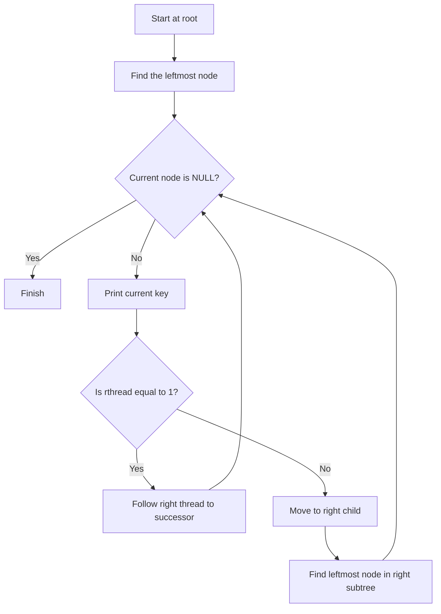
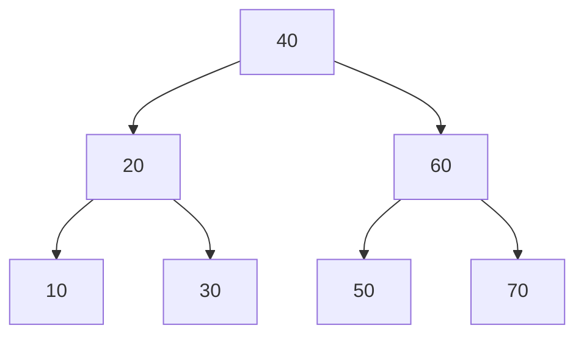
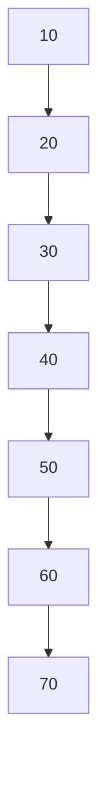
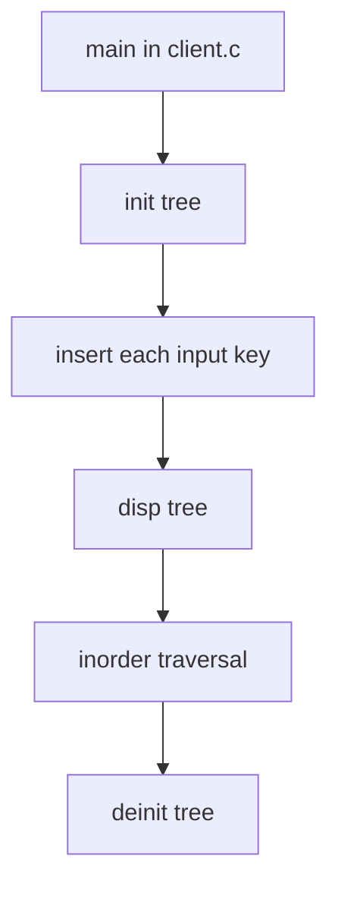

# Threaded Binary Search Tree Implementation

> [!abstract] Source archive
> This note documents **`5.zip`**. The archive contains four files at its root: `makefile`, `tree.c`, `tree.h`, and `client.c`. There are **no subfolders** in this archive.

## 1. Archive structure

```text
5.zip
├── makefile
├── tree.c
├── tree.h
└── client.c
```

## 2. What this implementation does

The source implements a **threaded binary search tree**. Instead of leaving both child pointers as `NULL` when a child does not exist, a thread can use that pointer to refer to the node's inorder predecessor or successor.

The structure in `tree.h` stores:

| Field | Meaning in this implementation |
|---|---|
| `key_` | Integer key stored in the node |
| `left_` | Left child pointer or left thread |
| `right_` | Right child pointer or right thread |
| `lthread_` | `1` means `left_` is a thread; `0` means it is a structural left-child pointer |
| `rthread_` | `1` means `right_` is a thread; `0` means it is a structural right-child pointer |
| `root_` | Pointer to the root node of the tree |

> [!important] Thread flags
> Do not interpret `lthread_ == 1` as “there is a left child.” It means the left pointer is a **thread**, not a structural child pointer. The same rule applies to `rthread_`.

## 3. How inorder traversal works

The implementation uses two helper functions:

- `leftmost(temp)` follows structural left-child pointers until it reaches the leftmost node. It stops when `lthread_ == 1`.
- `inorder(root)` starts at that leftmost node, prints its key, then either follows its right thread directly or enters the right subtree and finds that subtree's leftmost node.

This traversal is **iterative**; it does not use recursion or an explicit traversal stack.



## 4. Visualisation — client test case 1

The first input array in `client.c` is:

```c
int a1[] = {40, 20, 60, 10, 70, 30, 50};
```

Its structural BST shape is:



The inorder sequence is:

```text
10 20 30 40 50 60 70
```

The threaded pointers for this test case can be understood from the following table. A dash in the pointer column means the thread points to `NULL`.

| Node | Left link | `lthread_` | Right link | `rthread_` |
|---:|---|---:|---|---:|
| 10 | Thread → `NULL` | 1 | Child → 20 | 0 |
| 20 | Child → 10 | 0 | Child → 30 | 0 |
| 30 | Thread → 20 | 1 | Thread → 40 | 1 |
| 40 | Child → 20 | 0 | Child → 60 | 0 |
| 50 | Thread → 40 | 1 | Thread → 60 | 1 |
| 60 | Child → 50 | 0 | Child → 70 | 0 |
| 70 | Thread → 60 | 1 | Thread → `NULL` | 1 |

> [!note] Structural links and threads are different
> The Mermaid tree above shows only **structural child links**. The table lists the thread links separately so that the two kinds of links do not become visually confusing.

## 5. Visualisation — client test case 2

The second input array is:

```c
int a2[] = {10, 20, 30, 40, 50, 60, 70};
```

Inserting ascending values produces a right-skewed BST:



The inorder output is again:

```text
10 20 30 40 50 60 70
```

Here, each node except `70` has a structural right-child pointer. The left pointers of nodes `20` through `70` are threads to their inorder predecessors. Node `70` also has a right thread to `NULL`.

## 6. Visualisation — client test case 3

The third case initializes a tree and immediately displays it without inserting any values:

```c
tree_t t3;
init(&t3);
disp(&t3);
deinit(&t3);
```

The tree is empty because `init()` sets `root_` to `NULL`. The display function prints the prefix `Tree : ` followed by a newline, with no keys after the prefix.

## 7. Program flow



## 8. Source files — exact contents

The following blocks contain the source files from the archive. Markdown fences and syntax highlighting are added for readability; the code itself is reproduced from the extracted files.

### 8.1 `makefile`

```makefile
client.exe : client.o tree.o 
	gcc client.o tree.o -o client.exe
tree.o : tree.c tree.h 
	gcc -Wall -c tree.c 
client.o : client.c tree.h 
	gcc -Wall -c client.c 
	
```

### 8.2 `tree.h`

```c
#ifndef TREE_H
#define TREE_H
struct node 
{
	int key_;
	struct node *left_;
	struct node *right_;
	int lthread_;
	int rthread_;
};
typedef struct node node_t;

struct tree 
{
	node_t *root_;
};
typedef struct tree tree_t;

void init(tree_t *ptr_tree);
void deinit(tree_t *ptr_tree);
void disp(tree_t *ptr_tree);
void insert(tree_t *ptr_tree, int key);
#endif
```

### 8.3 `tree.c`

```c
#include <stdio.h>
#include <stdlib.h>
#include "tree.h"
static node_t *leftmost(node_t *temp)
{
    if (temp == NULL)
        return NULL;

    while (temp->lthread_ == 0)
        temp = temp->left_;

    return temp;
}


static void inorder(node_t *root)
{
    node_t *temp = leftmost(root);

    while (temp != NULL)
    {
        printf("%d ", temp->key_);

        if (temp->rthread_ == 1)
            temp = temp->right_;           
        else
            temp = leftmost(temp->right_);  
    }
}
// tree functions 
void init(tree_t *ptr_tree)
{
	ptr_tree->root_ = NULL;
}
void deinit(tree_t *ptr_tree)
{
	node_t *temp = leftmost(ptr_tree->root_);
	node_t *pres;
    while (temp != NULL)
    {
        //printf("%d ", temp->key_);
		pres = temp;
        if (temp->rthread_ == 1)
            temp = temp->right_;           
        else
            temp = leftmost(temp->right_);
		free(pres);
    }
	ptr_tree->root_ = NULL;
}
void disp(tree_t *ptr_tree)
{
	printf("Tree : ");
	inorder(ptr_tree->root_);
	printf("\n");
}

static node_t* create_node(int key)
{
	node_t *temp = (node_t*)malloc(sizeof(node_t));
	if(temp == NULL)
	{
		printf("no more memory\n"); exit(1);
	}
	temp->key_ = key;
	temp->left_ = temp->right_ = NULL;
	temp->lthread_ = temp->rthread_ = 1;
	return temp;
}
static node_t* insert_key(node_t* root, int key)
{
	node_t *temp = create_node(key);
	if(root == NULL)
	{
		return temp;
	}
	
	
	node_t *parent = NULL;
    node_t *curr = root;
    while (curr != NULL)
    {
        parent = curr;
        if (key < curr->key_)
        {
            if (curr->lthread_ == 0)
                curr = curr->left_;
            else
                break;
        }
        else
        {
            if (curr->rthread_ == 0)
                curr = curr->right_;
            else
                break;
        }
    }


    /* Insert as left child */
    if (key < parent->key_)
    {
        temp->left_ = parent->left_;
        temp->right_ = parent;

        parent->left_ = temp;
        parent->lthread_ = 0;
    }

    /* Insert as right child */
    else
    {
        temp->right_ = parent->right_;
        temp->left_ = parent;

        parent->right_ = temp;
        parent->rthread_ = 0;
    }

    return root;
}

void insert(tree_t *ptr_tree, int key)
{
	ptr_tree->root_ = insert_key(ptr_tree->root_, key);
}
```

### 8.4 `client.c`

```c
#include <stdio.h>
#include "tree.h"

int main()
{
	// case 1
	tree_t t1;
	init(&t1);
		int a1[] = {40, 20, 60, 10, 70, 30, 50};
	int n1 = 7;
	for(int i = 0; i < n1; ++i)
	{
		insert(&t1, a1[i]);
	}
	disp(&t1);
	deinit(&t1);
	
	// case 2
	tree_t t2;
	init(&t2);
	
	int a2[] = {10, 20, 30, 40, 50, 60, 70};
	int n2 = 7;
	for(int i = 0; i < n2; ++i)
	{
		insert(&t2, a2[i]);
	}
	disp(&t2);	
	deinit(&t2);
	
	// case 3
	tree_t t3;
	init(&t3);
	disp(&t3);	
	deinit(&t3);

}
```

## 9. Function map

| Function | Role in the supplied source |
|---|---|
| `init()` | Sets `root_` to `NULL`, making the tree empty |
| `deinit()` | Walks the threaded inorder sequence, frees each visited node, and resets `root_` to `NULL` |
| `disp()` | Prints `Tree : `, calls `inorder()`, and prints a newline |
| `create_node()` | Allocates and initializes a node; both thread flags are initially set to `1` |
| `insert_key()` | Inserts a new node while adjusting the predecessor/successor threads and structural links |
| `insert()` | Calls `insert_key()` and stores its returned root |
| `leftmost()` | Finds the leftmost node by following structural left links |
| `inorder()` | Prints the keys in inorder without recursion |

## 10. Build and run

The supplied Makefile describes a target named `client.exe`. From the directory containing the four files, run:

```bash
make
./client.exe
```

On environments where the generated executable is run differently, use the normal executable invocation for that environment. The Makefile compiles `tree.c` and `client.c` with `gcc -Wall` and links `client.o` and `tree.o` into `client.exe`.

### Expected display content from `client.c`

```text
Tree : 10 20 30 40 50 60 70
Tree : 10 20 30 40 50 60 70
Tree :
```

The third line has no keys because the third tree is empty. In the actual program output, each printed key is followed by a space (`printf("%d ", temp->key_)`), so the first two lines also contain a trailing space after `70`; the empty-tree line contains the `Tree : ` prefix and its trailing space.

## 11. Code-reading observations

> [!info] Behaviours directly visible in the source
> - `insert_key()` goes left only when `key < curr->key_`; otherwise it follows or inserts on the right. Equal keys therefore follow the right-side branch in this implementation.
> - `create_node()` initializes both thread flags to `1`. When a new node is attached as a child, the parent's corresponding flag is changed to `0` to mark that link as structural.
> - `deinit()` uses the threaded traversal order to visit and free nodes, then sets the root pointer to `NULL`.
> - The implementation shown provides insertion, inorder display, initialization, and deinitialization. There is no delete/search function declared in the supplied `tree.h`.

## 12. Quick revision

- A threaded tree uses otherwise-null child links as predecessor/successor threads.
- `lthread_ == 1` means the left pointer is a thread; `lthread_ == 0` means it is a left-child link.
- `rthread_ == 1` means the right pointer is a thread; `rthread_ == 0` means it is a right-child link.
- Inorder traversal starts at `leftmost(root)` and repeatedly follows a right thread or enters a right subtree and finds its leftmost node.
- The implementation performs inorder traversal without recursion and without an explicit traversal stack.

---

**Source scope:** This note is based on the four files present in `5.zip`. No additional delete/search implementation is included because those functions are absent from the supplied archive.
