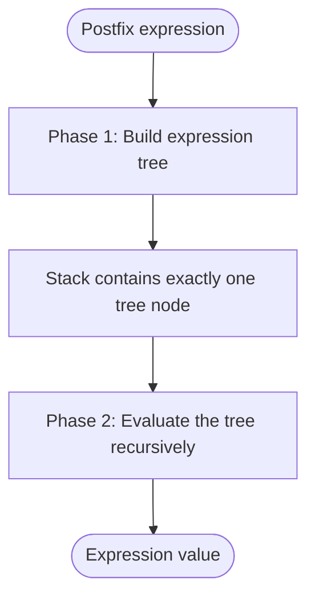
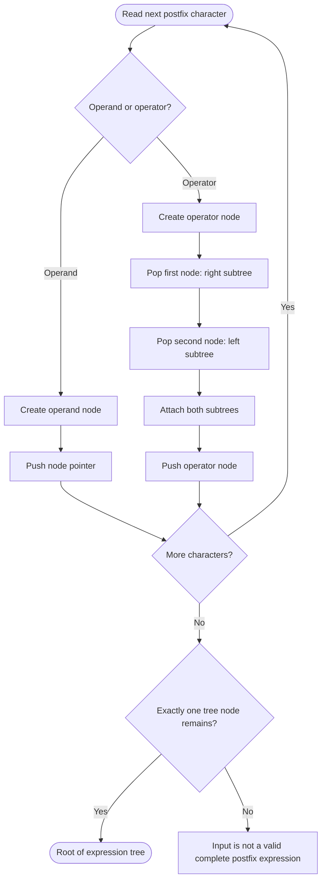
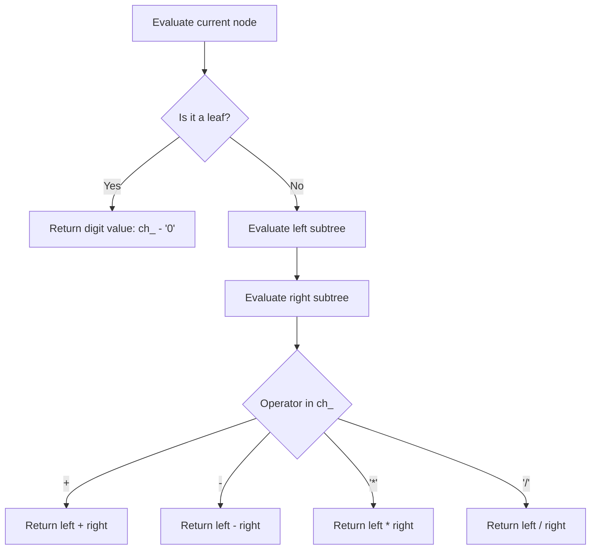
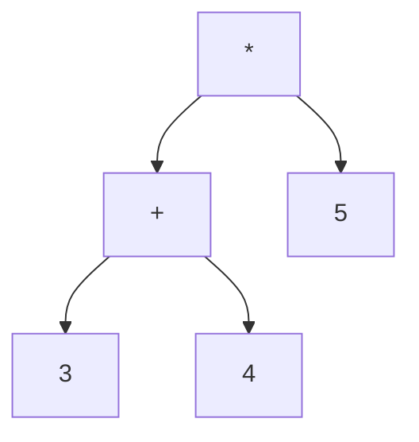
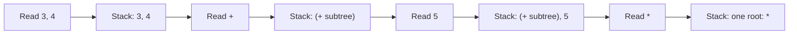

# Expression Tree — Construction and Evaluation

> [!abstract] Source document
> This note is based on **`6.docx` — Expression Tree**. It preserves the source's algorithm, interface declarations, implementation snippets, and terminology. The worked expression later in this note is an **additional illustrative example**, not an example supplied by the source document.

## Contents

- [[#1. Concept and objective|Concept and objective]]
- [[#2. Algorithm overview|Algorithm overview]]
- [[#3. Phase 1 — Construct the expression tree|Phase 1 — Construct the expression tree]]
- [[#4. Data structures|Data structures]]
- [[#5. Stack interface|Stack interface]]
- [[#6. Stack implementation|Stack implementation]]
- [[#7. Phase 2 — Evaluate the expression tree|Phase 2 — Evaluate the expression tree]]
- [[#8. Complete illustrative dry run|Illustrative dry run]]
- [[#9. Source-code observations|Source-code observations]]

---

## 1. Concept and objective

The source describes converting a **postfix expression** into an expression tree, where:

- **Leaves are operands.**
- **Internal nodes are operators.**

The tree is then evaluated to find the value of the expression.

### What the tree represents

For an expression tree, an operator node combines the result of its left subtree and the result of its right subtree. An operand node is a leaf and contributes its value directly.

> [!important] Source assumption
> The source assumes that operands are **single digits**. The node stores its key in a `char` field, `ch_`.

---

## 2. Algorithm overview

### Algorithm specification — source wording

- **Input:** an expression in postfix. For simplicity, the operands are assumed to be single digits.
- **Process:** construct an expression tree.
- **Output:** find the value of the expression.

The algorithm has two phases:



> [!note] Two different uses of recursion and a stack
> The **stack** is used while constructing the tree from postfix notation. The **tree evaluation** then uses recursive calls on the left and right subtrees.

---

## 3. Phase 1 — Construct the expression tree

**Data structure used:** a stack of tree-node pointers.

Scan the postfix expression **from left to right**.

1. **If the character is an operand:** create a tree node and push its pointer onto the stack.
2. **If the character is an operator:** pop two tree nodes from the stack and create a new node containing that operator.
3. Attach the popped nodes as the new node's subtrees.
4. Push the new operator node onto the stack.

The source's `push_operator()` implementation attaches the **first popped node as the right subtree** and the **second popped node as the left subtree**. The order matters for subtraction and division.

### Construction flow



> [!warning] Stack order — common mistake
> For an operator `-` or `/`, do **not** swap the two popped nodes. In the source, `temp->right_ = pop(ptr_stack);` comes first, followed by `temp->left_ = pop(ptr_stack);`.

---

## 4. Data structures

### 4.1 Tree node

The source uses a node containing a character and two pointers to its left and right subtrees.

```c
#define MAXSIZE 100
struct node
{
    char ch_;
    struct node *left_;
    struct node *right_;
};
typedef struct node node_t;
```

| Member | Purpose in the source implementation |
|---|---|
| `ch_` | Stores an operand character or an operator character. |
| `left_` | Pointer to the left subtree. |
| `right_` | Pointer to the right subtree. |
| `node_t` | Type alias for `struct node`. |

### 4.2 Stack structure

The stack is implemented using an array. Each element in the array is a **pointer to a tree node**, not a whole tree node.

```c
struct stack 
{
    node_t* key_[MAXSIZE];
    int top_;
};
typedef struct stack stack_t;
```

| Member | Purpose |
|---|---|
| `key_` | Array of pointers to tree nodes. |
| `top_` | Index of the current top stack element. |
| `stack_t` | Type alias for `struct stack`. |

> [!important] Read the declaration carefully
> `node_t* key_[MAXSIZE];` means **an array of `MAXSIZE` pointers to `node_t`**. It is not an array of `node_t` objects.

### Why is the key a `char`?

The source explains that this design limits an operand to one character. It suggests that a union containing `operand(int)` and `operator(char)` could be used to avoid this limitation. Because operands occur only in leaves, the source says a discriminator may not be required.

> [!note] This is a suggested design alternative
> The source does not implement the union version in the code shown here; its actual node structure uses `char ch_`.

---

## 5. Stack interface

The source notes that this differs from a normal stack because `pop()` returns a pointer to a tree node.

```c
void init_stack(stack_t *ptr_stack);
void deinit_stack();
void push_operand(stack_t *ptr_stack, char ch);
void push_operator(stack_t *ptr_stack, char ch);
node_t* pop(stack_t *ptr_stack);
int is_empty(stack_t *ptr_stack);
int is_full(stack_t *ptr_stack);
```

The evaluation interface is:

```c
int eval(stack_t *ptr_stack);
```

### Responsibilities of the functions

| Function | Responsibility described by the source |
|---|---|
| `init_stack()` | Initialises the stack. |
| `deinit_stack()` | Declared as the stack deinitialisation function. |
| `push_operand()` | Creates an operand node and pushes its pointer onto the stack. |
| `push_operator()` | Creates an operator node, pops two subtree roots, attaches them, and pushes the new root. |
| `pop()` | Returns a pointer to the top node, or reports that the stack is empty. |
| `is_empty()` | Checks whether the stack is empty. |
| `is_full()` | Checks whether the stack is full. |
| `eval()` | Pops the completed tree root and evaluates the tree recursively. |

> [!note] Prototype fidelity
> The declaration `void deinit_stack();` is reproduced as it appears in the source. The document does not provide its implementation.

---

## 6. Stack implementation

The source gives the following implementation snippets.

### 6.1 `create_node()`

This helper dynamically allocates one node. If allocation fails, it prints a message and exits the program.

```c
static node_t* create_node(char ch)
{
    node_t *temp = (node_t*)malloc(sizeof(node_t));
    if(temp == NULL)
    {
        printf("memory full\n"); exit(1);
    }
    temp->ch_ = ch;
    temp->left_ = temp->right_ = NULL;
    return temp;
}
```

**What to notice:**

- `malloc(sizeof(node_t))` allocates memory for one node.
- `temp->ch_ = ch` stores the operand/operator character.
- Both child pointers are initialised to `NULL`.
- The function returns the address of the new node.

### 6.2 `push_operand()`

The source says this function creates a node for the operand and pushes the node pointer onto the stack.

```c
void push_operand(stack_t *ptr_stack, char ch)
{
    if(! is_full(ptr_stack))
    {
        node_t* temp = create_node(ch);
        ptr_stack->key_[++ptr_stack->top_] = temp;
    }
    else 
    {
        printf("stack full; cannot push\n");
    }
}
```

**Important line:**

```c
ptr_stack->key_[++ptr_stack->top_] = temp;
```

The prefix increment advances `top_` first; the pointer is then stored at the new top index.

### 6.3 `push_operator()`

A new node is created with the operator as its key. Two nodes are popped from the stack and attached as its right and left subtrees, after which the new node is pushed onto the stack.

```c
void push_operator(stack_t *ptr_stack, char ch)
{
    if(! is_full(ptr_stack))
    {
        node_t* temp = create_node(ch);
        temp->right_ = pop(ptr_stack);
        temp->left_ = pop(ptr_stack);
        ptr_stack->key_[++ptr_stack->top_] = temp;
    }
}
```

#### Why right first, then left?

For a postfix fragment `ab-`, the first pop returns the node for `b` and the second pop returns the node for `a`. Therefore:

- `right_` points to `b`.
- `left_` points to `a`.
- The new `-` node represents `a - b`.

This ordering also matters for division: `ab/` represents `a / b`, not `b / a`.

### 6.4 `pop()`

The source says this function reports an empty stack and returns the null character constant; otherwise, it returns the top element. Its return type is a pointer to a node.

```c
node_t* pop(stack_t *ptr_stack)
{
    if(! is_empty(ptr_stack))
    {
        return ptr_stack->key_[ptr_stack->top_--];
    }
    else 
    {
        printf("stack empty; cannot pop\n");
        return '\0';
    }
}
```

**Important line:**

```c
return ptr_stack->key_[ptr_stack->top_--];
```

The current top pointer is returned, and then `top_` is decremented because the postfix decrement is used.

> [!warning] Error paths
> The shown `push_operator()` code checks whether the stack is full, but does not itself check that two nodes are available before calling `pop()` twice. The source snippet relies on valid postfix input and the stack functions; it does not show separate malformed-expression validation.

---

## 7. Phase 2 — Evaluate the expression tree

After construction, the stack should contain **one and only one tree node**. This node is the root of the completed expression tree.

The evaluation logic described by the source is:

1. Pop the root node from the stack.
2. If the node is a leaf, return the numeric value of its digit.
3. Otherwise, evaluate the left subtree recursively.
4. Evaluate the right subtree recursively.
5. Apply the operator stored at the current node to the two results.



### 7.1 `eval_recursive()`

This is the source implementation of recursive evaluation.

```c
int eval_recursive(node_t* root)
{
    int left, right;

    if (root->left_ == NULL && root->right_ == NULL)
        return root->ch_ - '0';

    left = eval_recursive(root->left_);
    right = eval_recursive(root->right_);

    switch (root->ch_)
    {
        case '+': return left + right;
        case '-': return left - right;
        case '*': return left * right;
        case '/': return left / right;
    }

    return 0;
}
```

#### How an operand character becomes an integer

```c
return root->ch_ - '0';
```

Under the source's single-digit assumption, subtracting the character constant `'0'` converts a digit character such as `'7'` to the integer value `7`.

#### Why the left and right results are stored separately

```c
left = eval_recursive(root->left_);
right = eval_recursive(root->right_);
```

The operator then combines the two results in their original order. This preserves the correct meaning of subtraction and division.

### 7.2 `eval()`

The source says `eval()` obtains the root by popping the one node left in the stack, then passes it to the recursive evaluator.

```c
int eval(stack_t *ptr_stack)
{
    return eval_recursive(pop(ptr_stack));
}
```

---

## 8. Complete illustrative dry run

> [!example] Added example — not present in the source document
> Use postfix expression **`34+5*`**. This example illustrates the source algorithm with single-digit operands.

### Step 1 — Scan the postfix expression

| Character read | Action | Stack, bottom → top |
|---|---|---|
| `3` | Create operand node `3`; push it. | `3` |
| `4` | Create operand node `4`; push it. | `3, 4` |
| `+` | Pop `4` as right child and `3` as left child; push `+`. | `+` |
| `5` | Create operand node `5`; push it. | `+, 5` |
| `*` | Pop `5` as right child and the `+` tree as left child; push `*`. | `*` |

At the end, exactly one tree node remains on the stack: the root `*`.

### Step 2 — Visualise the resulting expression tree



The tree represents:

\[
(3 + 4) \times 5
\]

### Step 3 — Evaluate recursively

| Node | Evaluation |
|---|---|
| Leaf `3` | Returns `3` |
| Leaf `4` | Returns `4` |
| Node `+` | `3 + 4 = 7` |
| Leaf `5` | Returns `5` |
| Root `*` | `7 * 5 = 35` |

**Final value: `35`.**

### Stack transformation at a glance



---

## 9. Source-code observations

These points follow directly from the source snippets and are useful when tracing code or preparing for implementation questions.

> [!tip] High-value tracing rules
> - Operand: **create one leaf node and push its pointer**.
> - Operator: **pop right first, then left**; create the operator node and push its pointer.
> - A leaf is recognised when **both** `left_` and `right_` are `NULL`.
> - The leaf's numeric value is calculated using `ch_ - '0'`.
> - Evaluation is postorder in effect: evaluate left subtree, evaluate right subtree, then apply the current operator.
> - At the end of valid tree construction, the stack must contain exactly one node.

### Limitations and behaviour visible in the snippets

- The node stores a `char`, and the source assumes **single-digit operands**. Multi-digit integers are not parsed by the shown algorithm.
- The evaluator supports `+`, `-`, `*`, and `/` in its `switch` statement.
- The division expression `left / right` uses C integer operands in the shown code, so it performs integer division for integer values.
- The shown evaluator does not check for a `NULL` root, malformed trees, or division by zero.
- The document supplies snippets and interface declarations; it does not provide a single complete compilable project file, nor the implementations of `init_stack()`, `deinit_stack()`, `is_empty()`, and `is_full()` in the sections transcribed here.

> [!success] Chapter endpoint
> The source concludes that the expression tree and its evaluation are complete once the postfix expression has been converted into a tree and `eval()` has returned the recursively computed value.
