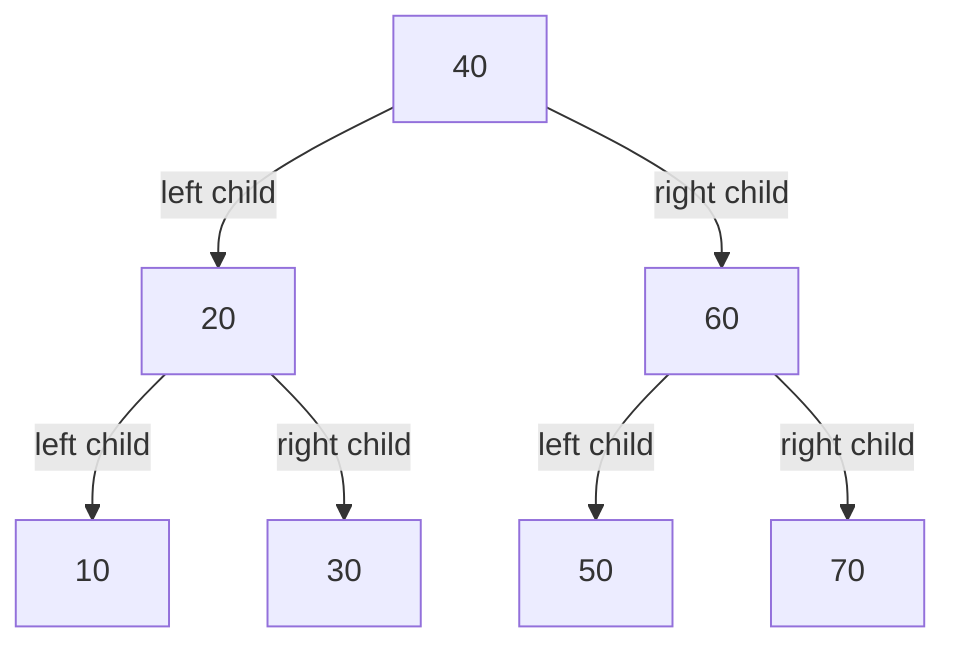
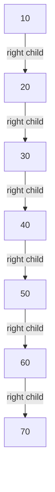
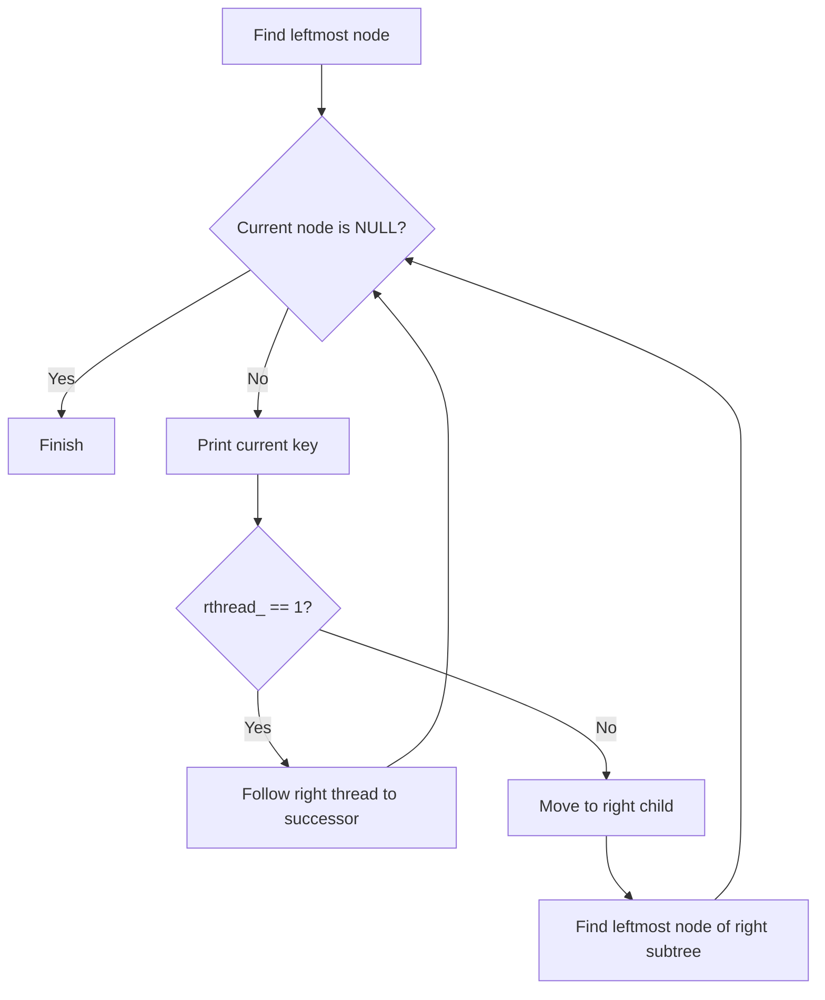

# 07 — Threaded Binary Search Tree Implementation

> [!abstract] What this archive contains
> A C implementation of a **threaded binary search tree (TBST)**. Instead of leaving every missing child pointer as `NULL`, the implementation uses those pointers as inorder predecessor/successor threads. This allows inorder traversal without recursion or an explicit stack.

## Contents

- [[#1. Archive structure|Archive structure]]
- [[#2. Idea and pointer rules|Idea and pointer rules]]
- [[#3. Tree visualisations|Tree visualisations]]
- [[#4. How inorder traversal works|How inorder traversal works]]
- [[#5. Original source files|Original source files]]
- [[#6. Build and run|Build and run]]
- [[#7. Observed program output|Observed program output]]
- [[#8. Important implementation observations|Important implementation observations]]

---

## 1. Archive structure

```text
7.zip
├── makefile
├── tree.h
├── tree.c
└── client.c
```

| File | Responsibility |
|---|---|
| `tree.h` | Defines the node and tree structures and declares the public functions. |
| `tree.c` | Implements initialization, deinitialization, insertion, display, and threaded inorder traversal. |
| `client.c` | Runs three test cases: a balanced-shaped BST, an increasingly ordered insertion sequence, and an empty tree. |
| `makefile` | Compiles `client.c` and `tree.c` and links the executable `client.exe`. |

> [!info] Source fidelity
> The source listings below are transcribed from the four files in `7.zip`. Formatting is preserved as supplied; explanations and diagrams are added separately.

---

## 2. Idea and pointer rules

A normal binary tree node has two child pointers. In a threaded binary tree, a pointer can be either a **structural link** to a child or a **thread** to an inorder predecessor/successor.

### Meaning of the thread flags

| Flag | Value | Meaning |
|---|---:|---|
| `lthread_` | `0` | `left_` is a structural link to the left child. |
| `lthread_` | `1` | `left_` is a thread to the inorder predecessor (or `NULL` at the leftmost boundary). |
| `rthread_` | `0` | `right_` is a structural link to the right child. |
| `rthread_` | `1` | `right_` is a thread to the inorder successor (or `NULL` at the rightmost boundary). |

> [!warning] The flags describe the pointer type
> Do not interpret `left_ == NULL` as the only way to know that a left child is absent. In this implementation, the thread flag tells you whether a pointer is a child link or a thread.

### Node and tree shapes

The node stores an integer key, two pointers, and two thread flags:

```c
struct node
{
    int key_;
    struct node *left_;
    struct node *right_;
    int lthread_;
    int rthread_;
};
typedef struct node node_t;

struct tree
{
    node_t *root_;
};
typedef struct tree tree_t;
```

### Insertion rule

A newly created node starts as a leaf, so both pointers initially behave as threads:

```c
temp->left_ = temp->right_ = NULL;
temp->lthread_ = temp->rthread_ = 1;
```

When inserted as a **left child** of `parent`:

- Its `left_` thread inherits the parent's former left thread (the new node's predecessor).
- Its `right_` thread points to `parent` (its inorder successor).
- `parent->left_` becomes a structural link, so `parent->lthread_ = 0`.

When inserted as a **right child** of `parent`:

- Its `right_` thread inherits the parent's former right thread (the new node's successor).
- Its `left_` thread points to `parent` (its inorder predecessor).
- `parent->right_` becomes a structural link, so `parent->rthread_ = 0`.

---

## 3. Tree visualisations

### Test case 1 — mixed insertion order

The client inserts:

```text
40, 20, 60, 10, 70, 30, 50
```

The resulting **structural BST links** are:



The inorder sequence is:

```text
10 → 20 → 30 → 40 → 50 → 60 → 70
```

Some of the thread relationships for this tree are summarised below. Boundary threads are `NULL` in this implementation.

| Node | Left pointer when `lthread_ = 1` | Right pointer when `rthread_ = 1` |
|---:|---|---|
| `10` | `NULL` — no inorder predecessor | `20` — successor |
| `30` | `20` — predecessor | `40` — successor |
| `50` | `40` — predecessor | `60` — successor |
| `70` | `60` — predecessor | `NULL` — no inorder successor |

The left and right pointers of nodes `20`, `40`, and `60` are structural child links, not threads.

### Test case 2 — sorted insertion order

The client inserts:

```text
10, 20, 30, 40, 50, 60, 70
```

Because each inserted key is greater than the previous key, the BST becomes right-skewed:



In this case, each node from `20` through `70` has its left pointer threaded to the preceding key; `10` has no predecessor, and `70` has no successor. The tree remains a BST, but this insertion order does **not** keep it balanced.

### Test case 3 — empty tree


`init()` sets `root_` to `NULL`. Calling `disp()` on this tree prints the label and a newline, but no keys.

---

## 4. How inorder traversal works

### Helper 1: `leftmost()`

1. If the supplied pointer is `NULL`, return `NULL`.
2. While `lthread_ == 0`, follow `left_` because it is a structural left-child link.
3. Stop when the left pointer is a thread. The current node is the leftmost node of that subtree.

### Helper 2: `inorder()`



The crucial test is `rthread_`:

- `rthread_ == 1`: `right_` already points to the inorder successor. Follow it directly.
- `rthread_ == 0`: `right_` is a real right child. Enter that subtree and find its leftmost node.

This avoids recursion and avoids needing an auxiliary stack for inorder traversal.

---

## 5. Original source files

### 5.1 `makefile`

```makefile
client.exe : client.o tree.o 
	gcc client.o tree.o -o client.exe
tree.o : tree.c tree.h 
	gcc -Wall -c tree.c 
client.o : client.c tree.h 
	gcc -Wall -c client.c 
	
```

### 5.2 `tree.h`

```c
#ifndef TREE_H
#define TREE_H
struct node 
{
	int key_;
	struct node *left_;
	struct node *right_;
	int lthread_;
	int rthread_;
};
typedef struct node node_t;

struct tree 
{
	node_t *root_;
};
typedef struct tree tree_t;

void init(tree_t *ptr_tree);
void deinit(tree_t *ptr_tree);
void disp(tree_t *ptr_tree);
void insert(tree_t *ptr_tree, int key);
#endif
```

### 5.3 `tree.c`

```c
#include <stdio.h>
#include <stdlib.h>
#include "tree.h"
static node_t *leftmost(node_t *temp)
{
    if (temp == NULL)
        return NULL;

    while (temp->lthread_ == 0)
        temp = temp->left_;

    return temp;
}


static void inorder(node_t *root)
{
    node_t *temp = leftmost(root);

    while (temp != NULL)
    {
        printf("%d ", temp->key_);

        if (temp->rthread_ == 1)
            temp = temp->right_;           
        else
            temp = leftmost(temp->right_);  
    }
}
// tree functions 
void init(tree_t *ptr_tree)
{
	ptr_tree->root_ = NULL;
}
void deinit(tree_t *ptr_tree)
{
	node_t *temp = leftmost(ptr_tree->root_);
	node_t *pres;
    while (temp != NULL)
    {
        //printf("%d ", temp->key_);
		pres = temp;
        if (temp->rthread_ == 1)
            temp = temp->right_;           
        else
            temp = leftmost(temp->right_);
		free(pres);
    }
	ptr_tree->root_ = NULL;
}
void disp(tree_t *ptr_tree)
{
	printf("Tree : ");
	inorder(ptr_tree->root_);
	printf("\n");
}

static node_t* create_node(int key)
{
	node_t *temp = (node_t*)malloc(sizeof(node_t));
	if(temp == NULL)
	{
		printf("no more memory\n"); exit(1);
	}
	temp->key_ = key;
	temp->left_ = temp->right_ = NULL;
	temp->lthread_ = temp->rthread_ = 1;
	return temp;
}
static node_t* insert_key(node_t* root, int key)
{
	node_t *temp = create_node(key);
	if(root == NULL)
	{
		return temp;
	}
	
	
	node_t *parent = NULL;
    node_t *curr = root;
    while (curr != NULL)
    {
        parent = curr;
        if (key < curr->key_)
        {
            if (curr->lthread_ == 0)
                curr = curr->left_;
            else
                break;
        }
        else
        {
            if (curr->rthread_ == 0)
                curr = curr->right_;
            else
                break;
        }
    }


    /* Insert as left child */
    if (key < parent->key_)
    {
        temp->left_ = parent->left_;
        temp->right_ = parent;

        parent->left_ = temp;
        parent->lthread_ = 0;
    }

    /* Insert as right child */
    else
    {
        temp->right_ = parent->right_;
        temp->left_ = parent;

        parent->right_ = temp;
        parent->rthread_ = 0;
    }

    return root;
}

void insert(tree_t *ptr_tree, int key)
{
	ptr_tree->root_ = insert_key(ptr_tree->root_, key);
}
```

### 5.4 `client.c`

```c
#include <stdio.h>
#include "tree.h"

int main()
{
	// case 1
	tree_t t1;
	init(&t1);
		int a1[] = {40, 20, 60, 10, 70, 30, 50};
	int n1 = 7;
	for(int i = 0; i < n1; ++i)
	{
		insert(&t1, a1[i]);
	}
	disp(&t1);
	deinit(&t1);
	
	// case 2
	tree_t t2;
	init(&t2);
	
	int a2[] = {10, 20, 30, 40, 50, 60, 70};
	int n2 = 7;
	for(int i = 0; i < n2; ++i)
	{
		insert(&t2, a2[i]);
	}
	disp(&t2);	
	deinit(&t2);
	
	// case 3
	tree_t t3;
	init(&t3);
	disp(&t3);	
	deinit(&t3);

}
```

---

## 6. Build and run

Run the following commands from the directory containing the extracted files:

```bash
make
./client.exe
```

The supplied Makefile compiles `client.c` and `tree.c` with `gcc -Wall`, then links them into `client.exe`.

> [!tip] If you are using Windows
> Run the commands in a shell environment with GCC and `make` available, such as MSYS2 or WSL. The Makefile's executable name is `client.exe`.

---

## 7. Observed program output

The archive was compiled and executed. The output was:

```text
Tree : 10 20 30 40 50 60 70
Tree : 10 20 30 40 50 60 70
Tree :
```

Both non-empty trees display their keys in ascending inorder order. The third line demonstrates the empty-tree case.

---

## 8. Important implementation observations

> [!success] What this implementation demonstrates
> - Uses `lthread_` and `rthread_` to distinguish child links from threads.
> - Inserts new nodes as leaves.
> - Displays the tree with non-recursive inorder traversal.
> - Deinitializes by traversing in inorder and freeing each visited node.

> [!note] Scope of the supplied code
> The public interface contains `init()`, `deinit()`, `disp()`, and `insert()`. It does **not** implement key deletion or search as public operations in these files.

> [!warning] Sorted input can produce a skewed BST
> Test case 2 inserts keys in ascending order and produces a chain of right-child links. Threading makes inorder traversal convenient, but it does not itself balance the tree.

### Quick revision checklist

- [ ] Explain what a threaded pointer represents.
- [ ] Identify the meaning of `lthread_ == 0` versus `lthread_ == 1`.
- [ ] Identify the meaning of `rthread_ == 0` versus `rthread_ == 1`.
- [ ] Dry-run insertion of a new left child and a new right child.
- [ ] Trace `leftmost()` on a subtree.
- [ ] Trace the two branches inside `inorder()`.
- [ ] Explain why sorted insertion results in a right-skewed BST.
- [ ] State the output when the tree is empty.

---

## Related notes

- [[01 - Tree Implementations (1.zip)]]
- [[02 - Tree Fundamentals and BST (2.docx)]]
- [[03 - BST Array Representation and Tree Operations (3.zip)]]
- [[04 - BST Array-Based Node Implementation (4.docx)]]
- [[05 - Threaded Binary Search Tree Implementation (5.zip)]]
- [[06 - Expression Tree Evaluation (6.docx)]]
