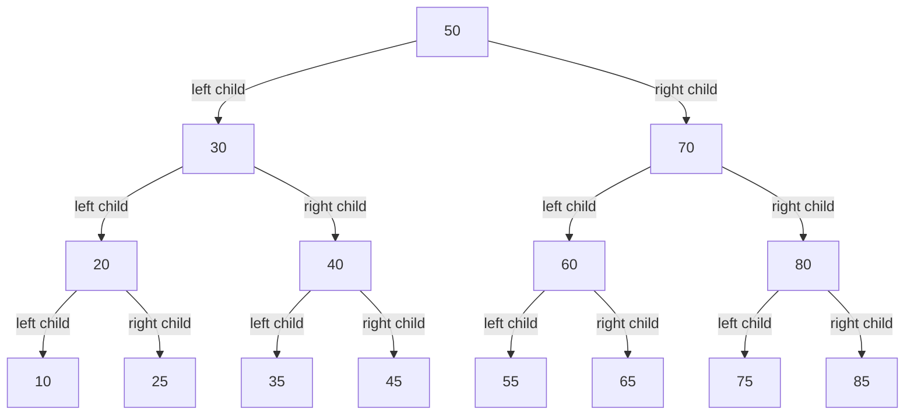
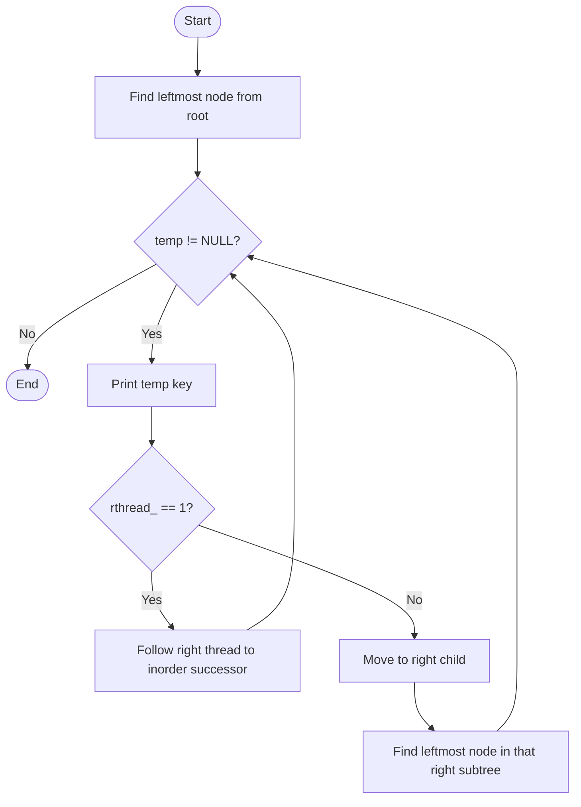

# 08 — Threaded Binary Tree

> [!abstract] What this note covers
> The source document discusses how a node-based, dynamically allocated binary search tree can use otherwise-empty child pointers as **inorder predecessor/successor threads**. It presents the node and tree interfaces, insertion, and iterative inorder traversal.

> [!info] Source fidelity
> Explanations and code below are transcribed from `8.docx`, preserving the source's terminology and code comments where possible. Headings, code fences, tables, and the Mermaid illustrations are added for Obsidian readability. The code fragments are **lecture snippets**, not a complete standalone project.

## Contents

- [[#1. A few points|A few points]]
- [[#2. Threaded binary tree|Threaded binary tree concept]]
- [[#3. Interface|Node and tree interface]]
- [[#4. Implementation|Implementation]]
- [[#5. Threaded-tree visualisation|Threaded-tree visualisation]]
- [[#6. Display the tree in inorder|Inorder traversal]]
- [[#7. Source notes and important observations|Source notes and observations]]

---

## 1. A few points

> **Original source text**
>
> So far, we have discussed general tree, binary tree and binary search tree. We have also discussed at length two different implementations of the tree – node and dynamic memory, node and array based.
>
> In this discussion, we will focus on two aspects.
>
> a) Make better use of pointers in node and dynamic memory-based tree structure.
>
> b) Evaluate an expression by creating an expression tree based on an expression in postfix notation.

> [!note] Scope of this file
> Although the introduction mentions expression trees, the remainder of this document covers the **threaded binary tree**. The expression-tree material is not developed in this document.

---

## 2. Threaded binary tree

### 2.1 Why threads?

> **Original source text**
>
> In a tree of n nodes, there are only n-1 edges or branches. In a node based implementation, each node has 2 pointers. We require only n-1 pointers to point to nodes – these are called structural pointers. So, as many as n + 1 pointers will be grounded.
>
> Based on a particular selected order of traversal (say inorder), can we, instead of grounding the left pointer, make it point to the predecessor? Similarly, instead of grounding the right pointer, can we make it point to the successor? Such a pointer is called a thresad.
>
> How do we make out whether the pointer is a structural pointer or a thread?
>
> To facilitate this, we may require two bit fields.
>
> Check the structure of the node in the header file : tree.h in the folder threaded.
>
> Lthread is 1 if left is thread and a structural pointer. Similarly, rthread is 1 if right is a thread and not a structural pointer. Otherwise, they will be 0.

A normal binary-tree node has two child pointers. In a threaded tree, a pointer that would otherwise be empty can instead point to the node's inorder predecessor or successor.

- A **structural pointer** points to a real left or right child.
- A **left thread** points to the inorder predecessor.
- A **right thread** points to the inorder successor.

### 2.2 Thread-flag meaning used by the code

| Flag | Value | Meaning |
|---|---:|---|
| `lthread_` | `0` | `left_` is a structural pointer to a left child. |
| `lthread_` | `1` | `left_` is a thread, usually to the inorder predecessor. |
| `rthread_` | `0` | `right_` is a structural pointer to a right child. |
| `rthread_` | `1` | `right_` is a thread, usually to the inorder successor. |

> [!warning] A wording issue in the source
> The source sentence defining `lthread_` says “left is thread and a structural pointer,” which is internally contradictory. The code and the diagram consistently use `1` for a thread and `0` for a structural child pointer. The table above states that interpretation explicitly rather than silently repeating the contradiction.

---

## 3. Interface

### 3.1 Node structure

**Original source code:**

```c
struct node
{
    int key_;
    struct node *left_;
    struct node *right_;
    int lthread_;
    int rthread_;
};
typedef struct node node_t;
```

The two pointer fields store either child links or threads. The two integer fields tell the traversal code which kind of pointer each field currently represents.

### 3.2 Tree structure

**Original source code:**

```c
struct tree
{
    node_t *root_;
};
typedef struct tree tree_t;
```

### 3.3 Public interface

> **Original source text:** The interface of the tree has not changed.

```c
void init(tree_t *ptr_tree);
void deinit(tree_t *ptr_tree);
void disp(tree_t *ptr_tree);
void insert(tree_t *ptr_tree, int key);
```

---

## 4. Implementation

### 4.1 Initialize

> **Original source text:** Initialize : The root is grounded.

```c
void init(tree_t *ptr_tree)
{
    ptr_tree->root_ = NULL;
}
```

The root pointer is set to `NULL`, representing an empty tree.

### 4.2 Insert — creating a node

> **Original source text**
>
> There is a helper function which creates a node.
>
> Note that a new node is created. If the allocation fails, this function gives an error message and exits the program.
>
> To the new node, key is copied.
>
> Always the node is added as a leaf. The pointers are grounded.
>
> We assume that the pointers are threads. We could also think otherwise and suitably take care in the insert routine.

**Original source code:**

```c
static node_t* create_node(int key)
{
    node_t *temp = (node_t*)malloc(sizeof(node_t));
    if(temp == NULL)
    {
        printf("no more memory\n"); exit(1);
    }
    temp->key_ = key;
    temp->left_ = temp->right_ = NULL;
    temp->lthread_ = temp->rthread_ = 1;
    return temp;
}
```

The new node starts with both pointers set to `NULL`, and both thread flags set to `1`.

### 4.3 Public `insert` function

> **Original source text:** This insert function calls the function `insert_key` to create a node and insert the node and adjust the structural and thread pointers.

```c
void insert(tree_t *ptr_tree, int key)
{
    ptr_tree->root_ = insert_key(ptr_tree->root_, key);
}
```

### 4.4 The `insert_key` function

> **Original source text:** This is quite a long function. We will discuss the different parts at length.

**Original source code:**

```c
static node_t* insert_key(node_t* root, int key)
{
    node_t *temp = create_node(key);
    node_t *parent = NULL;
    node_t *curr = root;

    while (curr != NULL)
    {
        parent = curr;
        if (key < curr->key_)
        {
            if (curr->lthread_ == 0)
                curr = curr->left_;
            else
                break;
        }
        else
        {
            if (curr->rthread_ == 0)
                curr = curr->right_;
            else
                break;
        }
    }

    if (parent == NULL)
    {
        return temp;
    }

    /* Insert as left child */
    if (key < parent->key_)
    {
        temp->left_ = parent->left_;
        temp->right_ = parent;

        parent->left_ = temp;
        parent->lthread_ = 0;
    }

    /* Insert as right child */
    else
    {
        temp->right_ = parent->right_;
        temp->left_ = parent;

        parent->right_ = temp;
        parent->rthread_ = 0;
    }

    return root;
}
```

### 4.5 Understanding the insertion function — source excerpts

The source next breaks the same function into smaller pieces. These repeated excerpts are retained because the accompanying questions and explanations are part of the lecture material.

#### Create a node and initialize local variables

> **Original source text**
>
> Create a node and initialize local variables.
>
> Observe that the node does not have a parent pointer. It is a local variable.

```c
node_t *temp = create_node(key);
node_t *parent = NULL;
node_t *curr = root;
```

#### Base case: first node in an empty tree

> **Original source text:** Take care of the base case when the first node is added and the tree is empty.

```c
if (parent == NULL)
{
    return temp;
}
```

#### Find the insertion position

> **Original source text**
>
> This is the loop to find the position to insert in the binary search tree. When the subtree is not empty, move along the tree. Remember that we always attach a new node as a leaf. Update the parent before changing current. Based on the key comparison, decide to move left or right. If we have reached a thread, it means that we have reached a leaf.
>
> Removing the break in the code is left as an exercise to you.

```c
while (curr != NULL)
{
    parent = curr;
    if (key < curr->key_)
    {
        if (curr->lthread_ == 0)
            curr = curr->left_;
        else
            break;
    }
    else
    {
        if (curr->rthread_ == 0)
            curr = curr->right_;
        else
            break;
    }
}
```

#### Attach as a left or right child

> **Original source text**
>
> Once the loop is exited, we have found a position to insert. We should find whether the insertion is happening in the left subtree or the right subtree with respect to the parent.
>
> To decide that, key is compared with the key of the parent.

**Original source code — left-child branch:**

```c
if (key < parent->key_)
{
    temp->left_ = parent->left_; // why temp->left_ not NULL?
    temp->right_ = parent; // parent is the successor; right_ is a thread

    parent->left_ = temp; // attach to the left subtree; so this is a structural pointer
    parent->lthread_ = 0; // and hence not a thread
}
```

**Original source code — right-child branch:**

```c
else
{
    temp->right_ = parent->right_; // why temp->right_ not NULL?

    temp->left_ = parent; // parent is the successor; left_ is a thread

    parent->right_ = temp; // attach to the right subtree; so this is a structural pointer
    parent->rthread_ = 0; // and hence not a thread
}
return root;
```

> [!question] Questions explicitly raised by the source
> - Why is `temp->left_` assigned `parent->left_` instead of `NULL` when inserting a left child?
> - Why is `temp->right_` assigned `parent->right_` instead of `NULL` when inserting a right child?
> - What would happen if the `break` statements in the search loop were removed?

### 4.6 What the pointer assignments accomplish

These explanations make the code easier to follow; they are separated from the source excerpts above.

- **Insert to the left:** the new node inherits the parent's former left thread as its own predecessor thread, and its right thread points to the parent as its inorder successor. The parent's left pointer then becomes a structural link to the new node, so `parent->lthread_` is set to `0`.
- **Insert to the right:** the new node inherits the parent's former right thread as its own successor thread, and its left thread points to the parent as its inorder predecessor. The parent's right pointer then becomes a structural link to the new node, so `parent->rthread_` is set to `0`.
- **First insertion:** when `parent == NULL`, the new node becomes the root and is returned.

> [!warning] Terminology in one source comment
> In the right-child excerpt, the source comment says `temp->left_ = parent; // parent is the successor`. In inorder ordering, the parent of a newly inserted right child is its **predecessor**. The source comment is preserved verbatim above; this callout flags the terminology issue.

---

## 5. Threaded-tree visualisation

The source's diagram on **page 6** is titled *Fully Threaded Binary Tree (with Inorder Threads)*. It uses these keys: `50`, `30`, `70`, `20`, `40`, `60`, `80`, `10`, `25`, `35`, `45`, `55`, `65`, `75`, and `85`. The diagrams below are Obsidian-native recreations of the structural tree and its inorder thread sequence.

### 5.1 Structural child links



### 5.2 Inorder visit sequence

The following diagram represents the **visit order**, not direct pointer links:


### 5.3 Threads shown in the source diagram

In the illustrated tree, the leaf nodes have both `lthread_ = 1` and `rthread_ = 1`. Their thread destinations are:

| Leaf node | Left thread (`lthread_ = 1`) points to predecessor | Right thread (`rthread_ = 1`) points to successor |
|---:|---:|---:|
| `10` | `NULL` boundary | `20` |
| `25` | `20` | `30` |
| `35` | `30` | `40` |
| `45` | `40` | `50` |
| `55` | `50` | `60` |
| `65` | `60` | `70` |
| `75` | `70` | `80` |
| `85` | `80` | `NULL` boundary |

> [!info] Reading the visualisations
> The first diagram shows **structural child links** only. The second shows the inorder visitation sequence and is not a representation of direct pointers. The table gives the thread destinations for the leaves in the source figure. The original source says the left thread of the leftmost node and the right thread of the rightmost node may point to the root or may be grounded.

### 5.4 Inorder ordering of the example

```text
10 → 20 → 25 → 30 → 35 → 40 → 45 → 50 → 55 → 60 → 65 → 70 → 75 → 80 → 85
```

**Original source text below the diagram:**

> The left of the leftmost node and the right of the rightmost node are threads and may point to the root node or may be grounded.

---

## 6. Display the tree in inorder

> **Original source text**
>
> This function `disp` calls the inorder function. Note that the inorder function is not recursive.

### 6.1 `disp`

**Original source code:**

```c
void disp(tree_t *ptr_tree)
{
    printf("Tree : ");
    inorder(ptr_tree->root_);
    printf("\n");
}
```

### 6.2 Find the leftmost node

> **Original source text**
>
> There is a helper function to find the leftmost node in the tree.
>
> If the tree is empty, there is no leftmost node.
>
> Otherwise keep traversing left. Remember no pointers are grounded. So, we will come to know that the left subtree is empty if the left is a thread.

**Original source code:**

```c
static node_t *leftmost(node_t *temp)
{
    if (temp == NULL)
        return NULL;

    while (temp->lthread_ == 0)
        temp = temp->left_;

    return temp;
}
```

### 6.3 Iterative inorder traversal

> **Original source text**
>
> This function inorder finds the leftmost node without a left subtree.
>
> It will display the key and then follow the right if is is a thread.
>
> Otherwise it is a structural pointer. Take one step right and then again find the leftmost node.

**Original source code:**

```c
static void inorder(node_t *root)
{
    node_t *temp = leftmost(root);

    while (temp != NULL)
    {
        printf("%d ", temp->key_);

        if (temp->rthread_ == 1)
            temp = temp->right_;
        else
            temp = leftmost(temp->right_);
    }
}
```

### 6.4 Traversal flow



### 6.5 Traversal logic, in plain terms

1. Call `leftmost(root)` to locate the first node in inorder.
2. Print the current node's key.
3. If `rthread_ == 1`, follow `right_` directly to the inorder successor.
4. Otherwise, `right_` is a real right-child link; move to that child and find the leftmost node of its subtree.
5. Repeat until `temp == NULL`.

This routine is iterative: it uses neither recursion nor an explicit stack for inorder traversal.

---

## 7. Source notes and important observations

- The original document provides **code fragments**, not a complete `tree.c` or `tree.h`; required includes and the surrounding project files are not supplied in this DOCX.
- The interface remains `init`, `deinit`, `disp`, and `insert`.
- The node structure has no parent pointer. In insertion, `parent` and `curr` are local variables.
- A new key is attached as a leaf; insertion updates the appropriate structural pointer and thread flag.
- `leftmost()` checks `lthread_ == 0` to keep following actual left-child links.
- `inorder()` checks `rthread_`: a thread is followed as the next inorder link; a structural right pointer leads to a right subtree whose leftmost node is next.
- The source says `deinit()` exists in the public interface, but this document does not show its implementation.
- The source says the `break` statement in the insertion loop may be removed as an exercise; it does not provide the exercise's solution.

> [!success] Core idea to remember
> **Thread flags distinguish a missing child from an inorder link.** That is what lets this implementation traverse the tree in inorder without recursive calls or a traversal stack.

---

## Source completion

> **Original final sentence:** This completes the discussion of threaded binary tree.
