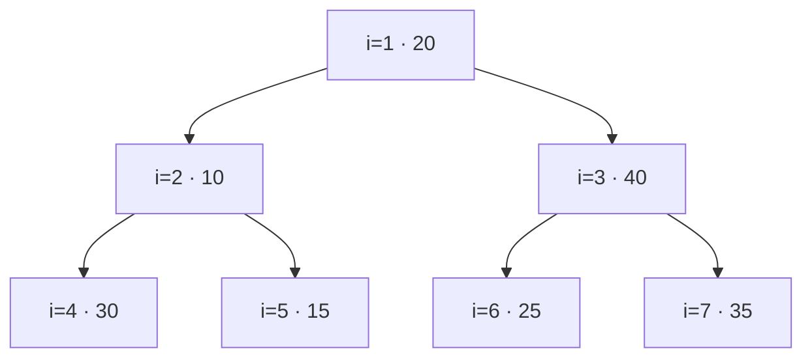
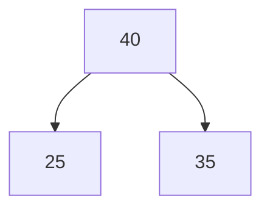
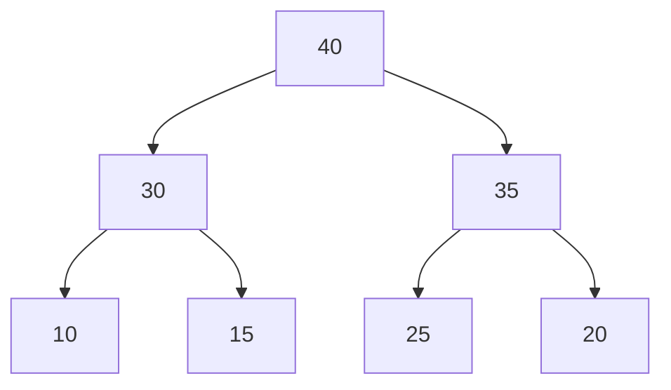
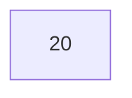
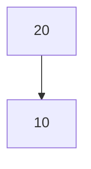
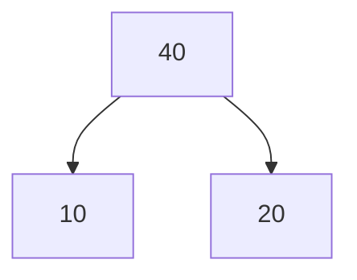
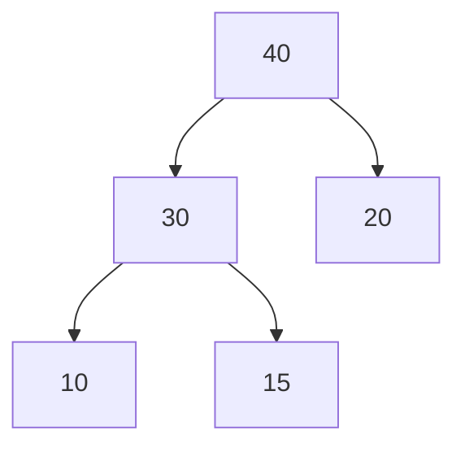
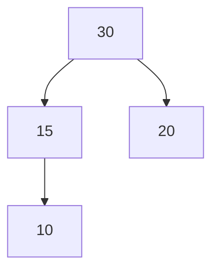
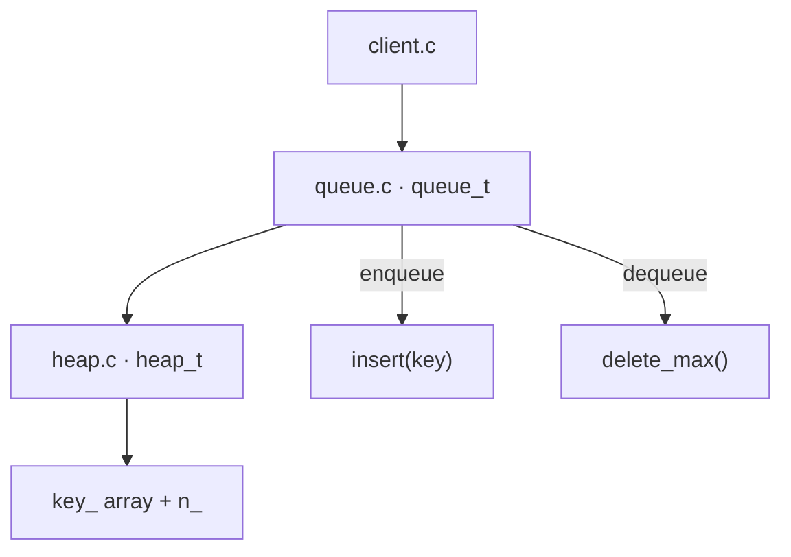

# 09 — Heap Implementations and Priority Queue

> [!abstract] Source archive
> **Original upload:** `9.zip`  
> **Root folder:** `heap/`  
> **Nested archive:** `heap/L33_34_heap_others.zip`  
> **Purpose of this note:** archive map, heap visualisations, build/run notes, and verbatim source-file copies. The source code below is preserved from the archive; observations are kept separately from the code.

> [!info] Navigation
> Previous: [[08 - Threaded Binary Tree (8.docx)]]  
> Next: `10.docx` — Heap theory and algorithms (to be documented separately)

---

## Contents

- [[#1. Archive structure|Archive structure]]
- [[#2. The three implementations|The three implementations]]
- [[#3. Array representation of a max-heap|Array representation]]
- [[#4. Visualising the build_heap operation|Build-heap visualisation]]
- [[#5. heap1 — build a heap from an input array|`heap1/` — build a heap]]
- [[#6. heap2 — interactive max-heap|`heap2/` — insert and delete maximum]]
- [[#7. priority_queue — queue API backed by a max-heap|`priority_queue/`]]
- [[#8. Build and run|Build and run]]
- [[#9. Source observations and edge cases|Source observations]]
- [[#10. Complete source files from the outer archive|All outer-archive source files]]
- [[#11. Complete source files from L33_34_heap_others.zip|All nested-archive source files]]

---

## 1. Archive structure

```text
9.zip
└── heap/
    ├── heap1/
    │   ├── client.c
    │   ├── heap.c
    │   ├── heap.h
    │   └── makefile
    ├── heap2/
    │   ├── client.c
    │   ├── heap.c
    │   ├── heap.h
    │   └── makefile
    ├── priority_queue/
    │   ├── client.c
    │   ├── heap.c
    │   ├── heap.h
    │   ├── makefile
    │   ├── queue.c
    │   └── queue.h
    └── L33_34_heap_others.zip
        ├── heap1/          (4 files)
        ├── heap2/          (4 files)
        └── priority_queue/ (6 files)
```

> [!important] Nested ZIP detail
> The nested archive contains copies of all three implementation folders. Most files are byte-for-byte the same as their outer-archive counterparts. **One visible difference:** `nested heap1/heap.h` declares `delete_max()` and `peek_max()` as well as the other heap functions; the outer `heap/heap1/heap.h` does not. Both header versions are included in this note so the difference is not lost.

### Folder index

| Folder | Main purpose | Files |
|---|---|---|
| `heap1/` | Build a max-heap from an existing 1-indexed array and display each bottom-up heapify pass | `client.c`, `heap.c`, `heap.h`, `makefile` |
| `heap2/` | Interactive max-heap with insertion and delete-maximum operations | `client.c`, `heap.c`, `heap.h`, `makefile` |
| `priority_queue/` | Expose enqueue/dequeue functions backed by the max-heap | `client.c`, `heap.c`, `heap.h`, `queue.c`, `queue.h`, `makefile` |

---

## 2. The three implementations

### `heap1/` — construct from an array

The client passes this array to `build_heap()`:

```c
int a[] = { -1, 20, 10, 40, 30, 15, 25, 35};
int n = 7;
```

The `0`th element is intentionally unused. Heap elements are stored at indices `1` through `n`.

### `heap2/` — maintain a max-heap interactively

- **Insert:** place the new value at the end, then move it up while it is greater than its parent.
- **Delete maximum:** save the root, move the last element to the root, shrink the heap, and heapify downward.
- **Display:** print heap elements in array order.

### `priority_queue/` — wrapper around the heap

`queue_t` contains a `heap_t`. `enqueue()` calls `insert()` and `dequeue()` calls `delete_max()`. As implemented, the operation removes the **largest key first**, so this behaves as a *max-priority queue*, not a conventional FIFO queue.

---

## 3. Array representation of a max-heap

The code uses **1-based indexing**. If a node is at array index `i`:

| Relationship | Index formula |
|---|---:|
| Parent | `i / 2` using integer division |
| Left child | `2 * i` |
| Right child | `2 * i + 1` |

A max-heap must satisfy both properties:

1. **Complete binary tree:** every level is full except possibly the last, and the last level fills from left to right.
2. **Max-heap order:** every parent key is greater than or equal to its child keys.

> [!tip] Do not confuse heap order with BST order
> A max-heap does **not** require every key in the left subtree to be smaller than every key in the right subtree. Only the parent–child ordering is required.

---

## 4. Visualising the `build_heap` operation

The starting keys in `heap1/client.c` (ignoring the unused index `0`) are:

`[20, 10, 40, 30, 15, 25, 35]`

### Initial complete binary tree



### Heapify at index `3`

The node at index `3` contains `40`; its children are `25` and `35`. Since `40` is already the largest, this subtree remains unchanged.



### Heapify at index `2`

`10` has children `30` and `15`. The larger child `30` rises, and `10` moves down to index `4`.


### Heapify at index `1`

`20` is compared with children `30` and `40`. The larger child `40` moves up. The value `20` then moves down and is compared with `25` and `35`; `35` moves above it.



Final heap array:

```text
Index:  1   2   3   4   5   6   7
Key:   40  30  35  10  15  25  20
```

> [!success] Actual program output
> I compiled and ran the archived `heap1/` program. Its output was:
>
> ```text
> building heap
> 20 10 40 30 15 25 35
> 20 30 40 10 15 25 35
> 40 30 35 10 15 25 20
> displaying heap
> 40 30 35 10 15 25 20
> ```
>
> The first intermediate line is the heap after processing index `3`; the second is after index `2`; the third is the final max-heap after index `1`.

### `heapify()` — downward adjustment

Conceptual flow:

```mermaid
flowchart TD
    S([Start at position i]) --> V[Save a[i] as val]
    V --> C{Has a child within n?}
    C -- No --> P[Place val at final position]
    C -- Yes --> L[Choose larger child]
    L --> G{Larger child > val?}
    G -- Yes --> U[Move larger child up]
    U --> N[Move i to child's index]
    N --> C
    G -- No --> P
    P --> E([End])
```

The implementation stores the original value in `val`, repeatedly moves the larger child upward, then places `val` at its final position. The loop ends when there are no children left or the selected child is not greater than `val`.

---

## 5. `heap1/` — build a heap from an input array

### Workflow

1. `init()` sets `n_` to `0`.
2. `build_heap()` copies input indices `1` through `n` into `key_`.
3. It starts from `n / 2`, the last internal node, and calls `heapify()` while moving back to the root.
4. The heap is displayed after each heapify pass.
5. `deinit()` resets `n_` to `0`.

### Key functions

- `heapify(int a[], int n, int pos)` restores max-heap order within the subtree rooted at `pos`, assuming its child subtrees are already heaps.
- `build_heap(heap_t *ptr_heap, int a[], int n)` copies an array and converts it into a max-heap bottom-up.
- `disp()` prints keys from index `1` to `n_`.

> [!note] Build-heap direction
> The loop is `for(int i = n / 2; i >= 1; --i)`. Leaves already satisfy the heap property, so the algorithm begins at the last internal node and finishes at the root.

---

## 6. `heap2/` — interactive max-heap

### Menu

```text
opt : 1 insert; 2 : delete; 0 : exit :
```

| Option | Action |
|---:|---|
| `1` | Read a key, insert it, and display the heap |
| `2` | Delete the maximum key, print the deleted value, and display the heap |
| `0` | Exit the loop and deinitialise the heap |

### Insert visualisation

Insert `20`, then `10`, then `40`:

After inserting `20`, the heap contains one node:



After inserting `10`, the key stays below `20`:



After inserting `40`, it moves above `20`:



Array snapshots:

| Operation | Heap array |
|---|---|
| Insert `20` | `[20]` |
| Insert `10` | `[20, 10]` |
| Insert `40` | `[40, 10, 20]` |

### Delete maximum visualisation

Starting from `[40, 30, 20, 10, 15]`, `delete_max()` returns `40`, moves the last key `15` to the root, decreases the count, then heapifies down. The resulting heap is `[30, 15, 20, 10]`.



After deleting `40`:



The important invariant is maintained: the root remains the maximum key after each completed insertion or deletion.

---

## 7. `priority_queue/` — queue API backed by a max-heap

### Structure and call flow



The queue wrapper uses these calls:

| Wrapper function | Implementation |
|---|---|
| `init_queue()` | Calls `init()` on the embedded heap |
| `deinit_queue()` | Calls `deinit()` on the embedded heap |
| `enqueue(key)` | Calls `insert()` |
| `dequeue()` | Returns the result of `delete_max()` |

> [!warning] Semantics of dequeue
> This implementation removes the maximum key. It is therefore a **priority queue ordered by numeric value**, not a first-in-first-out queue. If FIFO order is required, the implementation would need a different backing structure; no such alternative is present in this archive.

---

## 8. Build and run

Run commands from the relevant directory, because each Makefile expects source files in the current working directory.

```bash
cd heap/heap1 && make && ./client.exe
```

For the interactive heap:

```bash
cd heap/heap2 && make && ./client.exe
```

For the priority queue:

```bash
cd heap/priority_queue && make && ./client.exe
```

> [!success] Compilation check
> The three outer folders were built successfully using their supplied Makefiles with `gcc -Wall`. The `heap1/` output above was captured by running the compiled program. I also exercised insert/delete in `heap2/` and enqueue/dequeue in `priority_queue/`.

---

## 9. Source observations and edge cases

These are observations about the archived files, not edits to them.

> [!bug] 1-based indexing and `MAXSIZE`
> The structure declares `int key_[MAXSIZE];`, which allocates indices `0` through `MAXSIZE - 1`. Since the implementation uses indices starting at `1`, index `MAXSIZE` is outside the array. In `insert()`, the check is `if(pos > MAXSIZE)` after incrementing `n_`; when `pos == MAXSIZE`, the check does not stop the write to `key_[MAXSIZE]`. The bound should be revisited before using the code at full capacity.

> [!bug] `peek_max()` assumes the heap is non-empty
> `peek_max()` immediately returns `key_[1]` without checking `n_`. Calling it on an empty heap does not have a safe, defined API result in the current code.

> [!bug] Header declarations that are not implemented in the matching `.c`
> - Outer `heap1/heap.h` declares `insert()`, while outer `heap1/heap.c` does not define it.
> - `heap2/heap.h` and `priority_queue/heap.h` declare `build_heap()`, while their corresponding `heap.c` files do not define it.
> - `queue.h` declares `is_empty()` and `is_full()`, but `queue.c` does not define these functions.
> - The nested `heap1/heap.h` additionally declares `delete_max()` and `peek_max()`, although those implementations are not present in nested `heap1/heap.c` either.
>
> These unused declarations do not prevent the provided clients from linking, but calling the declared-yet-undefined functions would require implementations.

> [!warning] Priority queue's `0` sentinel convention
> In `priority_queue/client.c`, the dequeued value is printed only when `val != 0`. Since `0` is a valid integer key, dequeuing an actual zero value produces no message. The client uses `0` as though it were a special result, but the queue API itself returns an integer key and does not reserve zero in its interface.

> [!warning] Empty deletion terminates the program
> `delete_max()` prints `heap empty` and calls `exit(1)` if the heap is empty. The client therefore cannot recover from an attempted deletion on an empty heap.

> [!note] The heap is not sorted
> The array order represents the complete tree's level order. It is not a fully sorted array: a max-heap only guarantees that every parent is at least as large as its children.

---

## 10. Complete source files from the outer archive

The code blocks in this section are transcribed from the actual files extracted from `9.zip`. Relative paths are shown so each file can be placed back into its original folder.

### `heap/heap1/`

### `heap/heap1/client.c`

```c
#include <stdio.h>
#include "heap.h"

int main()
{
	// 0th element not used
	int a[] = { -1, 20, 10, 40, 30, 15, 25, 35};
	int n = 7;
	heap_t h;
	init(&h);
	printf("building heap\n");
	build_heap(&h, a, n);
	printf("displaying heap\n");
	disp(&h);
	deinit(&h);
}
```

### `heap/heap1/heap.c`

```c
#include <stdio.h>
#include <stdlib.h>
#include "heap.h"

void init(heap_t *ptr_heap)
{
	ptr_heap->n_ = 0;
}

void deinit(heap_t *ptr_heap)
{
	ptr_heap->n_ = 0;
}

void disp(heap_t *ptr_heap)
{
	for(int i = 1; i <= ptr_heap->n_; ++i)
	{
		printf("%d ", ptr_heap->key_[i]);
	}
	printf("\n");
}

static void heapify(int a[], int n, int pos)
{
	int i = pos;
	int j = 2 * i;
	int val = a[i];
	int is_heap = 0;
	while(j <= n && ! is_heap)
	{
		if(j + 1 <= n && a[j+1] > a[j])
			++j;
		if(a[j] > val)
		{
			a[i] = a[j];
			i = j;
			j = 2 * i;
		}
		else 
		{
			is_heap = 1;
		}

	}
	a[i] = val;
}

// indexed from 1 in both the arrays
void build_heap(heap_t *ptr_heap, int a[], int n)
{
	ptr_heap->n_ = n;
	for(int i = 1; i <= n; ++i)
	{
		ptr_heap->key_[i] = a[i];
	}
	for(int i = n / 2; i >= 1; --i)
	{
		heapify(ptr_heap->key_, ptr_heap->n_, i);
		disp(ptr_heap);
	}
}
```

### `heap/heap1/heap.h`

```c
#ifndef HEAP_H
#define HEAP_H

#define MAXSIZE 200

struct heap 
{
	int key_[MAXSIZE];
	int n_;
};
typedef struct heap  heap_t;

void init(heap_t *ptr_heap);
void deinit(heap_t *ptr_heap);
void disp(heap_t *ptr_heap);
void insert(heap_t *ptr_heap, int key);


void build_heap(heap_t *ptr_heap, int a[], int n);


#endif
```

### `heap/heap1/makefile`

```makefile
client.exe : client.o heap.o 
	gcc client.o heap.o -o client.exe
heap.o : heap.c heap.h 
	gcc -Wall -c heap.c 
client.o : client.c heap.h 
	gcc -Wall -c client.c 
	
```


### `heap/heap2/`

### `heap/heap2/client.c`

```c
#include <stdio.h>
#include "heap.h"

int main()
{
	heap_t h;
	init(&h);
	int opt;
	int key;
	printf("opt : 1 insert; 2 : delete; 0 : exit : ");
	scanf("%d", &opt);
	while(opt)
	{
		switch(opt)
		{
			case 1 : 	scanf("%d", &key);
						insert(&h, key);
						disp(&h);
						break;
			case 2 : 	key = delete_max(&h);
						printf("deleted : %d\n", key);
						disp(&h);
						break;
		}
		
		printf("opt : 1 insert; 2 : delete; 0 : exit : ");
		scanf("%d", &opt);
	}
	deinit(&h);
}
```

### `heap/heap2/heap.c`

```c
#include <stdio.h>
#include <stdlib.h>
#include "heap.h"

void init(heap_t *ptr_heap)
{
	ptr_heap->n_ = 0;
}

void deinit(heap_t *ptr_heap)
{
	ptr_heap->n_ = 0;
}

void disp(heap_t *ptr_heap)
{
	printf("\n displaying the heap \n");
	for(int i = 1; i <= ptr_heap->n_; ++i)
	{
		printf("%d ", ptr_heap->key_[i]);
	}
	printf("\n");
}

static void heapify(int a[], int n, int pos)
{
	int i = pos;
	int j = 2 * i;
	int val = a[i];
	int is_heap = 0;
	while(j <= n && ! is_heap)
	{
		if(j + 1 <= n && a[j+1] > a[j])
			++j;
		if(a[j] > val)
		{
			a[i] = a[j];
			i = j;
			j = 2 * i;
		}
		else 
		{
			is_heap = 1;
		}

	}
	a[i] = val;
}
static void swap(int *p, int *q)
{
	int temp = *p;
	*p = *q;
	*q = temp;
}

void insert(heap_t *ptr_heap, int key)
{
	// add at the end
	// heapify upwards 
	int pos = ++ptr_heap->n_;
	if(pos > MAXSIZE)
	{
		printf("heap full\n"); exit(1);
	}
	ptr_heap->key_[pos] = key;
	while(pos > 1 && ptr_heap->key_[pos] > ptr_heap->key_[pos/2])
	{
		swap(&ptr_heap->key_[pos], &ptr_heap->key_[pos/2]);
		pos = pos / 2;
	}
}
int delete_max(heap_t *ptr_heap)
{
	if(ptr_heap->n_ == 0)
	{
		printf("heap empty\n"); exit(1);
	}
	int res = ptr_heap->key_[1];
	ptr_heap->key_[1] = ptr_heap->key_[ptr_heap->n_];
	
	heapify(ptr_heap->key_, --ptr_heap->n_, 1);
	return res;
}

int peek_max(heap_t *ptr_heap)
{
	return ptr_heap->key_[1];
}
```

### `heap/heap2/heap.h`

```c
#ifndef HEAP_H
#define HEAP_H

#define MAXSIZE 200

struct heap 
{
	int key_[MAXSIZE];
	int n_;
};
typedef struct heap  heap_t;

void init(heap_t *ptr_heap);
void deinit(heap_t *ptr_heap);
void disp(heap_t *ptr_heap);
void insert(heap_t *ptr_heap, int key);
int delete_max(heap_t *ptr_heap);
int peek_max(heap_t *ptr_heap);

void build_heap(heap_t *ptr_heap, int a[], int n);


#endif
```

### `heap/heap2/makefile`

```makefile
client.exe : client.o heap.o 
	gcc client.o heap.o -o client.exe
heap.o : heap.c heap.h 
	gcc -Wall -c heap.c 
client.o : client.c heap.h 
	gcc -Wall -c client.c 
	
```


### `heap/priority_queue/`

### `heap/priority_queue/client.c`

```c
#include <stdio.h>
#include "queue.h" 

int main()
{
	queue_t q;
	init_queue(&q);
	int opt;
	int val;
	printf("opt : 1 : enqueue; 2 : dequeue ; 0 : quit\n");
	scanf("%d", &opt);
	while(opt)
	{
		switch(opt)
		{
			case 1 : scanf("%d", &val);
					 enqueue(&q, val);
					 break;
			case 2 : val = dequeue(&q);
					 if(val != 0)
						 printf("dequeue %d\n", val);
					 break;
		}
		printf("opt : 1 : enqueue; 2 : dequeue ; 0 : quit\n");
		scanf("%d", &opt);
	}
	deinit_queue(&q);
}
```

### `heap/priority_queue/heap.c`

```c
#include <stdio.h>
#include <stdlib.h>
#include "heap.h"

void init(heap_t *ptr_heap)
{
	ptr_heap->n_ = 0;
}

void deinit(heap_t *ptr_heap)
{
	ptr_heap->n_ = 0;
}

void disp(heap_t *ptr_heap)
{
	printf("\n displaying the heap \n");
	for(int i = 1; i <= ptr_heap->n_; ++i)
	{
		printf("%d ", ptr_heap->key_[i]);
	}
	printf("\n");
}

static void heapify(int a[], int n, int pos)
{
	int i = pos;
	int j = 2 * i;
	int val = a[i];
	int is_heap = 0;
	while(j <= n && ! is_heap)
	{
		if(j + 1 <= n && a[j+1] > a[j])
			++j;
		if(a[j] > val)
		{
			a[i] = a[j];
			i = j;
			j = 2 * i;
		}
		else 
		{
			is_heap = 1;
		}

	}
	a[i] = val;
}
static void swap(int *p, int *q)
{
	int temp = *p;
	*p = *q;
	*q = temp;
}

void insert(heap_t *ptr_heap, int key)
{
	// add at the end
	// heapify upwards 
	int pos = ++ptr_heap->n_;
	if(pos > MAXSIZE)
	{
		printf("heap full\n"); exit(1);
	}
	ptr_heap->key_[pos] = key;
	while(pos > 1 && ptr_heap->key_[pos] > ptr_heap->key_[pos/2])
	{
		swap(&ptr_heap->key_[pos], &ptr_heap->key_[pos/2]);
		pos = pos / 2;
	}
}
int delete_max(heap_t *ptr_heap)
{
	if(ptr_heap->n_ == 0)
	{
		printf("heap empty\n"); exit(1);
	}
	int res = ptr_heap->key_[1];
	ptr_heap->key_[1] = ptr_heap->key_[ptr_heap->n_];
	
	heapify(ptr_heap->key_, --ptr_heap->n_, 1);
	return res;
}

int peek_max(heap_t *ptr_heap)
{
	return ptr_heap->key_[1];
}
```

### `heap/priority_queue/heap.h`

```c
#ifndef HEAP_H
#define HEAP_H

#define MAXSIZE 200

struct heap 
{
	int key_[MAXSIZE];
	int n_;
};
typedef struct heap  heap_t;

void init(heap_t *ptr_heap);
void deinit(heap_t *ptr_heap);
void disp(heap_t *ptr_heap);
void insert(heap_t *ptr_heap, int key);
int delete_max(heap_t *ptr_heap);
int peek_max(heap_t *ptr_heap);

void build_heap(heap_t *ptr_heap, int a[], int n);


#endif
```

### `heap/priority_queue/makefile`

```makefile
client.exe : client.o heap.o queue.o
	gcc client.o heap.o queue.o -o client.exe
heap.o : heap.c heap.h 
	gcc -Wall -c heap.c 
client.o : client.c heap.h 
	gcc -Wall -c client.c 
queue.o : queue.h queue.c
	gcc -Wall -c queue.c 
	
	
```

### `heap/priority_queue/queue.c`

```c
#include <stdio.h>
#include <stdlib.h>
#include "queue.h"

void init_queue(queue_t *ptr_queue)
{
	init(&ptr_queue->q_);
}

void deinit_queue(queue_t *ptr_queue)
{
	deinit(&ptr_queue->q_);
}


void enqueue(queue_t *ptr_queue, int key)
{
	insert(&ptr_queue->q_, key);

}
int dequeue(queue_t *ptr_queue)
{
	return delete_max(&ptr_queue->q_);
}
```

### `heap/priority_queue/queue.h`

```c
#ifndef queue_H
#define queue_H 
#include "heap.h"
struct node
{
	int key_;
	struct node* next_;
};
typedef struct node node_t;

struct queue 
{
	heap_t q_;
};
typedef struct queue queue_t;

void init_queue(queue_t *ptr_queue);
void deinit_queue(queue_t *ptr_queue);
void enqueue(queue_t *ptr_queue, int key);
int dequeue(queue_t *ptr_queue);
int is_empty(queue_t *ptr_queue);
int is_full(queue_t *ptr_queue);


#endif
```

---

## 11. Complete source files from `L33_34_heap_others.zip`

The nested ZIP contains the same three directory names. These are listed separately because an archive can contain a different version of a file even when the filename matches. The only source-content difference identified between the outer and nested copies was `heap1/heap.h`.

### Nested `heap1/`

### `L33_34_heap_others.zip::heap1/client.c`

```c
#include <stdio.h>
#include "heap.h"

int main()
{
	// 0th element not used
	int a[] = { -1, 20, 10, 40, 30, 15, 25, 35};
	int n = 7;
	heap_t h;
	init(&h);
	printf("building heap\n");
	build_heap(&h, a, n);
	printf("displaying heap\n");
	disp(&h);
	deinit(&h);
}
```

### `L33_34_heap_others.zip::heap1/heap.c`

```c
#include <stdio.h>
#include <stdlib.h>
#include "heap.h"

void init(heap_t *ptr_heap)
{
	ptr_heap->n_ = 0;
}

void deinit(heap_t *ptr_heap)
{
	ptr_heap->n_ = 0;
}

void disp(heap_t *ptr_heap)
{
	for(int i = 1; i <= ptr_heap->n_; ++i)
	{
		printf("%d ", ptr_heap->key_[i]);
	}
	printf("\n");
}

static void heapify(int a[], int n, int pos)
{
	int i = pos;
	int j = 2 * i;
	int val = a[i];
	int is_heap = 0;
	while(j <= n && ! is_heap)
	{
		if(j + 1 <= n && a[j+1] > a[j])
			++j;
		if(a[j] > val)
		{
			a[i] = a[j];
			i = j;
			j = 2 * i;
		}
		else 
		{
			is_heap = 1;
		}

	}
	a[i] = val;
}

// indexed from 1 in both the arrays
void build_heap(heap_t *ptr_heap, int a[], int n)
{
	ptr_heap->n_ = n;
	for(int i = 1; i <= n; ++i)
	{
		ptr_heap->key_[i] = a[i];
	}
	for(int i = n / 2; i >= 1; --i)
	{
		heapify(ptr_heap->key_, ptr_heap->n_, i);
		disp(ptr_heap);
	}
}
```

### `L33_34_heap_others.zip::heap1/heap.h`

```c
#ifndef HEAP_H
#define HEAP_H

#define MAXSIZE 200

struct heap 
{
	int key_[MAXSIZE];
	int n_;
};
typedef struct heap  heap_t;

void init(heap_t *ptr_heap);
void deinit(heap_t *ptr_heap);
void disp(heap_t *ptr_heap);
void insert(heap_t *ptr_heap, int key);
int delete_max(heap_t *ptr_heap);
int peek_max(heap_t *ptr_heap);

void build_heap(heap_t *ptr_heap, int a[], int n);


#endif
```

### `L33_34_heap_others.zip::heap1/makefile`

```makefile
client.exe : client.o heap.o 
	gcc client.o heap.o -o client.exe
heap.o : heap.c heap.h 
	gcc -Wall -c heap.c 
client.o : client.c heap.h 
	gcc -Wall -c client.c 
	
```


### Nested `heap2/`

### `L33_34_heap_others.zip::heap2/client.c`

```c
#include <stdio.h>
#include "heap.h"

int main()
{
	heap_t h;
	init(&h);
	int opt;
	int key;
	printf("opt : 1 insert; 2 : delete; 0 : exit : ");
	scanf("%d", &opt);
	while(opt)
	{
		switch(opt)
		{
			case 1 : 	scanf("%d", &key);
						insert(&h, key);
						disp(&h);
						break;
			case 2 : 	key = delete_max(&h);
						printf("deleted : %d\n", key);
						disp(&h);
						break;
		}
		
		printf("opt : 1 insert; 2 : delete; 0 : exit : ");
		scanf("%d", &opt);
	}
	deinit(&h);
}
```

### `L33_34_heap_others.zip::heap2/heap.c`

```c
#include <stdio.h>
#include <stdlib.h>
#include "heap.h"

void init(heap_t *ptr_heap)
{
	ptr_heap->n_ = 0;
}

void deinit(heap_t *ptr_heap)
{
	ptr_heap->n_ = 0;
}

void disp(heap_t *ptr_heap)
{
	printf("\n displaying the heap \n");
	for(int i = 1; i <= ptr_heap->n_; ++i)
	{
		printf("%d ", ptr_heap->key_[i]);
	}
	printf("\n");
}

static void heapify(int a[], int n, int pos)
{
	int i = pos;
	int j = 2 * i;
	int val = a[i];
	int is_heap = 0;
	while(j <= n && ! is_heap)
	{
		if(j + 1 <= n && a[j+1] > a[j])
			++j;
		if(a[j] > val)
		{
			a[i] = a[j];
			i = j;
			j = 2 * i;
		}
		else 
		{
			is_heap = 1;
		}

	}
	a[i] = val;
}
static void swap(int *p, int *q)
{
	int temp = *p;
	*p = *q;
	*q = temp;
}

void insert(heap_t *ptr_heap, int key)
{
	// add at the end
	// heapify upwards 
	int pos = ++ptr_heap->n_;
	if(pos > MAXSIZE)
	{
		printf("heap full\n"); exit(1);
	}
	ptr_heap->key_[pos] = key;
	while(pos > 1 && ptr_heap->key_[pos] > ptr_heap->key_[pos/2])
	{
		swap(&ptr_heap->key_[pos], &ptr_heap->key_[pos/2]);
		pos = pos / 2;
	}
}
int delete_max(heap_t *ptr_heap)
{
	if(ptr_heap->n_ == 0)
	{
		printf("heap empty\n"); exit(1);
	}
	int res = ptr_heap->key_[1];
	ptr_heap->key_[1] = ptr_heap->key_[ptr_heap->n_];
	
	heapify(ptr_heap->key_, --ptr_heap->n_, 1);
	return res;
}

int peek_max(heap_t *ptr_heap)
{
	return ptr_heap->key_[1];
}
```

### `L33_34_heap_others.zip::heap2/heap.h`

```c
#ifndef HEAP_H
#define HEAP_H

#define MAXSIZE 200

struct heap 
{
	int key_[MAXSIZE];
	int n_;
};
typedef struct heap  heap_t;

void init(heap_t *ptr_heap);
void deinit(heap_t *ptr_heap);
void disp(heap_t *ptr_heap);
void insert(heap_t *ptr_heap, int key);
int delete_max(heap_t *ptr_heap);
int peek_max(heap_t *ptr_heap);

void build_heap(heap_t *ptr_heap, int a[], int n);


#endif
```

### `L33_34_heap_others.zip::heap2/makefile`

```makefile
client.exe : client.o heap.o 
	gcc client.o heap.o -o client.exe
heap.o : heap.c heap.h 
	gcc -Wall -c heap.c 
client.o : client.c heap.h 
	gcc -Wall -c client.c 
	
```


### Nested `priority_queue/`

### `L33_34_heap_others.zip::priority_queue/client.c`

```c
#include <stdio.h>
#include "queue.h" 

int main()
{
	queue_t q;
	init_queue(&q);
	int opt;
	int val;
	printf("opt : 1 : enqueue; 2 : dequeue ; 0 : quit\n");
	scanf("%d", &opt);
	while(opt)
	{
		switch(opt)
		{
			case 1 : scanf("%d", &val);
					 enqueue(&q, val);
					 break;
			case 2 : val = dequeue(&q);
					 if(val != 0)
						 printf("dequeue %d\n", val);
					 break;
		}
		printf("opt : 1 : enqueue; 2 : dequeue ; 0 : quit\n");
		scanf("%d", &opt);
	}
	deinit_queue(&q);
}
```

### `L33_34_heap_others.zip::priority_queue/heap.c`

```c
#include <stdio.h>
#include <stdlib.h>
#include "heap.h"

void init(heap_t *ptr_heap)
{
	ptr_heap->n_ = 0;
}

void deinit(heap_t *ptr_heap)
{
	ptr_heap->n_ = 0;
}

void disp(heap_t *ptr_heap)
{
	printf("\n displaying the heap \n");
	for(int i = 1; i <= ptr_heap->n_; ++i)
	{
		printf("%d ", ptr_heap->key_[i]);
	}
	printf("\n");
}

static void heapify(int a[], int n, int pos)
{
	int i = pos;
	int j = 2 * i;
	int val = a[i];
	int is_heap = 0;
	while(j <= n && ! is_heap)
	{
		if(j + 1 <= n && a[j+1] > a[j])
			++j;
		if(a[j] > val)
		{
			a[i] = a[j];
			i = j;
			j = 2 * i;
		}
		else 
		{
			is_heap = 1;
		}

	}
	a[i] = val;
}
static void swap(int *p, int *q)
{
	int temp = *p;
	*p = *q;
	*q = temp;
}

void insert(heap_t *ptr_heap, int key)
{
	// add at the end
	// heapify upwards 
	int pos = ++ptr_heap->n_;
	if(pos > MAXSIZE)
	{
		printf("heap full\n"); exit(1);
	}
	ptr_heap->key_[pos] = key;
	while(pos > 1 && ptr_heap->key_[pos] > ptr_heap->key_[pos/2])
	{
		swap(&ptr_heap->key_[pos], &ptr_heap->key_[pos/2]);
		pos = pos / 2;
	}
}
int delete_max(heap_t *ptr_heap)
{
	if(ptr_heap->n_ == 0)
	{
		printf("heap empty\n"); exit(1);
	}
	int res = ptr_heap->key_[1];
	ptr_heap->key_[1] = ptr_heap->key_[ptr_heap->n_];
	
	heapify(ptr_heap->key_, --ptr_heap->n_, 1);
	return res;
}

int peek_max(heap_t *ptr_heap)
{
	return ptr_heap->key_[1];
}
```

### `L33_34_heap_others.zip::priority_queue/heap.h`

```c
#ifndef HEAP_H
#define HEAP_H

#define MAXSIZE 200

struct heap 
{
	int key_[MAXSIZE];
	int n_;
};
typedef struct heap  heap_t;

void init(heap_t *ptr_heap);
void deinit(heap_t *ptr_heap);
void disp(heap_t *ptr_heap);
void insert(heap_t *ptr_heap, int key);
int delete_max(heap_t *ptr_heap);
int peek_max(heap_t *ptr_heap);

void build_heap(heap_t *ptr_heap, int a[], int n);


#endif
```

### `L33_34_heap_others.zip::priority_queue/makefile`

```makefile
client.exe : client.o heap.o queue.o
	gcc client.o heap.o queue.o -o client.exe
heap.o : heap.c heap.h 
	gcc -Wall -c heap.c 
client.o : client.c heap.h 
	gcc -Wall -c client.c 
queue.o : queue.h queue.c
	gcc -Wall -c queue.c 
	
	
```

### `L33_34_heap_others.zip::priority_queue/queue.c`

```c
#include <stdio.h>
#include <stdlib.h>
#include "queue.h"

void init_queue(queue_t *ptr_queue)
{
	init(&ptr_queue->q_);
}

void deinit_queue(queue_t *ptr_queue)
{
	deinit(&ptr_queue->q_);
}


void enqueue(queue_t *ptr_queue, int key)
{
	insert(&ptr_queue->q_, key);

}
int dequeue(queue_t *ptr_queue)
{
	return delete_max(&ptr_queue->q_);
}
```

### `L33_34_heap_others.zip::priority_queue/queue.h`

```c
#ifndef queue_H
#define queue_H 
#include "heap.h"
struct node
{
	int key_;
	struct node* next_;
};
typedef struct node node_t;

struct queue 
{
	heap_t q_;
};
typedef struct queue queue_t;

void init_queue(queue_t *ptr_queue);
void deinit_queue(queue_t *ptr_queue);
void enqueue(queue_t *ptr_queue, int key);
int dequeue(queue_t *ptr_queue);
int is_empty(queue_t *ptr_queue);
int is_full(queue_t *ptr_queue);


#endif
```

---

## Final checklist

- [x] Main archive folder names recorded.
- [x] Nested ZIP contents listed.
- [x] All outer-archive source files included.
- [x] All nested-archive source files included, including the distinct nested `heap1/heap.h`.
- [x] Mermaid diagrams use Obsidian's built-in rendering; no plugin is required for them.
- [x] Source observations are separated from source code; original code blocks have not been silently corrected.

> [!todo] Next document
> Once this note is verified, continue with `10.docx` (heap theory and algorithm notes).
