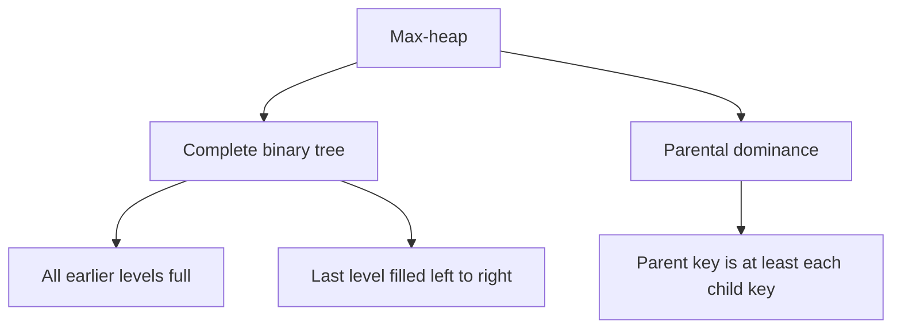
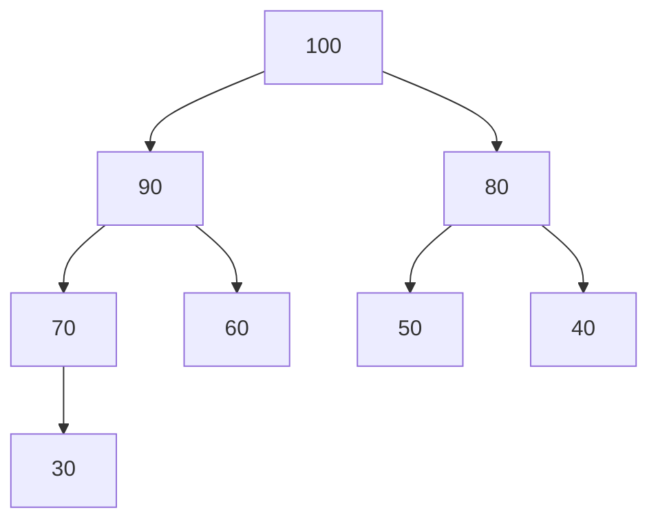
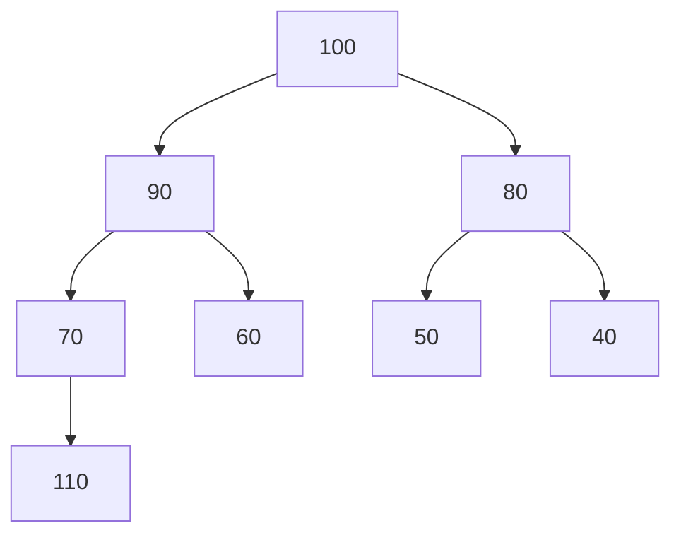
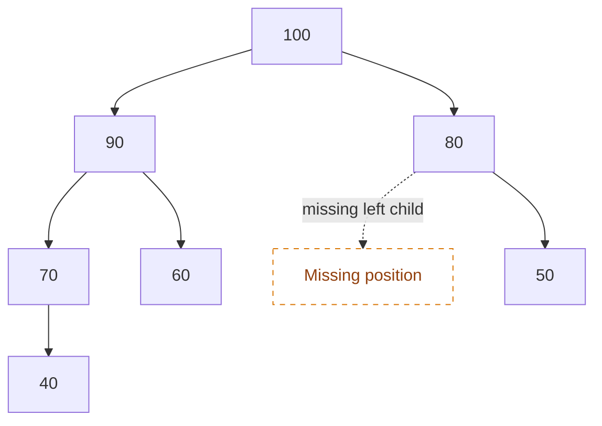
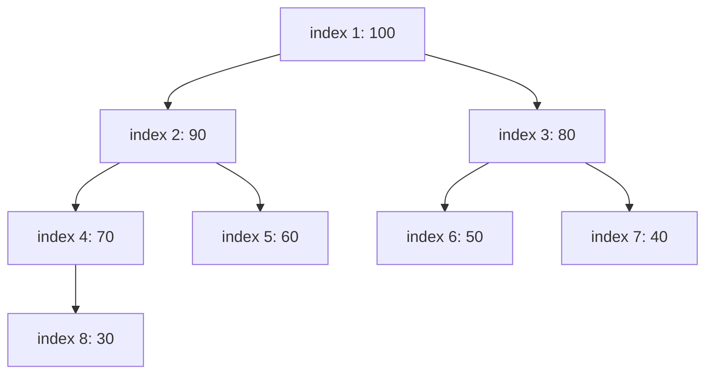
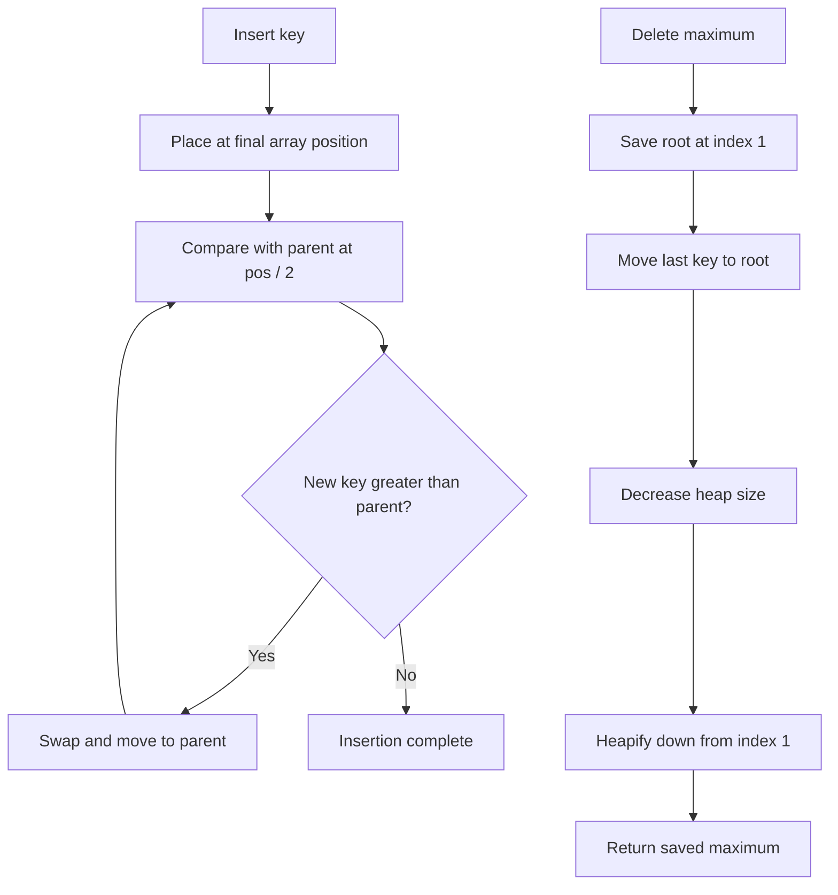
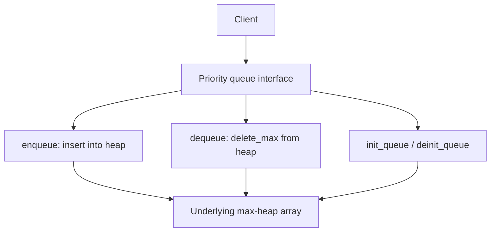

# Heap — Data Structure and Algorithms

> [!abstract] About this note
> Built from **`10.docx` (10 pages)**. The source explanations, interfaces, and code snippets are retained and arranged into readable sections. Mermaid visualisations, navigation, and clearly labelled implementation observations are additions to make the material easier to study in Obsidian.

> [!tip] Mermaid support
> Obsidian renders the diagrams below natively. No community plugin is required for these visualisations.

## Navigation

- [[#1. A few points — what is a heap?]]
- [[#2. The two properties of a max-heap]]
- [[#3. The three trees shown in the handout]]
- [[#4. Implementing a heap using an array]]
- [[#5. Advantages and uses of heaps]]
- [[#6. Example 1 — build a heap]]
- [[#7. Heapify]]
- [[#8. Example 2 — insert delete-max and peek-max]]
- [[#9. Example 3 — priority queue using a heap]]
- [[#10. Final revision sheet]]
- [[#11. Source observations and implementation cautions]]

---

## 1. A few points — what is a heap?

> [!quote] Source text — preserved
> There are many words in Computer Science which have different meanings depending on the context. Already we have observed that thread in Operating Systems stands for a unit of execution whereas threaded tree makes the NULL structural pointers point to its successor or predecessor making iterative functions possible for a particular order of traversal.

Similarly, the word **heap** has two meanings:

- **Heap in memory management:** a part of memory supporting dynamic allocation and deallocation.
- **Heap in data structures:** a special type of binary tree. **It is not a search tree.**

There are two kinds of heaps — called **max-heap** and **min-heap**.

> [!info] Scope of the handout
> In this discussion, the handout focuses on the **max-heap**. It says that the min-heap interface and implementation will be similar, with the comparison operator changed from **greater than (`>`)** to **less than (`<`)**.

---

## 2. The two properties of a max-heap

A heap (max-heap) is a tree with two special properties.

### Property 1 — Complete binary tree

- The nodes are filled up at each level.
- At the bottom-most level, the leftmost nodes are filled up.

### Property 2 — Parental dominance

The key at the root is greater than the keys of its subtrees recursively. In other words, for every parent-child edge in a **max-heap**, the parent's key is greater than or equal to the child's key; the source examples use distinct values and describe the parent as greater than the children.

> [!important] A heap is not a BST
> A max-heap does **not** require every key in the left subtree to be smaller than every key in the right subtree. Only the parent-child dominance property is required, along with completeness.

### Visual summary



---

## 3. The three trees shown in the handout

The handout's diagram on **page 2** presents three examples.

### 3.1 Example 1 — valid max-heap



Why it is a heap:

- The root has the highest value.
- Every parent has a greater key than its children in this example.
- The first three levels are full, and the final level is filled from the left.
- The tree has eight nodes.

The handout also notes that leaves are always heaps: a leaf has no children that could violate parental dominance, and it is complete by itself.

### 3.2 Example 2 — not a heap: parental dominance is violated



The handout explains that this is **not a heap** because the child of node `70` has key `110`:

\[
110 > 70
\]

So parental dominance is violated. The tree may be complete, but both heap properties must hold.

### 3.3 Example 3 — not a heap: incomplete binary tree



The handout says the left subtree of node `80` is missing, so the level is not completely filled from the left. Therefore, this is **not a heap**, even though the parent-child values shown do not violate parental dominance.

> [!note] Small inconsistency in the source diagram
> The diagram's overall title reads **“Three 8-Node Binary Trees”**, while the accompanying paragraph says the third tree **has 7 nodes**. Both pieces of source wording are preserved here; the prose's count matches the seven visible values in that third drawing.

---

## 4. Implementing a heap using an array

### Source explanation

> We always implement a heap tree using an array. As the tree is a complete tree, it provides an easy mapping to an array and also provides simple ways by which we can make out whether the tree is full or empty, insert, traverse and so on.

The handout gives **two ways** to map a heap to an array.

### 4.1 Zero-based mapping — root at index `0`

| Relationship | Formula |
|---|---:|
| Left child of index `i` | `2i + 1` |
| Right child of index `i` | `2i + 2` |
| Parent of index `i` | `floor((i - 1) / 2)` |

### 4.2 One-based mapping — root at index `1`

| Relationship | Formula |
|---|---:|
| Left child of index `i` | `2i` |
| Right child of index `i` | `2i + 1` |
| Parent of index `i` | `floor(i / 2)` |

The handout says: **“In our discussion, we will use the second implementation.”** The heap code in this handout therefore uses **one-based indexing**.

### Visualise one-based heap positions

This is the valid heap from the source diagram, annotated with its one-based array index:



Array positions `1` through `8` contain:

| Index | 1 | 2 | 3 | 4 | 5 | 6 | 7 | 8 |
|---:|---:|---:|---:|---:|---:|---:|---:|---:|
| Key | 100 | 90 | 80 | 70 | 60 | 50 | 40 | 30 |

> [!tip] Quick index-memory trick
> With **one-based indexing**, multiply an index by `2` to get its left child; add `1` to get its right child; divide by `2` (integer/floor division) to get the parent.

### Why array storage suits heaps

The handout lists these advantages:

- No pointers.
- No extra storage.
- Easy way to determine empty or full.
- Simple way to traverse either as an array or as a tree.
- Does not waste memory as the tree is a complete binary tree.

---

## 5. Advantages and uses of heaps

### Use 1 — Heapsort

The handout describes heapsort as a sorting method based on the heap concept. It says it is theoretically one of the most efficient comparison-based sorting algorithms, but is not cache friendly, and then states that no programming-language library implements it.

> [!note] Source wording
> The statement about library support is reproduced from the handout, rather than independently updated or generalized in this note.

### Use 2 — finding the maximum or minimum repeatedly

In many applications, insertion and deletion are based on the order of keys. The classical example is a **priority queue**: a task is enqueued and then dequeued based on priority.

The handout says these operations are equally efficient and require fewer operations than the number of elements. It describes the number of operations as proportional to the logarithm to base 2 of the number of elements in the tree.

---

## 6. Example 1 — build a heap

### Problem statement from the handout

- **Input:** an array having `n` elements.
- **Output:** an array representing a max-heap of `n` elements.

### Structure of heap

The heap contains an array of keys and the number of elements in use.

```c
struct heap
{
    int key_[MAXSIZE];
    int n_;
};

typedef struct heap heap_t;
```

### Interface of heap

```c
void init(heap_t *ptr_heap);
void deinit(heap_t *ptr_heap);
void disp(heap_t *ptr_heap);

void build_heap(heap_t *ptr_heap, int a[], int n);
```

### Initialise and deinitialise

The handout says there is no dynamic allocation. The number of elements in the tree is made `0`:

```c
ptr_heap->n_ = 0;
```

The same assignment is described for initialisation and deinitialisation.

### Display

The handout describes `disp()` as displaying the elements as an array, varying the index from `1` to `n`. Its complete implementation is **not included** in this document excerpt; only its interface and use are shown.

### Build a heap — source code

The handout explains that this takes an array, copies it into the heap structure, and converts it to a heap.

There are two parts to the algorithm:

1. Copy the given array into the array in the heap structure.
2. Convert each subtree to a heap.

All leaves are heaps. Therefore, conversions start from the middle of the array, skip the leaves, and move towards the root. `heapify()` converts the tree rooted at position `i`.

```c
void build_heap(heap_t *ptr_heap, int a[], int n)
{
    ptr_heap->n_ = n;

    for(int i = 1; i <= n; ++i)
    {
        ptr_heap->key_[i] = a[i];
    }

    for(int i = n / 2; i >= 1; --i)
    {
        heapify(ptr_heap->key_, ptr_heap->n_, i);
        disp(ptr_heap);
    }
}
```

### Bottom-up build visualisation

```mermaid
flowchart TD
    A[Set heap size to n] --> B[Copy a[1..n] into key_[1..n]]
    B --> C[Set i = floor(n / 2)]
    C --> D[heapify at position i]
    D --> E[Display heap]
    E --> F[Decrement i]
    F --> G{i >= 1?}
    G -- Yes --> D
    G -- No --> H[Heap construction complete]
```

> [!important] Why start at `n / 2`?
> With one-based indexing, every node past `floor(n/2)` is a leaf: its left child would be at index `2i`, beyond `n`. Leaves already satisfy the heap property, so the algorithm can start at the last internal node and work backwards.

---

## 7. Heapify

### What heapify does

> Given that the left subtrees and the right subtrees of a node are already heap, we want to position the root element properly in the subtrees so that the tree rooted at the given root becomes a heap.

The handout's step-by-step explanation:

1. The position of the root is `i`.
2. Its left child is at position `2i`. This is stored in variable `j`.
3. The value at the root is copied so that the `i`th location becomes a **hold** that can be modified.
4. Enter a loop while `j` is a valid index (`j <= n`) and the root element is not yet greater than the keys at the roots of its subtrees.
5. If `j + 1` exists and `a[j+1]` is greater than `a[j]`, increment `j` to move to the right child.
6. If `a[j]` is greater than the held value, move `a[j]` up into the current position and continue down the tree.
7. Otherwise, the search is over and `is_heap` is set to `1`.
8. When the loop exits, copy `val` into the final `i`th location.

### `heapify()` — source code

```c
static void heapify(int a[], int n, int pos)
{
    int i = pos;
    int j = 2 * i;
    int val = a[i];
    int is_heap = 0;

    while(j <= n && ! is_heap)
    {
        if(j + 1 <= n && a[j+1] > a[j])
            ++j;

        if(a[j] > val)
        {
            a[i] = a[j];
            i = j;
            j = 2 * i;
        }
        else
        {
            is_heap = 1;
        }
    }

    a[i] = val;
}
```

### Heapify decision flow

```mermaid
flowchart TD
    A[Start at pos] --> B[Save val = a[i]; set j = 2*i]
    B --> C{j <= n and not is_heap?}
    C -- No --> H[Write val into a[i]]
    C -- Yes --> D{Right child exists and is larger?}
    D -- Yes --> E[Increment j to select right child]
    D -- No --> F[Keep j at left child]
    E --> G{Selected child a[j] > val?}
    F --> G
    G -- Yes --> I[Move a[j] into a[i]]
    I --> J[Set i = j; set j = 2*i]
    J --> C
    G -- No --> K[Set is_heap = 1]
    K --> H
```

> [!tip] What the “hold” is doing
> `val` saves the value that must be inserted at its final position. Rather than swapping at every level, the algorithm shifts the larger child upwards and places `val` once the correct position is found.

---

## 8. Example 2 — insert, delete-max, and peek-max

The handout introduces a menu-driven program to support insertion and deletion, adding these interface functions:

```c
void insert(heap_t *ptr_heap, int key);
int delete_max(heap_t *ptr_heap);
int peek_max(heap_t *ptr_heap);
```

### 8.1 Insert a key

The handout explains:

> In insert, we always add the element at the end of the array and increase the heap size by 1. Then we propagate the element up towards the root to make the tree a heap.

#### Source code

```c
void insert(heap_t *ptr_heap, int key)
{
    // add at the end
    // heapify upwards
    int pos = ++ptr_heap->n_;

    if(pos > MAXSIZE)
    {
        printf("heap full\n"); exit(1);
    }

    ptr_heap->key_[pos] = key;

    while(pos > 1 && ptr_heap->key_[pos] > ptr_heap->key_[pos/2])
    {
        swap(&ptr_heap->key_[pos], &ptr_heap->key_[pos/2]);
        pos = pos / 2;
    }
}
```

#### How insertion works

1. Add the key at the end of the array and increment the number of elements.
2. Compare it with its parent at `pos / 2`.
3. If the new key is greater than its parent, swap the two.
4. Continue towards the root until the parent is not smaller, or the new key reaches index `1`.

The handout adds that in the `heapify()` routine above, a **hole was propagated**; in this insertion routine, **swapping** is used instead.

### 8.2 Delete the maximum key

In a max-heap, the maximum element is at the root. The handout's procedure is:

1. Save the root element.
2. Overwrite the root with the last element of the array.
3. Decrease the tree size by `1`.
4. Call `heapify()` about the root.
5. Return the saved maximum.

#### Source code

```c
int delete_max(heap_t *ptr_heap)
{
    if(ptr_heap->n_ == 0)
    {
        printf("heap empty\n"); exit(1);
    }

    int res = ptr_heap->key_[1];
    ptr_heap->key_[1] = ptr_heap->key_[ptr_heap->n_];

    heapify(ptr_heap->key_, --ptr_heap->n_, 1);
    return res;
}
```

### 8.3 Peek maximum

The handout says this returns the value at the root — the key at index `1`.

```c
int peek_max(heap_t *ptr_heap)
{
    return ptr_heap->key_[1];
}
```

### Insert vs delete — visual comparison



### Why both operations take logarithmic work

The handout notes:

> Observe that in delete, we call heapify, which discards one half the tree each time by doubling the value of `j`.
>
> Observe that in insert, we keep moving towards the parent and do not move towards the sibling by halving the index each time.
>
> So, in both the cases, the number of operations we do is proportional to the log to base 2 of number of elements in the tree.

**Interpretation:** both insertion and delete-max move along a root-to-leaf or leaf-to-root path. In a complete binary tree, the path height grows logarithmically with the number of elements.

---

## 9. Example 3 — priority queue using a heap

### Structure of priority queue

The handout presents the following node structure:

```c
struct node
{
    int key_;
    struct node* next_;
};

typedef struct node node_t;
```

It then defines a queue that contains a heap:

```c
struct queue
{
    heap_t q_;
};

typedef struct queue queue_t;
```

The priority queue has **composition of a heap** in it.

### Interface of priority queue

All of these functions, the handout explains, delegate functionality to those of the heap.

```c
void init_queue(queue_t *ptr_queue);
void deinit_queue(queue_t *ptr_queue);
void enqueue(queue_t *ptr_queue, int key);
int dequeue(queue_t *ptr_queue);
int is_empty(queue_t *ptr_queue);
int is_full(queue_t *ptr_queue);
```

### Implementation of priority queue — source snippets

```c
void init_queue(queue_t *ptr_queue)
{
    init(&ptr_queue->q_);
}
```

```c
void deinit_queue(queue_t *ptr_queue)
{
    deinit(&ptr_queue->q_);
}
```

```c
void enqueue(queue_t *ptr_queue, int key)
{
    insert(&ptr_queue->q_, key);
}
```

```c
int dequeue(queue_t *ptr_queue)
{
    return delete_max(&ptr_queue->q_);
}
```

### Priority-queue architecture



The source excerpt lists `is_empty()` and `is_full()` in the interface, but does not include their function bodies in the implementation section.

---

## 10. Final revision sheet

### Properties

| Concept | What to remember |
|---|---|
| Max-heap | Root stores the maximum key |
| Min-heap | Root stores the minimum key; the handout says comparisons change from `>` to `<` |
| Complete binary tree | Every level is filled, except possibly the last; last-level nodes occupy the leftmost positions |
| Parental dominance | In a max-heap, each parent dominates its children |
| Heap vs BST | A heap is **not** a binary search tree |
| Heap representation | Array representation is natural because the tree is complete |

### One-based index formulas used in this handout

| Operation | Formula |
|---|---:|
| Left child | `2i` |
| Right child | `2i + 1` |
| Parent | `floor(i / 2)` |

### Operation summary

| Operation | Main action |
|---|---|
| `build_heap()` | Copy the array, then call `heapify()` from `n/2` down to `1` |
| `heapify()` | Move a value down until its subtree satisfies max-heap order |
| `insert()` | Put the new key at the end and move it up by comparing with parents |
| `delete_max()` | Remove root, move the last key to root, reduce size, heapify downward |
| `peek_max()` | Return `key_[1]` |
| `enqueue()` | Delegate to heap insertion |
| `dequeue()` | Delegate to `delete_max()` |

### Complexity explicitly discussed by the handout

| Operation | Source's stated growth |
|---|---|
| Insert | Proportional to `log₂(n)` |
| Delete maximum | Proportional to `log₂(n)` |

---

## 11. Source observations and implementation cautions

> [!warning] These are observations, not silent edits
> The code blocks above preserve the handout's logic. The following points are flagged separately so the original material remains recognisable.

1. **One-based indexing with `key_[MAXSIZE]`:** the declaration `int key_[MAXSIZE];` has C-valid indices `0` through `MAXSIZE - 1`, but the implementation uses indices `1` through `n`. If `MAXSIZE` means the array's declared element count, index `MAXSIZE` is out of bounds. The declaration/capacity convention needs to be checked in the complete program.
2. **Capacity check in `insert()`:** the source increments `n_` before checking `pos > MAXSIZE`, and the check permits `pos == MAXSIZE`. Together with the declaration above, this is a boundary risk. It is reproduced unchanged in the code block.
3. **Input array convention in `build_heap()`:** the loop copies from `a[1]` through `a[n]`. The caller must therefore supply data according to that one-based convention; a standard zero-based array would usually be read differently.
4. **`peek_max()` on an empty heap:** the source returns `key_[1]` without checking whether `n_` is zero. The displayed snippet has no empty-heap guard.
5. **Helper functions not fully shown:** the handout calls `heapify()`, `disp()`, `swap()`, `init()`, and `deinit()`. Some are represented by descriptions or interfaces only, and their complete definitions are not all supplied in this document.
6. **Priority-queue interface completeness:** `is_empty()` and `is_full()` are declared in the priority-queue interface, but their bodies are not shown in the handout's implementation excerpt.
7. **Heap vs sorting-library statement:** the handout makes a broad claim that no programming-language library implements heapsort. That sentence is retained as source wording, not independently verified here.
8. **Node structure in priority-queue section:** the source shows `struct node` with `key_` and `next_`, then defines `struct queue` as containing `heap_t q_`. Both are kept because they appear in the handout, even though the displayed queue wrapper itself stores the heap.

---

> [!success] Core takeaway
> A heap is a **complete binary tree** that follows **parental dominance**. Using the handout's one-based array representation, insertion moves a new key upward; deleting the maximum moves the last key to the root and heapifies downward. A priority queue can expose `enqueue` and `dequeue` by delegating to those heap operations.

**Source:** `10.docx`, *Heap*, 10 pages. Page references in this note refer to that original document.
