# AVL Trees — Balance Factors and Rotations

> [!abstract] About this note
> Built from **`11.docx` (13 pages)**. The source discusses why an ordinary binary search tree can become skewed, the AVL balance condition, balance factors, the four rotation cases, and generalized rotation diagrams. The material is reorganized for study; the diagrams below are Obsidian Mermaid visualisations of the source's examples.

> [!tip] Diagram support
> The tree diagrams use **Mermaid**, which Obsidian supports natively. No community plugin is needed.

## Navigation

- [[#1. Why AVL trees?]]
- [[#2. AVL definition and balance condition]]
- [[#3. Balance factor]]
- [[#4. The four rotation cases — quick reference]]
- [[#5. LL case — right rotation]]
- [[#6. RR case — left rotation]]
- [[#7. LR case — left then right]]
- [[#8. RL case — right then left]]
- [[#9. Generalized rotation diagrams]]
- [[#10. What rotations preserve]]
- [[#11. Exam revision sheet]]
- [[#12. Source observations]]

---

## 1. Why AVL trees?

### The problem with an ordinary BST

The handout begins with this question:

> A binary search tree allows us to discard one of the subtrees while searching. Based on the key comparison at the root, we could discard the left subtree or the right subtree. Would that mean that the number of comparisons in the worst case will be `log(n, 2)` where `n` is the number of nodes in the tree?

**The source's answer is no.** A binary search tree can become **skewed** and degenerate into a list. In that situation, the number of comparisons during a search is proportional to the number of elements, rather than logarithmic.

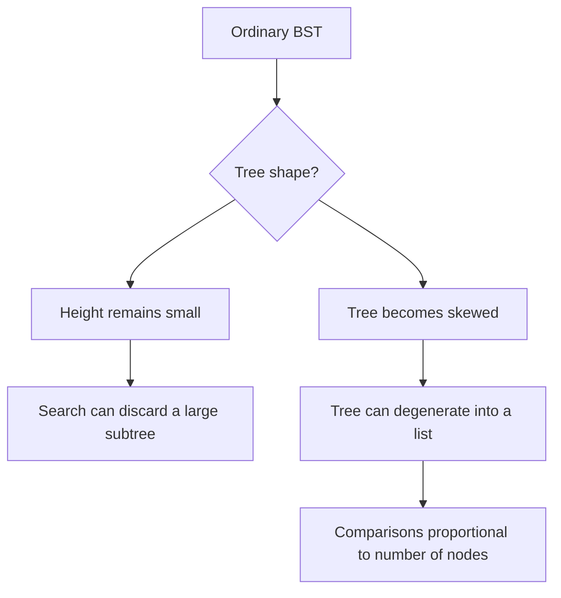

### What AVL trees try to achieve

The handout asks how the tree can be made to have the same depth — **at most with a difference of 1** — regardless of which direction we move from the root. This leads to **height-balanced binary search trees**; an AVL tree is one such tree.

> [!important] Central idea
> An AVL tree is still a **Binary Search Tree**, but it additionally maintains a height-balance condition. When insertion or deletion makes a node unbalanced, rotations change the shape of the tree.

---

## 2. AVL definition and balance condition

### Definition from the handout

- An **AVL tree** is a **self-balancing Binary Search Tree (BST)**.
- **AVL** stands for **Adelson-Velsky and Landis**, the two Russian mathematicians named by the source as the inventors of the tree.
- For every node, the heights of its left and right subtrees differ by **at most 1**.

In formula form, the AVL condition at every node is:

\[
|h_{left} - h_{right}| \leq 1
\]

This is equivalent to saying that the balance factor at each node must be one of **−1, 0, +1**.

### Example: a balanced node

The source shows this tree:

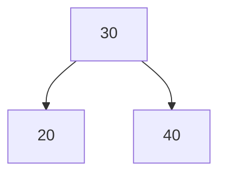

If the left and right subtree heights at node `30` are both `1`, then:

\[
BF(30) = 1 - 1 = 0
\]

So the node is balanced.

---

## 3. Balance factor

The handout defines the balance factor as:

\[
\boxed{BF(node) = h_{\text{left}} - h_{\text{right}}}
\]

Here, `h` stands for **height**.

| Balance factor | Meaning in the source | State |
|---:|---|---|
| `+1` | Left subtree is one level taller | Balanced |
| `0` | Both subtree heights are equal | Balanced |
| `−1` | Right subtree is one level taller | Balanced |
| `+2` | Left-heavy | Imbalanced — rotation needed |
| `−2` | Right-heavy | Imbalanced — rotation needed |

> [!warning] Keep the subtraction order straight
> The handout uses **left height minus right height**. With this convention, a positive balance factor means left-heavy and a negative balance factor means right-heavy.

### Worked imbalance from the handout

Insert `30, 20, 10` into an ordinary BST:

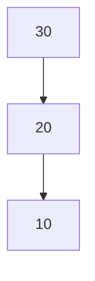

At node `30`, the handout gives:

- Left subtree height = `2`
- Right subtree height = `0`

Therefore:

\[
BF(30) = 2 - 0 = +2
\]

Node `30` is left-heavy and the tree is not AVL-balanced. A rotation is required. The handout explains that, after rotation, the balance factor should be brought back to `+1`, `0`, or `−1`.

---

## 4. The four rotation cases — quick reference

The source's summary table is reproduced below.

| Case | Configuration | Rotation |
|---|---|---|
| **LL** | Left-Left | Right rotation |
| **RR** | Right-Right | Left rotation |
| **LR** | Left-Right | Left rotation + Right rotation |
| **RL** | Right-Left | Right rotation + Left rotation |

> [!tip] Memory rule from the handout
> **Same direction → single rotation.**  
> **Opposite directions → double rotation.**

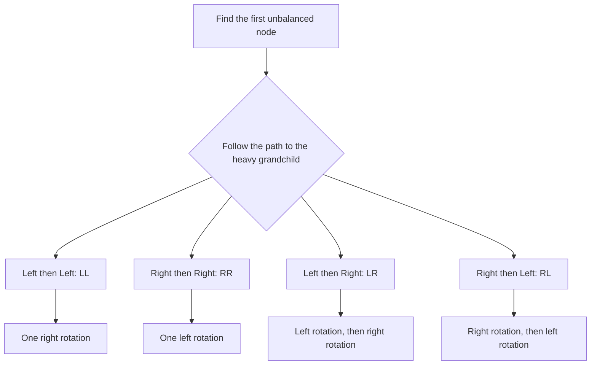

---

## 5. LL case — right rotation

### Source example

Insert:

```text
30, 20, 10
```

The resulting BST path is:

```text
30 → 20 → 10
```

Both moves are to the **left**, so the source calls this an **LL case**. At node `30`, the left subtree height is `2` and the right subtree height is `0`; the node is left-heavy.

### Before rotation


### Solution — rotate right around `30`

The handout rotates right around node `30`, producing:

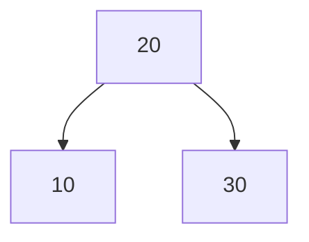

The tree is now balanced. The source states the rule as:

> **LL → Right Rotation**

> [!example] Pattern recognition
> If the unbalanced node's heavy path goes **left, then left**, perform a **single right rotation**.

---

## 6. RR case — left rotation

### Source example

Insert:

```text
10, 20, 30
```

The resulting path is:

```text
10 → 20 → 30
```

Both moves are to the **right**, so it is an **RR case**. Node `10` is right-heavy.

### Before rotation

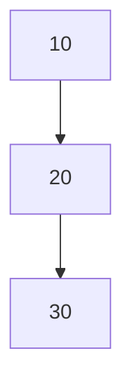

### Solution — rotate left around `10`


The tree is balanced. The source's rule is:

> **RR → Left Rotation**

> [!example] Pattern recognition
> If the unbalanced node's heavy path goes **right, then right**, perform a **single left rotation**.

---

## 7. LR case — left then right

### Source example

Insert:

```text
30, 10, 20
```

The path is:

```text
30 → 10 → 20
```

The first move is **left** and the second is **right**, so this is a **Left-Right (LR)** case.

### Before rotation

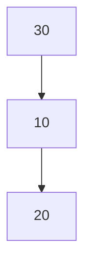

### Step 1 — left rotation at node `10`

The source first rotates the subtree rooted at `10` to the left. The shape becomes an LL configuration:


### Step 2 — right rotation at node `30`


The tree is now balanced. The source states:

> **LR → Left Rotation followed by Right Rotation**

> [!example] Pattern recognition
> For **left, then right**, rotate the child subtree **left first**, then rotate the unbalanced node **right**.

---

## 8. RL case — right then left

### Source example

Insert:

```text
10, 30, 20
```

The path is:

```text
10 → 30 → 20
```

The first move is **right**, followed by **left**, making this a **Right-Left (RL)** case.

### Before rotation


### Step 1 — right rotation at node `30`

The tree becomes an RR configuration:


### Step 2 — left rotation at node `10`


The tree is balanced. The source states:

> **RL → Right Rotation followed by Left Rotation**

> [!example] Pattern recognition
> For **right, then left**, rotate the child subtree **right first**, then rotate the unbalanced node **left**.

---

## 9. Generalized rotation diagrams

The source also expresses the four rotations using a node `X`, its children or grandchildren (`Y`, `Z`), and the subtrees `T₁`, `T₂`, `T₃`, and `T₄`. Each `T` represents a subtree whose internal structure is retained; the rotation changes where those subtrees attach.

### 9.1 LL — generalized right rotation

**Before:** `X` has left child `Y`; `Y` has left child `Z`.

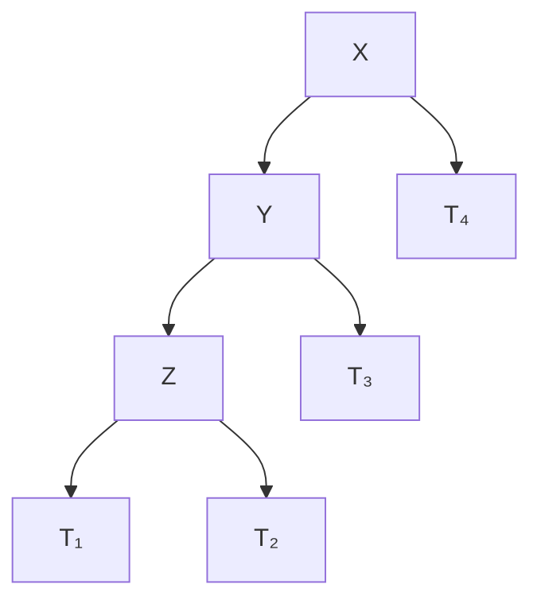

**After a right rotation:**

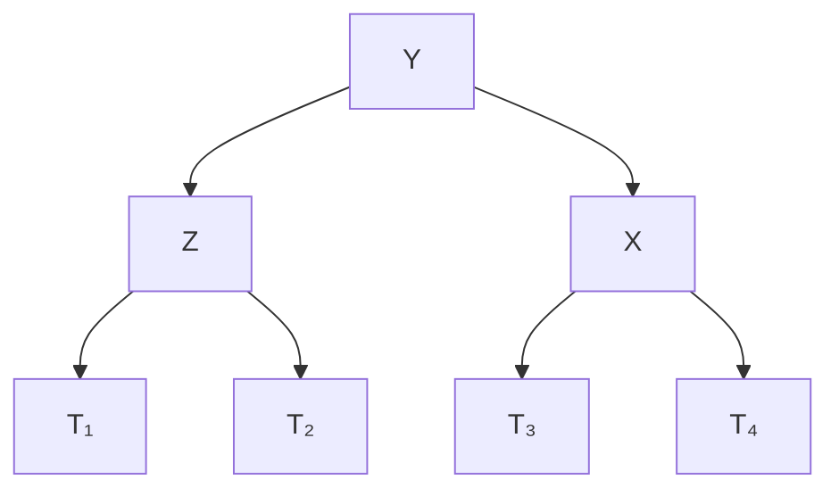

### 9.2 RR — generalized left rotation

**Before:** `X` has right child `Y`; `Y` has right child `Z`.

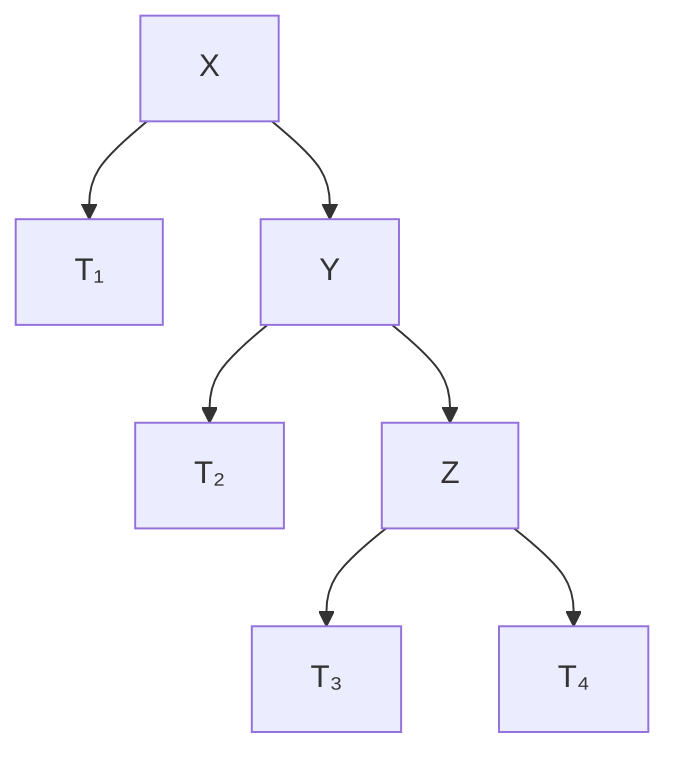

**After a left rotation:**


### 9.3 LR — generalized left rotation followed by right rotation

**Before:** `X` has left child `Y`, and `Y` has right child `Z`.

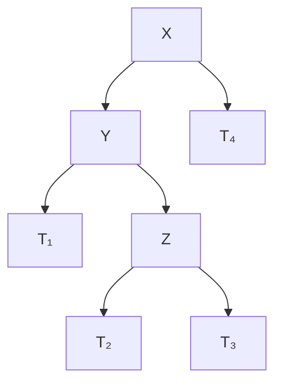

**After left + right rotations:**


### 9.4 RL — generalized right rotation followed by left rotation

**Before:** `X` has right child `Y`, and `Y` has left child `Z`.

```mermaid
flowchart TD
    X[X] --> T1[T₁]
    X --> Y[Y]
    Y --> Z[Z]
    Y --> T4[T₄]
    Z --> T2[T₂]
    Z --> T3[T₃]
```

**After right + left rotations:**

```mermaid
flowchart TD
    Z[Z] --> X[X]
    Z --> Y[Y]
    X --> T1[T₁]
    X --> T2[T₂]
    Y --> T3[T₃]
    Y --> T4[T₄]
```

> [!important] What the generalized diagrams show
> The nodes are rearranged, but the relative BST ordering is preserved. The `T₁`–`T₄` subtrees remain attached in the positions required to maintain that ordering.

---

## 10. What rotations preserve

The source lists these points:

- **Balancing does not alter the property of the tree.** It remains a BST.
- Rotations change the shape, **but not the inorder listing of the nodes**.
- The handout states that insertion and deletion require `log(n, 2)` operations.

### Inorder is unchanged

Before and after the source's three-key examples, the inorder order remains `10, 20, 30`:

```mermaid
flowchart LR
    A[LL, RR, LR or RL example] --> B[Rotation changes tree shape]
    B --> C[Inorder order is preserved]
    C --> D[10, 20, 30]
```

> [!note] Complexity wording
> The `log(n, 2)` statement is the wording used by the handout. It is presented in the section about height-balanced AVL trees; the note does not reinterpret it as a claim about an arbitrary, unbalanced BST.

---

## 11. Exam revision sheet

### Rotation rules at a glance

| Insertion path from the unbalanced node | Case | Rotation sequence | Number of rotations |
|---|---|---|---:|
| Left → Left | **LL** | Right rotation | 1 |
| Right → Right | **RR** | Left rotation | 1 |
| Left → Right | **LR** | Left, then right | 2 |
| Right → Left | **RL** | Right, then left | 2 |

### The three things to identify in an MCQ

1. **Find the unbalanced node.** This is the node whose balance factor has become `+2` or `−2` in the handout's examples.
2. **Follow the path to the inserted node** (or the heavy grandchild shown in the configuration).
3. **Match the direction pair** to LL, RR, LR, or RL, then choose the corresponding rotation sequence.

### Fast facts

- AVL is a **self-balancing BST**.
- At each node, the left and right subtree heights differ by at most `1`.
- `BF = height(left) − height(right)`.
- Allowed balance factors in an AVL tree: **−1, 0, +1**.
- `+2` means left-heavy; `−2` means right-heavy, under the source's convention.
- LL uses a **right rotation**.
- RR uses a **left rotation**.
- LR uses **left then right**.
- RL uses **right then left**.
- Rotations preserve the **BST property** and **inorder sequence**.
- The handout mentions a related structure: the **Red-Black tree**, which it says is most commonly used in libraries.

---

## 12. Source observations

> [!info] What is actually in `11.docx`
> This source is a **conceptual and diagram-based handout** on AVL trees. It does **not** contain a C implementation or source-code files, so no code has been invented or added here.

> [!quote] Source closing statement
> “There is another similar tree called the RED BLACK tree which is most commonly used in the libraries.”  
> “Amazing idea. Is it not?”

The examples in Sections 5–8 preserve the exact insertion sequences and rotation order stated in the handout. The Mermaid diagrams are redrawn versions of the source's ASCII tree shapes, intended to make the relationships easier to inspect in Obsidian.

---

## Related notes

- [[02 - Tree Fundamentals and BST (2.docx)]]
- [[04 - BST Array-Based Node Implementation (4.docx)]]
- [[05 - Threaded Binary Search Tree Implementation (5.zip)]]
- [[12 - Splay Trees (12.docx)]]
